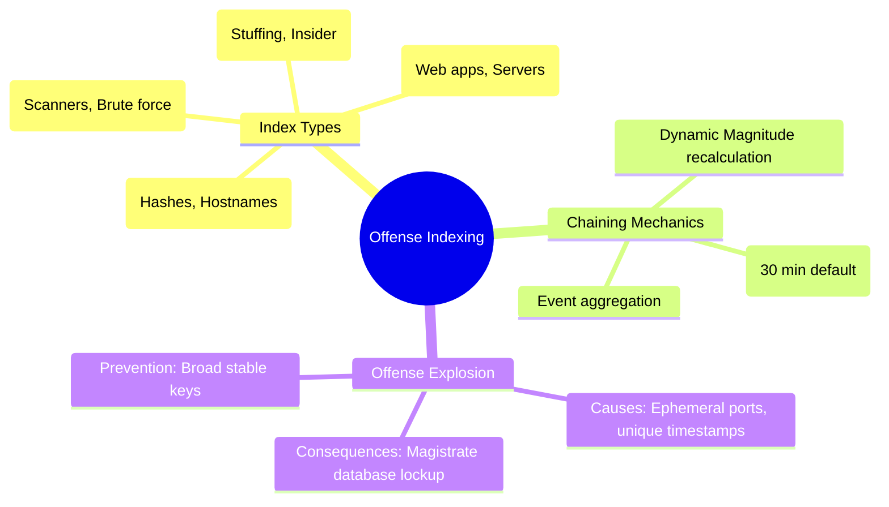

# 📖 Chapter 50: Offense Indexing Mechanics: Source IP vs Dest IP vs Username vs Custom Property Masterclass

> **The IBM QRadar Administrator's Technical Guide** | Phase 5: Custom Rules Engine (CRE) & Offense Architecture  
> **Target Audience:** 1.5-Year Administrators $\rightarrow$ Senior SIEM Engineers & Detection Engineering Specialists  
> **Focus:** Offense Indexing Architecture, Incident Consolidation, Chaining Logic, Offense Explosion Prevention, & Hands-on Lab 50

---

## 📸 1. Visual Overview: Offense Indexing & Incident Consolidation Engine


*Figure 50.1: 3D Isometric View of the QRadar Offense Indexing Engine: Disparate security events converging and clustering into unified incident cards based on Index Keys (Source IP, Destination IP, Username, Custom Properties) (`![[21_offense_indexing_magnitude_3d.jpg|1000]]`)*

---

## 2. What is Offense Indexing?

**Offense Indexing** is the mathematical mechanism QRadar uses to group thousands of related security events and network flows into a **single manageable incident (Offense)**. 

Without indexing, a brute-force attack generating 50,000 failed logins would create 50,000 separate alerts, overwhelming the SOC. With indexing on `Source IP`, all 50,000 events are chained into **1 single offense**.

```
┌────────────────────────────────────────────────────────────────────────┐
│ 🎯 THE 4 CORE INDEXING FIELDS & ARCHITECTURAL PERSPECTIVES             │
│                                                                        │
│ 1. SOURCE IP INDEXING (Attacker-Centric)                               │
│    • Perspective: Focuses on WHO is generating the attack.             │
│    • Best for: External scans, brute force, DDoS origins, C2 beacons.  │
│ ├────────────────────────────────────────────────────────────────────┤
│ 2. DESTINATION IP INDEXING (Target/Victim-Centric)                     │
│    • Perspective: Focuses on WHAT asset is under attack.               │
│    • Best for: Web application exploits (SQLi, XSS), DDoS targets,    │
│      database tampering, server compromise.                            │
│ ├────────────────────────────────────────────────────────────────────┤
│ 3. USERNAME INDEXING (Identity-Centric)                                │
│    • Perspective: Focuses on the COMPROMISED IDENTITY.                 │
│    • Best for: Credential stuffing, impossible travel, privilege       │
│      escalation, insider threats moving across multiple workstations.  │
│ ├────────────────────────────────────────────────────────────────────┤
│ 4. CUSTOM EVENT PROPERTY INDEXING (Context-Centric)                    │
│    • Perspective: Focuses on a SPECIFIC ATTRIBUTE (Hostname, Hash).    │
│    • Best for: Ransomware hashes, process names (`powershell.exe`),    │
│      cloud tenant IDs, domain names.                                   │
└────────────────────────────────────────────────────────────────────────┘
```

---

## 3. Offense Chaining & Inactivity Lifecycle Architecture

When an event triggers a rule with "Ensure detected event is part of an offense indexed by $X$":

```mermaid
flowchart TD
    EVT["Event Matches Rule: Indexed by Username = 'jsmith'"] --> MAG["Magistrate Daemon"]
    
    MAG --> CHECK{"Is there an OPEN Offense with Index = 'jsmith'?"}
    
    CHECK -->|Yes| CHAIN["Append Event to Existing Offense #1042"]
    CHAIN --> RECALC["Recalculate Dynamic Magnitude & Reset Inactivity Timer"]
    
    CHECK -->|No| CREATE["Create NEW Offense #1043 with Index = 'jsmith'"]
    CREATE --> SET_TIMER["Start Inactivity Timer (Default: 30 Mins)"]
    
    SET_TIMER --> IDLE{"No new events for 30 minutes?"}
    IDLE -->|Yes| DORMANT["Mark Offense as DORMANT / Inactive"]
    IDLE -->|No (New Event Arrives)| CHAIN
```

### Key Offense Timing Parameters:
1. **Inactivity Timeout (Default: 30 Minutes)**: If no new contributing events match the index within 30 minutes, the offense becomes **Dormant / Inactive**. If a new event arrives later, QRadar creates a new offense.
2. **Active Offense Retention (Default: 5 Days)**: The maximum continuous lifespan of an open offense receiving active events before being forced closed.

---

## 4. Index Selection Matrix: Choosing the Correct Field

| Threat Scenario | Recommended Index Field | Why? | Operational Disaster if Indexed Wrong |
| :--- | :--- | :--- | :--- |
| **SSH / RDP Brute Force** | `Source IP` | All attempts from the single attacker IP cluster into 1 offense. | If indexed by *Destination IP*, every scanned server generates a new offense. |
| **Distributed Credential Stuffing** | `Username` | Attacker uses 1,000 botnet IPs to guess 1 user's password. | If indexed by *Source IP*, you get 1,000 individual 1-event offenses (SOC blindness!). |
| **Web Application SQL Injection** | `Destination IP` | Hundreds of scanners hitting the same web server cluster together. | If indexed by *Source IP*, 500 script kiddies generate 500 offenses. |
| **Ransomware Execution** | `Custom Property: FileHash` | Tracks the spread of a malicious hash across all endpoints. | If indexed by *Source IP*, every infected workstation creates a siloed offense. |

---

## 5. The "Offense Explosion" Disaster: Root Causes & Remediation

An **Offense Explosion** occurs when a rule is misconfigured with an overly unique or dynamic indexing field, causing the Magistrate to generate tens of thousands of offenses within minutes.

```
┌────────────────────────────────────────────────────────────────────────┐
│ ⚠️ HOW TO CAUSE AN OFFENSE EXPLOSION (AND HOW TO FIX IT)               │
│                                                                        │
│ 💣 ROOT CAUSE 1: Indexing by "Event Name" on Generic Firewall Denies   │
│    • Why: Every slightly different deny creates a new offense.         │
│    • Fix: Index by Destination IP or Source IP.                        │
│                                                                        │
│ 💣 ROOT CAUSE 2: Indexing by "Source Port" on Ephemeral Port Scans     │
│    • Why: Client source ports change on every TCP packet (49152-65535)!│
│    • Result: 60,000 offenses generated in 2 minutes!                   │
│    • Fix: NEVER index by Source Port or ephemeral fields!              │
│                                                                        │
│ 💣 ROOT CAUSE 3: Indexing by Unparsed / Blank Property                 │
│    • Why: Blank values group all unrelated traffic into "N/A".         │
│    • Fix: Ensure property extraction regex is tested and robust.       │
└────────────────────────────────────────────────────────────────────────┘
```

---

## 📌 6. Visual Mind Map & Sticky Notes (Chapter 50 Quick-Review)

### 🧠 Hierarchical Mind Map


### 🗂️ Color-Coded Digital Sticky Notes

#### 🟨 Sticky Note 1: The Goal of Indexing
```text
┌─────────────────────────────────────────────────────────────┐
│ 📌 CONCEPT: CONSOLIDATION, NOT CREATION                     │
│                                                             │
│ • Indexing's primary purpose is reducing SOC noise by       │
│   merging related events into ONE actionable incident card. │
└─────────────────────────────────────────────────────────────┘
```

#### 🟩 Sticky Note 2: Never Index on Ephemeral Fields
```text
┌─────────────────────────────────────────────────────────────┐
│ 📌 GOLDEN RULE: FORBIDDEN INDEX FIELDS                      │
│                                                             │
│ • NEVER index by Source Port, Event Time, Packet Size, or   │
│   any property that changes on every single packet!         │
└─────────────────────────────────────────────────────────────┘
```

#### 🟪 Sticky Note 3: The 30-Minute Inactivity Window
```text
┌─────────────────────────────────────────────────────────────┐
│ 📌 ARCHITECTURE: INACTIVITY TIMEOUT                         │
│                                                             │
│ • An offense stays open as long as events matching its index│
│   arrive within 30 minutes of the previous event.           │
└─────────────────────────────────────────────────────────────┘
```

#### 🟦 Sticky Note 4: Distributed Attack Indexing
```text
┌─────────────────────────────────────────────────────────────┐
│ 📌 STRATEGY: DISTRIBUTED ATTACKS                            │
│                                                             │
│ • For distributed attacks (botnets, password spraying),     │
│   index by `Username` or `Destination IP`, never Source IP! │
└─────────────────────────────────────────────────────────────┘
```

#### 🟧 Sticky Note 5: Interview Cheat Code (Offense Indexing)
```text
┌─────────────────────────────────────────────────────────────┐
│ 📌 INTERVIEW CHEAT CODE: "HOW DO YOU CHOOSE AN INDEX FIELD?"│
│                                                             │
│ "I choose the index based on the primary pivot of the       │
│ investigation: Source IP for external attackers, Destination│
│ IP for attacked servers, Username for compromised accounts, │
│ and Custom Properties (like FileHash) for endpoint malware."│
└─────────────────────────────────────────────────────────────┘
```

#### 🟥 Sticky Note 6: Critical Pitfall
```text
┌─────────────────────────────────────────────────────────────┐
│ ⚠️ CRITICAL PITFALL: RE-INDEXING AN ACTIVE OFFENSE          │
│                                                             │
│ • Changing a rule's indexing field while active offenses    │
│   exist causes split offenses in PostgreSQL. Close existing │
│   offenses before deploying indexing modifications!         │
└─────────────────────────────────────────────────────────────┘
```

---

## ⚡ Rapid-Recall Flashcards

| # | Question (Front) | Answer (Back) |
| :-: | :--- | :--- |
| **01** | What is the primary purpose of Offense Indexing in QRadar? | To group multiple related events/flows into a **single unified incident** card to eliminate alert fatigue. |
| **02** | What field should you index on for a Distributed Password Spraying attack? | **`Username`** (to correlate 1,000 different attacker IPs targeting 1 account). |
| **03** | What field should you index on for an SSH Brute Force attack from a single IP? | **`Source IP`** (to merge all failed login attempts into 1 incident). |
| **04** | What happens to an open offense if no matching events arrive for 30 minutes? | The offense becomes **Dormant / Inactive**; subsequent events will spawn a new offense. |
| **05** | What causes an "Offense Explosion"? | Indexing on high-cardinality ephemeral fields like `Source Port` or unique timestamps. |
| **06** | Can you index an offense on a Custom Event Property (CEP)? | **Yes**, such as `Hostname`, `ProcessName`, `FileHash`, or `CloudTenantID`. |

---

## 🧪 7. Hands-on Practice Lab 50: Offense Index Auditing & Incident Consolidation Queries

### 🎯 Lab Objectives
1. Inspect active offense indexing configurations in the QRadar PostgreSQL database.
2. Query active open offenses and their assigned index keys.
3. Calculate event-to-offense compression ratios via AQL.
4. Identify offenses with high event counts.

---

### 📋 Step-by-Step Practical Lab Procedures

#### Step 1: Query Active Offenses and Their Index Keys in PostgreSQL
```bash
psql -U qradar -d qradar -x -c "
SELECT 
    id AS OffenseID, 
    description, 
    offensetype, 
    CASE 
        WHEN offensetype = 1 THEN 'Source IP' 
        WHEN offensetype = 2 THEN 'Destination IP' 
        WHEN offensetype = 3 THEN 'Event Name' 
        WHEN offensetype = 4 THEN 'Username' 
        WHEN offensetype = 5 THEN 'Source Port' 
        WHEN offensetype = 6 THEN 'Destination Port' 
        WHEN offensetype = 7 THEN 'Custom Property' 
        ELSE 'Other' 
    END AS IndexTypeName, 
    offensesource AS IndexValue, 
    eventcount, 
    magnitude, 
    status 
FROM offense 
WHERE status = 0 
ORDER BY eventcount DESC 
LIMIT 10;
"
```

---

#### Step 2: Calculate Incident Compression Ratio (Events to Offenses)
```bash
psql -U qradar -d qradar -c "
SELECT 
    COUNT(*) AS TotalOpenOffenses, 
    SUM(eventcount) AS TotalAggregatedEvents, 
    ROUND(SUM(eventcount)::numeric / NULLIF(COUNT(*), 0), 2) AS AverageEventsPerOffense 
FROM offense 
WHERE status = 0;
"
```
*Expected Output*: Demonstrates noise reduction (e.g., 500,000 events consolidated into 45 offenses).

---

#### Step 3: Query Top Contributing Events for a Specific Offense via AQL
```bash
/opt/qradar/bin/arielsql -p 32011 -q "
SELECT 
    DATEFORMAT(starttime, 'HH:mm:ss') AS EventTime, 
    sourceip AS AttackerIP, 
    destinationip AS TargetIP, 
    username AS TargetUser, 
    qidname(qid) AS EventName 
FROM events 
WHERE hasoffense = TRUE 
LAST 2 HOURS 
ORDER BY starttime DESC 
LIMIT 15;
"
```
