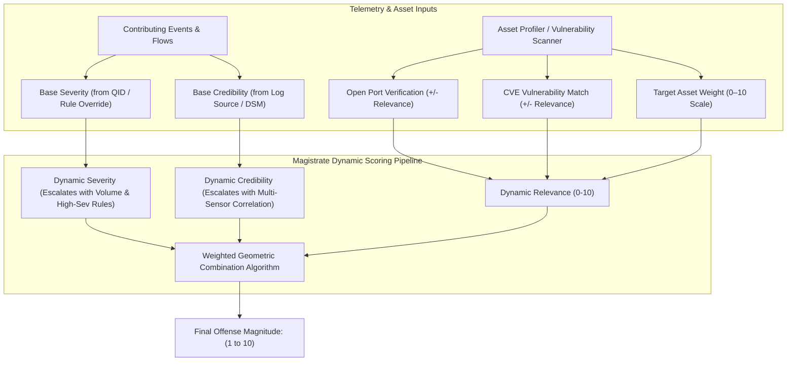
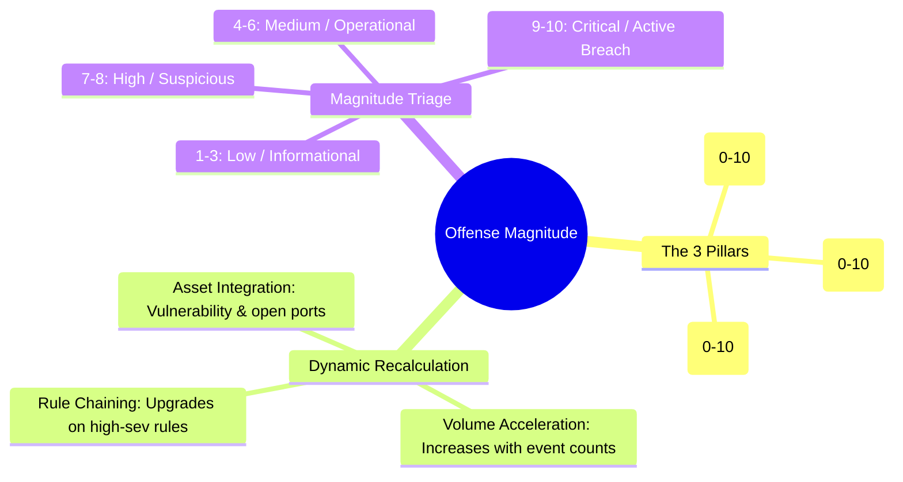

# 📖 Chapter 51: Dynamic Offense Magnitude Calculation: Severity, Credibility & Relevance Masterclass

> **The IBM QRadar Administrator's Technical Guide** | Phase 5: Custom Rules Engine (CRE) & Offense Architecture  
> **Target Audience:** 1.5-Year Administrators $\rightarrow$ Senior SIEM Engineers & Detection Engineering Specialists  
> **Focus:** Dynamic Magnitude Scoring (0–10), The 3 Pillars (S, C, R), Asset Weight Integration, & Hands-on Lab 51

---

## 📸 1. Visual Overview: Dynamic Magnitude Calculation Engine


*Figure 51.1: 3D Isometric View of the QRadar Dynamic Magnitude Engine: Real-time weighting of Severity (Damage Potential), Credibility (Source Reliability), and Relevance (Target Asset Vulnerability/Port Exposure) synthesizing into a unified 0–10 Threat Score (`![[21_offense_indexing_magnitude_3d.jpg|1000]]`)*

---

## 2. What is Offense Magnitude?

**Offense Magnitude** is QRadar's dynamic, algorithmic priority metric that rates the overall threat level of an offense on a **1 to 10 integer scale**. 

Instead of forcing SOC analysts to triage hundreds of unranked alerts, Magnitude allows the team to prioritize high-risk incidents (Magnitude 8–10) over low-risk operational anomalies (Magnitude 1–3).

```
┌────────────────────────────────────────────────────────────────────────┐
│ 🎚️ THE 3 PILLARS OF OFFENSE MAGNITUDE                                   │
│                                                                        │
│ 1. SEVERITY (0–10) $\rightarrow$ Potential Impact & Threat Damage      │
│    • What is the inherent lethality of the attack?                     │
│    • E.g., Ransomware encryption = 10, Port Scan = 2, Login Failure = 4.│
│ ├────────────────────────────────────────────────────────────────────┤
│ 2. CREDIBILITY (0–10) $\rightarrow$ Reliability & Detection Fidelity   │
│    • How trustworthy is the sensor/detection mechanism?                │
│    • E.g., Verified EDR Process Block = 9, Generic Heuristic Anomaly = 3│
│ ├────────────────────────────────────────────────────────────────────┤
│ 3. RELEVANCE (0–10) $\rightarrow$ Asset Applicability & Vulnerability  │
│    • Is the target vulnerable or is the port actually open?            │
│    • E.g., Linux exploit sent to Linux host with open port = 10;       │
│      IIS exploit sent to Linux server with closed port = 1.            │
└────────────────────────────────────────────────────────────────────────┘
```

---

## 3. Mathematical Scoring Architecture & Formula

QRadar calculates the overall Magnitude score through a non-linear weighted algorithm maintained by the **Magistrate** daemon:

$$\text{Offense Magnitude} = f\Big( \text{Severity}_{\text{eff}}, \text{Credibility}_{\text{eff}}, \text{Relevance}_{\text{eff}}, \text{Asset Weight}, \text{Event/Flow Count} \Big)$$



---

## 4. The 3 Factors in Action: A Comparative Scenario

| Scenario | Severity | Credibility | Relevance | Overall Magnitude | SOC Triage Action |
| :--- | :---: | :---: | :---: | :---: | :--- |
| **Apache Struts Exploit sent to Windows Server (Port 80 closed)** | **9** (Exploit) | **8** (Snort IDS) | **1** (Non-applicable target OS & closed port) | **Magnitude 3** | Low priority (Defended by architecture). |
| **Apache Struts Exploit sent to Linux Web Server (Unpatched CVE on Port 80)** | **9** (Exploit) | **8** (Snort IDS) | **10** (Target OS matches, port open, unpatched CVE!) | **Magnitude 10** | **CRITICAL P1 INCIDENT**. Immediate escalation! |
| **Internal Scanner running Nessus against corporate LAN** | **3** (Scan) | **9** (Verified scanner) | **2** (Scanner IP in authorized whitelist) | **Magnitude 2** | Low priority / Operational noise. |

---

## 5. Dynamic Magnitude Escalation & De-escalation

Magnitude is **not static**; it adjusts dynamically in real time as an incident evolves:

1. **Rule Chaining Escalation**: If an offense begins with a low-severity rule (e.g., *Port Scan*, Severity 3) and 2 minutes later matches a high-severity rule (e.g., *Privilege Escalation*, Severity 9), the Magistrate immediately recalculates the entire offense Magnitude upwards to **8 or 9**.
2. **Volume Multiplier**: As event counts cross threshold milestones (100 $\rightarrow$ 1,000 $\rightarrow$ 50,000 events), the Magistrate gradually increments the Magnitude score.
3. **Asset Profiler Integration**: If QRadar's Asset Profiler receives a new Vulnerability Assessment (VA) scan showing that the destination IP contains a critical CVE matching the attack signature, Relevance automatically jumps from 4 to 10.

---

## 📌 6. Visual Mind Map & Sticky Notes (Chapter 51 Quick-Review)

### 🧠 Hierarchical Mind Map


### 🗂️ Color-Coded Digital Sticky Notes

#### 🟨 Sticky Note 1: Magnitude Scale
```text
┌─────────────────────────────────────────────────────────────┐
│ 📌 CONCEPT: 1 TO 10 MAGNITUDE SCALE                         │
│                                                             │
│ • Magnitude 1–3: Informational / Noise.                     │
│ • Magnitude 4–6: Standard investigation required.           │
│ • Magnitude 7–10: High/Critical active security incident!   │
└─────────────────────────────────────────────────────────────┘
```

#### 🟩 Sticky Note 2: Asset Weight Multiplier
```text
┌─────────────────────────────────────────────────────────────┐
│ 📌 GOLDEN RULE: CONFIGURE ASSET WEIGHTS                     │
│                                                             │
│ • Assign Domain Controllers, Database Servers, and Crown    │
│   Jewels an Asset Weight of 9–10 to ensure attacks against  │
│   them automatically yield high Magnitude!                  │
└─────────────────────────────────────────────────────────────┘
```

#### 🟪 Sticky Note 3: Dynamic Shifting
```text
┌─────────────────────────────────────────────────────────────┐
│ 📌 ARCHITECTURE: REAL-TIME RECALCULATION                    │
│                                                             │
│ • The Magistrate recalculates Magnitude on EVERY new        │
│   contributing event or rule match in an active offense.    │
└─────────────────────────────────────────────────────────────┘
```

#### 🟦 Sticky Note 4: Relevance is Context
```text
┌─────────────────────────────────────────────────────────────┐
│ 📌 CONTEXT: RELEVANCE IS KEY                                │
│                                                             │
│ • A severity 10 exploit hitting a non-existent port has     │
│   Relevance 1 $\rightarrow$ preventing false alarm fatigue! │
└─────────────────────────────────────────────────────────────┘
```

#### 🟧 Sticky Note 5: Interview Cheat Code (Magnitude Calculation)
```text
┌─────────────────────────────────────────────────────────────┐
│ 📌 INTERVIEW CHEAT CODE: "HOW DOES QRADAR SCORE OFFENSES?"  │
│                                                             │
│ "QRadar calculates dynamic Magnitude (1-10) by combining    │
│ Severity (attack lethality), Credibility (sensor fidelity), │
│ and Relevance (target open ports, vulnerability, and asset  │
│ weighting), updating dynamically as new evidence arrives."  │
└─────────────────────────────────────────────────────────────┘
```

#### 🟥 Sticky Note 6: Critical Pitfall
```text
┌─────────────────────────────────────────────────────────────┐
│ ⚠️ CRITICAL PITFALL: STATIC RULE OVERRIDES                  │
│                                                             │
│ • Hardcoding Severity = 10 on a noisy informational rule    │
│   will artificially inflate all offenses to Magnitude 10,   │
│   destroying SOC prioritization!                            │
└─────────────────────────────────────────────────────────────┘
```

---

## ⚡ Rapid-Recall Flashcards

| # | Question (Front) | Answer (Back) |
| :-: | :--- | :--- |
| **01** | What are the 3 core components that calculate Offense Magnitude? | **Severity**, **Credibility**, and **Relevance**. |
| **02** | What scale is used to measure Offense Magnitude in QRadar? | A **1 to 10 integer scale** (1 = lowest priority, 10 = critical breach). |
| **03** | What does Relevance measure in the Magnitude equation? | How applicable and dangerous the attack is to the targeted destination asset (open ports, OS match, active vulnerabilities). |
| **04** | How does an unpatched CVE on a destination server impact Offense Magnitude? | It increases the **Relevance** score to maximum, driving overall Magnitude to 9 or 10. |
| **05** | What daemon recalculates dynamic offense magnitude on the Console? | The **Magistrate** daemon. |
| **06** | If an offense with Severity 4 receives a new event matching a rule with Severity 9, what happens? | The Magistrate **recalculates and escalates** the overall offense Magnitude immediately. |

---

## 🧪 7. Hands-on Practice Lab 51: Auditing Magnitude Scores & Relevance Profiling

### 🎯 Lab Objectives
1. Inspect the Severity, Credibility, and Relevance distribution of active offenses in PostgreSQL.
2. Identify offenses with Magnitude $\ge 8$ and inspect contributing rules.
3. Audit asset weights assigned in the QRadar Asset Profiler.
4. Run AQL queries to analyze event contribution to offense magnitude.

---

### 📋 Step-by-Step Practical Lab Procedures

#### Step 1: Query Offense Magnitude & Scoring Components in PostgreSQL
```bash
psql -U qradar -d qradar -x -c "
SELECT 
    id AS OffenseID, 
    description, 
    magnitude, 
    severity, 
    credibility, 
    relevance, 
    eventcount, 
    flowcount, 
    status 
FROM offense 
WHERE status = 0 
ORDER BY magnitude DESC 
LIMIT 10;
"
```

---

#### Step 2: Query High-Magnitude Offenses (Magnitude $\ge 8$) via CLI
```bash
psql -U qradar -d qradar -c "
SELECT 
    id AS OffenseID, 
    offensesource AS AttackerOrTarget, 
    magnitude, 
    severity, 
    credibility, 
    relevance 
FROM offense 
WHERE magnitude >= 8 AND status = 0 
ORDER BY magnitude DESC;
"
```

---

#### Step 3: Inspect Contributing Rules for Highest Magnitude Offense
```bash
/opt/qradar/bin/arielsql -p 32011 -q "
SELECT 
    DATEFORMAT(starttime, 'HH:mm:ss') AS EventTime, 
    sourceip, 
    destinationip, 
    username, 
    qidname(qid) AS EventName, 
    \"creRuleList\" AS RuleIDs 
FROM events 
WHERE hasoffense = TRUE 
ORDER BY starttime DESC 
LIMIT 10;
"
```
