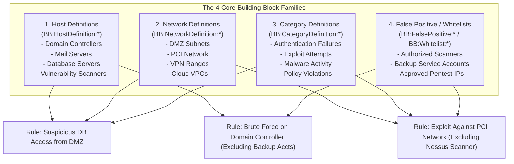
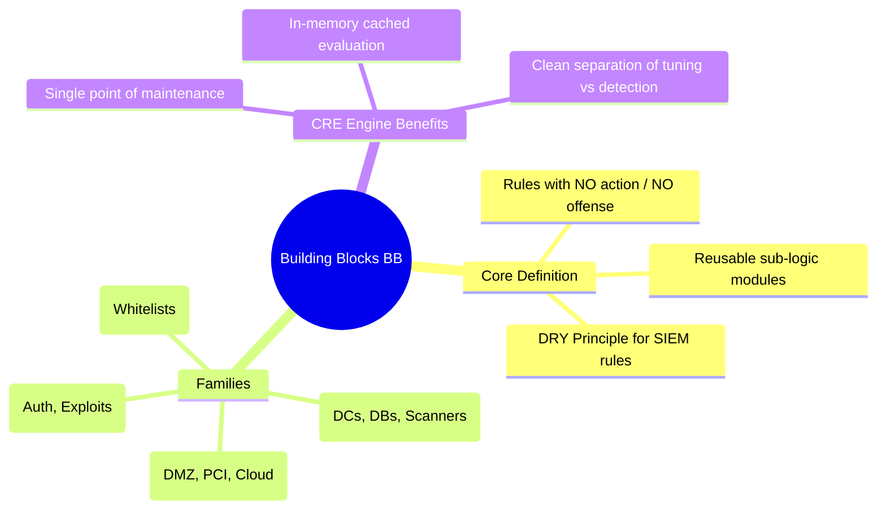

# 📖 Chapter 52: Building Blocks (BB): Modular Architecture & Suppression BBs Masterclass

> **The IBM QRadar Administrator's Technical Guide** | Phase 5: Custom Rules Engine (CRE) & Offense Architecture  
> **Target Audience:** 1.5-Year Administrators $\rightarrow$ Senior SIEM Engineers & Detection Engineering Specialists  
> **Focus:** Building Block (BB) Architecture, Host & Network Definitions, Whitelist Suppression BBs, Dependency Trees, & Hands-on Lab 52

---

## 📸 1. Visual Overview: Modular Building Block (BB) Hierarchy


*Figure 52.1: 3D Isometric View of the Modular Building Block (BB) Architecture in QRadar: Reusable Host Definitions, Network Definitions, Category Definitions, and Whitelist Suppression Filters stacking together into High-Order Correlation Rules (`![[22_building_blocks_hierarchy_3d.jpg|1000]]`)*

---

## 2. What is a Building Block (BB)?

A **Building Block (BB)** is a specialized correlation rule in QRadar that performs condition testing **without generating offenses, notifications, or actions**. 

Instead of generating an offense, a Building Block serves as a **reusable modular sub-component** referenced by dozens or hundreds of parent correlation rules.

```
┌────────────────────────────────────────────────────────────────────────┐
│ 🧩 THE 3 STRATEGIC ADVANTAGES OF BUILDING BLOCKS                       │
│                                                                        │
│ 1. SINGLE POINT OF MAINTENANCE (DRY Principle)                         │
│    • Example: You have 60 rules that monitor "Domain Controllers".     │
│    • Without BBs: You must update 60 individual rules when an IP shifts│
│    • With BBs: Update `BB:HostDefinition: Domain Controllers` ONCE,    │
│      and all 60 dependent rules inherit the update instantly!          │
│ ├────────────────────────────────────────────────────────────────────┤
│ 2. REUSABLE WHITELISTS & FALSE POSITIVE SUPPRESSION                    │
│    • Centralize authorized vulnerability scanner IPs, backup accounts, │
│      and administrative maintenance windows in suppression BBs.        │
│ ├────────────────────────────────────────────────────────────────────┤
│ 3. QEST PARSER & MEMORY OPTIMIZATION                                   │
│    • The CRE engine evaluates a referenced BB once and caches the      │
│      boolean result for all dependent rules during the event cycle!    │
└────────────────────────────────────────────────────────────────────────┘
```

---

## 3. The 4 Core Families of Building Blocks



---

## 4. Building Block Naming Conventions & Standard Catalog

IBM QRadar provides hundreds of out-of-the-box Building Blocks prefixed by their functional category:

| Building Block Family | Standard Prefix | Primary Test Conditions | Example Production BB |
| :--- | :--- | :--- | :--- |
| **Host Definitions** | `BB:HostDefinition:` | IP addresses, CIDRs, Hostnames, Server roles. | `BB:HostDefinition: Domain Controllers`<br/>`BB:HostDefinition: Mail Servers`<br/>`BB:HostDefinition: Vulnerability Scanners` |
| **Network Definitions** | `BB:NetworkDefinition:` | Network hierarchy groups, DMZs, External clouds. | `BB:NetworkDefinition: DMZ Net`<br/>`BB:NetworkDefinition: PCI Environment`<br/>`BB:NetworkDefinition: Corporate WiFi` |
| **Category Definitions** | `BB:CategoryDefinition:` | High-level and Low-level QID categories. | `BB:CategoryDefinition: Authentication Failures`<br/>`BB:CategoryDefinition: Account Created`<br/>`BB:CategoryDefinition: Denial of Service` |
| **False Positive / Whitelist** | `BB:FalsePositive:` or `BB:Whitelist:` | Whitelisted IPs, approved service accounts, ports. | `BB:FalsePositive: Authorized Nessus Scans`<br/>`BB:Whitelist: Automated Backup Service Users` |

---

## 5. False Positive Suppression Pattern using Building Blocks

The most effective architectural pattern for tuning QRadar rules without touching production detection logic is the **Suppression BB Pattern**:

```
┌────────────────────────────────────────────────────────────────────────┐
│ 🛡️ THE SUPPRESSION BB DESIGN PATTERN                                   │
│                                                                        │
│ 📋 RULE DEFINITION:                                                    │
│    • Test 1: when the event matches BB:CategoryDefinition: Auth Failures│
│    • Test 2: and when the event matches BB:HostDefinition: Domain Ctrl │
│    • Test 3: and when at least 10 events occur in 5 minutes            │
│    • Test 4: AND NOT when the event matches BB:FalsePositive: Auth     │
│              Suppression (Authorized Service Accounts & Scanners)      │
│ ├────────────────────────────────────────────────────────────────────┤
│ 💡 WHY THIS IS BULLETPROOF:                                            │
│    • Whenever a new service account causes false positives, the SOC    │
│      adds the account to the Suppression BB.                           │
│    • The core detection rule remains untouched and fully standardized! │
└────────────────────────────────────────────────────────────────────────┘
```

---

## 📌 6. Visual Mind Map & Sticky Notes (Chapter 52 Quick-Review)

### 🧠 Hierarchical Mind Map


### 🗂️ Color-Coded Digital Sticky Notes

#### 🟨 Sticky Note 1: What is a Building Block?
```text
┌─────────────────────────────────────────────────────────────┐
│ 📌 CONCEPT: ACTIONLESS MODULAR RULES                        │
│                                                             │
│ • A Building Block is a rule with no actions/responses.    │
│ • It only tests conditions and returns TRUE or FALSE to     │
│   calling rules.                                            │
└─────────────────────────────────────────────────────────────┘
```

#### 🟩 Sticky Note 2: Populate Host Definitions First
```text
┌─────────────────────────────────────────────────────────────┐
│ 📌 GOLDEN RULE: STEP 1 OF ANY QRADAR DEPLOYMENT             │
│                                                             │
│ • Immediately populate `BB:HostDefinition: Domain           │
│   Controllers`, `Mail Servers`, and `DNS Servers` with your │
│   actual production IP addresses!                           │
└─────────────────────────────────────────────────────────────┘
```

#### 🟪 Sticky Note 3: Nested Building Blocks
```text
┌─────────────────────────────────────────────────────────────┐
│ 📌 ARCHITECTURE: SUBTREE RESOLUTION                         │
│                                                             │
│ • Building Blocks can reference other Building Blocks.      │
│ • QRadar prevents circular dependency loops at compile time.│
└─────────────────────────────────────────────────────────────┘
```

#### 🟦 Sticky Note 4: Centralized Tuning
```text
┌─────────────────────────────────────────────────────────────┐
│ 📌 BEST PRACTICE: WHITELIST VIA BBS                         │
│                                                             │
│ • Never edit a rule directly to whitelist an IP.            │
│ • Add the IP to a FalsePositive Building Block or Reference │
│   Set referenced by the rule.                               │
└─────────────────────────────────────────────────────────────┘
```

#### 🟧 Sticky Note 5: Interview Cheat Code (Building Blocks)
```text
┌─────────────────────────────────────────────────────────────┐
│ 📌 INTERVIEW CHEAT CODE: "WHAT ARE BUILDING BLOCKS IN QRADAR?"│
│                                                             │
│ "Building Blocks are reusable, actionless rule components   │
│ that define host types, network segments, event categories, │
│ and suppression whitelists across multiple correlation rules│
│ to ensure modularity and centralized maintenance."          │
└─────────────────────────────────────────────────────────────┘
```

#### 🟥 Sticky Note 6: Critical Pitfall
```text
┌─────────────────────────────────────────────────────────────┐
│ ⚠️ CRITICAL PITFALL: UNPOPULATED DEFAULT BBS                │
│                                                             │
│ • Leaving `BB:HostDefinition: Domain Controllers` empty     │
│   disables over 40 critical Active Directory detection      │
│   rules out of the box!                                     │
└─────────────────────────────────────────────────────────────┘
```

---

## ⚡ Rapid-Recall Flashcards

| # | Question (Front) | Answer (Back) |
| :-: | :--- | :--- |
| **01** | What distinguishes a Building Block from a standard correlation rule? | A Building Block **does not generate offenses, alerts, or actions**; it only tests conditions to be referenced by other rules. |
| **02** | What are the 4 primary families of Building Blocks? | **Host Definitions**, **Network Definitions**, **Category Definitions**, and **False Positive / Whitelist Suppressions**. |
| **03** | Why should you populate `BB:HostDefinition: Domain Controllers` immediately after deployment? | Because dozens of out-of-the-box Windows security rules rely on this BB to detect AD attacks. |
| **04** | How do Building Blocks improve CRE execution performance? | The CRE evaluates a referenced BB once per event and reuses the cached boolean outcome for all parent rules. |
| **05** | How do Building Blocks facilitate false positive tuning? | By allowing administrators to add whitelist entries into a single suppression BB without modifying individual detection rules. |
| **06** | Can a Building Block reference another Building Block? | **Yes**, building blocks can be nested hierarchically. |

---

## 🧪 7. Hands-on Practice Lab 52: Auditing & Configuring Core Building Blocks

### 🎯 Lab Objectives
1. Query active Building Blocks in the QRadar PostgreSQL database.
2. Inspect the IP definitions inside `BB:HostDefinition: Domain Controllers`.
3. Identify parent rules dependent on specific Building Blocks.
4. Verify Building Block test execution logs.

---

### 📋 Step-by-Step Practical Lab Procedures

#### Step 1: Query All Active Building Blocks in PostgreSQL
```bash
psql -U qradar -d qradar -c "
SELECT 
    id AS BB_ID, 
    name AS BuildingBlockName, 
    enabled 
FROM customrule 
WHERE name LIKE 'BB:%' AND enabled = true 
ORDER BY name ASC 
LIMIT 20;
"
```

---

#### Step 2: Audit Host Definition Building Blocks
```bash
psql -U qradar -d qradar -c "
SELECT 
    id AS BB_ID, 
    name AS HostDefinitionBB 
FROM customrule 
WHERE name LIKE 'BB:HostDefinition:%' 
ORDER BY name ASC;
"
```

---

#### Step 3: Find All Rules Dependent on a Specific Building Block
```bash
# Search customrules.xml for dependencies referencing Domain Controllers BB
grep -B 2 -A 5 -i "BB:HostDefinition: Domain Controllers" /opt/qradar/conf/customrules.xml | head -n 30
```

---

#### Step 4: Audit False Positive Suppression Building Blocks
```bash
psql -U qradar -d qradar -c "
SELECT 
    id AS BB_ID, 
    name AS FalsePositiveBB 
FROM customrule 
WHERE name LIKE 'BB:FalsePositive:%' 
ORDER BY name ASC;
"
```
