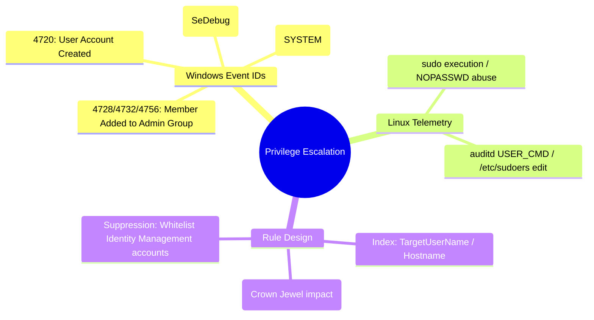

# 📖 Chapter 54: Production Use Case 2: Privilege Escalation & Admin Account Creation Masterclass

> **The IBM QRadar Administrator's Technical Guide** | Phase 5: Custom Rules Engine (CRE) & Offense Architecture  
> **Target Audience:** 1.5-Year Administrators $\rightarrow$ Senior SIEM Engineers & Detection Engineering Specialists  
> **Focus:** Privilege Escalation Kill-Chain, Windows 4720/4728/4732/4672, Linux `sudo`/`auditd`, & Hands-on Lab 54

---

## 📸 1. Visual Overview: Privilege Escalation Threat Correlation


*Figure 54.1: 3D Multi-Stage Threat Correlation in QRadar: Stage 2 showing an attacker escalating privileges from standard account to Domain Admin on Core Database and Identity Servers (`![[23_threat_correlation_usecases_3d.jpg|1000]]`)*

---

## 2. Threat Landscape: The Privilege Escalation Kill-Chain

Once an adversary achieves initial execution on an endpoint, their immediate objective is **Privilege Escalation** — elevating permissions to `SYSTEM`, `root`, or adding a backdoor user to enterprise administrative groups (`Domain Admins`, `Enterprise Admins`, `Schema Admins`, `Administrators`, `sudoers`):

```
┌────────────────────────────────────────────────────────────────────────┐
│ 👑 PRIVILEGE ESCALATION ATTACK TECHNIQUES                              │
│                                                                        │
│ 1. LOCAL PRIVILEGE ESCALATION (LPE)                                    │
│    • Technique: Kernel exploits, token impersonation, unquoted service  │
│      paths, abusing `sudo` misconfigurations (`NOPASSWD`).              │
│ ├────────────────────────────────────────────────────────────────────┤
│ 2. BACKDOOR ACCOUNT CREATION                                           │
│    • Technique: Attacker executes `net user hacker /add` followed by    │
│      `net group "Domain Admins" hacker /add`.                          │
│ ├────────────────────────────────────────────────────────────────────┤
│ 3. PERSISTENCE VIA SERVICE INSTALLATION                                │
│    • Technique: Installing malicious Windows Service (Event 7045) or   │
│      cron job (`/etc/cron.d/`) running as SYSTEM/root.                 │
└────────────────────────────────────────────────────────────────────────┘
```

---

## 3. Telemetry Sources & Critical Event IDs

Detection of administrative tampering requires monitoring specific security audit event IDs across Active Directory and Linux hosts:

| OS / Platform | Event ID / Signature | Description | High-Value Fields to Extract |
| :--- | :---: | :--- | :--- |
| **Windows Active Directory** | **`4720`** | A user account was created | `SubjectUserName` (Creator), `TargetUserName` (New User) |
| **Windows Active Directory** | **`4728`** | Member added to Global Security Group | `MemberName` (Added User), `TargetGroupName` (e.g. Domain Admins) |
| **Windows Active Directory** | **`4732`** | Member added to Local Security Group | `MemberName`, `TargetGroupName` (e.g. Administrators) |
| **Windows Active Directory** | **`4756`** | Member added to Universal Security Group | `MemberName`, `TargetGroupName` (e.g. Enterprise Admins) |
| **Windows Endpoint** | **`4672`** | Special privileges assigned to new logon | `PrivilegeList` (`SeDebugPrivilege`, `SeTcbPrivilege`) |
| **Windows System** | **`7045`** | A new service was installed in the system | `ServiceName`, `ImagePath` (Executable path), `ServiceType` |
| **Linux OS (`auditd` / `sudo`)** | `COMMAND=/bin/su` or `visudo` | User executing commands via `sudo` | `USER`, `COMMAND`, `PWD`, `tty` |

---

## 4. Production Rule Architecture: Unauthorized Addition to Privileged Groups

```
┌────────────────────────────────────────────────────────────────────────┐
│ 📋 RULE SPECIFICATION: AD: Unauthorized Member Added to Admin Group     │
│                                                                        │
│ 🔍 RULE TEST CONDITIONS:                                               │
│    • Apply "AD: Unauthorized Member Added to Admin Group" on events    │
│    • and when the event QID is one of (4728, 4732, 4756)               │
│    • and when "TargetGroupName" (Regex) matches any of (               │
│      'Domain Admins', 'Enterprise Admins', 'Schema Admins',            │
│      'Administrators', 'Account Operators', 'Backup Operators' )       │
│    • AND NOT when "SubjectUserName" is contained in Reference Set:     │
│      "Authorized_Identity_Provisioning_Service_Accounts"               │
│                                                                        │
│ ⚙️ RULE ACTIONS:                                                       │
│    • Ensure detected event is part of an OFFENSE                       │
│    • Index Offense by: Username (TargetUserName)                       │
│    • Set Severity to: 9, Credibility to: 9, Relevance to: 10           │
│    • Annotate: "CRITICAL: User added to Privileged Domain Admin Group!" │
│                                                                        │
│ 📢 RULE RESPONSES:                                                     │
│    • Send SNMP Trap to SOC High-Priority Queue                         │
│    • Dispatch New Event: "Privileged Group Membership Tampering"       │
│    • Add "TargetUserName" to Reference Set: "Monitored_VIP_Users"      │
└────────────────────────────────────────────────────────────────────────┘
```

---

## 5. Production Rule Architecture: High-Privilege Token Elevation (`SeDebugPrivilege`)

```
┌────────────────────────────────────────────────────────────────────────┐
│ 📋 RULE SPECIFICATION: WIN: High-Privilege Token Elevation (SeDebug)   │
│                                                                        │
│ 🔍 RULE TEST CONDITIONS:                                               │
│    • Apply "WIN: High-Privilege Token Elevation" on events             │
│    • and when the event QID is 4672 (Special Privileges Assigned)      │
│    • and when the event payload contains regex 'SeDebugPrivilege'      │
│    • AND NOT when the username matches any of ('SYSTEM', 'LOCAL SERVICE',│
│      'NETWORK SERVICE', 'DWM-*')                                       │
│                                                                        │
│ ⚙️ RULE ACTIONS:                                                       │
│    • Ensure detected event is part of an OFFENSE                       │
│    • Index Offense by: Username                                        │
│    • Set Severity to: 8, Credibility to: 8, Relevance to: 8            │
└────────────────────────────────────────────────────────────────────────┘
```

---

## 📌 6. Visual Mind Map & Sticky Notes (Chapter 54 Quick-Review)

### 🧠 Hierarchical Mind Map


### 🗂️ Color-Coded Digital Sticky Notes

#### 🟨 Sticky Note 1: Windows 4728 vs 4732 vs 4756
```text
┌─────────────────────────────────────────────────────────────┐
│ 📌 CONCEPT: THE ACTIVE DIRECTORY GROUP TRIO                 │
│                                                             │
│ • 4728 = Global Group (e.g. Domain Admins).                │
│ • 4732 = Local Group (e.g. Local Administrators).           │
│ • 4756 = Universal Group (e.g. Enterprise Admins).          │
└─────────────────────────────────────────────────────────────┘
```

#### 🟩 Sticky Note 2: Whitelist Change Management
```text
┌─────────────────────────────────────────────────────────────┐
│ 📌 GOLDEN RULE: SUPPRESS IDENTITY PROVISIONING ENGINES      │
│                                                             │
│ • Whitelist automated IAM platforms (SailPoint, CyberArk,   │
│   Azure AD Connect) to prevent false alerts on legit adds!  │
└─────────────────────────────────────────────────────────────┘
```

#### 🟪 Sticky Note 3: Account Creation + Group Add Chaining
```text
┌─────────────────────────────────────────────────────────────┐
│ 📌 ARCHITECTURE: CORRELATION CHAINING                       │
│                                                             │
│ • Correlate Event 4720 (Account Created) followed within    │
│   5 minutes by Event 4728 (Admin Group Add) on same user!   │
└─────────────────────────────────────────────────────────────┘
```

#### 🟦 Sticky Note 4: SeDebugPrivilege Lethality
```text
┌─────────────────────────────────────────────────────────────┐
│ 📌 SECURITY: SeDebugPrivilege                               │
│                                                             │
│ • `SeDebugPrivilege` allows a process to dump memory from   │
│   `lsass.exe` (Mimikatz credential dumping!).               │
└─────────────────────────────────────────────────────────────┘
```

#### 🟧 Sticky Note 5: Interview Cheat Code (Privilege Escalation)
```text
┌─────────────────────────────────────────────────────────────┐
│ 📌 INTERVIEW CHEAT CODE: "HOW DO YOU DETECT ROGUE ADMINS?"  │
│                                                             │
│ "In QRadar, I monitor Windows Event IDs 4728, 4732, and     │
│ 4756 filtering for privileged target groups like Domain     │
│ Admins, suppressing authorized IAM service accounts via a   │
│ Reference Set, and indexing by TargetUserName at Severity 9."│
└─────────────────────────────────────────────────────────────┘
```

#### 🟥 Sticky Note 6: Critical Pitfall
```text
┌─────────────────────────────────────────────────────────────┐
│ ⚠️ CRITICAL PITFALL: MISSING AUDIT POLICIES                 │
│                                                             │
│ • If Active Directory "Audit Security Group Management" is  │
│   disabled in Group Policy (GPO), Windows never logs Event  │
│   4728, rendering SIEM rules completely blind!              │
└─────────────────────────────────────────────────────────────┘
```

---

## ⚡ Rapid-Recall Flashcards

| # | Question (Front) | Answer (Back) |
| :-: | :--- | :--- |
| **01** | What Windows Event ID indicates that a user was added to a Global Security Group (like Domain Admins)? | **Event ID 4728**. |
| **02** | What Windows Event ID indicates that a new user account was created? | **Event ID 4720**. |
| **03** | What Windows Event ID indicates that a member was added to a Local Security Group (like Administrators)? | **Event ID 4732**. |
| **04** | Why is `SeDebugPrivilege` in Event 4672 considered high risk? | It grants permission to inspect and dump memory from sensitive processes like `lsass.exe` for credential theft. |
| **05** | What Windows System Event ID records the installation of a new executable service? | **Event ID 7045**. |
| **06** | What field should you index on when detecting an unauthorized administrative group membership change? | **`TargetUserName`** (or `Username`). |

---

## 🧪 7. Hands-on Practice Lab 54: Auditing Privileged Group Changes & Building Rules

### 🎯 Lab Objectives
1. Query active directory group modification events via AQL.
2. Build an AQL query that extracts Subject User (Creator) and Target User (New Admin).
3. Emulate Windows Event 4728 payload injection via `logger`.
4. Verify offense generation and magnitude calculation via CLI.

---

### 📋 Step-by-Step Practical Lab Procedures

#### Step 1: Query Administrative Group Changes in AQL
```bash
/opt/qradar/bin/arielsql -p 32011 -q "
SELECT 
    DATEFORMAT(starttime, 'YYYY-MM-dd HH:mm:ss') AS EventTime, 
    sourceip, 
    username AS SubjectUser, 
    \"TargetUserName\" AS TargetUser, 
    \"TargetGroupName\" AS GroupName, 
    qidname(qid) AS EventName 
FROM events 
WHERE qid IN (4728, 4732, 4756) 
LAST 7 DAYS 
ORDER BY starttime DESC;
"
```

---

#### Step 2: Emulate Windows Event 4728 (Domain Admin Group Tampering)
Inject a simulated Windows Active Directory security log into QRadar:
```bash
logger -n 127.0.0.1 -P 514 -d -t Microsoft-Windows-Security-Auditing \
'<134>1 2026-09-25T19:00:00.000Z dc-01.corp.local Microsoft-Windows-Security-Auditing 4728 - - [Keywords="0x8020000000000000"] A member was added to a security-enabled global group. Subject: Security ID: S-1-5-21-100-500 Account Name: bad_actor Target Account: Security ID: S-1-5-21-100-1001 Account Name: backdoor_admin Group: Group Name: Domain Admins'
```

---

#### Step 3: Verify Offense Creation in `/var/log/qradar.log`
```bash
grep -iE "4728|Domain Admins|Privileged Group" /var/log/qradar.log | tail -n 10
```

---

#### Step 4: Verify Offense Magnitude & Scoring in PostgreSQL
```bash
psql -U qradar -d qradar -x -c "
SELECT 
    id AS OffenseID, 
    description, 
    offensesource, 
    magnitude, 
    severity, 
    relevance 
FROM offense 
WHERE description ILIKE '%Admin%' OR description ILIKE '%4728%' 
ORDER BY id DESC 
LIMIT 1;
"
```
