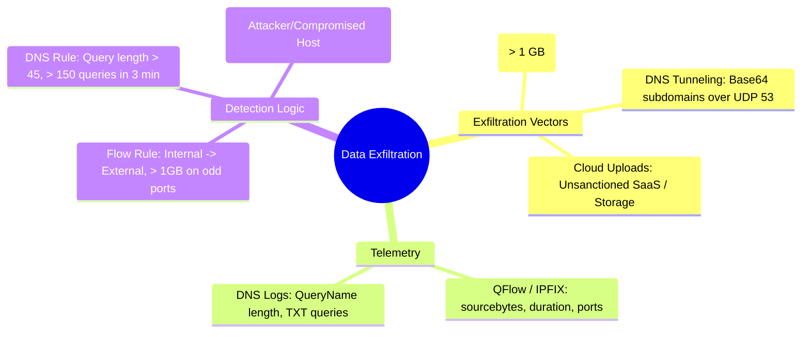

# 📖 Chapter 56: Production Use Case 4: Data Exfiltration: Flow Spikes & DNS Tunneling Masterclass

> **The IBM QRadar Administrator's Technical Guide** | Phase 5: Custom Rules Engine (CRE) & Offense Architecture  
> **Target Audience:** 1.5-Year Administrators $\rightarrow$ Senior SIEM Engineers & Detection Engineering Specialists  
> **Focus:** Network Exfiltration Kill-Chain, QFlow / IPFIX Telemetry, DNS Tunneling Heuristics, Shannon Entropy, & Hands-on Lab 56

---

## 📸 1. Visual Overview: Data Exfiltration & DNS Tunneling Correlation


*Figure 56.1: 3D Multi-Stage Threat Correlation in QRadar: Stage 4 showing an internal compromised application server exfiltrating database records via DNS Tunneling (Port 53) and High-Volume Outbound Flow Channels to External C2 Servers (`![[23_threat_correlation_usecases_3d.jpg|1000]]`)*

---

## 2. Threat Landscape: Data Exfiltration Modalities

The final objective of advanced persistent threat (APT) actors and ransomware groups is **Data Exfiltration** (double extortion). Exfiltration typically occurs via two primary network techniques:

```
┌────────────────────────────────────────────────────────────────────────┐
│ 📤 THE 2 PRIMARY DATA EXFILTRATION VECTORS                             │
│                                                                        │
│ 1. HIGH-VOLUME FLOW SPIKES (Direct Network Channels)                  │
│    • Technique: Massive outbound transfers via SFTP, HTTPS, Cloud S3,  │
│      MEGA, or raw TCP sockets on non-standard ports.                   │
│    • Ingestion Source: QFlow, NetFlow, IPFIX, NextGen Firewalls.       │
│ ├────────────────────────────────────────────────────────────────────┤
│ 2. COVERT DNS TUNNELING (Slow & Low Covert Channel)                    │
│    • Technique: Base32/Base64 encoding stolen data into subdomains of   │
│      an attacker-controlled domain (e.g. `dGVzdGRhdGE.c2.attacker.com`) │
│    • Protocol: UDP 53 (DNS Queries - almost always permitted outbound).│
│    • Ingestion Source: Windows DNS debug logs, BIND, Infoblox, QFlow.  │
└────────────────────────────────────────────────────────────────────────┘
```

---

## 3. Telemetry Sources: QFlow vs DNS Server Logs

| Telemetry Stream | Daemon / Source | Extracted Fields | Detection Capability |
| :--- | :--- | :--- | :--- |
| **QFlow DPI / IPFIX** | `qflow` / `ecs-ep` | `sourcebytes`, `destinationbytes`, `totalbytes`, `duration`, `sourceport`, `destinationport` | Detects abnormal outbound byte volume, long-duration C2 sessions, protocol mismatches. |
| **Windows DNS Server Audit** | WinCollect / File Forwarder | `QueryName`, `QueryType` (TXT, A, AAAA), `ClientIP`, `ResponseCode` | Detects high-entropy subdomains, massive query volume to a single domain. |
| **NextGen Firewall (Palo Alto / Fortinet)** | Syslog / TLS | `bytes_sent`, `bytes_received`, `app_name`, `url_category`, `action` | Identifies unauthorized cloud storage uploads (Dropbox, Mega.nz). |

---

## 4. Production Rule Architecture 1: DNS Tunneling Detection via Query Frequency

```
┌────────────────────────────────────────────────────────────────────────┐
│ 📋 RULE SPECIFICATION: NET: Suspected DNS Tunneling Exfiltration       │
│                                                                        │
│ 🔍 RULE TEST CONDITIONS:                                               │
│    • Apply "NET: Suspected DNS Tunneling Exfiltration" on events       │
│    • and when the event matches BB:CategoryDefinition: DNS Events      │
│    • and when the destination port is 53                               │
│    • and when "DNS_QueryName_Length" > 45                              │
│    • and when at least 150 events occur with the same Source IP and    │
│      the same Root_Domain in 3 minutes                                 │
│    • AND NOT when the destination IP is contained in Internal_DNS_Servers│
│                                                                        │
│ ⚙️ RULE ACTIONS:                                                       │
│    • Ensure detected event is part of an OFFENSE                       │
│    • Index Offense by: Source IP                                       │
│    • Set Severity to: 9, Credibility to: 9, Relevance to: 9            │
│    • Annotate: "CRITICAL: High-frequency long DNS query stream detected"│
│                                                                        │
│ 📢 RULE RESPONSES:                                                     │
│    • Add "Root_Domain" to Reference Set: "Threat_Intel_Malicious_Domains"│
│    • Dispatch New Event: "DNS Tunneling Covert Channel Detected"       │
└────────────────────────────────────────────────────────────────────────┘
```

---

## 5. Production Rule Architecture 2: Abnormal Outbound Flow Bandwidth Spike

```
┌────────────────────────────────────────────────────────────────────────┐
│ 📋 RULE SPECIFICATION: FLOW: Massive Outbound Data Transfer to Untrusted│
│                                                                        │
│ 🔍 RULE TEST CONDITIONS:                                               │
│    • Apply "FLOW: Massive Outbound Data Transfer to Untrusted" on flows│
│    • and when the source is internal and the destination is external   │
│    • and when the source bytes is greater than 1,073,741,824 (1 GB)    │
│    • and when the destination port is NOT one of (80, 443, 8080)       │
│    • AND NOT when the destination IP is contained in Cloud_Backup_CIDRs│
│                                                                        │
│ ⚙️ RULE ACTIONS:                                                       │
│    • Ensure detected flow is part of an OFFENSE                        │
│    • Index Offense by: Source IP                                       │
│    • Set Severity to: 9, Credibility to: 10, Relevance to: 10          │
│                                                                        │
│ 📢 RULE RESPONSES:                                                     │
│    • Send High-Priority PagerDuty / SOC Alert                          │
│    • Execute Custom Action: "firewall_isolate_workstation.py"          │
└────────────────────────────────────────────────────────────────────────┘
```

---

## 📌 6. Visual Mind Map & Sticky Notes (Chapter 56 Quick-Review)

### 🧠 Hierarchical Mind Map


### 🗂️ Color-Coded Digital Sticky Notes

#### 🟨 Sticky Note 1: Shannon Entropy in DNS
```text
┌─────────────────────────────────────────────────────────────┐
│ 📌 CONCEPT: HIGH-ENTROPY DOMAINS                            │
│                                                             │
│ • Tunneling queries look like random noise:                 │
│   `a8f7b2c91d4e8.tunnel.evil.com`.                          │
│ • High character entropy + query length $> 45$ = Tunneling! │
└─────────────────────────────────────────────────────────────┘
```

#### 🟩 Sticky Note 2: Non-Standard Outbound Ports
```text
┌─────────────────────────────────────────────────────────────┐
│ 📌 GOLDEN RULE: FLOW MONITORING ON ODD PORTS                │
│                                                             │
│ • Any internal server transferring $> 500 \text{ MB}$ to an │
│   external IP on ports other than 80/443 is an immediate    │
│   red flag!                                                 │
└─────────────────────────────────────────────────────────────┘
```

#### 🟪 Sticky Note 3: TXT Records for C2
```text
┌─────────────────────────────────────────────────────────────┐
│ 📌 PROTOCOL: DNS TXT RECORD ABUSE                           │
│                                                             │
│ • Adversaries use DNS `TXT` records to download second-stage│
│   payloads and C2 commands because TXT payloads can hold    │
│   up to 65,535 bytes!                                       │
└─────────────────────────────────────────────────────────────┘
```

#### 🟦 Sticky Note 4: Destination IP Whitelisting
```text
┌─────────────────────────────────────────────────────────────┐
│ 📌 TUNING: CLOUD BACKUP SUPPRESSION                         │
│                                                             │
│ • Whitelist enterprise cloud backup destinations (AWS S3,   │
│   Azure Backup) via CIDR Reference Sets to prevent false    │
│   offenses during nightly backup jobs.                      │
└─────────────────────────────────────────────────────────────┘
```

#### 🟧 Sticky Note 5: Interview Cheat Code (Data Exfiltration)
```text
┌─────────────────────────────────────────────────────────────┐
│ 📌 INTERVIEW CHEAT CODE: "HOW DO YOU DETECT DNS TUNNELING?" │
│                                                             │
│ "In QRadar, I correlate DNS event telemetry looking for     │
│ abnormal query lengths (> 45 chars) and high-frequency      │
│ unique subdomain queries (> 150 in 3 min) hitting external  │
│ root domains, creating a Severity 9 offense."               │
└─────────────────────────────────────────────────────────────┘
```

#### 🟥 Sticky Note 6: Critical Pitfall
```text
┌─────────────────────────────────────────────────────────────┐
│ ⚠️ CRITICAL PITFALL: MISSING QFLOW ON EGRESS CHANNELS       │
│                                                             │
│ • If QFlow or NetFlow is only monitored on internal switches│
│   and not the Internet border firewall, outbound byte       │
│   volumes are completely invisible to CRE Flow Rules!       │
└─────────────────────────────────────────────────────────────┘
```

---

## ⚡ Rapid-Recall Flashcards

| # | Question (Front) | Answer (Back) |
| :-: | :--- | :--- |
| **01** | What protocol is most commonly abused for covert data exfiltration due to universally open firewall policies? | **DNS (UDP / TCP Port 53)**. |
| **02** | What characteristics distinguish a DNS tunneling query from a legitimate DNS lookup? | **Excessive query length ($> 45$ characters)**, **high randomness / entropy**, and **massive query frequency** to the same root domain. |
| **03** | What network flow fields in QRadar identify high-volume data exfiltration? | **`sourcebytes`**, **`destinationbytes`**, **`destinationport`**, and **`duration`**. |
| **04** | Why do attackers abuse DNS `TXT` query records? | Because `TXT` responses can return large arbitrary text/base64 payload data to the client. |
| **05** | What rule type is used to detect large outbound file transfers? | A **Flow Rule** (or **Common Rule**). |
| **06** | What field should be indexed for an exfiltration offense? | **`Source IP`** (the internal compromised asset transmitting data). |

---

## 🧪 7. Hands-on Practice Lab 56: Hunting DNS Tunneling & Outbound Flow Spikes

### 🎯 Lab Objectives
1. Query high-volume outbound network flows using AQL.
2. Search DNS query logs for anomalous domain lengths ($> 45$ characters).
3. Emulate a DNS tunneling event stream via `logger`.
4. Inspect flow bandwidth anomalies and offense generation.

---

### 📋 Step-by-Step Practical Lab Procedures

#### Step 1: Query Top Outbound Network Flow Exfiltration Candidates via AQL
```bash
/opt/qradar/bin/arielsql -p 32011 -q "
SELECT 
    sourceip AS InternalHost, 
    destinationip AS ExternalDestination, 
    destinationport AS DstPort, 
    SUM(sourcebytes) / (1024*1024) AS TotalMBSent, 
    COUNT(*) AS FlowCount 
FROM flows 
WHERE INCIDR('10.0.0.0/8', sourceip) AND NOT INCIDR('10.0.0.0/8', destinationip) 
LAST 24 HOURS 
GROUP BY sourceip, destinationip, destinationport 
ORDER BY TotalMBSent DESC 
LIMIT 10;
"
```

---

#### Step 2: Hunt Long / High-Entropy DNS Queries in Event Telemetry
```bash
/opt/qradar/bin/arielsql -p 32011 -q "
SELECT 
    DATEFORMAT(starttime, 'HH:mm:ss') AS EventTime, 
    sourceip AS ClientIP, 
    \"DNS_QueryName\" AS QueryDomain, 
    STRLEN(\"DNS_QueryName\") AS QueryLength 
FROM events 
WHERE destinationport = 53 AND STRLEN(\"DNS_QueryName\") > 40 
LAST 12 HOURS 
ORDER BY QueryLength DESC 
LIMIT 15;
"
```

---

#### Step 3: Emulate a Fast-Rate DNS Tunneling Attack Stream
Inject 25 synthetic long-query DNS requests into `ecs-ec-ingress`:
```bash
for i in {1..25}; do
    PAYLOAD_CHUNK=$(openssl rand -hex 24)
    logger -n 127.0.0.1 -P 514 -d -t named \
    "<134>$(date '+%b %d %H:%M:%S') dns-srv-01 named[1054]: client 10.100.4.50#51234 (${PAYLOAD_CHUNK}.tunnel.c2server.org): query: ${PAYLOAD_CHUNK}.tunnel.c2server.org IN A + (10.100.1.5)"
    sleep 0.1
done
```

---

#### Step 4: Verify DNS Tunneling Offense Triggered in PostgreSQL
```bash
psql -U qradar -d qradar -x -c "
SELECT 
    id AS OffenseID, 
    description, 
    offensesource, 
    eventcount, 
    magnitude, 
    severity 
FROM offense 
WHERE description ILIKE '%DNS%' OR description ILIKE '%Tunneling%' 
ORDER BY id DESC 
LIMIT 1;
"
```
