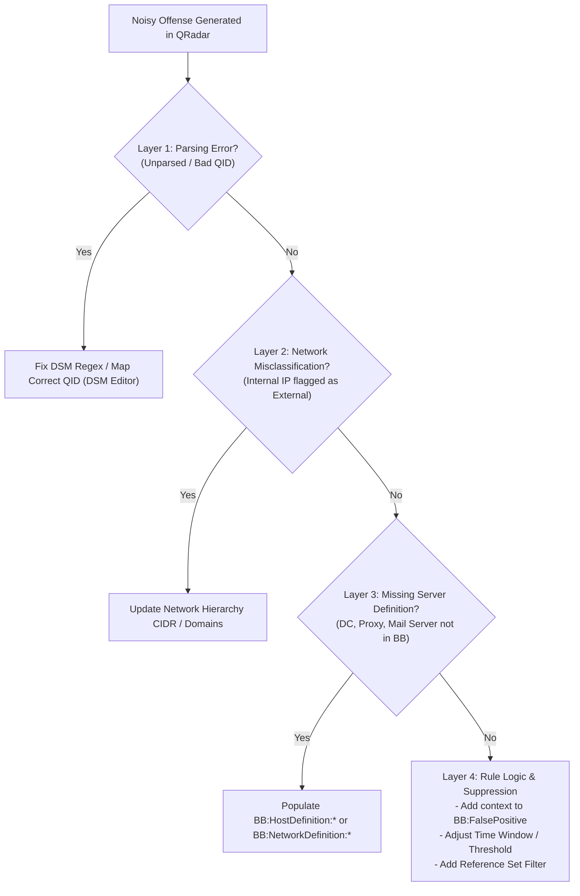
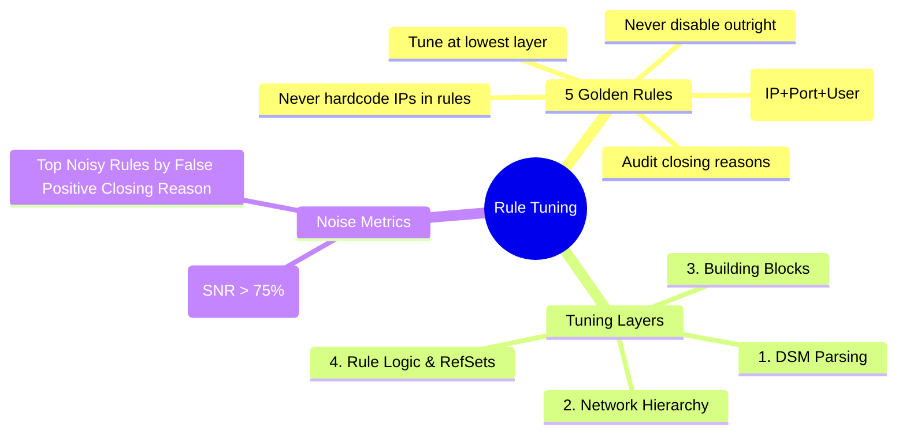

# 📖 Chapter 57: Rule Tuning & False Positive Suppression Masterclass

> **The IBM QRadar Administrator's Technical Guide** | Phase 5: Custom Rules Engine (CRE) & Offense Architecture  
> **Target Audience:** 1.5-Year Administrators $\rightarrow$ Senior SIEM Engineers & Detection Engineering Specialists  
> **Focus:** 5 Golden Rules of Tuning, False Positive Suppression without Blinding, Reference Sets & BB Tuning, & Hands-on Lab 57

---

## 📸 1. Visual Overview: The False Positive Tuning & Feedback Loop


*Figure 57.1: The Systematic QRadar Rule Tuning Architecture: Filtering raw event telemetry through layered Whitelist Reference Sets and False Positive Building Blocks before CRE threshold evaluation (`![[stage7_cre_correlation_engine_3d.jpg|1000]]`)*

---

## 2. The False Positive Problem in Enterprise SIEM

In a mature Security Operations Center (SOC), **alert fatigue** is the #1 reason true security breaches are overlooked. When analysts are inundated with 200 noisy offenses a day, mean time to detect (MTTD) skyrockets. 

However, junior administrators often make the fatal mistake of **disabling noisy rules entirely** or adding overly broad CIDR whitelists, completely blinding the organization to real attacks.

```
┌────────────────────────────────────────────────────────────────────────┐
│ 🎯 THE 5 GOLDEN RULES OF ENTERPRISE QRADAR RULE TUNING                 │
│                                                                        │
│ 1. NEVER DISABLE A RULE OUTRIGHT IF IT CAN BE TUNED                    │
│    • Instead of disabling "Brute Force", tune the threshold or add a   │
│      suppression condition for the specific noisy service account.     │
│ ├────────────────────────────────────────────────────────────────────┤
│ 2. NEVER HARDCODE IPS OR USERNAMES DIRECTLY IN RULES                   │
│    • Always route whitelists through **Reference Sets** or             │
│      **False Positive Building Blocks** (`BB:FalsePositive:*`).        │
│ ├────────────────────────────────────────────────────────────────────┤
│ 3. TUNE WITH STRICT CONTEXTUAL SPECIFICITY                             │
│    • Never whitelist an IP globally across all ports!                  │
│    • Whitelist: `IP = 10.10.1.5 AND Port = 443 AND User = svc_backup`.│
│ ├────────────────────────────────────────────────────────────────────┤
│ 4. TUNE AT THE LOWEST EFFECTIVE ARCHITECTURAL LAYER                    │
│    • Layer 1 (DSM Parsing) $\rightarrow$ Layer 2 (Network Hierarchy)   │
│      $\rightarrow$ Layer 3 (Building Block) $\rightarrow$ Layer 4 (Rule)│
│ ├────────────────────────────────────────────────────────────────────┤
│ 5. AUDIT OFFENSE CLOSING REASONS CONTINUOUSLY                          │
│    • Use closed offense metrics ("False Positive", "Non-Issue") to     │
│      identify the top 5 noisiest rules weekly.                         │
└────────────────────────────────────────────────────────────────────────┘
```

---

## 3. The 4-Layer Tuning Hierarchy in QRadar Architecture

Before modifying a Custom Rule, determine which architectural layer is causing the noise:



---

## 4. The 3 Tuning Methodologies Compared

| Tuning Method | How It Works | Best Use Case | Risk Level |
| :--- | :--- | :--- | :---: |
| **Reference Set Whitelisting** | Add authorized IP/User into an in-memory Reference Set checked with `AND NOT`. | Rapid operational tuning (Vulnerability scanners, dynamic pentest teams). | **Lowest (Zero Downtime)** |
| **Building Block Modification** | Add conditions or IPs into `BB:FalsePositive:*`. | Enterprise-wide suppression shared across 20+ correlation rules. | **Low** |
| **Rule Threshold Adjustment** | Increase threshold (e.g. from 5 failed logins to 15) or shrink time window. | High-frequency environment where standard thresholds are too sensitive. | **Medium (May miss slow attacks)** |
| **Offense Tuning Wizard (UI)** | QRadar UI wizard that modifies the underlying rule condition. | Quick single-rule tuning by SOC Level 2 analysts. | **Medium** |

---

## 5. Mathematical Metric: Offense Signal-to-Noise Ratio (SNR)

Enterprise SIEM administrators measure tuning success using the **Offense Signal-to-Noise Ratio (SNR)**:

$$\text{Offense SNR} = \frac{\text{Actionable Security Incidents (True Positives)}}{\text{Total Closed Offenses}} \times 100\%$$

- **Target Enterprise Benchmark**: $> 75\%$ Actionable Offenses (FPs $< 25\%$).
- If SNR is $< 40\%$, the SIEM is suffering from severe rule drift and requires an immediate tuning sprint.

---

## 📌 6. Visual Mind Map & Sticky Notes (Chapter 57 Quick-Review)

### 🧠 Hierarchical Mind Map


### 🗂️ Color-Coded Digital Sticky Notes

#### 🟨 Sticky Note 1: Never Hardcode Whitelists
```text
┌─────────────────────────────────────────────────────────────┐
│ 📌 CONCEPT: HARDCODED RULES = DEBT                          │
│                                                             │
│ • Hardcoding an IP in a rule requires a full "Deploy        │
│   Changes" every time an IP changes. Use Reference Sets!    │
└─────────────────────────────────────────────────────────────┘
```

#### 🟩 Sticky Note 2: Contextual Whitelisting
```text
┌─────────────────────────────────────────────────────────────┐
│ 📌 GOLDEN RULE: THREE-POINT SPECIFICITY                     │
│                                                             │
│ • Never whitelist just `10.10.1.50`.                        │
│ • Whitelist: `Source IP = 10.10.1.50 AND Port = 445 AND     │
│   Username = svc_veeam`!                                    │
└─────────────────────────────────────────────────────────────┘
```

#### 🟪 Sticky Note 3: Tuning via Reference Sets
```text
┌─────────────────────────────────────────────────────────────┐
│ 📌 ARCHITECTURE: ZERO-DEPLOY TUNING                         │
│                                                             │
│ • Updating a Reference Set takes effect instantly in memory │
│   without needing "Deploy Changes" or restarting `ecs-ep`!  │
└─────────────────────────────────────────────────────────────┘
```

#### 🟦 Sticky Note 4: Layer 1 First
```text
┌─────────────────────────────────────────────────────────────┐
│ 📌 TROUBLESHOOTING: CHECK PARSING FIRST                     │
│                                                             │
│ • 40% of false positives are caused by bad DSM parsing (e.g.│
│   extracting the firewall proxy IP as the Source IP).       │
└─────────────────────────────────────────────────────────────┘
```

#### 🟧 Sticky Note 5: Interview Cheat Code (Rule Tuning)
```text
┌─────────────────────────────────────────────────────────────┐
│ 📌 INTERVIEW CHEAT CODE: "HOW DO YOU TUNE A NOISY RULE?"    │
│                                                             │
│ "I identify the root cause across the 4 tuning layers:      │
│ verifying DSM parsing, Network Hierarchy, and Building      │
│ Blocks. I then apply contextual suppression via Reference   │
│ Sets or FalsePositive BBs rather than disabling the rule."  │
└─────────────────────────────────────────────────────────────┘
```

#### 🟥 Sticky Note 6: Critical Pitfall
```text
┌─────────────────────────────────────────────────────────────┐
│ ⚠️ CRITICAL PITFALL: BLANKET SUBNET WHITELISTS              │
│                                                             │
│ • Whitelisting an entire `/24` subnet on an exploit rule    │
│   means any infected machine in that subnet can compromise  │
│   the network undetected!                                   │
└─────────────────────────────────────────────────────────────┘
```

---

## ⚡ Rapid-Recall Flashcards

| # | Question (Front) | Answer (Back) |
| :-: | :--- | :--- |
| **01** | What is the #1 mistake junior administrators make when dealing with noisy rules? | **Disabling the rule entirely**, which creates massive security blind spots. |
| **02** | What are the 4 layers of the QRadar tuning hierarchy? | **Layer 1: DSM Parsing** $\rightarrow$ **Layer 2: Network Hierarchy** $\rightarrow$ **Layer 3: Building Blocks** $\rightarrow$ **Layer 4: Rule Logic / Reference Sets**. |
| **03** | Why is tuning via Reference Sets preferred over editing rules directly? | Reference Sets update **instantly in memory** without requiring a "Deploy Changes" restart of `ecs-ep`. |
| **04** | What is meant by "Contextual Specificity" in whitelisting? | Suppressing traffic only when multiple attributes match (e.g. Source IP + Destination Port + Specific Service Account) rather than a broad IP whitelist. |
| **05** | What is the target enterprise benchmark for Offense Signal-to-Noise Ratio (SNR)? | **$> 75\%$** True Positive / Actionable Offenses. |
| **06** | What QRadar feature tracks why an offense was closed (e.g. False Positive, Non-Issue)? | **Offense Closing Reasons**. |

---

## 🧪 7. Hands-on Practice Lab 57: Auditing False Positives & Tuning Noisy Rules

### 🎯 Lab Objectives
1. Query top closed offenses by Closing Reason ("False Positive") in PostgreSQL.
2. Identify the top 5 noisiest correlation rules generating false alarms.
3. Build an AQL query to inspect traffic patterns for a noisy rule.
4. Implement a contextual Reference Set whitelist suppression test.

---

### 📋 Step-by-Step Practical Lab Procedures

#### Step 1: Query Top Offenses Closed as "False Positive" in PostgreSQL
```bash
psql -U qradar -d qradar -c "
SELECT 
    c.reason AS CloseReason, 
    COUNT(*) AS ClosedCount 
FROM offense o 
JOIN close_reason c ON o.closereasonid = c.id 
WHERE o.status = 1 
GROUP BY c.reason 
ORDER BY ClosedCount DESC;
"
```

---

#### Step 2: Identify the Top 5 Noisiest Rules Causing False Positives
```bash
psql -U qradar -d qradar -c "
SELECT 
    r.name AS NoisyRuleName, 
    COUNT(o.id) AS FalsePositiveCount 
FROM offense o 
JOIN customrule r ON o.ruleid = r.id 
JOIN close_reason c ON o.closereasonid = c.id 
WHERE c.reason ILIKE '%False Positive%' AND o.status = 1 
GROUP BY r.name 
ORDER BY FalsePositiveCount DESC 
LIMIT 5;
"
```

---

#### Step 3: Analyze Contributing Events for the Noisiest Rule via AQL
```bash
/opt/qradar/bin/arielsql -p 32011 -q "
SELECT 
    sourceip, 
    destinationip, 
    destinationport, 
    username, 
    COUNT(*) AS EventCount 
FROM events 
WHERE \"creRuleList\" IS NOT NULL 
LAST 24 HOURS 
GROUP BY sourceip, destinationip, destinationport, username 
ORDER BY EventCount DESC 
LIMIT 10;
"
```

---

#### Step 4: Populate a Reference Set via CLI to Suppress Verified Noise
```bash
# Add an authorized automated vulnerability scanner IP to the suppression set
/opt/qradar/bin/ReferenceDataCLI.sh add "BB:FalsePositive_Authorized_Scanners" "10.100.50.25"
```
