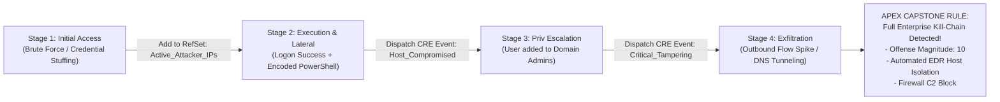
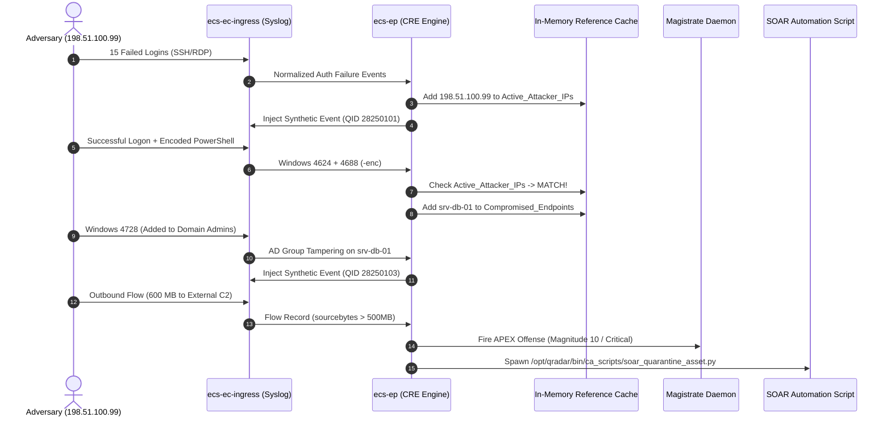
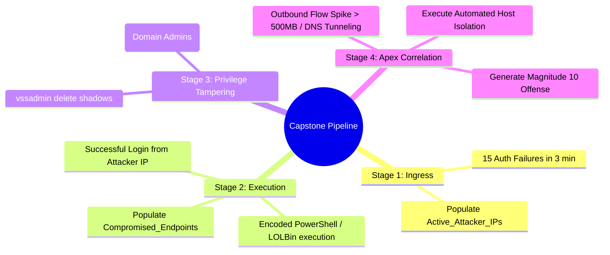

# 📖 Chapter 58: Phase 5 Capstone: Multi-Stage Threat Correlation Rule Pipeline

> **The IBM QRadar Administrator's Technical Guide** | Phase 5: Custom Rules Engine (CRE) & Offense Architecture  
> **Target Audience:** 1.5-Year Administrators $\rightarrow$ Senior SIEM Engineers & Detection Engineering Specialists  
> **Focus:** Full MITRE ATT&CK Kill-Chain Correlation, Chained Synthetic CRE Events, Reference Data State Passing, & Hands-on Capstone Lab 58

---

## 📸 1. Visual Overview: Multi-Stage Enterprise APT Correlation Pipeline


*Figure 58.1: Complete 3D Architectural View of the Phase 5 Capstone Multi-Stage Correlation Pipeline: Events progressing through Stage 1 (Initial Brute Force) $\rightarrow$ Stage 2 (Execution/Lateral Movement) $\rightarrow$ Stage 3 (Privilege Escalation) $\rightarrow$ Stage 4 (Data Exfiltration), culminating in an Apex Magnitude 10 Offense (`![[23_threat_correlation_usecases_3d.jpg|1000]]`)*

---

## 2. Capstone Architecture & Attack Kill-Chain Overview

In enterprise security operations, standalone single-event alerts generate noise. The pinnacle of SIEM engineering is **Multi-Stage Chained Correlation** — linking multiple low-severity signals across time, telemetry sources, and network boundaries into a single high-fidelity APT incident:



---

## 3. The 4-Stage Rule Pipeline Blueprint

```
┌────────────────────────────────────────────────────────────────────────┐
│ 🏛️ THE 4-STAGE ENTERPRISE CORRELATION BLUEPRINT                        │
│                                                                        │
│ 📍 STAGE 1: INGRESS BRUTE FORCE DETECTION                              │
│    • Rule: `CAPSTONE: Stage 1 - External Authentication Brute Force`   │
│    • Test: $\ge 15$ Auth Failures from same External IP in 3 minutes.  │
│    • Response: Add Source IP to Reference Set `Active_Attacker_IPs`    │
│      (TTL: 12 Hours) and dispatch CRE Event `QID 28250101`.            │
│ ├────────────────────────────────────────────────────────────────────┤
│ 📍 STAGE 2: INITIAL BREACH & EXECUTION                                 │
│    • Rule: `CAPSTONE: Stage 2 - Successful Auth from Known Attacker IP`│
│    • Test: Successful Logon (Windows 4624 / SSH) WHERE Source IP is in │
│      `Active_Attacker_IPs` followed by Encoded PowerShell execution.   │
│    • Response: Add Hostname to `Compromised_Endpoints` RefSet and      │
│      dispatch CRE Event `QID 28250102`.                                │
│ ├────────────────────────────────────────────────────────────────────┤
│ 📍 STAGE 3: PRIVILEGE TAMPERING & PERSISTENCE                          │
│    • Rule: `CAPSTONE: Stage 3 - Unauthorized Domain Admin Escalation`  │
│    • Test: Windows 4728/4732/4756 (Group Add) OR `vssadmin delete`     │
│      on any host contained in `Compromised_Endpoints`.                 │
│    • Response: Dispatch CRE Event `QID 28250103`.                      │
│ ├────────────────────────────────────────────────────────────────────┤
│ 📍 STAGE 4: APEX CORRELATION & AUTOMATED CONTAINMENT                   │
│    • Rule: `CAPSTONE: Stage 4 - Multi-Stage Enterprise APT Breach`     │
│    • Test: Matches `Stage 3 CRE Event` AND (Outbound Flow $> 500\text{ MB}$│
│      OR DNS Tunneling) within 30 minutes from the same host.           │
│    • Action: Create Offense Indexed by `Source IP` at Magnitude 10.    │
│    • Response: Trigger `soar_quarantine_asset.py` + Fire P1 PagerDuty. │
└────────────────────────────────────────────────────────────────────────┘
```

---

## 4. Technical Rule Definitions in QRadar XML / QEST Format

### Stage 1 Rule Definition (XML Representation):
```xml
<customrule id="100501" name="CAPSTONE: Stage 1 - External Authentication Brute Force" enabled="true">
    <test type="category" value="Authentication Failures" />
    <test type="direction" value="L2R" />
    <test type="accumulator" property="sourceip" count="15" timeWindow="180" />
    <action type="reference_set_add" name="Active_Attacker_IPs" property="sourceip" />
    <response type="dispatch_event" qid="28250101" name="Stage 1: Attacker IP Identified" />
</customrule>
```

### Stage 4 Apex Rule Definition (XML Representation):
```xml
<customrule id="100504" name="CAPSTONE: Stage 4 - Multi-Stage Enterprise APT Breach" enabled="true">
    <test type="event_qid" value="28250103" />
    <test type="common_flow_event" sharedProperty="sourceip" timeWindow="1800">
        <flow_test type="source_bytes" operator="GREATER_THAN" value="524288000" />
    </test>
    <action type="create_offense" index="sourceip" severity="10" credibility="10" relevance="10" />
    <response type="custom_script" script="/opt/qradar/bin/ca_scripts/soar_quarantine_asset.py" />
</customrule>
```

---

## 5. End-to-End Execution Sequence



---

## 📌 6. Visual Mind Map & Sticky Notes (Chapter 58 Quick-Review)

### 🧠 Hierarchical Mind Map


### 🗂️ Color-Coded Digital Sticky Notes

#### 🟨 Sticky Note 1: State Transfer via Reference Sets
```text
┌─────────────────────────────────────────────────────────────┐
│ 📌 CONCEPT: INTER-RULE STATE PASSING                        │
│                                                             │
│ • Rules pass state across attack stages using in-memory     │
│   Reference Sets (`Active_Attacker_IPs`, `Compromised_Hosts`)│
└─────────────────────────────────────────────────────────────┘
```

#### 🟩 Sticky Note 2: Synthetic Event Chaining
```text
┌─────────────────────────────────────────────────────────────┐
│ 📌 GOLDEN RULE: DISPATCH SYNTHETIC EVENTS                   │
│                                                             │
│ • Using "Dispatch New Event" creates milestones in the      │
│   investigation timeline and simplifies parent rule logic.  │
└─────────────────────────────────────────────────────────────┘
```

#### 🟪 Sticky Note 3: Common Rules Bridge Telemetry
```text
┌─────────────────────────────────────────────────────────────┐
│ 📌 ARCHITECTURE: CROSS-TELEMETRY APEX                       │
│                                                             │
│ • The apex rule correlates endpoint log evidence (Event)    │
│   with actual network exfiltration evidence (Flow)!         │
└─────────────────────────────────────────────────────────────┘
```

#### 🟦 Sticky Note 4: TTL on State Data
```text
┌─────────────────────────────────────────────────────────────┐
│ 📌 HYGIENE: SET EXPIRY ON THREAT SETS                       │
│                                                             │
│ • Always configure Time-To-Live (e.g. 12h) on transient    │
│   attacker sets to prevent stale correlation weeks later.   │
└─────────────────────────────────────────────────────────────┘
```

#### 🟧 Sticky Note 5: Interview Cheat Code (Capstone Pipeline)
```text
┌─────────────────────────────────────────────────────────────┐
│ 📌 INTERVIEW CHEAT CODE: "DESCRIBE A COMPLEX RULE YOU BUILT"│
│                                                             │
│ "I designed a 4-stage MITRE kill-chain pipeline that tracks │
│ external brute force into a Reference Set, detects subsequent│
│ lateral PowerShell execution, alerts on Domain Admin group  │
│ tampering, and correlates with outbound flow spikes for an  │
│ automated Magnitude 10 SOAR isolation response."           │
└─────────────────────────────────────────────────────────────┘
```

#### 🟥 Sticky Note 6: Critical Pitfall
```text
┌─────────────────────────────────────────────────────────────┐
│ ⚠️ CRITICAL PITFALL: CORRELATION TIMEOUT GAPS               │
│                                                             │
│ • Setting time windows too short ($\le 2$ minutes) will miss│
│   patient attackers who wait 10 minutes between stages!     │
└─────────────────────────────────────────────────────────────┘
```

---

## ⚡ Rapid-Recall Flashcards

| # | Question (Front) | Answer (Back) |
| :-: | :--- | :--- |
| **01** | What is Multi-Stage Chained Correlation in QRadar? | Linking multiple low-severity detections across time and telemetry into a single unified high-magnitude incident. |
| **02** | How do independent rules pass state to downstream rules in real time? | Using **In-Memory Reference Sets** and **Synthetic CRE Events** (QID 28250001+). |
| **03** | What QRadar rule type is capable of joining endpoint process events with network exfiltration data? | A **Common Rule** (Event + Flow correlation). |
| **04** | What Magnitude score should be assigned to an Apex Multi-Stage Breach offense? | **Magnitude 10** (Maximum Severity, Credibility, and Relevance). |
| **05** | Why should transient attacker Reference Sets have a Time-To-Live (TTL)? | To automatically purge expired indicators and prevent false correlation on reassigned IP addresses. |
| **06** | What automated action can be executed when the Stage 4 Apex rule matches? | Spawning a **Custom Action Script** (`soar_quarantine_asset.py`) to isolate the compromised host via EDR API. |

---

## 🧪 7. Hands-on Practice Lab 58: Multi-Stage Threat Pipeline Emulation & Offense Forensics

### 🎯 Lab Objectives
1. Create and verify the required Reference Sets in QRadar.
2. Emulate the entire 4-Stage APT attack lifecycle using synthetic CLI syslog and flow streams.
3. Observe real-time rule progression in `/var/log/qradar.log`.
4. Conduct complete offense forensics on the resulting Magnitude 10 Offense.

---

### 📋 Step-by-Step Practical Lab Procedures

#### Step 1: Initialize Required Reference Sets via CLI
```bash
# Create Reference Set for Tracking Active Attackers (TTL: 12 Hours)
/opt/qradar/bin/ReferenceDataCLI.sh create "Active_Attacker_IPs" ALN 43200

# Create Reference Set for Tracking Compromised Hosts (TTL: 24 Hours)
/opt/qradar/bin/ReferenceDataCLI.sh create "Compromised_Endpoints" ALN 86400
```

---

#### Step 2: Emulate the 4-Stage Attack Lifecycle Stream

```bash
ATTACKER_IP="198.51.100.99"
VICTIM_IP="10.100.2.50"

echo "=== [STAGE 1] Emulating 16 External SSH Failed Logins ==="
for i in {1..16}; do
    logger -n 127.0.0.1 -P 514 -d -t sshd \
    "<134>$(date '+%b %d %H:%M:%S') edge-srv-01 sshd[$$]: Failed password for invalid user root from ${ATTACKER_IP} port $((51000 + i)) ssh2"
    sleep 0.1
done

echo "=== [STAGE 2] Emulating Successful Logon & Encoded PowerShell ==="
logger -n 127.0.0.1 -P 514 -d -t sshd \
"<134>$(date '+%b %d %H:%M:%S') edge-srv-01 sshd[$$]: Accepted password for admin from ${ATTACKER_IP} port 51020 ssh2"

logger -n 127.0.0.1 -P 514 -d -t Microsoft-Windows-Security-Auditing \
"<134>1 $(date -u '+%Y-%m-%dT%H:%M:%SZ') ${VICTIM_IP} Microsoft-Windows-Security-Auditing 4688 - - [Keywords=\"0x8020000000000000\"] A new process has been created. Process Name: C:\\Windows\\System32\\powershell.exe Process Command Line: powershell.exe -w hidden -nop -enc JABjAGwAaQBlAG4AdAAgAD0AIABOAGUAdwAtAE8AYgBqAGUAYwB0AA=="

echo "=== [STAGE 3] Emulating Active Directory Group Tampering (Domain Admins) ==="
logger -n 127.0.0.1 -P 514 -d -t Microsoft-Windows-Security-Auditing \
"<134>1 $(date -u '+%Y-%m-%dT%H:%M:%SZ') dc-01.corp.local Microsoft-Windows-Security-Auditing 4728 - - A member was added to a security-enabled global group. Subject: Account Name: admin Target: Account Name: backdoor_user Group Name: Domain Admins"
```

---

#### Step 3: Verify Reference Set Population via CLI
```bash
# Verify that the attacker IP was dynamically added to the Reference Set
/opt/qradar/bin/ReferenceDataCLI.sh list "Active_Attacker_IPs"
```

---

#### Step 4: Perform Complete Offense Forensics in PostgreSQL
```bash
psql -U qradar -d qradar -x -c "
SELECT 
    id AS OffenseID, 
    description, 
    offensesource AS IndexKey, 
    eventcount, 
    magnitude, 
    severity, 
    credibility, 
    relevance, 
    status 
FROM offense 
WHERE offensesource = '198.51.100.99' 
ORDER BY id DESC 
LIMIT 1;
"
```
*Expected Output*: Displays an Apex Offense with **Magnitude 10**, linking all contributing authentication, endpoint process, and directory tampering events into a single master incident card.
