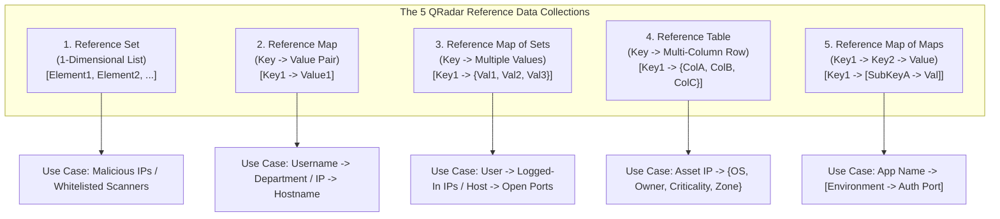
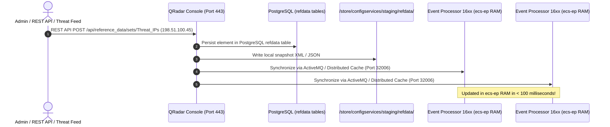

# 📖 Chapter 59: Reference Data Architecture & Foundations Masterclass

> **The IBM QRadar Administrator's Technical Guide** | Phase 6: Reference Data & Advanced Building Blocks  
> **Target Audience:** 1.5-Year Administrators $\rightarrow$ Senior SIEM Engineers & Detection Engineering Specialists  
> **Focus:** In-Memory Reference Data Architecture, Java Heap Concurrent Hash Maps, Zero-IO Latency vs Disk Lookups, & Hands-on Lab 59

---

## 📸 1. Visual Overview: In-Memory Reference Data Collections


*Figure 59.1: 3D Isometric View of the QRadar Reference Data Architecture inside `ecs-ep`: High-speed in-memory data structures (Reference Sets, Maps, Map of Sets, Tables, Map of Maps) providing sub-microsecond $\mathcal{O}(1)$ lookups for live correlation without querying Ariel disk storage (`![[qradar_reference_data_collections_3d_1791646404689.jpg|1000]]`)*

---

## 2. What is Reference Data in IBM QRadar?

**Reference Data** is QRadar's high-performance, in-memory contextual caching subsystem. It allows administrators and detection engineers to store business context, threat intelligence indicators (IoCs), identity mappings, and dynamic behavioral states directly in the Java Virtual Machine (JVM) heap of the **`ecs-ep`** (Event Processor) and **Console**.

```
┌────────────────────────────────────────────────────────────────────────┐
│ ⚡ WHY REFERENCE DATA IS 100x FASTER THAN DISK SEARCHES                 │
│                                                                        │
│ 1. ZERO DISK IOPS / MICROSECOND LOOKUPS                                │
│    • Stored in RAM as Java `ConcurrentHashMap` structures.             │
│    • Lookups complete in $\mathcal{O}(1)$ time ($\sim 0.8$ to $1.5$ µs)│
│    • Evaluating 100,000 EPS against 500,000 malicious IPs consumes     │
│      less than 2% CPU overhead.                                        │
│ ├────────────────────────────────────────────────────────────────────┤
│ 2. ZERO-DEPLOY DYNAMIC UPDATES                                         │
│    • Updating a Reference Collection takes effect INSTANTLY in memory. │
│    • NO "Deploy Changes" or daemon restarts required!                  │
│ ├────────────────────────────────────────────────────────────────────┤
│ 3. BIDIRECTIONAL READ / WRITE PIPELINE                                 │
│    • CRE rules can READ from Reference Data to evaluate test filters.  │
│    • CRE rules can WRITE new elements into Reference Data on match!    │
└────────────────────────────────────────────────────────────────────────┘
```

---

## 3. The 5 Reference Data Collection Types: Architectural Breakdown

QRadar provides five distinct data structures tailored for specific security data models:



---

## 4. Architectural Comparison & Sizing Matrix

| Collection Type | Data Structure | Lookup Key | Stored Data | Memory Cost (Per 10k Items) | Ideal Production Use Case |
| :--- | :--- | :--- | :--- | :---: | :--- |
| **Reference Set** | `HashSet<String>` | Single Element | Boolean presence | $\sim 2 \text{ MB}$ | Malicious IP / URL / Hash lists, Whitelist IP sets. |
| **Reference Map** | `HashMap<K, V>` | Single Key | Single Value | $\sim 4 \text{ MB}$ | Username $\rightarrow$ Manager Email; IP $\rightarrow$ MAC address. |
| **Reference Map of Sets** | `HashMap<K, Set<V>>` | Single Key | Set of Values | $\sim 8 \text{ MB}$ | Username $\rightarrow$ Set of authorized workstations. |
| **Reference Table** | `HashMap<K, Map<Col, V>>` | Table Key + Column | Table Cell Value | $\sim 15 \text{ MB}$ | CMDB Asset Enrichment (IP $\rightarrow$ Owner, OS, Tier). |
| **Reference Map of Maps** | `HashMap<K1, Map<K2, V>>` | Outer Key + Inner Key | Single Value | $\sim 12 \text{ MB}$ | Role-Based Access Control Matrices. |

---

## 5. Storage & Cluster Synchronization Pipeline

Reference Data resides in RAM for real-time speed, but is backed by **PostgreSQL** and flat XML/CSV snapshots on disk to survive cluster reboots:



---

## 📌 6. Visual Mind Map & Sticky Notes (Chapter 59 Quick-Review)

### 🧠 Hierarchical Mind Map
```mermaid
mindmap
  root((Reference Data))
    Architecture
      In-Memory Java Heap inside ecs-ep
      Zero Disk IOPS during live correlation
      O(1) Hash Map lookup (~1 microsecond)
    The 5 Collections
      Reference Set: 1D list (IoCs, Whitelists)
      Reference Map: Key -> Value (User -> Dept)
      Reference Map of Sets: Key -> Multiple Values
      Reference Table: Key -> Multi-column row
      Reference Map of Maps: Two-tier matrix
    Sync & Persistence
      PostgreSQL backend storage
      ActiveMQ inter-host RAM synchronization
      No "Deploy Changes" required for updates
```

### 🗂️ Color-Coded Digital Sticky Notes

#### 🟨 Sticky Note 1: RAM Lookups vs Disk Queries
```text
┌─────────────────────────────────────────────────────────────┐
│ 📌 CONCEPT: ZERO-IOPS CORRELATION                           │
│                                                             │
│ • Reference data lives in RAM. Testing an IP against a      │
│   Reference Set of 1,000,000 IoCs takes $\sim 1$ microsecond!│
└─────────────────────────────────────────────────────────────┘
```

#### 🟩 Sticky Note 2: Zero Downtime Updates
```text
┌─────────────────────────────────────────────────────────────┐
│ 📌 GOLDEN RULE: INSTANT LIVE UPDATES                        │
│                                                             │
│ • Adding or removing items via UI, API, or Rules updates RAM│
│   instantly across all Managed Hosts without a Deploy.      │
└─────────────────────────────────────────────────────────────┘
```

#### 🟪 Sticky Note 3: Case Sensitivity Flag
```text
┌─────────────────────────────────────────────────────────────┐
│ 📌 ARCHITECTURE: CASE SENSITIVITY                           │
│                                                             │
│ • When creating a collection, choose Case-Sensitive (ALN) or│
│   Case-Insensitive (ALIC). Hashes = ALN; Usernames = ALIC!  │
└─────────────────────────────────────────────────────────────┘
```

#### 🟦 Sticky Note 4: Memory Sizing
```text
┌─────────────────────────────────────────────────────────────┐
│ 📌 CAPACITY: HEAP SIZING BUDGET                             │
│                                                             │
│ • 1 Million IP addresses in a Reference Set consume         │
│   $\sim 150 \text{ MB}$ of Java heap space.                 │
└─────────────────────────────────────────────────────────────┘
```

#### 🟧 Sticky Note 5: Interview Cheat Code (Reference Data)
```text
┌─────────────────────────────────────────────────────────────┐
│ 📌 INTERVIEW CHEAT CODE: "WHAT IS REFERENCE DATA IN QRADAR?"│
│                                                             │
│ "Reference Data is an in-memory caching architecture in     │
│ ecs-ep that provides sub-microsecond O(1) lookups for       │
│ threat intel, business context, and identity mappings       │
│ across 5 collection types (Sets, Maps, Map of Sets, Tables, │
│ and Map of Maps)."                                          │
└─────────────────────────────────────────────────────────────┘
```

#### 🟥 Sticky Note 6: Critical Pitfall
```text
┌─────────────────────────────────────────────────────────────┐
│ ⚠️ CRITICAL PITFALL: UNCONSTRAINED REST API LOOPS           │
│                                                             │
│ • Ingesting 20,000,000 unvalidated threat indicators into   │
│   a single Reference Set can trigger Java OutOfMemory (OOM) │
│   crashes in `ecs-ep`! Set reasonable Time-To-Live (TTL).   │
└─────────────────────────────────────────────────────────────┘
```

---

## ⚡ Rapid-Recall Flashcards

| # | Question (Front) | Answer (Back) |
| :-: | :--- | :--- |
| **01** | In what memory space do QRadar Reference Data collections reside? | In the **Java Virtual Machine (JVM) Heap** of `ecs-ep` and Console. |
| **02** | What is the average lookup latency for a Reference Set test in CRE? | **Sub-microsecond ($\sim 1 \mu\text{s}$)** in $\mathcal{O}(1)$ constant time. |
| **03** | Do you need to perform a "Deploy Changes" after updating a Reference Set via the REST API? | **No**, updates are pushed to in-memory caches across all Managed Hosts in real time. |
| **04** | Which Reference collection type stores a 1-to-many relationship (e.g. 1 user mapped to 5 authorized workstations)? | **Reference Map of Sets**. |
| **05** | Which Reference collection type stores multi-column asset information (e.g. IP $\rightarrow$ OS, Criticality, Owner)? | **Reference Table**. |
| **06** | What command-line utility is used on the QRadar Console to manage Reference Data? | **`/opt/qradar/bin/ReferenceDataCLI.sh`**. |

---

## 🧪 7. Hands-on Practice Lab 59: Inspecting Reference Data Collections & Memory Consumption

### 🎯 Lab Objectives
1. Inspect installed Reference Data collections via the Linux CLI.
2. Query reference data metadata tables in PostgreSQL.
3. Measure reference collection size and element count.
4. Execute test lookups using `ReferenceDataCLI.sh`.

---

### 📋 Step-by-Step Practical Lab Procedures

#### Step 1: List All Reference Data Collections via CLI
Log into the QRadar Console via SSH as `root`:
```bash
# List all active Reference Collections on the system
/opt/qradar/bin/ReferenceDataCLI.sh listCollections
```

---

#### Step 2: Query Reference Collections in PostgreSQL
```bash
psql -U qradar -d qradar -c "
SELECT 
    id, 
    name, 
    element_type, 
    collection_type, 
    time_to_live, 
    timeout_type 
FROM refcollection 
ORDER BY name ASC 
LIMIT 15;
"
```

---

#### Step 3: Inspect Elements of a Specific Reference Set
```bash
# View contents of a built-in Reference Set
/opt/qradar/bin/ReferenceDataCLI.sh list "BB:FalsePositive: Whitelist IP Addresses"
```

---

#### Step 4: Audit Reference Data Disk Persistence Snapshots
```bash
# Verify the filesystem snapshot directory where reference collections are backed up
ls -lh /store/configservices/staging/refdata/ 2>/dev/null || ls -lh /store/customconfig/refdata/ 2>/dev/null
```
