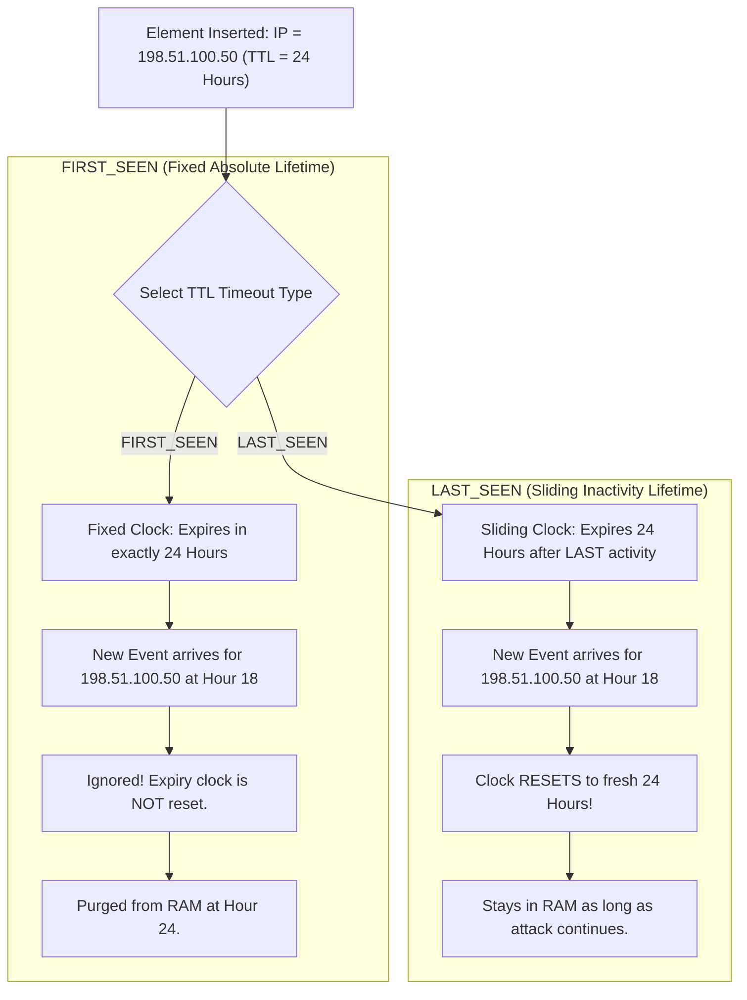
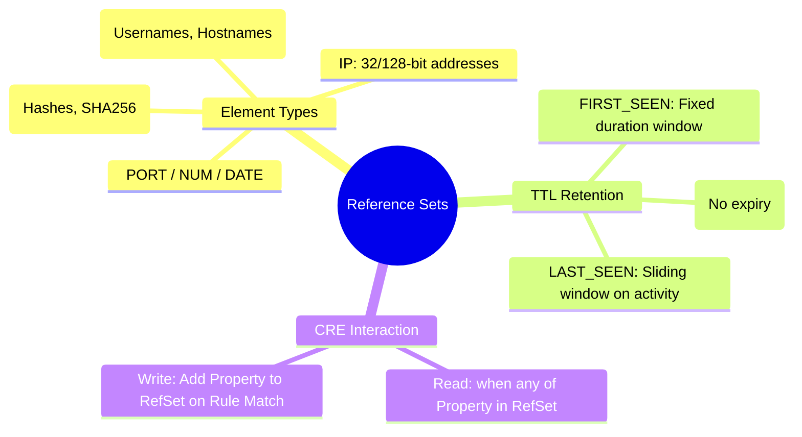

# 📖 Chapter 60: Reference Sets: TTL Dynamic Caching & Static Whitelists Masterclass

> **The IBM QRadar Administrator's Technical Guide** | Phase 6: Reference Data & Advanced Building Blocks  
> **Target Audience:** 1.5-Year Administrators $\rightarrow$ Senior SIEM Engineers & Detection Engineering Specialists  
> **Focus:** Reference Set Architecture, Element Types (ALN vs ALIC vs IP), TTL Expiration Strategies, & Hands-on Lab 60

---

## 📸 1. Visual Overview: Reference Sets & Dynamic TTL Pipeline


*Figure 60.1: 3D Visualization of Reference Set Architecture: Unique elements stored in memory with active Time-To-Live (TTL) countdown clocks, automatically purging expired indicators (`![[qradar_reference_data_collections_3d_1791646404689.jpg|1000]]`)*

---

## 2. What is a Reference Set?

A **Reference Set** is a one-dimensional collection of unique data elements stored in RAM. It behaves identically to a mathematical Set — duplicates are automatically ignored, and membership tests (`contains(element)`) execute in **$\mathcal{O}(1)$ constant time**.

```
┌────────────────────────────────────────────────────────────────────────┐
│ 🎯 THE 2 OPERATIONAL MODES OF REFERENCE SETS                           │
│                                                                        │
│ 1. STATIC WHITELISTS & INVENTORY LISTS (Permanent / No TTL)            │
│    • Contents: Corporate Subnets, Penetration Testers, Domain Admin    │
│      accounts, Authorized Vulnerability Scanner IPs.                   │
│    • Retention: Infinite (Never expires until manually deleted).       │
│ ├────────────────────────────────────────────────────────────────────┤
│ 2. DYNAMIC THREAT & STATE TRACKERS (Time-To-Live / TTL Enabled)        │
│    • Contents: Active Brute-Force Attacker IPs, Suspicious Tor Exit    │
│      Nodes, Users with active VPN sessions, High-Risk Endpoints.       │
│    • Retention: Auto-purges after $X$ seconds (e.g. 12 Hours, 7 Days). │
└────────────────────────────────────────────────────────────────────────┘
```

---

## 3. Element Types & Case Sensitivity Matrix

When defining a Reference Set, selecting the correct **Element Type** is critical for memory efficiency and matching accuracy:

| Element Type Code | Meaning | Case Sensitivity | Storage Format | Ideal Security Telemetry |
| :---: | :--- | :---: | :--- | :--- |
| **`ALN`** | Alphanumeric | **Case-Sensitive** | UTF-8 String | Cryptographic Hashes (MD5, SHA256), Base64 tokens, Exact URLs. |
| **`ALIC`** | Alphanumeric Ignore Case | **Case-Insensitive** | Lowercase Normalized String | Usernames (`JSmith` vs `jsmith`), Hostnames, Process Names (`CMD.EXE`). |
| **`IP`** | IP Address | N/A | 32-bit (IPv4) / 128-bit (IPv6) Integer | Source IPs, Destination IPs, Gateway Routers. |
| **`PORT`** | Port Number | N/A | 16-bit Unsigned Integer | Monitored Destination Ports (e.g. `22`, `445`, `3389`). |
| **`NUM`** | Number | N/A | 64-bit Signed Long | Event counts, Magnitude scores, Status codes. |
| **`DATE`** | Timestamp | N/A | Epoch Milliseconds | Creation times, Access timestamps. |

---

## 4. Time-To-Live (TTL) Expiration Strategies: `FIRST_SEEN` vs `LAST_SEEN`

QRadar provides two distinct eviction algorithms for managing dynamic data lifetimes:



| Timeout Type | When to Use | Operational Behavior |
| :--- | :--- | :--- |
| **`FIRST_SEEN`** | Fixed quarantine windows (e.g. Temporary 4-hour sandbox block). | Clock never resets on repeated hits; strictly purges at $T_0 + \text{TTL}$. |
| **`LAST_SEEN`** | Active attacker tracking & persistent brute-force mitigation. | Clock resets on every match. Attacker remains banned as long as they attack. |

---

## 5. CRE Rule Integration: Read & Write Mechanics

```
┌────────────────────────────────────────────────────────────────────────┐
│ 🔄 REFERENCE SET RULE INTEGRATION ARCHITECTURE                         │
│                                                                        │
│ 1. READING FROM A REFERENCE SET (Rule Test Condition):                 │
│    • Syntax: `when any of Source IP are contained in Malicious_IPs`    │
│    • Inverted: `AND NOT when any of Source IP are contained in Whitelist`│
│                                                                        │
│ 2. WRITING TO A REFERENCE SET (Rule Response Action):                  │
│    • Response: `Add Source IP to Reference Set: Active_Attackers`      │
│    • When the rule matches, the CRE injects the extracted property     │
│      into the Reference Set in $\mathcal{O}(1)$ time.                  │
└────────────────────────────────────────────────────────────────────────┘
```

---

## 📌 6. Visual Mind Map & Sticky Notes (Chapter 60 Quick-Review)

### 🧠 Hierarchical Mind Map


### 🗂️ Color-Coded Digital Sticky Notes

#### 🟨 Sticky Note 1: ALN vs ALIC for Hashes & Users
```text
┌─────────────────────────────────────────────────────────────┐
│ 📌 CONCEPT: HASHE TYPE MAPPING                              │
│                                                             │
│ • Always use `ALN` (case-sensitive) for MD5/SHA256 hashes!  │
│ • Always use `ALIC` (case-insensitive) for Usernames!       │
└─────────────────────────────────────────────────────────────┘
```

#### 🟩 Sticky Note 2: Use LAST_SEEN for Threat Sets
```text
┌─────────────────────────────────────────────────────────────┐
│ 📌 GOLDEN RULE: ATTACKER RETENTION                          │
│                                                             │
│ • Use `LAST_SEEN` for attacker tracking so persistent       │
│   brute-force bots stay blocked throughout the attack.      │
└─────────────────────────────────────────────────────────────┘
```

#### 🟪 Sticky Note 3: Instant Rule Response
```text
┌─────────────────────────────────────────────────────────────┐
│ 📌 ARCHITECTURE: ZERO-LATENCY ENRICHMENT                    │
│                                                             │
│ • When Rule 1 adds an IP to a RefSet, Rule 2 sees the IP in │
│   the very next event ($< 1 \text{ ms}$ latency!).          │
└─────────────────────────────────────────────────────────────┘
```

#### 🟦 Sticky Note 4: TTL in Seconds
```text
┌─────────────────────────────────────────────────────────────┐
│ 📌 SYNTAX: TIME UNITS                                       │
│                                                             │
│ • ReferenceDataCLI.sh expects TTL specified in SECONDS:     │
│   - 1 Hour = 3600                                           │
│   - 24 Hours = 86400                                        │
│   - 7 Days = 604800                                         │
└─────────────────────────────────────────────────────────────┘
```

#### 🟧 Sticky Note 5: Interview Cheat Code (Reference Sets)
```text
┌─────────────────────────────────────────────────────────────┐
│ 📌 INTERVIEW CHEAT CODE: "HOW DO REFERENCE SETS WORK?"      │
│                                                             │
│ "Reference Sets are in-memory hash sets with sub-microsecond│
│ lookups supporting ALN, ALIC, and IP data types with either │
│ permanent retention for whitelists or sliding LAST_SEEN     │
│ TTL for dynamic threat tracking."                           │
└─────────────────────────────────────────────────────────────┘
```

#### 🟥 Sticky Note 6: Critical Pitfall
```text
┌─────────────────────────────────────────────────────────────┐
│ ⚠️ CRITICAL PITFALL: WRONG ELEMENT TYPE IN CRE TESTS        │
│                                                             │
│ • If a Reference Set is created as `IP` and your rule tests │
│   a string username against it, the test ALWAYS returns     │
│   FALSE due to type mismatch!                               │
└─────────────────────────────────────────────────────────────┘
```

---

## ⚡ Rapid-Recall Flashcards

| # | Question (Front) | Answer (Back) |
| :-: | :--- | :--- |
| **01** | What is the time complexity of searching for an element inside a Reference Set? | **$\mathcal{O}(1)$** (constant time in-memory hash lookup). |
| **02** | What element type should be selected for storing file hashes (MD5 / SHA256)? | **`ALN`** (Alphanumeric, Case-Sensitive). |
| **03** | What element type should be selected for storing Active Directory usernames? | **`ALIC`** (Alphanumeric Ignore Case, Case-Insensitive). |
| **04** | What is the difference between `FIRST_SEEN` and `LAST_SEEN` TTL timeout types? | `FIRST_SEEN` expires at a fixed time after creation; `LAST_SEEN` resets the countdown timer whenever the element is re-observed. |
| **05** | How do you make a Reference Set permanent so elements never expire? | Set the TTL parameter to **`0`** (or leave empty). |
| **06** | Can a QRadar correlation rule dynamically add an IP to a Reference Set when it fires? | **Yes**, via the Rule Response "Add to Reference Set" action. |

---

## 🧪 7. Hands-on Practice Lab 60: Creating & Managing Dynamic TTL Reference Sets

### 🎯 Lab Objectives
1. Create a permanent Whitelist Reference Set using `ReferenceDataCLI.sh`.
2. Create a dynamic 24-hour TTL Threat Reference Set with `LAST_SEEN` eviction.
3. Add and delete elements via the CLI.
4. Verify element TTL countdown in PostgreSQL.

---

### 📋 Step-by-Step Practical Lab Procedures

#### Step 1: Create a Permanent IP Whitelist Reference Set
Log into the QRadar Console via SSH as `root`:
```bash
# Create a permanent IP Reference Set (TTL = 0)
/opt/qradar/bin/ReferenceDataCLI.sh create "Corp_Approved_Scanners" IP 0
```

---

#### Step 2: Create a Dynamic Threat Intel Set with 24-Hour Sliding TTL (`LAST_SEEN`)
```bash
# Create dynamic IP Reference Set with 86400s (24h) TTL and LAST_SEEN mode
/opt/qradar/bin/ReferenceDataCLI.sh create "Active_Attacker_Banned_IPs" IP 86400 LAST_SEEN
```

---

#### Step 3: Populate Elements into Both Reference Sets
```bash
# Add authorized scanner to permanent set
/opt/qradar/bin/ReferenceDataCLI.sh add "Corp_Approved_Scanners" "10.100.50.25"
/opt/qradar/bin/ReferenceDataCLI.sh add "Corp_Approved_Scanners" "10.100.50.26"

# Add active malicious attacker to dynamic set
/opt/qradar/bin/ReferenceDataCLI.sh add "Active_Attacker_Banned_IPs" "198.51.100.120"
/opt/qradar/bin/ReferenceDataCLI.sh add "Active_Attacker_Banned_IPs" "203.0.113.77"
```

---

#### Step 4: Verify Collection Elements and TTL in PostgreSQL
```bash
# Inspect elements, first_seen, and last_seen timestamps in PostgreSQL
psql -U qradar -d qradar -c "
SELECT 
    c.name AS CollectionName, 
    e.value AS StoredElement, 
    TO_TIMESTAMP(e.first_seen/1000) AS FirstSeen, 
    TO_TIMESTAMP(e.last_seen/1000) AS LastSeen 
FROM refcollection c 
JOIN refset_element e ON c.id = e.refcollection_id 
WHERE c.name IN ('Corp_Approved_Scanners', 'Active_Attacker_Banned_IPs');
"
```
