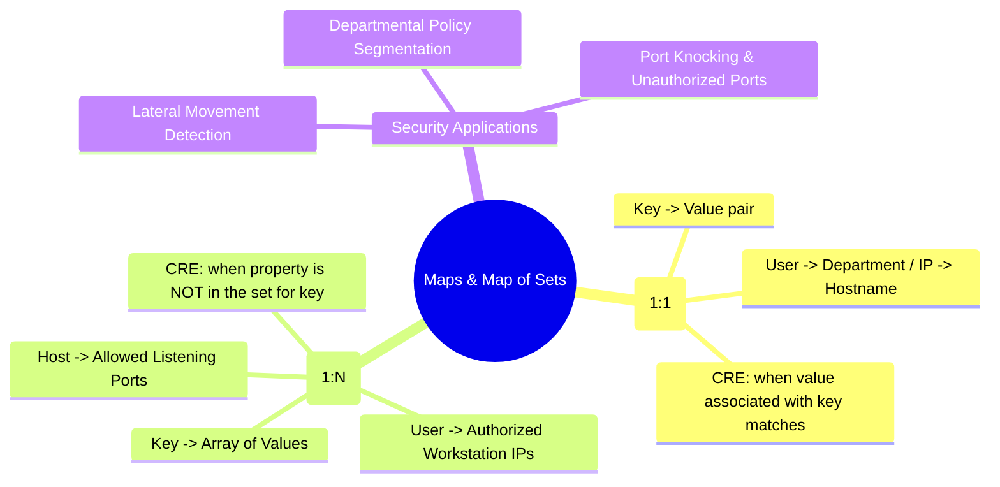

# 📖 Chapter 61: Reference Maps & Map of Sets: Key-Value & Identity Multi-Mapping Masterclass

> **The IBM QRadar Administrator's Technical Guide** | Phase 6: Reference Data & Advanced Building Blocks  
> **Target Audience:** 1.5-Year Administrators $\rightarrow$ Senior SIEM Engineers & Detection Engineering Specialists  
> **Focus:** Reference Maps (1:1 Key-Value), Reference Map of Sets (1:N Multi-Mapping), Identity Governance Rules, & Hands-on Lab 61

---

## 📸 1. Visual Overview: Key-Value & Map of Sets Data Structures


*Figure 61.1: 3D Visualization of Reference Maps (1:1 Key-Value lookup) and Reference Map of Sets (1:N Array lookup) providing in-memory identity enrichment and authorized workstation validation (`![[qradar_reference_data_collections_3d_1791646404689.jpg|1000]]`)*

---

## 2. Reference Maps vs Reference Map of Sets

While Reference Sets store flat lists of items, enterprise identity governance and asset tracking require **relational mapping**:

```
┌────────────────────────────────────────────────────────────────────────┐
│ 🗺️ REFERENCE MAP VS REFERENCE MAP OF SETS                              │
│                                                                        │
│ 1. REFERENCE MAP (1-to-1 Key-Value Pair)                               │
│    • Structure: `Key -> Value`                                         │
│    • Example: `jsmith -> Finance` (Username -> Department)             │
│    • Example: `10.100.1.50 -> dc-01.corp.local` (IP -> Hostname)       │
│    • Evaluation: Look up the Value associated with a Key in RAM.       │
│ ├────────────────────────────────────────────────────────────────────┤
│ 2. REFERENCE MAP OF SETS (1-to-Many Key-to-Set Mapping)                │
│    • Structure: `Key -> {Value_1, Value_2, Value_3, ...}`              │
│    • Example: `jsmith -> {10.10.1.15, 10.10.1.16}` (User -> Allowed PCs)│
│    • Example: `srv-app-01 -> {80, 443, 8080}` (Server -> Allowed Ports)│
│    • Evaluation: Check if a property is contained in the Key's Set.    │
└────────────────────────────────────────────────────────────────────────┘
```

---

## 3. Production Security Use Case 1: Departmental Access Violation via Reference Map

```mermaid
flowchart TD
    EVT["Event: Logon to PCI Database Server (10.200.1.10) by User 'jdoe'"] --> MAP_LOOKUP["Reference Map Lookup: 'User_Departments'"]
    
    MAP_LOOKUP --> RETRIEVE["Retrieve Department for Key 'jdoe' -> 'Marketing'"]
    
    RETRIEVE --> RULE_CHECK{"Is Department == 'Finance' or 'DBA'?"}
    
    RULE_CHECK -->|No (Marketing != Finance)| ALERT["Trigger Offense: Unauthorized Departmental Access to PCI Database (Mag 8)"]
    RULE_CHECK -->|Yes| ALLOW["Normal Authorized Operation"]
```

---

## 4. Production Security Use Case 2: Unauthorized Workstation Logon via Map of Sets

In high-security environments, employees are restricted to logging into specific approved workstations. An adversary moving laterally using stolen credentials will log into unauthorized endpoints:

```
┌────────────────────────────────────────────────────────────────────────┐
│ 📋 RULE SPECIFICATION: UBA: User Logged into Unauthorized Endpoint     │
│                                                                        │
│ 🔍 RULE TEST CONDITIONS:                                               │
│    • Apply "UBA: User Logged into Unauthorized Endpoint" on events     │
│    • and when the event matches BB:CategoryDefinition: Success Logons  │
│    • and when "Username" is a key in Map of Sets: "User_Authorized_PCs"│
│    • AND NOT when "Destination IP" is in the Set for "Username" in     │
│      "User_Authorized_PCs"                                             │
│                                                                        │
│ ⚙️ RULE ACTIONS:                                                       │
│    • Ensure detected event is part of an OFFENSE                       │
│    • Index Offense by: Username                                        │
│    • Set Severity to: 8, Credibility to: 8, Relevance to: 9            │
│    • Annotate: "Lateral Movement: Account logged into unassigned host" │
└────────────────────────────────────────────────────────────────────────┘
```

---

## 5. CLI & REST API Syntax for Maps and Map of Sets

| Operation | Reference Map CLI Command | Reference Map of Sets CLI Command |
| :--- | :--- | :--- |
| **Create Collection** | `/opt/qradar/bin/ReferenceDataCLI.sh create "User_Dept_Map" MAP ALIC ALIC` | `/opt/qradar/bin/ReferenceDataCLI.sh create "User_Allowed_IPs" MAP_OF_SETS ALIC IP` |
| **Insert / Update Item** | `/opt/qradar/bin/ReferenceDataCLI.sh add "User_Dept_Map" "jsmith" "Finance"` | `/opt/qradar/bin/ReferenceDataCLI.sh add "User_Allowed_IPs" "jsmith" "10.10.1.50"` |
| **Query Value** | `/opt/qradar/bin/ReferenceDataCLI.sh get "User_Dept_Map" "jsmith"` | `/opt/qradar/bin/ReferenceDataCLI.sh get "User_Allowed_IPs" "jsmith"` |
| **Delete Item** | `/opt/qradar/bin/ReferenceDataCLI.sh delete "User_Dept_Map" "jsmith"` | `/opt/qradar/bin/ReferenceDataCLI.sh delete "User_Allowed_IPs" "jsmith" "10.10.1.50"` |

---

## 📌 6. Visual Mind Map & Sticky Notes (Chapter 61 Quick-Review)

### 🧠 Hierarchical Mind Map


### 🗂️ Color-Coded Digital Sticky Notes

#### 🟨 Sticky Note 1: 1:1 vs 1:N Structure
```text
┌─────────────────────────────────────────────────────────────┐
│ 📌 CONCEPT: MAPPING CARDINALITY                             │
│                                                             │
│ • Map = 1 key maps to exactly 1 value (User $\rightarrow$ Dept)│
│ • Map of Sets = 1 key maps to multiple values (User $\rightarrow$ IPs)│
└─────────────────────────────────────────────────────────────┘
```

#### 🟩 Sticky Note 2: Detecting Lateral Movement
```text
┌─────────────────────────────────────────────────────────────┐
│ 📌 GOLDEN RULE: LATERAL MOVEMENT DETECTION                  │
│                                                             │
│ • Use Reference Map of Sets to detect when compromised user │
│   credentials log into an unassigned workstation!           │
└─────────────────────────────────────────────────────────────┘
```

#### 🟪 Sticky Note 3: Specifying Key & Value Types
```text
┌─────────────────────────────────────────────────────────────┐
│ 📌 SYNTAX: DUAL TYPE DECLARATION                            │
│                                                             │
│ • When creating a Map, specify BOTH the Key Type and Value  │
│   Type (e.g. `ALIC IP`).                                    │
└─────────────────────────────────────────────────────────────┘
```

#### 🟦 Sticky Note 4: AQL Map Extraction
```text
┌─────────────────────────────────────────────────────────────┐
│ 📌 AQL: IN-QUERY MAP LOOKUP                                 │
│                                                             │
│ • Query values directly in AQL:                             │
│   `SELECT REFERENCEMAP('User_Dept_Map', username) FROM ...` │
└─────────────────────────────────────────────────────────────┘
```

#### 🟧 Sticky Note 5: Interview Cheat Code (Map of Sets)
```text
┌─────────────────────────────────────────────────────────────┐
│ 📌 INTERVIEW CHEAT CODE: "HOW DO YOU DETECT ABNORMAL LOGONS?"│
│                                                             │
│ "In QRadar, I maintain an in-memory Reference Map of Sets of│
│ authorized workstations per user, triggering an offense when│
│ a successful logon destination IP is NOT in the user's set."│
└─────────────────────────────────────────────────────────────┘
```

#### 🟥 Sticky Note 6: Critical Pitfall
```text
┌─────────────────────────────────────────────────────────────┐
│ ⚠️ CRITICAL PITFALL: MISSING KEY CHECK BEFORE NEGATION      │
│                                                             │
│ • When writing "NOT in Set", ALWAYS verify the Key exists   │
│   first! Otherwise new users not yet in the map will trigger│
│   false positive alerts on every single logon!              │
└─────────────────────────────────────────────────────────────┘
```

---

## ⚡ Rapid-Recall Flashcards

| # | Question (Front) | Answer (Back) |
| :-: | :--- | :--- |
| **01** | What data structure maps a single key to a single value in QRadar? | A **Reference Map** (1:1). |
| **02** | What data structure maps a single key to multiple values in QRadar? | A **Reference Map of Sets** (1:N). |
| **03** | How is a Reference Map of Sets used to detect lateral movement? | By alerting when a user authenticates to a destination IP that is **NOT** in their authorized workstation set. |
| **04** | What AQL function retrieves a value from a Reference Map inside a query? | **`REFERENCEMAP('MapName', key_property)`**. |
| **05** | What happens if you add a duplicate value to a key's array in a Reference Map of Sets? | The duplicate is **ignored** because the inner container is a mathematical Set. |
| **06** | Why must you verify that a key exists in a Map of Sets before evaluating an `AND NOT` test? | To prevent newly created users (who have no entry in the map) from triggering false alarms on every logon. |

---

## 🧪 7. Hands-on Practice Lab 61: Building Identity Governance Maps & AQL Lookups

### 🎯 Lab Objectives
1. Create a Reference Map for User Departments via CLI.
2. Create a Reference Map of Sets for User Authorized Workstations.
3. Populate test entries and verify lookups.
4. Execute AQL queries using `REFERENCEMAP` and `REFERENCEMAPOFSETS`.

---

### 📋 Step-by-Step Practical Lab Procedures

#### Step 1: Create the Reference Map and Map of Sets
Log into the QRadar Console via SSH as `root`:
```bash
# 1. Create Reference Map: Username -> Department (Key: ALIC, Value: ALIC)
/opt/qradar/bin/ReferenceDataCLI.sh create "User_Department_Map" MAP ALIC ALIC

# 2. Create Reference Map of Sets: Username -> Allowed IPs (Key: ALIC, Value: IP)
/opt/qradar/bin/ReferenceDataCLI.sh create "User_Allowed_Workstations" MAP_OF_SETS ALIC IP
```

---

#### Step 2: Populate Data Entries into Both Collections
```bash
# Populate Department Map
/opt/qradar/bin/ReferenceDataCLI.sh add "User_Department_Map" "jdoe" "Finance"
/opt/qradar/bin/ReferenceDataCLI.sh add "User_Department_Map" "asmith" "Engineering"

# Populate Allowed Workstations for jdoe
/opt/qradar/bin/ReferenceDataCLI.sh add "User_Allowed_Workstations" "jdoe" "10.100.4.15"
/opt/qradar/bin/ReferenceDataCLI.sh add "User_Allowed_Workstations" "jdoe" "10.100.4.16"
```

---

#### Step 3: Query Elements via CLI
```bash
# Query department for jdoe
/opt/qradar/bin/ReferenceDataCLI.sh get "User_Department_Map" "jdoe"

# Query allowed IP list for jdoe
/opt/qradar/bin/ReferenceDataCLI.sh get "User_Allowed_Workstations" "jdoe"
```

---

#### Step 4: Perform Real-Time In-Query Enrichment via AQL
```bash
/opt/qradar/bin/arielsql -p 32011 -q "
SELECT 
    DATEFORMAT(starttime, 'HH:mm:ss') AS Time, 
    username AS User, 
    sourceip AS SourceIP, 
    REFERENCEMAP('User_Department_Map', username) AS Department 
FROM events 
WHERE username IS NOT NULL 
LAST 2 HOURS 
ORDER BY starttime DESC 
LIMIT 10;
"
```
