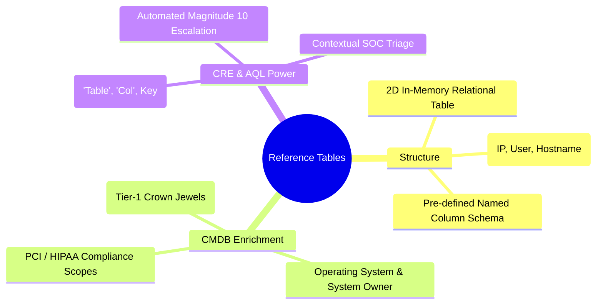

# 📖 Chapter 62: Reference Tables & Map of Maps: Multi-Column CMDB & Matrix Lookups Masterclass

> **The IBM QRadar Administrator's Technical Guide** | Phase 6: Reference Data & Advanced Building Blocks  
> **Target Audience:** 1.5-Year Administrators $\rightarrow$ Senior SIEM Engineers & Detection Engineering Specialists  
> **Focus:** Reference Tables (Multi-Column CMDB Enrichment), Reference Map of Maps (2-Tier Matrices), Dynamic Relevance Boosting, & Hands-on Lab 62

---

## 📸 1. Visual Overview: Multi-Column Reference Table Architecture


*Figure 62.1: 3D Visualization of Reference Tables: In-memory multi-column relational tables indexing Asset IP addresses to Crown-Jewel Criticality, Operating System, System Owner, and Compliance Scope for instant CRE rule evaluation (`![[qradar_reference_data_collections_3d_1791646404689.jpg|1000]]`)*

---

## 2. What is a Reference Table?

A **Reference Table** is a two-dimensional, multi-column in-memory relational table stored within the Java heap of `ecs-ep`. It allows enterprise security teams to import their complete Configuration Management Database (CMDB) into QRadar to enrich security events with business criticality, server roles, system owners, and compliance scope in microsecond real time:

```
┌────────────────────────────────────────────────────────────────────────┐
│ 📊 STRUCTURE OF AN IN-MEMORY REFERENCE TABLE: `CMDB_Asset_Inventory`   │
│                                                                        │
│ 🔑 PRIMARY KEY (IP) │ 🏷️ OS_Type │ 👑 Criticality │ 👤 Owner │ 🛡️ PCI │
│ ────────────────────┼────────────┼────────────────┼──────────┼────────┤
│ `10.100.1.10`       │ Windows    │ Tier-1-Crown   │ SecOps   │ TRUE   │
│ `10.100.1.50`       │ Linux RHEL │ Tier-1-Crown   │ DBA-Team │ TRUE   │
│ `10.200.4.88`       │ Ubuntu     │ Tier-3-Dev     │ Dev-Team │ FALSE  │
│ `192.168.10.15`     │ Win11 Work │ Tier-4-EndUser │ Helpdesk │ FALSE  │
└────────────────────────────────────────────────────────────────────────┘
```

---

## 3. Reference Tables vs Reference Map of Maps

| Feature | Reference Table | Reference Map of Maps |
| :--- | :--- | :--- |
| **Structure** | Primary Key $\rightarrow$ Pre-defined Named Columns $\rightarrow$ Value | Outer Key $\rightarrow$ Dynamic Inner Key $\rightarrow$ Value |
| **Schema** | Fixed column schema declared at creation time. | Dynamic key-value pairs per outer entry. |
| **Ideal Use Case** | **CMDB Asset Inventory**, Vulnerability Context, User Identity Records. | **Role-Based Access Matrices**, Firewall Port-to-Service mappings. |
| **AQL Function** | `REFERENCETABLE('Table', 'Column', Key)` | `REFERENCEMAPOFMAPS('MapOfMaps', OuterKey, InnerKey)` |

---

## 4. CRE Rule Integration: Dynamic Relevance & Severity Boosting

Using Reference Tables, detection engineers can write highly targeted rules that automatically escalate Offense Magnitude based on real-time CMDB data:

```mermaid
flowchart TD
    EVT["Event: Suspicious SSH Brute Force or Exploit Target (10.100.1.50)"] --> TABLE_LOOKUP["Reference Table Lookup: 'CMDB_Asset_Inventory'"]
    
    TABLE_LOOKUP --> GET_TIER["Extract Column: 'Criticality' for Key '10.100.1.50'"]
    GET_TIER --> CHECK{"Is Criticality == 'Tier-1-Crown'?"}
    
    CHECK -->|Yes| ESCALATE["Rule Action:<br/>- Override Relevance: 10<br/>- Override Severity: 10<br/>- Final Offense Magnitude: 10 (CRITICAL P1)"]
    CHECK -->|No (Tier-3 / Dev)| STANDARD["Rule Action:<br/>- Standard Severity: 4<br/>- Final Offense Magnitude: 4 (Operational)"]
```

---

## 5. CLI & CSV Import Architecture for Reference Tables

Enterprise CMDBs (ServiceNow, Jira Assets) are synchronized into QRadar via automated CSV imports or REST API endpoints:

```bash
# 1. Create a Reference Table with declared column names & element types
/opt/qradar/bin/ReferenceDataCLI.sh createTable "CMDB_Asset_Inventory" IP \
"OS_Type:ALIC,Criticality:ALIC,Owner:ALIC,PCI_Scope:ALIC"

# 2. Add an individual row record
/opt/qradar/bin/ReferenceDataCLI.sh addRow "CMDB_Asset_Inventory" "10.100.1.50" \
"OS_Type=Linux RHEL,Criticality=Tier-1-Crown,Owner=DBA-Team,PCI_Scope=TRUE"

# 3. Query a specific column value for an IP
/opt/qradar/bin/ReferenceDataCLI.sh getTableCell "CMDB_Asset_Inventory" "10.100.1.50" "Criticality"
```

---

## 📌 6. Visual Mind Map & Sticky Notes (Chapter 62 Quick-Review)

### 🧠 Hierarchical Mind Map


### 🗂️ Color-Coded Digital Sticky Notes

#### 🟨 Sticky Note 1: In-Memory CMDB
```text
┌─────────────────────────────────────────────────────────────┐
│ 📌 CONCEPT: RAM-BASED ASSET INVENTORY                       │
│                                                             │
│ • Storing your CMDB in a Reference Table gives CRE instant  │
│   access to server ownership, OS, and criticality!          │
└─────────────────────────────────────────────────────────────┘
```

#### 🟩 Sticky Note 2: Dynamic Magnitude Escalation
```text
┌─────────────────────────────────────────────────────────────┐
│ 📌 GOLDEN RULE: ESCALATE ON CROWN JEWELS                    │
│                                                             │
│ • When `Criticality == Tier-1-Crown`, immediately set       │
│   Relevance to 10 to ensure P1 SOC alert generation.        │
└─────────────────────────────────────────────────────────────┘
```

#### 🟪 Sticky Note 3: Column Schema Declaration
```text
┌─────────────────────────────────────────────────────────────┐
│ 📌 SYNTAX: PRE-DEFINED COLUMNS                              │
│                                                             │
│ • Reference Tables require all column names and types to be │
│   defined during the initial `createTable` call.            │
└─────────────────────────────────────────────────────────────┘
```

#### 🟦 Sticky Note 4: AQL Table Lookups
```text
┌─────────────────────────────────────────────────────────────┐
│ 📌 AQL: DIRECT COLUMN EXTRACTION                            │
│                                                             │
│ • `SELECT REFERENCETABLE('CMDB', 'Owner', destinationip)    │
│   AS AssetOwner FROM events`                                │
└─────────────────────────────────────────────────────────────┘
```

#### 🟧 Sticky Note 5: Interview Cheat Code (Reference Tables)
```text
┌─────────────────────────────────────────────────────────────┐
│ 📌 INTERVIEW CHEAT CODE: "HOW DO YOU ENRICH EVENTS WITH CMDB?"│
│                                                             │
│ "In QRadar, I import the CMDB into an in-memory Reference   │
│ Table indexed by IP address. The CRE engine and AQL queries │
│ extract asset criticality and ownership in microsecond time │
│ to dynamically escalate offense magnitude for Crown Jewels."│
└─────────────────────────────────────────────────────────────┘
```

#### 🟥 Sticky Note 6: Critical Pitfall
```text
┌─────────────────────────────────────────────────────────────┐
│ ⚠️ CRITICAL PITFALL: CASE-SENSITIVE COLUMN NAMES            │
│                                                             │
│ • Column names in `REFERENCETABLE` lookups are strictly     │
│   case-sensitive! Querying `'criticality'` instead of       │
│   `'Criticality'` returns NULL without an error message!    │
└─────────────────────────────────────────────────────────────┘
```

---

## ⚡ Rapid-Recall Flashcards

| # | Question (Front) | Answer (Back) |
| :-: | :--- | :--- |
| **01** | What data structure provides a 2-dimensional multi-column in-memory table in QRadar? | A **Reference Table**. |
| **02** | What is the primary enterprise use case for Reference Tables? | **CMDB Asset Inventory Enrichment** (storing OS type, System Owner, Business Criticality, and Compliance Scope). |
| **03** | What AQL function retrieves a specific column value from a Reference Table? | **`REFERENCETABLE('TableName', 'ColumnName', key_property)`**. |
| **04** | How can Reference Tables be used to prioritize incident triage? | By checking if the destination asset has `Criticality == 'Tier-1'` and boosting the Offense Magnitude to 10. |
| **05** | What is the difference between a Reference Table and a Reference Map of Maps? | Reference Tables have a fixed pre-defined column schema; Map of Maps supports dynamic nested key-value pairs. |
| **06** | Are column names in Reference Table lookups case-sensitive? | **Yes**, column names are strictly case-sensitive. |

---

## 🧪 7. Hands-on Practice Lab 62: Building a CMDB Reference Table & AQL Threat Enrichment

### 🎯 Lab Objectives
1. Create a multi-column CMDB Asset Reference Table via CLI.
2. Populate production server records with ownership and criticality metadata.
3. Query table cells and rows via `ReferenceDataCLI.sh`.
4. Run an AQL query that enriches live security events with CMDB attributes.

---

### 📋 Step-by-Step Practical Lab Procedures

#### Step 1: Create the CMDB Reference Table via CLI
Log into the QRadar Console via SSH as `root`:
```bash
/opt/qradar/bin/ReferenceDataCLI.sh createTable "CMDB_Asset_Inventory" IP \
"OS_Type:ALIC,Criticality:ALIC,Owner:ALIC,Compliance_Scope:ALIC"
```

---

#### Step 2: Populate Production Server Records
```bash
# Populate Domain Controller Record
/opt/qradar/bin/ReferenceDataCLI.sh addRow "CMDB_Asset_Inventory" "10.100.1.10" \
"OS_Type=Windows Server 2022,Criticality=Tier-1-Crown,Owner=Identity-Team,Compliance_Scope=PCI-SOX"

# Populate Core Database Server Record
/opt/qradar/bin/ReferenceDataCLI.sh addRow "CMDB_Asset_Inventory" "10.100.1.50" \
"OS_Type=Oracle Linux 8,Criticality=Tier-1-Crown,Owner=DBA-Team,Compliance_Scope=PCI-DSS"

# Populate Development App Server Record
/opt/qradar/bin/ReferenceDataCLI.sh addRow "CMDB_Asset_Inventory" "10.200.4.88" \
"OS_Type=Ubuntu 22.04,Criticality=Tier-3-Dev,Owner=DevOps-Team,Compliance_Scope=None"
```

---

#### Step 3: Query Table Rows and Specific Columns via CLI
```bash
# Query entire row for Database Server
/opt/qradar/bin/ReferenceDataCLI.sh getTableRow "CMDB_Asset_Inventory" "10.100.1.50"

# Query specific column (Criticality)
/opt/qradar/bin/ReferenceDataCLI.sh getTableCell "CMDB_Asset_Inventory" "10.100.1.50" "Criticality"
```

---

#### Step 4: Perform Real-Time Event Enrichment via AQL
```bash
/opt/qradar/bin/arielsql -p 32011 -q "
SELECT 
    DATEFORMAT(starttime, 'HH:mm:ss') AS EventTime, 
    sourceip AS AttackerIP, 
    destinationip AS TargetAsset, 
    REFERENCETABLE('CMDB_Asset_Inventory', 'Criticality', destinationip) AS AssetTier, 
    REFERENCETABLE('CMDB_Asset_Inventory', 'Owner', destinationip) AS AssetOwner, 
    qidname(qid) AS EventName 
FROM events 
WHERE destinationip IS NOT NULL 
LAST 2 HOURS 
ORDER BY starttime DESC 
LIMIT 10;
"
```
