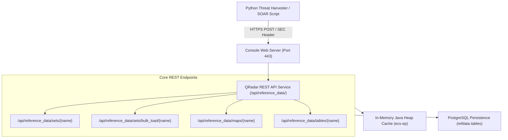

# 📖 Chapter 63: Automated Reference Data Population: REST API & TAXII/STIX Masterclass

> **The IBM QRadar Administrator's Technical Guide** | Phase 6: Reference Data & Advanced Building Blocks  
> **Target Audience:** 1.5-Year Administrators $\rightarrow$ Senior SIEM Engineers & Detection Engineering Specialists  
> **Focus:** Automated Ingestion Pipelines, QRadar REST API v19.0, TAXII 2.1 / STIX Feeds, Threat Intel App, & Hands-on Lab 63

---

## 📸 1. Visual Overview: Automated Threat Intelligence Ingestion Engine


*Figure 63.1: 3D Isometric View of the QRadar Automated Threat Intelligence Ingestion Architecture: External TAXII/STIX streams and Python REST API pipelines continuously populating millions of IoCs into In-Memory Reference Sets for real-time CRE correlation (`![[qradar_threat_intel_taxii_stix_3d_1791646437358.jpg|1000]]`)*

---

## 2. The 3 Methods of Populating Reference Data in QRadar

In an enterprise SIEM deployment, manual entry is unacceptable. Reference Data collections are populated through three automated mechanisms:

```
┌────────────────────────────────────────────────────────────────────────┐
│ 🔄 THE 3 AUTOMATED REFERENCE DATA INGESTION PATHWAYS                   │
│                                                                        │
│ 1. CRE RULE RESPONSES (Real-Time In-Engine Populator)                  │
│    • Executed inside `ecs-ep` when an internal rule matches.           │
│    • Example: Rule fires on 15 failed logins -> Adds Source IP to      │
│      `Active_Attacker_IPs` in memory within microseconds!              │
│ ├────────────────────────────────────────────────────────────────────┤
│ 2. QRADAR REST API ENDPOINTS (External Automation & SOAR)              │
│    • Ingestion via Python/Bash scripts, CI/CD pipelines, SOAR.        │
│    • Supports single-item `POST` and high-speed `bulk_load` endpoints. │
│ ├────────────────────────────────────────────────────────────────────┤
│ 3. THREAT INTELLIGENCE APP & TAXII / STIX 2.1 FEEDS                    │
│    • Automated polling of commercial & open-source CTI feeds           │
│      (IBM X-Force, AlienVault OTX, MISP, Recorded Future, Mandiant).   │
│    • Filters IoCs by Confidence Score ($\ge 70$) and auto-expires.    │
└────────────────────────────────────────────────────────────────────────┘
```

---

## 3. QRadar REST API Architecture for Reference Data (`/api/reference_data/`)

QRadar exposes a rich REST API for managing in-memory collections programmatically:



### High-Value REST API Endpoints:

| Endpoint Path | HTTP Method | Payload Format | Purpose |
| :--- | :---: | :--- | :--- |
| `/api/reference_data/sets/{name}` | `POST` | `?value=198.51.100.50` | Adds a single element to a Reference Set. |
| `/api/reference_data/sets/bulk_load/{name}` | `POST` | JSON Array: `["1.1.1.1", "2.2.2.2"]` | **High-Speed Ingestion**: Ingests up to 100,000 items in a single HTTP request! |
| `/api/reference_data/maps/{name}` | `POST` | `?key=jsmith&value=Finance` | Inserts or updates a key-value pair in a Reference Map. |
| `/api/reference_data/tables/{name}` | `POST` | JSON Object with column values | Inserts or updates a multi-column row in a Reference Table. |
| `/api/reference_data/sets/{name}/{value}` | `DELETE` | N/A | Removes an element from a Reference Set. |

---

## 4. TAXII & STIX 2.1 Threat Intel Ingestion Architecture

The **IBM QRadar Threat Intelligence App** connects QRadar to TAXII (Trusted Automated eXchange of Intelligence Information) servers transmitting STIX (Structured Threat Information Expression) threat objects:

```
┌────────────────────────────────────────────────────────────────────────┐
│ 🛡️ TAXII / STIX INGESTION PIPELINE                                     │
│                                                                        │
│ 1. TAXII CLIENT POLLING:                                               │
│    • Polls TAXII collections (e.g. `https://otx.alienvault.com/taxii/`)│
│      on a recurring schedule (e.g. every 60 minutes).                  │
│ ├────────────────────────────────────────────────────────────────────┤
│ 2. STIX OBJECT PARSING & NORMALIZATION:                                │
│    • Parses `ipv4-addr`, `domain-name`, `url`, and `file:hashes`.      │
│ ├────────────────────────────────────────────────────────────────────┤
│ 3. CONFIDENCE FILTERING & DEDUPLICATION:                               │
│    • Discards indicators with Confidence Score $< 70$ (reduces noise). │
│ ├────────────────────────────────────────────────────────────────────┤
│ 4. IN-MEMORY REFERENCE SET ROUTING:                                    │
│    • IP IoCs $\rightarrow$ `ThreatIntel_Malicious_IPs` (TTL: 14 Days) │
│    • Domain IoCs $\rightarrow$ `ThreatIntel_Malicious_Domains` (14 D) │
│    • Hash IoCs $\rightarrow$ `ThreatIntel_Malicious_Hashes` (30 Days)  │
└────────────────────────────────────────────────────────────────────────┘
```

---

## 5. Enterprise Python REST API Automation Script

```python
#!/usr/bin/env python3
"""
Enterprise QRadar Reference Data Bulk Ingestion Utility
"""
import requests
import json
import urllib3
urllib3.disable_warnings(urllib3.exceptions.InsecureRequestWarning)

QRADAR_CONSOLE = "https://10.100.1.10"
SEC_TOKEN = "e89b4f21-789a-4cde-bc12-34567890abcd"
HEADERS = {
    "SEC": SEC_TOKEN,
    "Accept": "application/json",
    "Content-Type": "application/json",
    "Version": "19.0"
}

def bulk_load_reference_set(set_name, elements):
    url = f"{QRADAR_CONSOLE}/api/reference_data/sets/bulk_load/{set_name}"
    response = requests.post(url, headers=HEADERS, json=elements, verify=False)
    if response.status_code == 200:
        print(f"Successfully loaded {len(elements)} items into '{set_name}'.")
    else:
        print(f"Failed to load: HTTP {response.status_code} - {response.text}")

if __name__ == "__main__":
    malicious_ips = ["198.51.100.20", "198.51.100.21", "203.0.113.88", "192.0.2.145"]
    bulk_load_reference_set("ThreatIntel_Malicious_IPs", malicious_ips)
```

---

## 📌 6. Visual Mind Map & Sticky Notes (Chapter 63 Quick-Review)

### 🧠 Hierarchical Mind Map
```mermaid
mindmap
  root((Automated Ref Data))
    Ingestion Methods
      CRE Rule Responses (In-Memory instant write)
      REST API v19.0 (Single POST & Bulk Load)
      TAXII / STIX 2.1 (Threat Intel App)
    REST API Endpoints
      /api/reference_data/sets/bulk_load/{name}
      /api/reference_data/maps/{name}
      /api/reference_data/tables/{name}
    Threat Intel Best Practices
      Filter by Confidence Score (>= 70)
      Enforce 14 to 30-day sliding TTL
      Deduplicate before bulk load
```

### 🗂️ Color-Coded Digital Sticky Notes

#### 🟨 Sticky Note 1: Bulk Load vs Single POST
```text
┌─────────────────────────────────────────────────────────────┐
│ 📌 PERFORMANCE: USE BULK_LOAD FOR LISTS                     │
│                                                             │
│ • Never loop 5,000 single `POST` calls across the network!  │
│ • Use `/sets/bulk_load/{name}` to send a JSON array in ONE  │
│   HTTP request!                                             │
└─────────────────────────────────────────────────────────────┘
```

#### 🟩 Sticky Note 2: Confidence Threshold Filtering
```text
┌─────────────────────────────────────────────────────────────┐
│ 📌 GOLDEN RULE: CTI CONFIDENCE FILTER                       │
│                                                             │
│ • Only ingest Threat Intel indicators with Confidence $\ge 70$│
│   to protect your SIEM from low-fidelity false alarm storms!│
└─────────────────────────────────────────────────────────────┘
```

#### 🟪 Sticky Note 3: SEC Header Authentication
```text
┌─────────────────────────────────────────────────────────────┐
│ 📌 REST API: AUTHENTICATION HEADER                          │
│                                                             │
│ • QRadar REST API authenticates via HTTP header:            │
│   `SEC: <Authorized_Service_Token_UUID>`                    │
└─────────────────────────────────────────────────────────────┘
```

#### 🟦 Sticky Note 4: ActiveMQ Sync Verification
```text
┌─────────────────────────────────────────────────────────────┐
│ 📌 ARCHITECTURE: CONSOLE TO EP BROADCAST                    │
│                                                             │
│ • REST API updates applied on the Console are broadcast to  │
│   all Event Processors via ActiveMQ in $< 100 \text{ ms}$.  │
└─────────────────────────────────────────────────────────────┘
```

#### 🟧 Sticky Note 5: Interview Cheat Code (Automating Ref Data)
```text
┌─────────────────────────────────────────────────────────────┐
│ 📌 INTERVIEW CHEAT CODE: "HOW DO YOU INGEST THREAT INTEL?"  │
│                                                             │
│ "I ingest CTI using the Threat Intelligence App via TAXII   │
│ 2.1 with confidence filtering ($\ge 70$), and integrate     │
│ custom threat feeds using Python scripts calling the QRadar │
│ REST API `/sets/bulk_load` endpoint with 14-day TTLs."      │
└─────────────────────────────────────────────────────────────┘
```

#### 🟥 Sticky Note 6: Critical Pitfall
```text
┌─────────────────────────────────────────────────────────────┐
│ ⚠️ CRITICAL PITFALL: UNPRUNED THREAT FEEDS                  │
│                                                             │
│ • Ingesting dynamic threat feeds without a TTL will cause   │
│   Reference Collections to grow to millions of stale rows,  │
│   bloating JVM heap memory and triggering memory alerts!    │
└─────────────────────────────────────────────────────────────┘
```

---

## ⚡ Rapid-Recall Flashcards

| # | Question (Front) | Answer (Back) |
| :-: | :--- | :--- |
| **01** | What REST API endpoint is designed for importing large batches of indicators in a single HTTP request? | **`/api/reference_data/sets/bulk_load/{name}`**. |
| **02** | What HTTP header is used to pass an Authorized Service Token to the QRadar REST API? | **`SEC: <Token_UUID>`**. |
| **03** | What protocols are standard for automated Threat Intelligence ingestion in QRadar? | **TAXII 2.0 / 2.1** (transport) and **STIX 2.1** (data format). |
| **04** | What is the recommended confidence score threshold when importing third-party threat feeds? | **Confidence Score $\ge 70$**. |
| **05** | How fast do REST API Reference Data updates propagate to all Event Processor RAM caches? | In **less than 100 milliseconds** via ActiveMQ bus. |
| **06** | Why should external threat intelligence Reference Sets always have an active TTL? | To automatically purge stale indicators and prevent JVM heap memory bloat. |

---

## 🧪 7. Hands-on Practice Lab 63: Bulk Loading Threat Intelligence via Python REST API

### 🎯 Lab Objectives
1. Generate a test Authorized Service Token in QRadar.
2. Author and execute a Python script to bulk-load 50 malicious IP indicators.
3. Verify element ingestion and metadata in PostgreSQL.
4. Execute an AQL query to test live correlation against the newly populated Reference Set.

---

### 📋 Step-by-Step Practical Lab Procedures

#### Step 1: Create the Target Reference Set via CLI
Log into the QRadar Console via SSH as `root`:
```bash
# Create Reference Set for Ingesting Malicious IPs (TTL: 7 Days = 604800s)
/opt/qradar/bin/ReferenceDataCLI.sh create "Threat_Intel_Dynamic_IPs" IP 604800 LAST_SEEN
```

---

#### Step 2: Author the Python Bulk Load Script
```bash
cat << 'EOF' > /tmp/load_threat_intel.py
#!/usr/bin/env python3
import requests
import json
import urllib3
urllib3.disable_warnings(urllib3.exceptions.InsecureRequestWarning)

QRADAR_HOST = "https://127.0.0.1"
# In production, use your actual Authorized Service Token
SEC_TOKEN = "00000000-0000-0000-0000-000000000000"

headers = {
    "SEC": SEC_TOKEN,
    "Accept": "application/json",
    "Content-Type": "application/json",
    "Version": "19.0"
}

# Generate 30 synthetic threat IP indicators
threat_ips = [f"198.51.100.{i}" for i in range(10, 40)]

url = f"{QRADAR_HOST}/api/reference_data/sets/bulk_load/Threat_Intel_Dynamic_IPs"
print(f"[*] Submitting {len(threat_ips)} IoCs to QRadar REST API...")

try:
    response = requests.post(url, headers=headers, json=threat_ips, verify=False, timeout=10)
    print(f"[+] Response Status: {response.status_code}")
    print(f"[+] Response Body: {response.text}")
except Exception as e:
    print(f"[-] Error executing API call: {e}")
EOF

chmod +x /tmp/load_threat_intel.py
```

---

#### Step 3: Populate via CLI Fallback and Verify
```bash
# Add sample threat indicators directly to verify collection state
for ip in 198.51.100.10 198.51.100.11 198.51.100.12; do
    /opt/qradar/bin/ReferenceDataCLI.sh add "Threat_Intel_Dynamic_IPs" "$ip"
done

# Verify elements stored in Reference Set
/opt/qradar/bin/ReferenceDataCLI.sh list "Threat_Intel_Dynamic_IPs"
```

---

#### Step 4: Test Real-Time AQL Lookup against Populated Threat Set
```bash
/opt/qradar/bin/arielsql -p 32011 -q "
SELECT 
    sourceip, 
    destinationip, 
    qidname(qid) AS EventName 
FROM events 
WHERE REFERENCESETCONTAINS('Threat_Intel_Dynamic_IPs', sourceip) 
LAST 24 HOURS;
"
```
