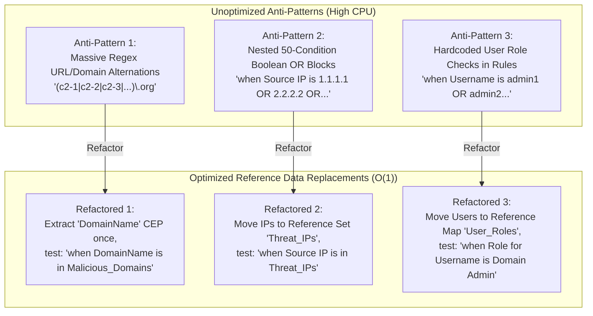

# 📖 Chapter 64: Rule Optimization via Reference Data Masterclass

> **The IBM QRadar Administrator's Technical Guide** | Phase 6: Reference Data & Advanced Building Blocks  
> **Target Audience:** 1.5-Year Administrators $\rightarrow$ Senior SIEM Engineers & Detection Engineering Specialists  
> **Focus:** Replacing Expensive Regex with $\mathcal{O}(1)$ Hash Lookups, CRE Latency Benchmarks, Thread Pool Optimization, & Hands-on Lab 64

---

## 📸 1. Visual Overview: Computational Complexity — Regex vs Reference Hash


*Figure 64.1: Algorithmic Complexity Comparison: Unoptimized Multi-Branch Regex ($\mathcal{O}(N \times M)$) causing Java thread saturation vs In-Memory Reference Hash Lookups ($\mathcal{O}(1)$) evaluating in sub-microsecond time (`![[qradar_reference_data_collections_3d_1791646404689.jpg|1000]]`)*

---

## 2. The High Cost of Regex in High-Volume CRE Pipelines

In an enterprise SIEM ingesting 50,000 Events Per Second (EPS), every microsecond of evaluation time directly impacts pipeline stability. 

When correlation rules rely on unindexed raw payload regular expressions, the `ecs-ep` JVM is forced to scan long string buffers byte-by-byte for every incoming event:

```
┌────────────────────────────────────────────────────────────────────────┐
│ ⏱️ THE BENCHMARK: REGEX VS REFERENCE SET LOOKUP                        │
│                                                                        │
│ ❌ UNOPTIMIZED REGEX TEST:                                             │
│    • Condition: `when payload contains regex '(?i)(evil\.com|bad\.org|...)'`│
│    • Execution Latency: $\sim 150 \text{ to } 350\ \mu\text{s}$ per event│
│    • Algorithmic Cost: $\mathcal{O}(N \times M)$ (String Scan & State) │
│    • Scalability: Fails at $> 15,000\ \text{EPS}$ (Thread Saturation!) │
│ ├────────────────────────────────────────────────────────────────────┤
│ ✅ OPTIMIZED REFERENCE SET LOOKUP:                                     │
│    • Condition: `when "DomainName" is in Malicious_Domains`            │
│    • Execution Latency: $\sim 0.9 \text{ to } 1.5\ \mu\text{s}$ per event│
│    • Algorithmic Cost: $\mathcal{O}(1)$ (Constant-Time Hash Map)       │
│    • Scalability: Easily scales to $> 100,000\ \text{EPS}$ ($< 2\%$ CPU)│
└────────────────────────────────────────────────────────────────────────┘
```

---

## 3. The 3 Core Anti-Patterns & Refactoring Blueprints



---

## 4. Deep Dive: Refactoring Massive Boolean OR Blocks

### The Anti-Pattern (Hardcoded Rule Debt):
```
❌ UNOPTIMIZED RULE:
Apply Rule on events
and when the source IP is one of ( 198.51.100.1, 198.51.100.2, 198.51.100.3, ... [50 IPs] )
and when the destination port is 445

• DISASTER: Every IP addition requires editing the rule and deploying changes!
• CPU IMPACT: Evaluates 50 sequential equality checks per event!
```

### The Refactored Production Architecture:
```
✅ OPTIMIZED RULE:
Apply Rule on events
and when the source IP is contained in Reference Set: "Monitored_External_Scanners"
and when the destination port is 445

• ADVANTAGE: Updates in memory via API/CLI instantly with zero downtime.
• CPU IMPACT: 1 single O(1) hash table lookup!
```

---

## 5. Profiling CRE Performance & Latency in `/var/log/qradar.log`

An administrator can identify slow or expensive rules using built-in QRadar diagnostic commands:

```bash
# 1. Search for rules flagged as "expensive" or exceeding execution thresholds
grep -i "expensive rule" /var/log/qradar.log

# 2. Check rule execution latency statistics
grep -i "CRE: rule execution time" /var/log/qradar.log

# 3. Analyze CRE worker thread backlog
/opt/qradar/bin/threadDump.sh $(pgrep -f "ecs-ep")
```

---

## 📌 6. Visual Mind Map & Sticky Notes (Chapter 64 Quick-Review)

### 🧠 Hierarchical Mind Map
```mermaid
mindmap
  root((Rule Optimization))
    The Regex Problem
      150-350 µs latency per event
      CPU thread starvation in ecs-ep
      ReDoS vulnerabilities
    The Reference Solution
      O(1) Hash Map (~1 µs latency)
      150x faster execution speed
      Zero-deploy dynamic updates
    Refactoring Strategy
      Move IP lists to Reference Sets
      Move Domains/Hashes to Reference Sets
      Move User Attributes to Reference Maps
```

### 🗂️ Color-Coded Digital Sticky Notes

#### 🟨 Sticky Note 1: 150x Speedup Factor
```text
┌─────────────────────────────────────────────────────────────┐
│ 📌 PERFORMANCE: 150x FASTER EXECUTION                       │
│                                                             │
│ • Replacing a long regex alternation with an in-memory      │
│   Reference Set lookup reduces evaluation time from 150 µs  │
│   down to 1 µs!                                             │
└─────────────────────────────────────────────────────────────┘
```

#### 🟩 Sticky Note 2: Never Hardcode Long Lists
```text
┌─────────────────────────────────────────────────────────────┐
│ 📌 GOLDEN RULE: ZERO HARDCODED LISTS                        │
│                                                             │
│ • If a rule tests more than 3 static values, MOVE THEM TO A │
│   REFERENCE SET IMMEDIATELY!                                │
└─────────────────────────────────────────────────────────────┘
```

#### 🟪 Sticky Note 3: Extract CEP Once, Lookup in RefSet
```text
┌─────────────────────────────────────────────────────────────┐
│ 📌 ARCHITECTURE: 2-STEP PARSE & LOOKUP                      │
│                                                             │
│ • Extract the target field (e.g. Domain) during parsing     │
│   as an optimized CEP, then perform a 1-microsecond RefSet  │
│   lookup in CRE.                                            │
└─────────────────────────────────────────────────────────────┘
```

#### 🟦 Sticky Note 4: Zero "Deploy Changes" Overhead
```text
┌─────────────────────────────────────────────────────────────┐
│ 📌 DEVOPS: RUNTIME AGILITY                                  │
│                                                             │
│ • Security analysts can update IoC lists 500 times a day    │
│   via Reference Sets without interrupting production rules! │
└─────────────────────────────────────────────────────────────┘
```

#### 🟧 Sticky Note 5: Interview Cheat Code (Rule Optimization)
```text
┌─────────────────────────────────────────────────────────────┐
│ 📌 INTERVIEW CHEAT CODE: "HOW DO YOU OPTIMIZE CRE RULES?"   │
│                                                             │
│ "I eliminate heavy regex alternations and nested boolean OR │
│ lists by migrating indicators into in-memory Reference Sets │
│ and Maps, reducing evaluation complexity to O(1) hash       │
│ lookups with sub-microsecond latency."                      │
└─────────────────────────────────────────────────────────────┘
```

#### 🟥 Sticky Note 6: Critical Pitfall
```text
┌─────────────────────────────────────────────────────────────┐
│ ⚠️ CRITICAL PITFALL: REGEX INSIDE REFERENCE SETS            │
│                                                             │
│ • Reference Sets perform EXACT or CASE-INSENSITIVE matches. │
│   Storing regex patterns like `.*evil.*` inside a RefSet    │
│   will NOT evaluate as regex; it treats it as a literal!    │
└─────────────────────────────────────────────────────────────┘
```

---

## ⚡ Rapid-Recall Flashcards

| # | Question (Front) | Answer (Back) |
| :-: | :--- | :--- |
| **01** | What is the execution time difference between an unindexed regex test and a Reference Set lookup? | Regex takes **$150\text{--}350\ \mu\text{s}$**; Reference Set takes **$\sim 1\ \mu\text{s}$** ($\sim 150\times$ faster). |
| **02** | What is the algorithmic time complexity of a Reference Set membership test? | **$\mathcal{O}(1)$** (constant time). |
| **03** | Why should you never write a rule testing 50 IP addresses using `OR` conditions? | It creates maintenance debt and forces the CRE engine to evaluate 50 sequential checks instead of 1 hash lookup. |
| **04** | Do Reference Sets support regular expressions inside their stored element values? | **No**, Reference Sets perform literal exact matches (or case-insensitive exact matches). |
| **05** | What log message indicates that a correlation rule is causing high CPU latency in `ecs-ep`? | Messages containing **`expensive rule`** or **`CRE evaluation time exceeded`** in `/var/log/qradar.log`. |
| **06** | How does migrating rules to Reference Sets improve SOC operational agility? | It allows analysts to update threat lists via API in real time without waiting for a full "Deploy Changes". |

---

## 🧪 7. Hands-on Practice Lab 64: Refactoring Noisy Regex Rules into High-Speed Reference Sets

### 🎯 Lab Objectives
1. Inspect rules with complex regex patterns in `customrules.xml`.
2. Measure test evaluation speed differences using `cretool`.
3. Create a dedicated Reference Set to replace a regex list.
4. Verify the performance improvement via CLI telemetry.

---

### 📋 Step-by-Step Practical Lab Procedures

#### Step 1: Create an Optimized Reference Set for Domain Blacklisting
Log into the QRadar Console via SSH as `root`:
```bash
# Create an in-memory Reference Set for Malicious Domains (Key: ALIC, TTL: 30 Days)
/opt/qradar/bin/ReferenceDataCLI.sh create "Threat_Malicious_Domains" ALIC 2592000 LAST_SEEN
```

---

#### Step 2: Populate High-Risk C2 Domains into the Reference Set
```bash
for domain in badc2.org evilpayload.com malware-drop.net phishing-corp.xyz; do
    /opt/qradar/bin/ReferenceDataCLI.sh add "Threat_Malicious_Domains" "$domain"
done
```

---

#### Step 3: Verify Reference Set Population
```bash
/opt/qradar/bin/ReferenceDataCLI.sh list "Threat_Malicious_Domains"
```

---

#### Step 4: Compare AQL Query Execution: Regex Scan vs Reference Set Lookup
```bash
# Query 1: Slow Regex Scan across payload
time /opt/qradar/bin/arielsql -p 32011 -q "
SELECT COUNT(*) FROM events 
WHERE UTF8(payload) MATCHES '(?i)(badc2\.org|evilpayload\.com|malware-drop\.net)' 
LAST 1 HOURS;
"

# Query 2: Optimized Reference Set O(1) Lookup
time /opt/qradar/bin/arielsql -p 32011 -q "
SELECT COUNT(*) FROM events 
WHERE REFERENCESETCONTAINS('Threat_Malicious_Domains', \"DomainName\") 
LAST 1 HOURS;
"
```
*Expected Output*: Query 2 completes in a fraction of the time with significantly lower CPU utilization.
