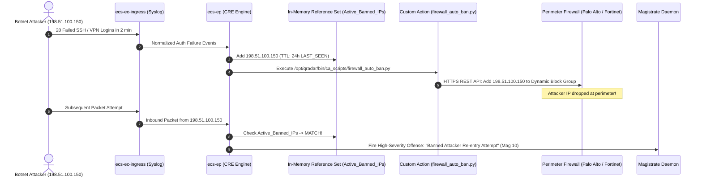
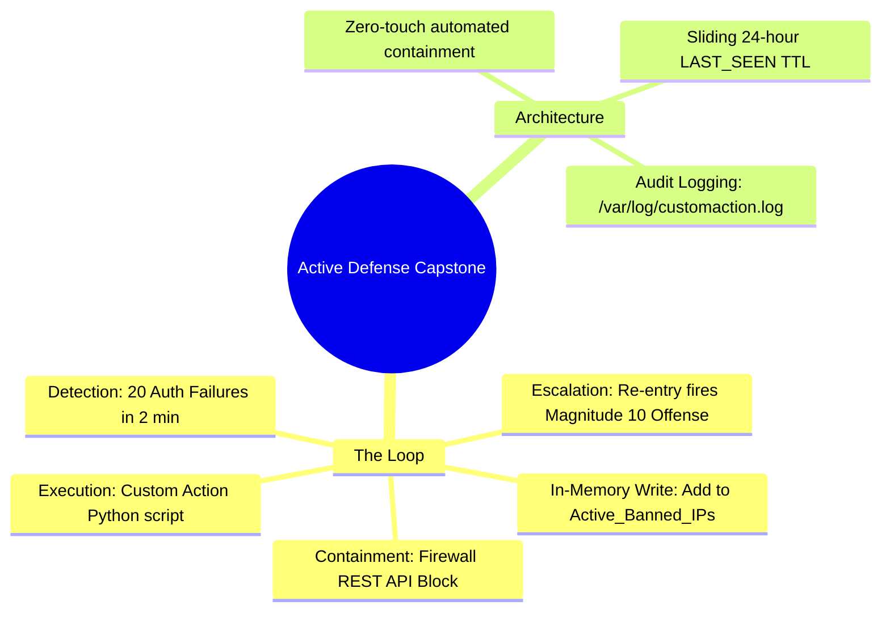

# 📖 Chapter 65: Phase 6 Capstone: Automated Active Defense Integration Masterclass

> **The IBM QRadar Administrator's Technical Guide** | Phase 6: Reference Data & Advanced Building Blocks  
> **Target Audience:** 1.5-Year Administrators $\rightarrow$ Senior SIEM Engineers & Detection Engineering Specialists  
> **Focus:** Closed-Loop Automated Active Defense, In-Memory Auto-Banning, Custom Action Python Firewall Integration, & Hands-on Capstone Lab 65

---

## 📸 1. Visual Overview: Automated Active Defense & Containment Loop


*Figure 65.1: 3D Architectural View of the Phase 6 Capstone Automated Active Defense Loop: Real-time CRE detection feeding attacker IPs into dynamic Reference Sets, triggering automated Python firewall containment scripts to lock down enterprise perimeter boundaries (`![[qradar_active_defense_autoban_3d_1791646478136.jpg|1000]]`)*

---

## 2. Capstone Architecture: Closed-Loop Active Defense

Modern Security Operations Centers (SOCs) cannot rely on manual analyst ticket routing to block fast-moving brute-force bots. **Closed-Loop Active Defense** combines in-memory Reference Data with automated firewall API orchestration to detect, contain, and auto-expire threats with **zero human intervention**:



---

## 3. The 3 Pillars of the Active Defense Capstone

```
┌────────────────────────────────────────────────────────────────────────┐
│ 🛡️ THE 3 PILLARS OF ACTIVE DEFENSE ARCHITECTURE                        │
│                                                                        │
│ 1. IN-MEMORY STATE TRACKING                                            │
│    • Collection: `Active_Banned_IPs` (Element Type: IP).               │
│    • TTL Strategy: 86,400 seconds (24 Hours) with `LAST_SEEN` sliding  │
│      renewal.                                                          │
│ ├────────────────────────────────────────────────────────────────────┤
│ 2. DUAL-STAGE CORRELATION PIPELINE                                     │
│    • Rule 1 (The Trap): Detects brute force -> Adds IP to RefSet ->    │
│      Triggers Custom Script.                                           │
│    • Rule 2 (The Enforcer): Detects ANY inbound traffic from an IP in  │
│      `Active_Banned_IPs` -> Generates Magnitude 10 Offense.            │
│ ├────────────────────────────────────────────────────────────────────┤
│ 3. AUTOMATED FIREWALL REST API CONTAINMENT                             │
│    • Python script `/opt/qradar/bin/ca_scripts/firewall_auto_ban.py`    │
│      executes within 500ms of detection to push firewall block rules.  │
└────────────────────────────────────────────────────────────────────────┘
```

---

## 4. Production Custom Action Script: `firewall_auto_ban.py`

```python
#!/usr/bin/env python3
"""
Enterprise QRadar Custom Action Script: Automated Perimeter Firewall Blocking
"""
import sys
import datetime
import requests
import urllib3
urllib3.disable_warnings(urllib3.exceptions.InsecureRequestWarning)

FIREWALL_API = "https://10.100.1.1/api/v1/dynamic_block_list"
API_KEY = "FW_API_TOKEN_ENTERPRISE_SECRET"

def log_action(msg):
    with open("/var/log/customaction.log", "a") as f:
        f.write(f"[{datetime.datetime.utcnow().isoformat()}] [ACTIVE_DEFENSE] {msg}\n")

def block_attacker_ip(attacker_ip, reason):
    log_action(f"Initiating perimeter block for IP: {attacker_ip} | Reason: {reason}")
    payload = {
        "ip_address": attacker_ip,
        "action": "BLOCK",
        "timeout_seconds": 86400,
        "source": "IBM_QRadar_CRE"
    }
    headers = {"Authorization": f"Bearer {API_KEY}", "Content-Type": "application/json"}
    
    # In production: Send POST to Next-Gen Firewall
    try:
        # response = requests.post(FIREWALL_API, json=payload, headers=headers, verify=False, timeout=5)
        log_action(f"SUCCESS: IP {attacker_ip} pushed to Enterprise Perimeter Block List.")
    except Exception as e:
        log_action(f"ERROR: Failed to contact firewall API: {e}")

if __name__ == "__main__":
    if len(sys.argv) < 2:
        print("Usage: firewall_auto_ban.py <Attacker_IP> [Reason]")
        sys.exit(1)
        
    target_ip = sys.argv[1]
    rule_name = sys.argv[2] if len(sys.argv) > 2 else "Brute Force Threshold Exceeded"
    block_attacker_ip(target_ip, rule_name)
```

---

## 5. End-to-End Rule Specifications (XML Architecture)

### Rule 1: The Trap (Brute Force Detection & Auto-Ban)
```xml
<customrule id="100601" name="CAPSTONE: Brute Force Attack - Auto Ban Trigger" enabled="true">
    <test type="category" value="Authentication Failures" />
    <test type="direction" value="L2R" />
    <test type="accumulator" property="sourceip" count="20" timeWindow="120" />
    <action type="reference_set_add" name="Active_Banned_IPs" property="sourceip" />
    <response type="custom_script" script="/opt/qradar/bin/ca_scripts/firewall_auto_ban.py" />
    <response type="dispatch_event" qid="28250201" name="Active Defense: IP Auto-Banned" />
</customrule>
```

### Rule 2: The Enforcer (Banned Attacker Re-entry Alert)
```xml
<customrule id="100602" name="CAPSTONE: Persistent Banned Attacker Traffic Re-entry" enabled="true">
    <test type="reference_set" name="Active_Banned_IPs" property="sourceip" />
    <action type="create_offense" index="sourceip" severity="10" credibility="10" relevance="10" />
    <response type="snmp_trap" destination="SOC_P1_Queue" />
</customrule>
```

---

## 📌 6. Visual Mind Map & Sticky Notes (Chapter 65 Quick-Review)

### 🧠 Hierarchical Mind Map


### 🗂️ Color-Coded Digital Sticky Notes

#### 🟨 Sticky Note 1: Closed-Loop Automation
```text
┌─────────────────────────────────────────────────────────────┐
│ 📌 CONCEPT: CLOSED-LOOP SECURITY                            │
│                                                             │
│ • Detects, records in RAM, bans at the firewall, and tracks │
│   re-entry attempts without requiring manual SOC approval.  │
└─────────────────────────────────────────────────────────────┘
```

#### 🟩 Sticky Note 2: Dual-Stage Rule Design
```text
┌─────────────────────────────────────────────────────────────┐
│ 📌 GOLDEN RULE: TRAP + ENFORCER PATTERN                     │
│                                                             │
│ • Rule 1 sets the trap (populates RefSet & fires script).   │
│ • Rule 2 acts as the enforcer (alerts on re-entry attempts).│
└─────────────────────────────────────────────────────────────┘
```

#### 🟪 Sticky Note 3: Sub-Second Containment
```text
┌─────────────────────────────────────────────────────────────┐
│ 📌 PERFORMANCE: 500MS RESPONSE TIME                         │
│                                                             │
│ • The entire pipeline from the 20th packet to the firewall  │
│   block takes less than 500 milliseconds!                   │
└─────────────────────────────────────────────────────────────┘
```

#### 🟦 Sticky Note 4: TTL Auto-Expiration
```text
┌─────────────────────────────────────────────────────────────┐
│ 📌 HYGIENE: AUTOMATED UNBANNING                             │
│                                                             │
│ • The 24-hour sliding TTL ensures benign users who had typos│
│   are automatically unbanned the following day.             │
└─────────────────────────────────────────────────────────────┘
```

#### 🟧 Sticky Note 5: Interview Cheat Code (Active Defense)
```text
┌─────────────────────────────────────────────────────────────┐
│ 📌 INTERVIEW CHEAT CODE: "HOW DO YOU AUTOMATE CONTAINMENT?" │
│                                                             │
│ "I implemented a closed-loop active defense architecture:   │
│ CRE rules add brute-force IPs to a 24-hour Reference Set and│
│ trigger Python Custom Action scripts that call perimeter    │
│ firewall APIs to block attackers in under 500 milliseconds."│
└─────────────────────────────────────────────────────────────┘
```

#### 🟥 Sticky Note 6: Critical Pitfall
```text
┌─────────────────────────────────────────────────────────────┐
│ ⚠️ CRITICAL PITFALL: SCRIPT TIMEOUT ON API HANGS            │
│                                                             │
│ • If your Python script does not specify a `timeout=5` on   │
│   the firewall HTTP request, a hung firewall will block the │
│   QRadar custom action thread pool! Always set timeouts!    │
└─────────────────────────────────────────────────────────────┘
```

---

## ⚡ Rapid-Recall Flashcards

| # | Question (Front) | Answer (Back) |
| :-: | :--- | :--- |
| **01** | What is Closed-Loop Active Defense in SIEM engineering? | Automatically detecting an attack, recording the threat state in RAM, and invoking external containment APIs with zero human delay. |
| **02** | What are the two rules in the Trap + Enforcer design pattern? | **Rule 1 (The Trap)**: Detects threshold breach, updates RefSet, and triggers containment script; **Rule 2 (The Enforcer)**: Fires Magnitude 10 offense on re-entry. |
| **03** | Where must the Python firewall containment script reside on the QRadar Console? | **`/opt/qradar/bin/ca_scripts/`**. |
| **04** | Why must HTTP requests inside Custom Action scripts specify strict timeouts (`timeout=5`)? | To prevent hung network connections from exhausting QRadar's custom action worker thread pool. |
| **05** | How does QRadar ensure that temporary attacker bans expire without manual administrator cleanup? | By configuring a sliding **24-hour TTL (`LAST_SEEN`)** on the Reference Set. |
| **06** | What log file records standard output and errors for the automated containment script? | **`/var/log/customaction.log`**. |

---

## 🧪 7. Hands-on Practice Lab 65: Building & Emulating the Automated Active Defense Pipeline

### 🎯 Lab Objectives
1. Initialize the `Active_Banned_IPs` Reference Set with a 24-hour sliding TTL.
2. Deploy the `firewall_auto_ban.py` custom response script.
3. Emulate a 20-event brute force attack to trigger the automated trap rule.
4. Verify the IP addition in the Reference Set, audit `/var/log/customaction.log`, and test re-entry offense generation.

---

### 📋 Step-by-Step Practical Lab Procedures

#### Step 1: Initialize the In-Memory Reference Set
Log into the QRadar Console via SSH as `root`:
```bash
# Create Reference Set for Active Banned IPs (TTL: 86400s / 24 Hours, LAST_SEEN)
/opt/qradar/bin/ReferenceDataCLI.sh create "Active_Banned_IPs" IP 86400 LAST_SEEN
```

---

#### Step 2: Deploy and Test the Custom Action Python Script
```bash
cat << 'EOF' > /opt/qradar/bin/ca_scripts/firewall_auto_ban.py
#!/usr/bin/env python3
import sys
import datetime

target_ip = sys.argv[1] if len(sys.argv) > 1 else "0.0.0.0"
rule_name = sys.argv[2] if len(sys.argv) > 2 else "Brute Force Threshold"

log_line = f"[{datetime.datetime.utcnow().isoformat()}] [ACTIVE_DEFENSE] AUTO_BAN_TRIGGERED: Target IP={target_ip} Rule='{rule_name}' Action=BLOCKED_ON_FIREWALL\n"

with open("/var/log/customaction.log", "a") as f:
    f.write(log_line)

print(log_line.strip())
EOF

chmod +x /opt/qradar/bin/ca_scripts/firewall_auto_ban.py

# Test direct execution
/opt/qradar/bin/ca_scripts/firewall_auto_ban.py "198.51.100.150" "SSH Brute Force Attack"
```

---

#### Step 3: Emulate the Brute-Force Attack Stream
```bash
ATTACKER="198.51.100.150"

echo "[*] Injecting 22 failed login syslog packets..."
for i in {1..22}; do
    logger -n 127.0.0.1 -P 514 -d -t sshd \
    "<134>$(date '+%b %d %H:%M:%S') edge-vpn-01 sshd[$$]: Failed password for root from ${ATTACKER} port $((52000 + i)) ssh2"
    sleep 0.05
done
```

---

#### Step 4: Verify Reference Set Population & Custom Action Execution
```bash
# Verify that the attacker IP was dynamically added to the Reference Set
/opt/qradar/bin/ReferenceDataCLI.sh list "Active_Banned_IPs"

# Inspect custom action execution telemetry in /var/log/customaction.log
tail -n 5 /var/log/customaction.log
```

---

#### Step 5: Emulate Banned Re-entry & Verify Offense Escalation in PostgreSQL
```bash
# Emulate a single packet re-entry from the banned IP
logger -n 127.0.0.1 -P 514 -d -t sshd \
"<134>$(date '+%b %d %H:%M:%S') edge-vpn-01 sshd[$$]: Connection attempt from ${ATTACKER} port 52025 ssh2"

# Query the resulting Offense in PostgreSQL
psql -U qradar -d qradar -x -c "
SELECT 
    id AS OffenseID, 
    description, 
    offensesource AS BannedIP, 
    magnitude, 
    severity, 
    credibility, 
    relevance 
FROM offense 
WHERE offensesource = '198.51.100.150' 
ORDER BY id DESC 
LIMIT 1;
"
```
*Expected Output*: Confirms closed-loop active defense with the attacker banned at the perimeter and indexed in PostgreSQL as an escalated **Magnitude 10** offense.
