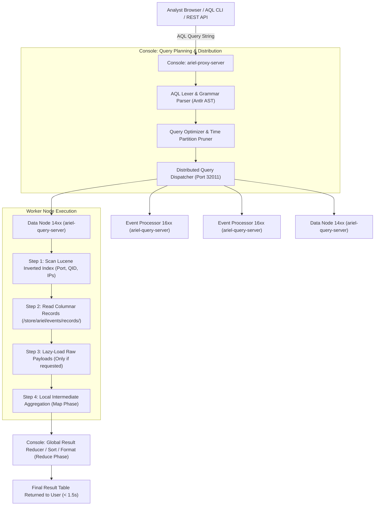
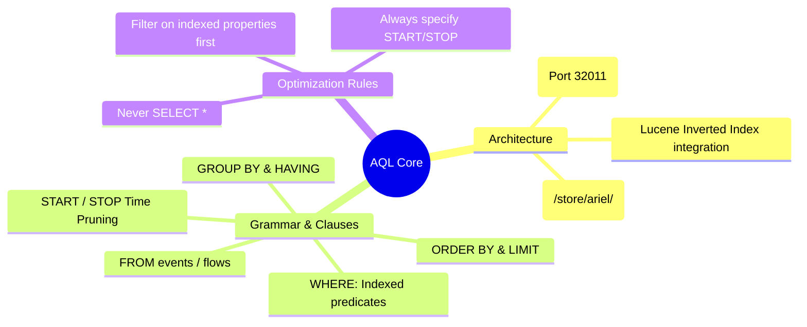

# 📖 Chapter 66: AQL Core Foundations: Syntax, Clauses & Query Execution Masterclass

> **The IBM QRadar Administrator's Technical Guide** | Phase 7: AQL Mastery & Ariel Storage Optimization  
> **Target Audience:** 1.5-Year Administrators $\rightarrow$ Senior SIEM Engineers & Detection Engineering Specialists  
> **Focus:** AQL Grammar & Parsing, Ariel Query Planner, Execution Pipeline, `START`/`STOP` Time Scoping, & Hands-on Lab 66

---

## 📸 1. Visual Overview: The Ariel Query Language (AQL) Execution Engine


*Figure 66.1: 3D Isometric View of the QRadar Ariel Query Language (AQL) Subsystem: Analytics Query Planner parsing SQL-like syntax into distributed search Abstract Syntax Trees (AST), routing across Data Nodes over TCP 32011, leveraging Lucene columnar indexes, and streaming aggregated result tables (`![[qradar_aql_query_engine_3d_1791647183664.jpg|1000]]`)*

---

## 2. What is Ariel Query Language (AQL)?

**Ariel Query Language (AQL)** is IBM QRadar's native, ANSI-SQL-92-compliant declarative query language designed to search, filter, aggregate, and analyze petabyte-scale historical event and network flow telemetry stored on disk inside the proprietary **Ariel Database**.

```
┌────────────────────────────────────────────────────────────────────────┐
│ ⚡ THE 4 CORE CAPABILITIES OF AQL                                       │
│                                                                        │
│ 1. HISTORICAL THREAT HUNTING                                           │
│    • Query billions of compressed events across months of storage.     │
│ ├────────────────────────────────────────────────────────────────────┤
│ 2. REAL-TIME DASHBOARD & REPORT GENERATION                             │
│    • Powers SOC pulse dashboards, scheduled executive reports, and     │
│      compliance audit extracts.                                        │
│ ├────────────────────────────────────────────────────────────────────┤
│ 3. ADVANCED AGGREGATIONS & TIME-SERIES PROFILING                       │
│    • Perform multi-dimensional grouping, geospatial lookups, and       │
│      statistical standard deviation anomaly calculations.              │
│ ├────────────────────────────────────────────────────────────────────┤
│ 4. REST API & AUTOMATION INTEGRATION                                   │
│    • Execute searches programmatically via `/api/ariel/searches/`      │
│      for SOAR, Jupyter Notebooks, and external SIEM data lakes.        │
└────────────────────────────────────────────────────────────────────────┘
```

---

## 3. AQL Query Execution Pipeline: From Console to Data Nodes

When an analyst submits an AQL query in Log Activity or via CLI:



---

## 4. The 8 Mandatory & Optional Clauses in AQL

```sql
SELECT 
    DATEFORMAT(starttime, 'YYYY-MM-dd HH:mm:ss') AS EventTime,
    sourceip AS AttackerIP,
    destinationip AS TargetIP,
    qidname(qid) AS EventName,
    COUNT(*) AS EventCount
FROM events
WHERE qid IN (5000854, 5000855) 
  AND INCIDR('10.0.0.0/8', destinationip)
GROUP BY sourceip, destinationip, qidname(qid)
HAVING EventCount > 10
ORDER BY EventCount DESC
LIMIT 50
START '2026-09-25 00:00:00' STOP '2026-09-25 23:59:59';
```

| Clause | Purpose | Execution Order | Optimization Best Practice |
| :--- | :--- | :---: | :--- |
| **`SELECT`** | Specifies columns, expressions, functions, or custom properties. | 5 | Never use `SELECT *` in production! Select only needed columns. |
| **`FROM`** | Selects the database: `events` or `flows`. | 1 | Target `events` for logs, `flows` for network traffic. |
| **`WHERE`** | Filters records based on boolean predicates. | 2 | Put indexed properties (QID, LogSourceID, IP) first! |
| **`GROUP BY`** | Aggregates results into summary buckets. | 3 | Group by high-cardinality fields (e.g. `sourceip`). |
| **`HAVING`** | Filters aggregated group buckets. | 4 | Filters after aggregation (e.g. `HAVING COUNT(*) > 100`). |
| **`ORDER BY`** | Sorts final result set (`ASC` or `DESC`). | 6 | Sorting high-volume non-aggregated rows causes memory spikes. |
| **`LIMIT`** | Caps the maximum returned records. | 7 | Always provide a `LIMIT` (e.g. `LIMIT 1000`) on raw queries. |
| **`START / STOP`** | **CRITICAL**: Restricts time partition pruning. | **0 (Pre-Flight)** | **Always** specify explicit time bounds to avoid full disk scans! |

---

## 5. Time Scoping Formats: Relative vs Absolute

| Syntax Type | AQL Syntax Example | When to Use |
| :--- | :--- | :--- |
| **Relative Duration** | `LAST 15 MINUTES`<br/>`LAST 24 HOURS`<br/>`LAST 7 DAYS` | SOC Live Dashboards, Incident Triage, Continuous Hunting. |
| **Absolute Epoch** | `START 1758800000000 STOP 1758886400000` | Automated API scripts, SOAR integrations (millisecond precision). |
| **Absolute Human String** | `START '2026-09-25 08:00:00' STOP '2026-09-25 12:00:00'` | Forensic root cause investigations across specific attack windows. |

---

## 📌 6. Visual Mind Map & Sticky Notes (Chapter 66 Quick-Review)

### 🧠 Hierarchical Mind Map


### 🗂️ Color-Coded Digital Sticky Notes

#### 🟨 Sticky Note 1: Never SELECT *
```text
┌─────────────────────────────────────────────────────────────┐
│ 📌 PERFORMANCE: AVOID SELECT *                              │
│                                                             │
│ • `SELECT *` forces Ariel to decompress every single raw    │
│   payload off disk, slowing queries down by 20x!            │
└─────────────────────────────────────────────────────────────┘
```

#### 🟩 Sticky Note 2: Explicit START / STOP
```text
┌─────────────────────────────────────────────────────────────┐
│ 📌 GOLDEN RULE: TIME PARTITION PRUNING                      │
│                                                             │
│ • Always specify `START` and `STOP` (or `LAST X HOURS`).    │
│   Without time bounds, Ariel scans EVERY partition on disk! │
└─────────────────────────────────────────────────────────────┘
```

#### 🟪 Sticky Note 3: CLI Utility `arielsql`
```text
┌─────────────────────────────────────────────────────────────┐
│ 📌 LINUX CLI: RUNNING QUERIES DIRECTLY                      │
│                                                             │
│ • Execute AQL directly from bash using `/opt/qradar/bin/`   │
│   `arielsql -p 32011 -q "<Query>"`.                         │
└─────────────────────────────────────────────────────────────┘
```

#### 🟦 Sticky Note 4: Execution vs Written Order
```text
┌─────────────────────────────────────────────────────────────┐
│ 📌 ARCHITECTURE: EXECUTION ORDER                            │
│                                                             │
│ • Written: SELECT $\rightarrow$ FROM $\rightarrow$ WHERE $\rightarrow$ GROUP BY  │
│ • Executed: TIME PRUNE $\rightarrow$ FROM $\rightarrow$ WHERE $\rightarrow$ GROUP $\rightarrow$ SELECT│
└─────────────────────────────────────────────────────────────┘
```

#### 🟧 Sticky Note 5: Interview Cheat Code (AQL Architecture)
```text
┌─────────────────────────────────────────────────────────────┐
│ 📌 INTERVIEW CHEAT CODE: "HOW DOES AQL WORK UNDER THE HOOD?"│
│                                                             │
│ "AQL uses a distributed MapReduce architecture: the Console │
│ parses the query AST and dispatches it over TCP 32011 to    │
│ Event Processors and Data Nodes, which scan Lucene indexes, │
│ perform local aggregations, and stream reduced results back."│
└─────────────────────────────────────────────────────────────┘
```

#### 🟥 Sticky Note 6: Critical Pitfall
```text
┌─────────────────────────────────────────────────────────────┐
│ ⚠️ CRITICAL PITFALL: UNCONSTRAINED HISTORICAL QUERIES       │
│                                                             │
│ • Running a non-aggregated query over `LAST 6 MONTHS` with  │
│   no `LIMIT` can exhaust Console memory and crash Tomcat!   │
└─────────────────────────────────────────────────────────────┘
```

---

## ⚡ Rapid-Recall Flashcards

| # | Question (Front) | Answer (Back) |
| :-: | :--- | :--- |
| **01** | What port is used by the Console to dispatch distributed AQL queries to Managed Hosts? | **TCP Port 32011** (`ariel-query-server`). |
| **02** | What is the difference between `WHERE` and `HAVING` in an AQL query? | `WHERE` filters individual event records before aggregation; `HAVING` filters grouped summary buckets after aggregation. |
| **03** | Why is `SELECT *` strongly discouraged in production AQL queries? | It forces Ariel to read and decompress raw payload blocks from disk rather than using fast in-memory columnar metadata. |
| **04** | What happens if you omit `START/STOP` or `LAST X` from an AQL query? | Ariel will perform a full scan across all historical disk partitions, causing extreme search latency. |
| **05** | What CLI binary is used on the QRadar Console to execute AQL searches directly? | **`/opt/qradar/bin/arielsql`**. |
| **06** | What are the two target databases supported by the `FROM` clause? | **`events`** and **`flows`**. |

---

## 🧪 7. Hands-on Practice Lab 66: Executing & Profiling AQL Queries via CLI

### 🎯 Lab Objectives
1. Connect to the Ariel query engine via `arielsql` CLI.
2. Execute basic SELECT, WHERE, and LIMIT queries.
3. Compare query execution times with and without time bounding.
4. Export AQL search results to CSV and JSON formats from the command line.

---

### 📋 Step-by-Step Practical Lab Procedures

#### Step 1: Execute a Basic AQL Query via `arielsql`
Log into the QRadar Console via SSH as `root`:
```bash
/opt/qradar/bin/arielsql -p 32011 -q "
SELECT 
    DATEFORMAT(starttime, 'YYYY-MM-dd HH:mm:ss') AS EventTime, 
    sourceip, 
    destinationip, 
    qidname(qid) AS EventName 
FROM events 
LAST 2 HOURS 
LIMIT 10;
"
```

---

#### Step 2: Measure Performance Difference with Explicit Time Scoping
```bash
# Query 1: Relative 1-Hour Window
time /opt/qradar/bin/arielsql -p 32011 -q "
SELECT COUNT(*) FROM events LAST 1 HOURS;
"

# Query 2: Absolute Precision Window
time /opt/qradar/bin/arielsql -p 32011 -q "
SELECT COUNT(*) FROM events 
START '$(date -d "2 hours ago" "+%Y-%m-%d %H:00:00")' 
STOP '$(date -d "1 hour ago" "+%Y-%m-%d %H:00:00")';
"
```

---

#### Step 3: Export Query Results Directly to a CSV File
```bash
/opt/qradar/bin/arielsql -p 32011 -f csv -q "
SELECT 
    sourceip AS AttackerIP, 
    COUNT(*) AS HitCount 
FROM events 
WHERE qidname(qid) ILIKE '%Failed%' 
LAST 24 HOURS 
GROUP BY sourceip 
ORDER BY HitCount DESC 
LIMIT 20;
" > /tmp/top_failed_logins.csv

# Inspect generated CSV export
head -n 10 /tmp/top_failed_logins.csv
```
