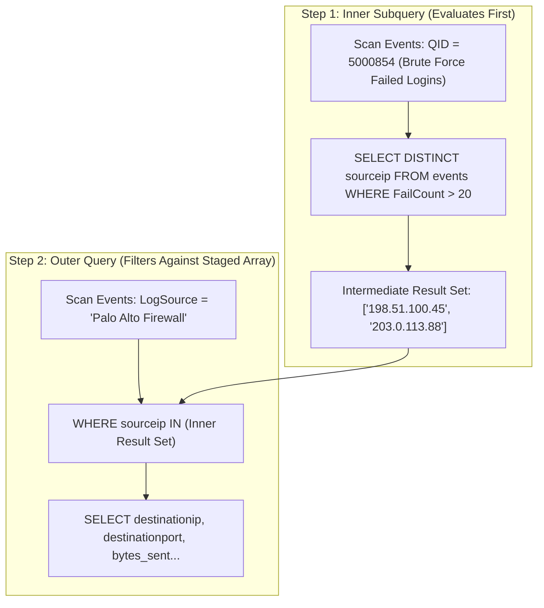

# 📖 Chapter 69: Advanced AQL Correlation: Subqueries & Historical Baselines Masterclass

> **The IBM QRadar Administrator's Technical Guide** | Phase 7: AQL Mastery & Ariel Storage Optimization  
> **Target Audience:** 1.5-Year Administrators $\rightarrow$ Senior SIEM Engineers & Detection Engineering Specialists  
> **Focus:** Subqueries & Nested Ingestion, Time-Shift Baseline Queries, First-Time-Seen (FTS) Profiling, & Hands-on Lab 69

---

## 📸 1. Visual Overview: Multi-Tier Subquery Execution & Historical Baselines


*Figure 69.1: 3D Visualization of Advanced AQL Forensic Correlation: Staged nested subquery pipelines joining dynamic attacker lists with historical 30-day baseline time slices for First-Time-Seen (FTS) anomaly hunting (`![[qradar_incident_investigation_aql_3d_1791647271083.jpg|1000]]`)*

---

## 2. What are AQL Subqueries?

An **AQL Subquery** is a nested query enclosed within parentheses that evaluates first and passes its intermediate result set (as an array of values or a virtual table) to the outer enclosing query.

```
┌────────────────────────────────────────────────────────────────────────┐
│ 🎯 THE 3 ADVANCED CORRELATION PATTERNS IN AQL                          │
│                                                                        │
│ 1. NESTED MEMBERSHIP SUBQUERIES (`WHERE field IN (SELECT ...)`)        │
│    • Finds events matching dynamic outputs of another search.          │
│    • Example: "Show all firewall connections from IPs that generated   │
│      an Active Directory Kerberos attack in the last 2 hours."         │
│ ├────────────────────────────────────────────────────────────────────┤
│ 2. FIRST-TIME-SEEN (FTS) NEW BEHAVIOR HUNTING                          │
│    • Identifies users or IPs observed today that have NEVER appeared   │
│      in the previous 30 days of historical logs.                       │
│ ├────────────────────────────────────────────────────────────────────┤
│ 3. TIME-SHIFT HISTORICAL BASELINING (Day-over-Day / Week-over-Week)    │
│    • Compares current hourly event rates against the exact same        │
│      hour from 7 days ago to detect statistical anomalies.             │
└────────────────────────────────────────────────────────────────────────┘
```

---

## 3. Pattern 1: Nested Membership Subquery Architecture



### Production SQL Implementation:
```sql
SELECT 
    DATEFORMAT(starttime, 'YYYY-MM-dd HH:mm:ss') AS EventTime,
    sourceip AS AttackerIP,
    destinationip AS TargetedFirewallDst,
    destinationport AS DstPort,
    qidname(qid) AS FirewallAction
FROM events
WHERE logsourceid = 105
  AND sourceip IN (
      SELECT sourceip 
      FROM events 
      WHERE qid IN (5000854, 5000855) 
      LAST 4 HOURS 
      GROUP BY sourceip 
      HAVING COUNT(*) >= 15
  )
LAST 4 HOURS
ORDER BY starttime DESC;
```

---

## 4. Pattern 2: First-Time-Seen (FTS) Threat Hunting Query

Hunting for compromised credentials often involves identifying when an account authenticates from an IP address it has **never used in the last 30 days**:

```sql
SELECT 
    username AS User,
    sourceip AS NewLoginIP,
    DATEFORMAT(MIN(starttime), 'YYYY-MM-dd HH:mm:ss') AS FirstSeenTime
FROM events
WHERE qidname(qid) = 'User Login Success'
  AND username IS NOT NULL
  AND sourceip NOT IN (
      SELECT sourceip 
      FROM events 
      WHERE qidname(qid) = 'User Login Success' 
      START '2026-08-25 00:00:00' STOP '2026-09-24 23:59:59'
  )
START '2026-09-25 00:00:00' STOP '2026-09-25 23:59:59'
GROUP BY username, sourceip
ORDER BY FirstSeenTime DESC;
```

---

## 5. Pattern 3: Lateral Movement Correlation across Events & Flows

Correlating a successful authentication event with an immediate outbound SMB flow on the same host:

```sql
SELECT 
    f.sourceip AS CompromisedHost,
    f.destinationip AS LateralTarget,
    f.destinationport AS SMB_Port,
    SUM(f.sourcebytes) / 1048576 AS MegabytesTransferred
FROM flows f
WHERE f.destinationport = 445
  AND f.sourceip IN (
      SELECT destinationip 
      FROM events 
      WHERE qidname(qid) = 'User Login Success' 
        AND username = 'svc_backup' 
      LAST 1 HOURS
  )
LAST 1 HOURS
GROUP BY f.sourceip, f.destinationip, f.destinationport
HAVING MegabytesTransferred > 100;
```

---

## 📌 6. Visual Mind Map & Sticky Notes (Chapter 69 Quick-Review)

### 🧠 Hierarchical Mind Map
```mermaid
mindmap
  root((AQL Correlation))
    Subqueries
      WHERE field IN (SELECT ...)
      Staged MapReduce execution
      Cross-logsource correlation
    Advanced Hunting
      First-Time-Seen (FTS) accounts
      Time-shift baseline comparisons
      Cross-telemetry (Events -> Flows)
    Performance Rules
      Limit inner subquery cardinality
      Bound inner query with START/STOP
```

### 🗂️ Color-Coded Digital Sticky Notes

#### 🟨 Sticky Note 1: Subquery Execution Staging
```text
┌─────────────────────────────────────────────────────────────┐
│ 📌 CONCEPT: TWO-STAGE EVALUATION                            │
│                                                             │
│ • The inner subquery runs to completion first, holding its  │
│   result set in RAM before the outer query evaluates.       │
└─────────────────────────────────────────────────────────────┘
```

#### 🟩 Sticky Note 2: Bound the Inner Query Time
```text
┌─────────────────────────────────────────────────────────────┐
│ 📌 GOLDEN RULE: DUAL TIME BOUNDING                          │
│                                                             │
│ • ALWAYS specify `START/STOP` or `LAST X` on BOTH the inner │
│   subquery AND the outer query!                             │
└─────────────────────────────────────────────────────────────┘
```

#### 🟪 Sticky Note 3: FTS Inverted NOT IN
```text
┌─────────────────────────────────────────────────────────────┐
│ 📌 THREAT HUNTING: FIRST-TIME-SEEN (FTS)                    │
│                                                             │
│ • Filter `WHERE property NOT IN (SELECT property FROM past)`│
│   to uncover zero-day lateral movement.                     │
└─────────────────────────────────────────────────────────────┘
```

#### 🟦 Sticky Note 4: Subquery Cardinality Limits
```text
┌─────────────────────────────────────────────────────────────┐
│ 📌 PERFORMANCE: KEEP INNER RESULTS $< 10,000$               │
│                                                             │
│ • If the inner subquery returns $> 50,000$ items, query     │
│   memory will exceed limits. Use `GROUP BY` and `HAVING`!   │
└─────────────────────────────────────────────────────────────┘
```

#### 🟧 Sticky Note 5: Interview Cheat Code (AQL Subqueries)
```text
┌─────────────────────────────────────────────────────────────┐
│ 📌 INTERVIEW CHEAT CODE: "HOW DO YOU HUNT LATERAL MOVEMENT?"│
│                                                             │
│ "In AQL, I write a nested subquery that identifies hosts    │
│ with anomalous admin logons, and feeds those target IPs into│
│ an outer flow search looking for high-volume SMB/RDP flows."│
└─────────────────────────────────────────────────────────────┘
```

#### 🟥 Sticky Note 6: Critical Pitfall
```text
┌─────────────────────────────────────────────────────────────┐
│ ⚠️ CRITICAL PITFALL: UNBOUNDED HISTORICAL BASELINES         │
│                                                             │
│ • Running an FTS query across 1 year of raw data will cause │
│   the Ariel query server to timeout (HTTP 504). Keep baseline│
│   windows $\le 30$ days.                                    │
└─────────────────────────────────────────────────────────────┘
```

---

## ⚡ Rapid-Recall Flashcards

| # | Question (Front) | Answer (Back) |
| :-: | :--- | :--- |
| **01** | What is an AQL Subquery? | A nested query evaluated first whose result array is passed into the outer query's filter conditions. |
| **02** | What clause operator checks if a field matches any value returned by an inner subquery? | **`WHERE field IN (SELECT ...)`**. |
| **03** | How do you construct a First-Time-Seen (FTS) query in AQL? | By filtering today's events with `WHERE ip NOT IN (SELECT ip FROM events START 'past' STOP 'past')`. |
| **04** | Why must you specify time boundaries inside the inner subquery? | Because inner subqueries execute independently; without time bounds, the inner query scans all historical disk partitions. |
| **05** | What happens if an inner subquery returns 500,000 unique rows? | The query may exceed JVM memory allocation and return an Ariel query timeout. |
| **06** | Can an AQL subquery join data between the `events` and `flows` databases? | **Yes**, you can query `FROM flows WHERE sourceip IN (SELECT destinationip FROM events ...)`. |

---

## 🧪 7. Hands-on Practice Lab 69: Constructing Nested Subqueries & Lateral Movement Hunts

### 🎯 Lab Objectives
1. Author an AQL nested subquery correlating authentication failures with firewall blocks.
2. Build an FTS (First-Time-Seen) user logon detection query.
3. Correlate endpoint logon events with outbound network flows.
4. Measure subquery execution performance via `arielsql`.

---

### 📋 Step-by-Step Practical Lab Procedures

#### Step 1: Correlate Brute Force IPs with Firewall Traffic via Subquery
Log into the QRadar Console via SSH as `root`:
```bash
/opt/qradar/bin/arielsql -p 32011 -q "
SELECT 
    DATEFORMAT(starttime, 'HH:mm:ss') AS EventTime, 
    sourceip AS AttackerIP, 
    destinationip AS TargetHost, 
    destinationport AS TargetPort, 
    qidname(qid) AS ActivityName 
FROM events 
WHERE sourceip IN (
    SELECT sourceip 
    FROM events 
    WHERE qidname(qid) ILIKE '%Failed%' 
    LAST 6 HOURS 
    GROUP BY sourceip 
    HAVING COUNT(*) >= 10
) 
LAST 6 HOURS 
LIMIT 20;
"
```

---

#### Step 2: Build a First-Time-Seen (FTS) Remote Desktop (RDP) Login Query
```bash
/opt/qradar/bin/arielsql -p 32011 -q "
SELECT 
    username AS TargetUser, 
    sourceip AS LogonIP, 
    DATEFORMAT(MIN(starttime), 'YYYY-MM-dd HH:mm:ss') AS FirstObserved 
FROM events 
WHERE destinationport = 3389 AND qidname(qid) ILIKE '%Success%' 
  AND sourceip NOT IN (
      SELECT sourceip 
      FROM events 
      WHERE destinationport = 3389 AND qidname(qid) ILIKE '%Success%' 
      START '$(date -d "7 days ago" "+%Y-%m-%d 00:00:00")' 
      STOP '$(date -d "1 day ago" "+%Y-%m-%d 23:59:59")'
  ) 
LAST 24 HOURS 
GROUP BY username, sourceip 
ORDER BY FirstObserved DESC;
"
```

---

#### Step 3: Cross-Telemetry Hunt: Event Authentication followed by Network Flow
```bash
/opt/qradar/bin/arielsql -p 32011 -q "
SELECT 
    sourceip AS InternalOrigin, 
    destinationip AS RemoteTarget, 
    destinationport AS DstPort, 
    SUM(sourcebytes) / 1048576 AS MBTransferred 
FROM flows 
WHERE sourceip IN (
    SELECT sourceip 
    FROM events 
    WHERE qidname(qid) ILIKE '%Privilege%' OR qidname(qid) ILIKE '%Admin%' 
    LAST 2 HOURS
) 
LAST 2 HOURS 
GROUP BY sourceip, destinationip, destinationport 
ORDER BY MBTransferred DESC 
LIMIT 10;
"
```
