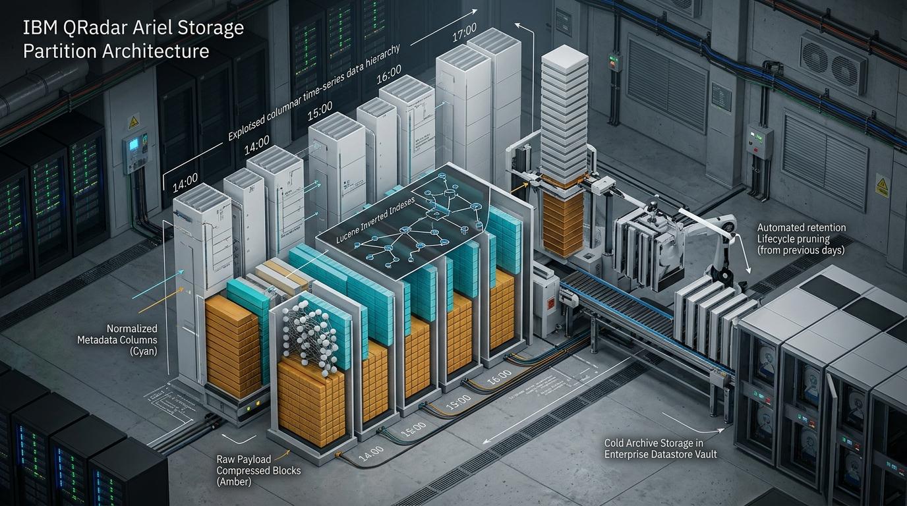
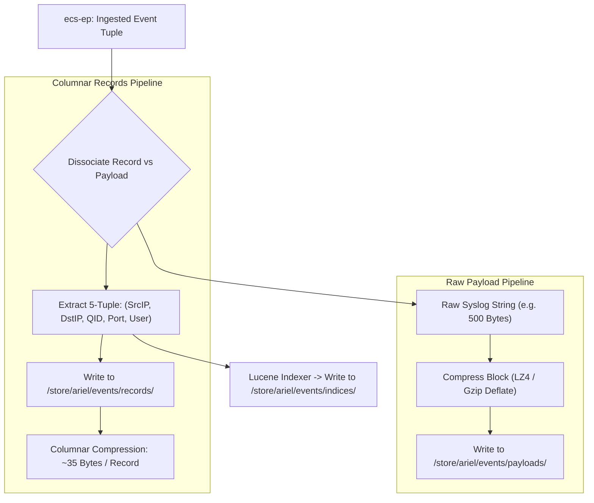
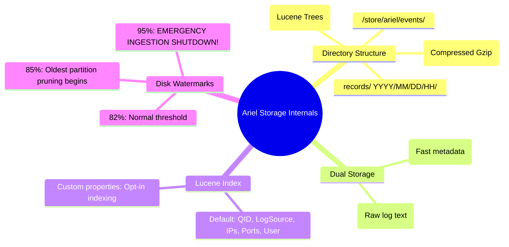

# 📖 Chapter 70: Ariel Database Internals: Partitions, Lucene Indexing & Retention Pruning Masterclass

> **The IBM QRadar Administrator's Technical Guide** | Phase 7: AQL Mastery & Ariel Storage Optimization  
> **Target Audience:** 1.5-Year Administrators $\rightarrow$ Senior SIEM Engineers & Detection Engineering Specialists  
> **Focus:** Ariel Physical Disk Layout, Records vs Payloads, Lucene Inverted Indexes, Super-Intervals, Retention Pruning, & Hands-on Lab 70

---

## 📸 1. Visual Overview: Ariel Storage Subsystem & Directory Hierarchy


*Figure 70.1: 3D Isometric Cutaway of the Ariel Time-Series Columnar Database: Hourly partitioned storage showing Normalized Metadata Records (Cyan), Compressed Raw Payloads (Amber), Lucene Inverted Index Trees, and Automated Retention Lifecycles (`![[qradar_ariel_storage_partitions_3d_1791647224940.jpg|1000]]`)*

---

## 2. What is the Ariel Database?

**Ariel** is IBM QRadar's proprietary, append-only, time-series columnar datastore engineered specifically for high-throughput security event and network flow persistence. 

Unlike traditional relational databases (which fail under $> 10,000\ \text{EPS}$ due to transactional locking), Ariel achieves ingestion rates exceeding **$100,000+\ \text{EPS}$ per appliance** by utilizing strict time partitioning, columnar binary layouts, and asynchronous Lucene indexing.

```
┌────────────────────────────────────────────────────────────────────────┐
│ 🏛️ THE 4 ARCHITECTURAL PILLARS OF ARIEL STORAGE                        │
│                                                                        │
│ 1. TIME-SLICED HOURLY DIRECTORY PARTITIONING                           │
│    • Filesystem is partitioned strictly by UTC Year, Month, Day, Hour. │
│    • Queries prune 99% of disk directories before reading a single byte│
│ ├────────────────────────────────────────────────────────────────────┤
│ 2. DUAL DISSOCIATED STORAGE (RECORDS VS PAYLOADS)                      │
│    • Normalized Records (Fast Columnar Metadata) are stored SEPARATELY │
│      from Raw Payloads (Gzip/LZ4 Compressed Blocks).                   │
│ ├────────────────────────────────────────────────────────────────────┤
│ 3. LUCENE INVERTED INDEXING                                            │
│    • Fixed 5-tuple fields are indexed asynchronously every minute.     │
│ ├────────────────────────────────────────────────────────────────────┤
│ 4. AUTOMATED WATERMARK RETENTION PRUNING                               │
│    • Self-governing disk cleanup based on percentage watermarks.       │
└────────────────────────────────────────────────────────────────────────┘
```

---

## 3. Physical Directory Hierarchy in `/store/ariel/`

All event and flow data on Managed Hosts and Consoles is stored under the `/store/ariel/` filesystem mount:

```
/store/ariel/
├── events/
│   ├── records/                     <-- Normalized columnar metadata
│   │   └── 2026/
│   │       └── 09/
│   │           └── 25/
│   │               ├── 00/          <-- Hour 00 UTC (00:00 - 00:59)
│   │               ├── 01/
│   │               └── 14/
│   │                   └── events~2026_9_25_14_0_0.ariel
│   ├── payloads/                    <-- Compressed raw log strings
│   │   └── 2026/09/25/14/
│   │       └── payload~2026_9_25_14_0_0.ariel.gz
│   └── indices/                     <-- Lucene inverted index trees
│       └── 2026/09/25/14/
│           ├── _0.cfe
│           ├── _0.cfs
│           └── segments_1
├── flows/                           <-- Network flow records & payloads
│   ├── records/2026/09/25/14/
│   └── payloads/2026/09/25/14/
└── persistent_data/                 <-- Historical baseline profiles
```

---

## 4. Records vs Payloads: The Dual-Storage Architecture



---

## 5. Lucene Inverted Indexing & Out-of-the-Box Indexed Properties

Ariel writes Lucene index segments every 60 seconds. Queries testing indexed fields jump directly to the target record offsets without scanning unmatching records:

| Default Indexed Property | Ariel Storage Field | Index Implementation |
| :--- | :--- | :--- |
| **Event Time** | `starttime` / `endtime` | Millisecond B-Tree Range Index |
| **QID** | `qid` | Lucene Term Integer Index |
| **Log Source** | `logsourceid` | Lucene Term Integer Index |
| **Source IP** | `sourceip` | 32-bit Bitmask / Integer Term Index |
| **Destination IP** | `destinationip` | 32-bit Bitmask / Integer Term Index |
| **Destination Port** | `destinationport` | 16-bit Integer Range Index |
| **Username** | `username` | Lucene Lowercase String Inverted Term Index |

---

## 6. Retention Buckets & Watermark Disk Pruning

Ariel automatically monitors the disk capacity of `/store` (monitored by `hostcontext` and `ariel-writer`):

```
┌────────────────────────────────────────────────────────────────────────┐
│ 🚨 THE 4 DISK WATERMARK THRESHOLDS IN QRADAR                           │
│                                                                        │
│ 1. NORMAL OPERATION ($< 82\%$ Disk Usage):                             │
│    • Data accumulates normally according to Retention Policy retention │
│      buckets (e.g. Keep Events for 90 Days).                           │
│ ├────────────────────────────────────────────────────────────────────┤
│ 2. WARNING WATERMARK ($82\%$ to $85\%$ Disk Usage):                    │
│    • System generates informational notification: "Storage utilization │
│      approaching threshold".                                           │
│ ├────────────────────────────────────────────────────────────────────┤
│ 3. AGGRESSIVE PRUNING WATERMARK ($85\%$ to $90\%$ Disk Usage):         │
│    • Ariel automatically deletes the OLDEST uncompressed, unlocked     │
│      hourly partitions regardless of retention policy!                 │
│ ├────────────────────────────────────────────────────────────────────┤
│ 4. CRITICAL HALT WATERMARK ($95\%$ Disk Usage):                        │
│    • `ecs-ec-ingress` and `ecs-ep` SHUT DOWN automated ingestion to    │
│      prevent filesystem corruption! Incoming syslog drops!             │
└────────────────────────────────────────────────────────────────────────┘
```

---

## 📌 7. Visual Mind Map & Sticky Notes (Chapter 70 Quick-Review)

### 🧠 Hierarchical Mind Map


### 🗂️ Color-Coded Digital Sticky Notes

#### 🟨 Sticky Note 1: Hourly Partition Trees
```text
┌─────────────────────────────────────────────────────────────┐
│ 📌 CONCEPT: TIME-PRUNING HIERARCHY                          │
│                                                             │
│ • Hourly folders (`YYYY/MM/DD/HH/`) allow queries to skip   │
│   entire days or weeks of disk data before reading files!   │
└─────────────────────────────────────────────────────────────┘
```

#### 🟩 Sticky Note 2: Payloads vs Records Separation
```text
┌─────────────────────────────────────────────────────────────┐
│ 📌 GOLDEN RULE: QUERIES READ RECORDS FIRST                  │
│                                                             │
│ • Ariel queries read ONLY the `records/` files unless your  │
│   query explicitly calls `UTF8(payload)` or `SELECT *`!     │
└─────────────────────────────────────────────────────────────┘
```

#### 🟪 Sticky Note 3: The 85% Disk Watermark
```text
┌─────────────────────────────────────────────────────────────┐
│ 📌 STORAGE: AUTOMATED OLD DATA PRUNING                      │
│                                                             │
│ • When `/store` crosses 85%, Ariel begins deleting the      │
│   oldest unlocked hourly partitions to protect the OS.      │
└─────────────────────────────────────────────────────────────┘
```

#### 🟦 Sticky Note 4: Protecting Critical Partitions
```text
┌─────────────────────────────────────────────────────────────┐
│ 📌 COMPLIANCE: RETENTION LOCKING                            │
│                                                             │
│ • In the QRadar UI, "Lock" critical investigation dates to  │
│   prevent Ariel from auto-pruning them during disk spikes!  │
└─────────────────────────────────────────────────────────────┘
```

#### 🟧 Sticky Note 5: Interview Cheat Code (Ariel Architecture)
```text
┌─────────────────────────────────────────────────────────────┐
│ 📌 INTERVIEW CHEAT CODE: "HOW DOES ARIEL STORE LOGS?"       │
│                                                             │
│ "Ariel is an append-only time-series columnar engine that   │
│ splits data into hourly partitions, separating normalized   │
│ metadata records from compressed payloads, indexed with     │
│ Lucene and pruned automatically via disk watermarks."       │
└─────────────────────────────────────────────────────────────┘
```

#### 🟥 Sticky Note 6: Critical Pitfall
```text
┌─────────────────────────────────────────────────────────────┐
│ ⚠️ CRITICAL PITFALL: DISK REACHING 95%                      │
│                                                             │
│ • If `/store` reaches 95%, QRadar halts `ecs-ep` ingestion  │
│   immediately. Monitor disk space weekly to prevent outages!│
└─────────────────────────────────────────────────────────────┘
```

---

## ⚡ Rapid-Recall Flashcards

| # | Question (Front) | Answer (Back) |
| :-: | :--- | :--- |
| **01** | What is the base filesystem path for Ariel database partitions in QRadar? | **`/store/ariel/events/`** and **`/store/ariel/flows/`**. |
| **02** | What are the two distinct files created for every time partition in Ariel? | **`records/`** (normalized metadata) and **`payloads/`** (raw compressed text). |
| **03** | How often does Ariel generate Lucene inverted index files? | Every **60 seconds** (asynchronous batch). |
| **04** | At what disk watermark does Ariel begin aggressively deleting the oldest unlocked hourly partitions? | At **$85\%$ disk utilization** of `/store`. |
| **05** | What occurs when `/store` reaches 95% capacity? | **Emergency Ingestion Shutdown**: `ecs-ec-ingress` and `ecs-ep` halt to prevent corruption, dropping incoming packets. |
| **06** | How can an administrator prevent critical historical forensic logs from being auto-deleted during disk pruning? | By **Locking** the retention bucket or date range in Admin $\rightarrow$ Event Retention. |

---

## 🧪 7. Hands-on Practice Lab 70: Exploring `/store/ariel/` Filesystem & Retention Telemetry

### 🎯 Lab Objectives
1. Inspect the physical `/store/ariel/` partition layout on disk via CLI.
2. Measure storage consumption across `records/` vs `payloads/` vs `indices/`.
3. Query retention bucket configurations in PostgreSQL.
4. Audit disk utilization and watermark thresholds.

---

### 📋 Step-by-Step Practical Lab Procedures

#### Step 1: Inspect the Ariel Directory Hierarchy
Log into the QRadar Console or Managed Host via SSH as `root`:
```bash
# Explore the physical hourly partitions of Ariel events
ls -la /store/ariel/events/records/$(date '+%Y/%m/%d')/ 2>/dev/null || ls -la /store/ariel/events/records/
```

---

#### Step 2: Measure Disk Consumption: Records vs Payloads vs Indexes
```bash
# Compare disk size of normalized records vs raw compressed payloads
echo "=== Ariel Records Size ==="
du -sh /store/ariel/events/records/ 2>/dev/null

echo "=== Ariel Payloads Size ==="
du -sh /store/ariel/events/payloads/ 2>/dev/null

echo "=== Ariel Lucene Indices Size ==="
du -sh /store/ariel/events/indices/ 2>/dev/null
```
*Expected Output*: Payloads consume $\sim 70\text{--}80\%$ of total storage; records consume $\sim 15\text{--}20\%$; indices consume $\sim 5\%$.

---

#### Step 3: Query Active Event Retention Buckets in PostgreSQL
```bash
psql -U qradar -d qradar -x -c "
SELECT 
    id AS BucketID, 
    name AS BucketName, 
    retention_period AS RetentionDays, 
    is_locked AS IsLocked, 
    description 
FROM retention_bucket 
ORDER BY id ASC;
"
```

---

#### Step 4: Audit `/store` Mount Disk Usage and Inodes
```bash
# Check disk capacity and inode availability on /store
df -h /store
df -i /store
```
