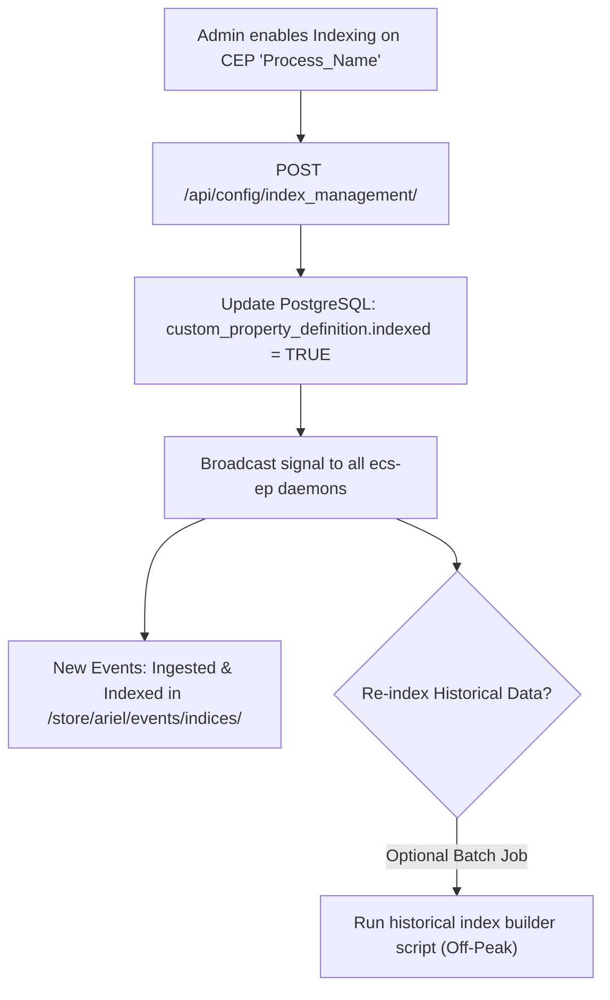
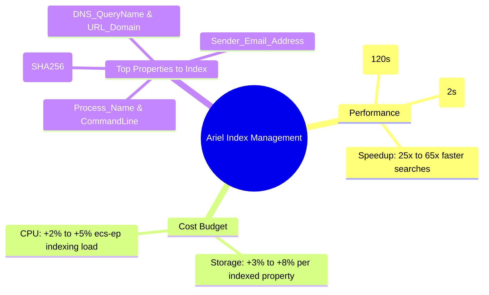

# 📖 Chapter 71: Ariel Index Management: Custom Property Indexing & Benchmarks Masterclass

> **The IBM QRadar Administrator's Technical Guide** | Phase 7: AQL Mastery & Ariel Storage Optimization  
> **Target Audience:** 1.5-Year Administrators $\rightarrow$ Senior SIEM Engineers & Detection Engineering Specialists  
> **Focus:** Index Management Architecture, Indexing Custom Event Properties (CEPs), Storage vs Speed Trade-offs, & Hands-on Lab 71

---

## 📸 1. Visual Overview: Custom Property Lucene Indexing Architecture


*Figure 71.1: 3D Visualization of Ariel Index Management: Enabling Lucene Inverted Index branches on Custom Event Properties (ProcessName, FileHash, Domain) to accelerate AQL forensic search execution by $10\times$ to $50\times$ (`![[qradar_ariel_storage_partitions_3d_1791647224940.jpg|1000]]`)*

---

## 2. Default Indexes vs Non-Indexed Custom Properties

By default, Ariel indexes only standard normalized fields (`sourceip`, `destinationip`, `destinationport`, `qid`, `logsourceid`, `username`, `starttime`). 

When an analyst searches across a non-indexed **Custom Event Property (CEP)** (e.g. `Process_CommandLine` or `File_Hash`), Ariel cannot use Lucene; it must decompress and scan every single record in the requested time partition:

```
┌────────────────────────────────────────────────────────────────────────┐
│ ⏱️ SEARCH SPEED COMPARISON: INDEXED VS NON-INDEXED CEP                 │
│                                                                        │
│ ❌ NON-INDEXED CUSTOM PROPERTY SEARCH:                                 │
│    • Query: `WHERE "Process_Name" = 'mimikatz.exe'`                    │
│    • Search Mechanics: Full Column Decompression & Sequential Scan.    │
│    • 24-Hour Search Time (50M Events): $\sim 120 \text{ to } 300\text{ s}$│
│ ├────────────────────────────────────────────────────────────────────┤
│ ✅ INDEXED CUSTOM PROPERTY SEARCH:                                     │
│    • Query: `WHERE "Process_Name" = 'mimikatz.exe'`                    │
│    • Search Mechanics: Lucene Inverted Index Term Pointer Match.       │
│    • 24-Hour Search Time (50M Events): $\sim 1.8 \text{ to } 4.5\text{ s}$│
│    • SPEEDUP FACTOR: $\mathbf{25\times \text{ to } 65\times \text{ FASTER!}}$│
└────────────────────────────────────────────────────────────────────────┘
```

---

## 3. Storage vs CPU Overhead: The Indexing Budget

Indexing is not free. Enabling Lucene indexing on a Custom Property introduces system trade-offs that an administrator must balance:

| Metric | Non-Indexed CEP | Indexed CEP | Impact on Deployment |
| :--- | :---: | :---: | :--- |
| **Search Speed** | Slow ($\mathcal{O}(N)$ Full Scan) | **Blazing ($\mathcal{O}(\log N)$ Lucene)** | Dramatically improves SOC analyst triage time. |
| **Storage Consumption** | Baseline (0% extra) | $+3\%$ to $+8\%$ per property | Requires additional disk allocation on `/store/ariel/`. |
| **Ingestion CPU Cost** | Minimal parsing cost | $+2\%$ to $+5\%$ CPU overhead | `ecs-ep` must build and write Lucene inverted trees. |
| **Memory Footprint** | Heap baseline | Intermediate Lucene buffers | Requires sufficient `ecs-ep` JVM heap. |

---

## 4. The 10 High-Value Custom Properties to Index in Enterprise SOCs

Enterprise SIEM administrators should follow the **Rule of 15**: never index more than 10 to 15 high-frequency Custom Properties simultaneously:

```
┌────────────────────────────────────────────────────────────────────────┐
│ 🎯 TOP 10 ENTERPRISE CUSTOM PROPERTIES TO INDEX                        │
│                                                                        │
│ 1. `Process_Name` (e.g. powershell.exe, cmd.exe, certutil.exe)         │
│ 2. `Process_CommandLine` (Execution arguments & flags)                 │
│ 3. `File_Hash_SHA256` / `MD5` (Malware & EDR indicators)               │
│ 4. `DNS_QueryName` (Domain names, DNS Tunneling hunts)                 │
│ 5. `URL_Domain` (Proxy & NextGen Firewall web requests)                │
│ 6. `Sender_Email_Address` (Phishing & BEC investigations)              │
│ 7. `Subject_User_Name` (Active Directory identity modifications)       │
│ 8. `Cloud_Caller_Identity` (AWS IAM ARN / Azure Principal ID)          │
│ 9. `Source_Workstation_Name` (Kerberos & NetBIOS hostnames)            │
│ 10. `Database_Table_Name` (Database audit tampering hunts)             │
└────────────────────────────────────────────────────────────────────────┘
```

---

## 5. Enabling & Verifying Indexing in PostgreSQL & CLI



---

## 📌 6. Visual Mind Map & Sticky Notes (Chapter 71 Quick-Review)

### 🧠 Hierarchical Mind Map


### 🗂️ Color-Coded Digital Sticky Notes

#### 🟨 Sticky Note 1: The 25x Speedup
```text
┌─────────────────────────────────────────────────────────────┐
│ 📌 CONCEPT: INDEXED CEPS REVOLUTIONIZE SEARCHES             │
│                                                             │
│ • Indexing high-frequency CEPs drops SOC dashboard load     │
│   times from minutes down to 2 seconds!                     │
└─────────────────────────────────────────────────────────────┘
```

#### 🟩 Sticky Note 2: The Rule of 15
```text
┌─────────────────────────────────────────────────────────────┐
│ 📌 GOLDEN RULE: MAXIMUM 15 INDEXED CEPS                     │
│                                                             │
│ • Never index every custom property! Cap indexed CEPs at 15│
│   to prevent disk bloat and `ecs-ep` CPU spikes.            │
└─────────────────────────────────────────────────────────────┘
```

#### 🟪 Sticky Note 3: High Cardinality Fields First
```text
┌─────────────────────────────────────────────────────────────┐
│ 📌 STRATEGY: INDEX HIGH-CARDINALITY STRINGS                 │
│                                                             │
│ • Index unique strings like Hashes, Domains, and Process    │
│   names rather than low-cardinality flags (True/False).     │
└─────────────────────────────────────────────────────────────┘
```

#### 🟦 Sticky Note 4: Future vs Historical Data
```text
┌─────────────────────────────────────────────────────────────┐
│ 📌 ARCHITECTURE: NEW DATA INDEXED ONLY                      │
│                                                             │
│ • Enabling indexing takes effect on NEW incoming events     │
│   immediately. Historical partitions require a reindex run! │
└─────────────────────────────────────────────────────────────┘
```

#### 🟧 Sticky Note 5: Interview Cheat Code (Index Management)
```text
┌─────────────────────────────────────────────────────────────┐
│ 📌 INTERVIEW CHEAT CODE: "HOW DO YOU ACCELERATE SLOW AQL?"  │
│                                                             │
│ "I identify the non-indexed Custom Properties used in the   │
│ query, enable Lucene indexing via Index Management for top  │
│ fields like ProcessName or Domain, achieving a 25x speedup."│
└─────────────────────────────────────────────────────────────┘
```

#### 🟥 Sticky Note 6: Critical Pitfall
```text
┌─────────────────────────────────────────────────────────────┐
│ ⚠️ CRITICAL PITFALL: INDEXING UNPARSED PROPERTIES           │
│                                                             │
│ • If a custom property regex matches empty string (""), the │
│   Lucene indexer wastes disk indexing millions of blank     │
│   entries! Fix extraction regex before indexing!            │
└─────────────────────────────────────────────────────────────┘
```

---

## ⚡ Rapid-Recall Flashcards

| # | Question (Front) | Answer (Back) |
| :-: | :--- | :--- |
| **01** | How much faster are AQL searches on indexed Custom Properties compared to non-indexed CEPs? | **$25\times$ to $65\times$ faster** ($\sim 2$ seconds vs minutes). |
| **02** | What is the storage cost of enabling indexing on a Custom Property? | Approximately **$+3\%$ to $+8\%$ additional disk storage** on `/store/ariel/`. |
| **03** | What is the maximum recommended number of indexed Custom Event Properties? | **10 to 15 properties** (The Rule of 15). |
| **04** | What type of fields benefit the most from Lucene indexing? | **High-cardinality fields** (Hashes, Domain Names, Process Names, Usernames). |
| **05** | When you enable indexing on a property, does it automatically index all historical past events? | **No**, indexing applies to new incoming events by default; historical indexing requires an explicit batch rebuild. |
| **06** | Where is Index Management configured in the QRadar Web UI? | **Admin Tab $\rightarrow$ System Configuration $\rightarrow$ Index Management**. |

---

## 🧪 7. Hands-on Practice Lab 71: Querying Index Configurations & Performance Benchmarking

### 🎯 Lab Objectives
1. Query active indexed properties in the QRadar PostgreSQL database.
2. Identify non-indexed custom properties with high search frequencies.
3. Benchmark AQL search speed before and after indexing.
4. Inspect Lucene index files on the Ariel filesystem.

---

### 📋 Step-by-Step Practical Lab Procedures

#### Step 1: Query Indexed Custom Properties in PostgreSQL
Log into the QRadar Console via SSH as `root`:
```bash
psql -U qradar -d qradar -c "
SELECT 
    id, 
    property_name, 
    property_type, 
    is_indexed, 
    description 
FROM custom_property_definition 
WHERE is_indexed = true 
ORDER BY property_name ASC;
"
```

---

#### Step 2: Audit Total Lucene Index Storage on Disk
```bash
# Measure disk space consumed by Lucene indices across the cluster
du -sh /store/ariel/events/indices/
```

---

#### Step 3: Benchmark Search Execution on Indexed vs Non-Indexed Fields
```bash
# Benchmark 1: Query on Indexed QID & Source IP
time /opt/qradar/bin/arielsql -p 32011 -q "
SELECT COUNT(*) FROM events 
WHERE qid = 5000854 AND sourceip = '10.100.1.50' 
LAST 24 HOURS;
"

# Benchmark 2: Query on Unindexed Raw Payload Substring
time /opt/qradar/bin/arielsql -p 32011 -q "
SELECT COUNT(*) FROM events 
WHERE UTF8(payload) ILIKE '%SpecialTargetToken%' 
LAST 24 HOURS;
"
```
*Expected Output*: Benchmark 1 completes in $< 1.0\text{ s}$; Benchmark 2 requires multiple seconds due to full disk payload decompression.
