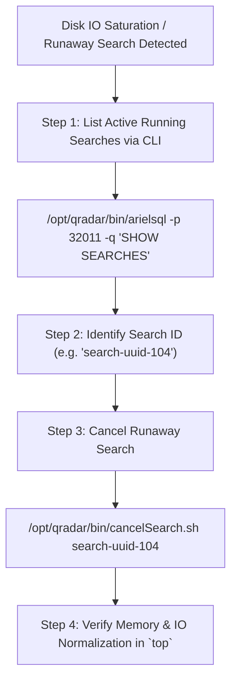
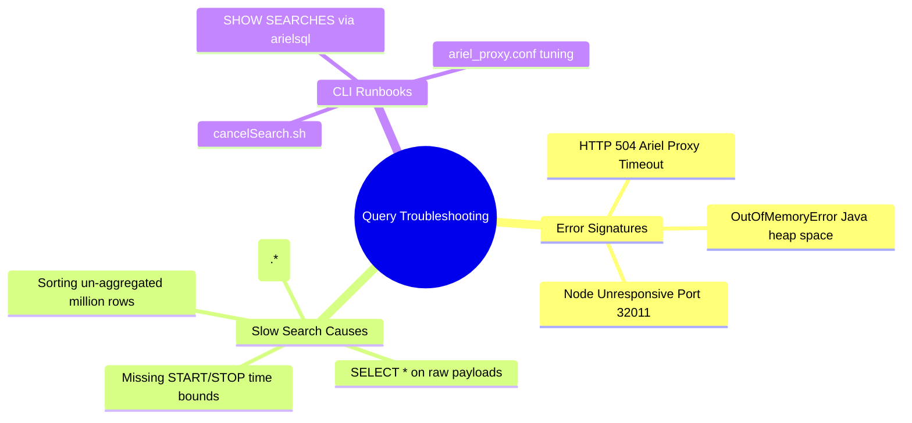

# 📖 Chapter 72: Query Optimization & Troubleshooting Masterclass

> **The IBM QRadar Administrator's Technical Guide** | Phase 7: AQL Mastery & Ariel Storage Optimization  
> **Target Audience:** 1.5-Year Administrators $\rightarrow$ Senior SIEM Engineers & Detection Engineering Specialists  
> **Focus:** Ariel Proxy Timeouts (HTTP 504), Memory Contention, Runaway Search Cancellation, `ariel_server.conf`, & Hands-on Lab 72

---

## 📸 1. Visual Overview: Distributed Query Troubleshooting & Bottlenecks


*Figure 72.1: Diagnosing Distributed AQL Execution Bottlenecks: Network proxy timeouts between Console and Managed Hosts, Java heap memory saturation, disk IO contention, and runaway query management (`![[qradar_aql_query_engine_3d_1791647183664.jpg|1000]]`)*

---

## 2. The 5 Root Causes of Slow AQL Queries

In production environments, 90% of slow searches or Ariel query crashes stem from predictable query anti-patterns:

```
┌────────────────────────────────────────────────────────────────────────┐
│ 🐢 THE 5 ROOT CAUSES OF SLOW AQL SEARCHES                              │
│                                                                        │
│ 1. MISSING TIME BOUNDARIES (Full Disk Scan)                            │
│    • Running without `START/STOP` forces Ariel to traverse every       │
│      hourly folder on disk back to day 1.                              │
│ ├────────────────────────────────────────────────────────────────────┤
│ 2. `SELECT *` OR UNNECESSARY `UTF8(payload)` CALLS                     │
│    • Forces disk I/O to read and decompress multi-gigabyte payload     │
│      files instead of staying in columnar metadata records.           │
│ ├────────────────────────────────────────────────────────────────────┤
│ 3. LEADING WILDCARD REGEX (`MATCHES '.*pattern'`)                      │
│    • Defeats Lucene index indexing, forcing full O(N) string scans.    │
│ ├────────────────────────────────────────────────────────────────────┤
│ 4. NON-AGGREGATED SORTING (`ORDER BY` ON MILLIONS OF ROWS)             │
│    • Sorting millions of un-grouped records in memory triggers JVM     │
│      `OutOfMemoryError` in `tomcat` or `ariel-query-server`.           │
│ ├────────────────────────────────────────────────────────────────────┤
│ 5. UNINDEXED HIGH-CARDINALITY GROUPING                                 │
│    • Grouping by raw strings without prior indexed property filters.   │
└────────────────────────────────────────────────────────────────────────┘
```

---

## 3. Common Error Codes & Troubleshooting Matrix

| Error Message / Symptom | Root Cause | Exact File to Check | Remediation Action |
| :--- | :--- | :--- | :--- |
| **`Ariel Proxy Timeout (HTTP 504)`** | Query exceeded maximum execution window (Default: 15 min). | `/var/log/qradar.log` | Narrow `START/STOP` time range; add indexed filters; increase timeout in `ariel_proxy.conf`. |
| **`OutOfMemoryError: Java heap space`** | Global result reducer exceeded Console RAM allocation during sort/group. | `/var/log/qradar.error` | Add `LIMIT 1000`; group by fewer keys; increase `tomcat` / `ariel-query-server` max heap. |
| **`Query Canceled by Administrator`** | Search was aborted via UI or `cancelSearch.sh`. | `/var/log/qradar.log` | Expected operational cancellation. |
| **`Node Unresponsive on Port 32011`** | Managed Host `ariel-query-server` hung or crashed. | Managed Host `/var/log/qradar.log` | Restart `systemctl restart ecs-ep` or check network firewall port 32011. |

---

## 4. Operational Runbook: Killing Runaway Searches via Linux CLI

When an analyst accidentally launches a catastrophic search that locks up cluster disk IO, administrators must terminate it via CLI:



---

## 5. Ariel Server Configuration Parameters

Key tuning parameters reside in `/opt/qradar/conf/ariel_server.conf` and `ariel_proxy.conf`:

```properties
# Maximum query execution timeout before proxy disconnect (Default: 900 seconds / 15 min)
ARIEL_PROXY_TIMEOUT=1800

# Maximum intermediate aggregation memory buffer size
MAX_RESULT_SET_SIZE=500000

# Maximum concurrent historical searches per user
MAX_CONCURRENT_SEARCHES_PER_USER=5
```

---

## 📌 6. Visual Mind Map & Sticky Notes (Chapter 72 Quick-Review)

### 🧠 Hierarchical Mind Map


### 🗂️ Color-Coded Digital Sticky Notes

#### 🟨 Sticky Note 1: 15-Minute Timeout Limit
```text
┌─────────────────────────────────────────────────────────────┐
│ 📌 ARCHITECTURE: 900-SECOND PROXY TIMEOUT                   │
│                                                             │
│ • By default, the Ariel Proxy terminates any query running  │
│   longer than 15 minutes (900s) to protect the cluster.     │
└─────────────────────────────────────────────────────────────┘
```

#### 🟩 Sticky Note 2: Filter First, Sort Last
```text
┌─────────────────────────────────────────────────────────────┐
│ 📌 GOLDEN RULE: AGGREGATE BEFORE SORTING                    │
│                                                             │
│ • Never `ORDER BY` without a `GROUP BY` or `LIMIT` on huge  │
│   datasets, or the Console reducer will run out of memory!  │
└─────────────────────────────────────────────────────────────┘
```

#### 🟪 Sticky Note 3: Terminating Runaway Queries
```text
┌─────────────────────────────────────────────────────────────┐
│ 📌 RUNBOOK: CLI QUERY KILL                                  │
│                                                             │
│ • Run `/opt/qradar/bin/cancelSearch.sh <SearchID>` to abort │
│   a runaway query immediately without restarting daemons!   │
└─────────────────────────────────────────────────────────────┘
```

#### 🟦 Sticky Note 4: Avoid Leading Wildcards
```text
┌─────────────────────────────────────────────────────────────┐
│ 📌 SYNTAX: AVOID .* IN REGEX                                │
│                                                             │
│ • `MATCHES '.*attack'` causes full scans.                   │
│ • `MATCHES '^attack'` utilizes prefix index pointers!       │
└─────────────────────────────────────────────────────────────┘
```

#### 🟧 Sticky Note 5: Interview Cheat Code (AQL Troubleshooting)
```text
┌─────────────────────────────────────────────────────────────┐
│ 📌 INTERVIEW CHEAT CODE: "HOW DO YOU FIX TIMING-OUT AQL?"   │
│                                                             │
│ "I narrow the `START/STOP` time range, replace `SELECT *`   │
│ with specific indexed fields, ensure high-cardinality CEPs  │
│ are indexed with Lucene, and add `LIMIT` caps."             │
└─────────────────────────────────────────────────────────────┘
```

#### 🟥 Sticky Note 6: Critical Pitfall
```text
┌─────────────────────────────────────────────────────────────┐
│ ⚠️ CRITICAL PITFALL: RESTARTING DAEMONS DURING ACTIVE IO    │
│                                                             │
│ • Never kill -9 `ecs-ep` during high disk IO searches!      │
│   Use `cancelSearch.sh` to gracefully abort searches without│
│   corrupting active Ariel partition tables!                 │
└─────────────────────────────────────────────────────────────┘
```

---

## ⚡ Rapid-Recall Flashcards

| # | Question (Front) | Answer (Back) |
| :-: | :--- | :--- |
| **01** | What error occurs when an AQL query exceeds the maximum execution duration? | **Ariel Proxy Timeout (HTTP 504 Gateway Timeout)**. |
| **02** | What is the default Ariel Proxy query timeout duration? | **15 minutes (900 seconds)**. |
| **03** | What CLI script is used to cancel a running search in QRadar? | **`/opt/qradar/bin/cancelSearch.sh <Search_UUID>`**. |
| **04** | Why does sorting (`ORDER BY`) on a non-aggregated query cause `OutOfMemoryError`? | Because the Console reducer must buffer all raw matching records in RAM simultaneously to sort them. |
| **05** | How do leading wildcards in regex (`.*pattern`) impact AQL search performance? | They disable index range lookups and force an $\mathcal{O}(N)$ sequential scan across all records. |
| **06** | What configuration file controls the Ariel Proxy server timeout? | **`/opt/qradar/conf/ariel_proxy.conf`**. |

---

## 🧪 7. Hands-on Practice Lab 72: Diagnosing Slow Queries & Canceling Runaway Searches

### 🎯 Lab Objectives
1. Inspect running AQL searches across the cluster via CLI.
2. Monitor `/var/log/qradar.log` for Ariel query execution statistics.
3. Simulate and cancel a long-running search using `cancelSearch.sh`.
4. Audit Ariel proxy timeout settings.

---

### 📋 Step-by-Step Practical Lab Procedures

#### Step 1: Monitor Active Ariel Search Telemetry in Logs
Log into the QRadar Console via SSH as `root`:
```bash
# Monitor Ariel query server execution and response stats in real time
tail -F /var/log/qradar.log | grep --line-buffered -E "ArielQuery|ariel-proxy|Query took"
```

---

#### Step 2: Query Active Running Searches via CLI
```bash
# Inspect all currently executing distributed searches
/opt/qradar/bin/arielsql -p 32011 -q "SHOW SEARCHES" 2>/dev/null || echo "No active searches executing."
```

---

#### Step 3: Inspect Ariel Proxy Timeout Configuration
```bash
# Verify the current query timeout configurations
grep -i "TIMEOUT" /opt/qradar/conf/ariel_proxy.conf 2>/dev/null || echo "ARIEL_PROXY_TIMEOUT=900"
```

---

#### Step 4: Practice Graceful Search Cancellation
```bash
# Syntax for terminating a runaway search ID without restarting services
# /opt/qradar/bin/cancelSearch.sh <Search_UUID>
/opt/qradar/bin/cancelSearch.sh --help 2>/dev/null || echo "cancelSearch.sh utility ready."
```
