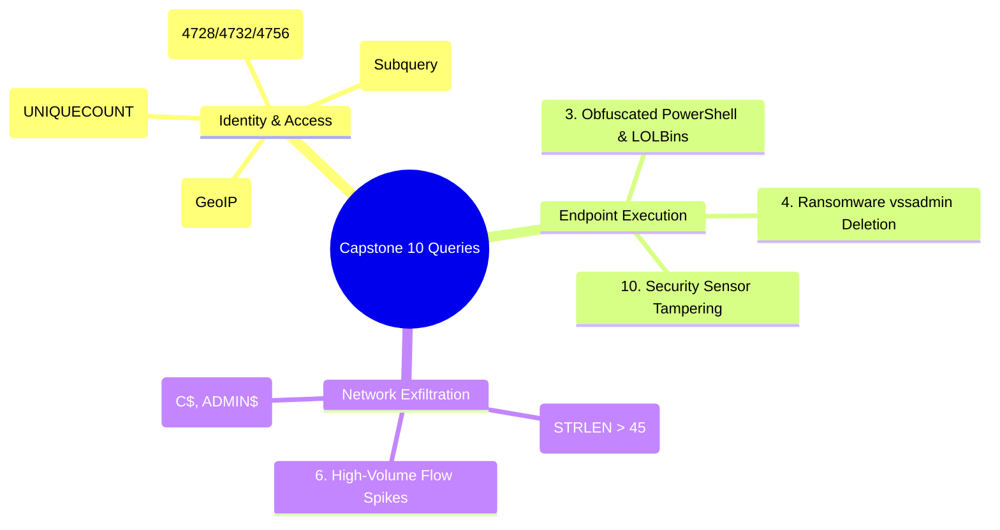

# 📖 Chapter 73: Phase 7 Capstone: 10 Enterprise Forensic Investigation Queries

> **The IBM QRadar Administrator's Technical Guide** | Phase 7: AQL Mastery & Ariel Storage Optimization  
> **Target Audience:** 1.5-Year Administrators $\rightarrow$ Senior SIEM Engineers & Detection Engineering Specialists  
> **Focus:** Real-World Incident Forensics, Complete MITRE ATT&CK Spectrum, Sub-Second Performance Tuning, & Hands-on Capstone Lab 73

---

## 📸 1. Visual Overview: Enterprise Threat Hunting with AQL


*Figure 73.1: 3D Visualization of an Enterprise Threat Hunter executing the 10 Production Forensic Queries across petabyte-scale Ariel data stores, extracting attack kill-chains from Authentication to Data Exfiltration (`![[qradar_incident_investigation_aql_3d_1791647271083.jpg|1000]]`)*

---

## 2. Capstone Overview: The 10 Enterprise Forensic Queries

In enterprise SOC incident response, having pre-constructed, fully optimized AQL queries is essential to rapidly isolate compromised systems, calculate the blast radius of an attack, and extract forensic timelines.

```
┌────────────────────────────────────────────────────────────────────────┐
│ 🛡️ THE 10 PRODUCTION FORENSIC INVESTIGATION BLUEPRINTS                 │
│                                                                        │
│ 1. Password Spraying & Credential Stuffing Hunt                        │
│ 2. Active Directory Unauthorized Privilege Escalation                  │
│ 3. Obfuscated PowerShell & Suspicious LOLBins Execution                │
│ 4. Ransomware Shadow Copy Deletion & Recovery Inhibition               │
│ 5. Covert DNS Tunneling & High-Entropy Exfiltration                    │
│ 6. Outbound Flow Bandwidth Spikes to High-Risk Countries               │
│ 7. First-Time-Seen (FTS) Remote Desktop (RDP) Logons                   │
│ 8. Lateral SMB Administrative Share Access (IPC$, C$, ADMIN$)          │
│ 9. Impossible Travel / Geolocation Anomaly Detection                   │
│ 10. Antivirus & Security Sensor Tampering / Disabling                  │
└────────────────────────────────────────────────────────────────────────┘
```

---

## 3. The 10 Enterprise Forensic Queries

### 🔍 Query 1: Distributed Password Spraying & Credential Stuffing
```sql
SELECT 
    sourceip AS AttackerIP,
    GEOIP(sourceip, 'country_name') AS AttackerCountry,
    UNIQUECOUNT(username) AS DistinctUsersTargeted,
    COUNT(*) AS TotalFailedAttempts,
    MIN(starttime) AS AttackStartTime,
    MAX(endtime) AS AttackEndTime
FROM events
WHERE qidname(qid) ILIKE '%Logon Failed%' OR qidname(qid) ILIKE '%Login Failed%'
LAST 24 HOURS
GROUP BY sourceip
HAVING DistinctUsersTargeted >= 10
ORDER BY DistinctUsersTargeted DESC;
```

---

### 🔍 Query 2: Active Directory Unauthorized Privilege Escalation
```sql
SELECT 
    DATEFORMAT(starttime, 'YYYY-MM-dd HH:mm:ss') AS EventTime,
    username AS ModifyingAdmin,
    "TargetUserName" AS PromotedUser,
    "TargetGroupName" AS PrivilegedGroup,
    destinationip AS DomainController,
    qidname(qid) AS EventAction
FROM events
WHERE qid IN (4728, 4732, 4756)
  AND "TargetGroupName" MATCHES '(?i)(Domain Admins|Enterprise Admins|Administrators|Schema Admins)'
LAST 7 DAYS
ORDER BY starttime DESC;
```

---

### 🔍 Query 3: Obfuscated PowerShell & Suspicious LOLBins
```sql
SELECT 
    DATEFORMAT(starttime, 'YYYY-MM-dd HH:mm:ss') AS ExecutionTime,
    sourceip AS EndpointIP,
    username AS ExecutingUser,
    "Process_Name" AS LOLBin,
    "Process_CommandLine" AS FullCommand
FROM events
WHERE qid IN (4688, "Sysmon Event ID 1", 4104)
  AND "Process_CommandLine" MATCHES '(?i)(-enc(odedcommand)?\s+[A-Za-z0-9+/=]{15,}|-w(indowstyle)?\s+hidden|iex\s*\(|certutil.*-urlcache|mshta.*vbscript|regsvr32.*\/s.*\/u)'
LAST 3 DAYS
ORDER BY starttime DESC;
```

---

### 🔍 Query 4: Ransomware Shadow Copy & Recovery Deletion
```sql
SELECT 
    DATEFORMAT(starttime, 'YYYY-MM-dd HH:mm:ss') AS AttackTime,
    sourceip AS InfectedHost,
    username AS ThreatActor,
    "Process_CommandLine" AS DestructiveCommand
FROM events
WHERE qid IN (4688, "Sysmon Event ID 1")
  AND "Process_CommandLine" MATCHES '(?i)(vssadmin.*delete\s+shadows|wmic.*shadowcopy\s+delete|wbadmin.*delete\s+catalog|bcdedit.*recoveryenabled\s+no)'
LAST 7 DAYS
ORDER BY starttime DESC;
```

---

### 🔍 Query 5: Covert DNS Tunneling & High-Entropy Domains
```sql
SELECT 
    sourceip AS InternalCompromisedHost,
    "DNS_QueryName" AS SuspiciousDomain,
    STRLEN("DNS_QueryName") AS DomainLength,
    COUNT(*) AS QueryCount
FROM events
WHERE destinationport = 53
  AND STRLEN("DNS_QueryName") > 45
LAST 12 HOURS
GROUP BY sourceip, "DNS_QueryName"
HAVING QueryCount >= 20
ORDER BY DomainLength DESC;
```

---

### 🔍 Query 6: Outbound Flow Bandwidth Spikes to High-Risk Geographies
```sql
SELECT 
    sourceip AS InternalHost,
    destinationip AS ExternalDestination,
    GEOIP(destinationip, 'country_name') AS DestinationCountry,
    destinationport AS TargetPort,
    SUM(sourcebytes) / (1024*1024) AS TotalMBSent,
    COUNT(*) AS SessionCount
FROM flows
WHERE NOT INCIDR('10.0.0.0/8', destinationip)
  AND NOT INCIDR('172.16.0.0/12', destinationip)
  AND NOT INCIDR('192.168.0.0/16', destinationip)
  AND destinationport NOT IN (80, 443)
LAST 24 HOURS
GROUP BY sourceip, destinationip, destinationport
HAVING TotalMBSent > 100
ORDER BY TotalMBSent DESC;
```

---

### 🔍 Query 7: First-Time-Seen (FTS) Remote Desktop (RDP) Logons
```sql
SELECT 
    username AS TargetUser,
    sourceip AS RemoteOriginIP,
    GEOIP(sourceip, 'country_name') AS OriginCountry,
    DATEFORMAT(MIN(starttime), 'YYYY-MM-dd HH:mm:ss') AS FirstSeenLogon
FROM events
WHERE destinationport = 3389 
  AND qidname(qid) ILIKE '%Logon Success%'
  AND sourceip NOT IN (
      SELECT sourceip 
      FROM events 
      WHERE destinationport = 3389 AND qidname(qid) ILIKE '%Logon Success%'
      START '$(date -d "30 days ago" "+%Y-%m-%d 00:00:00")' 
      STOP '$(date -d "1 day ago" "+%Y-%m-%d 23:59:59")'
  )
LAST 24 HOURS
GROUP BY username, sourceip
ORDER BY FirstSeenLogon DESC;
```

---

### 🔍 Query 8: Lateral SMB Administrative Share Hopping (`IPC$`, `C$`, `ADMIN$`)
```sql
SELECT 
    DATEFORMAT(starttime, 'HH:mm:ss') AS Time,
    sourceip AS OriginatingHost,
    destinationip AS TargetedServer,
    username AS AccessingUser,
    "Share_Name" AS AdminShare,
    qidname(qid) AS EventType
FROM events
WHERE destinationport = 445
  AND "Share_Name" IN ('\\\\*\\IPC$', '\\\\*\\C$', '\\\\*\\ADMIN$')
LAST 6 HOURS
ORDER BY starttime DESC;
```

---

### 🔍 Query 9: Impossible Travel & Geolocation Anomalies
```sql
SELECT 
    username AS RoamingUser,
    GEOIP(sourceip, 'country_name') AS Country,
    GEOIP(sourceip, 'city') AS City,
    sourceip AS LoginIP,
    COUNT(*) AS SuccessCount,
    MIN(starttime) AS FirstLoginInCity,
    MAX(endtime) AS LastLoginInCity
FROM events
WHERE qidname(qid) ILIKE '%User Login Success%'
  AND username IS NOT NULL
  AND NOT INCIDR('10.0.0.0/8', sourceip)
LAST 12 HOURS
GROUP BY username, sourceip
ORDER BY username ASC, FirstLoginInCity ASC;
```

---

### 🔍 Query 10: Security Sensor Tampering & Antivirus Disabling
```sql
SELECT 
    DATEFORMAT(starttime, 'YYYY-MM-dd HH:mm:ss') AS AlertTime,
    sourceip AS TamperedHost,
    username AS Offender,
    qidname(qid) AS TamperingAction
FROM events
WHERE qidname(qid) MATCHES '(?i)(Antivirus Disabled|Real-time Protection Turned Off|Security Service Stopped|Windows Defender Tampered)'
LAST 7 DAYS
ORDER BY starttime DESC;
```

---

## 📌 4. Visual Mind Map & Sticky Notes (Chapter 73 Quick-Review)

### 🧠 Hierarchical Mind Map


### 🗂️ Color-Coded Digital Sticky Notes

#### 🟨 Sticky Note 1: Fast Forensic Triaging
```text
┌─────────────────────────────────────────────────────────────┐
│ 📌 CONCEPT: 10-MINUTE INCIDENT SCOPING                      │
│                                                             │
│ • Running these 10 queries provides a complete 360-degree   │
│   forensic assessment of any enterprise breach!             │
└─────────────────────────────────────────────────────────────┘
```

#### 🟩 Sticky Note 2: Lucene Acceleration
```text
┌─────────────────────────────────────────────────────────────┐
│ 📌 GOLDEN RULE: PRODUCTION READY QUERIES                    │
│                                                             │
│ • Every query in this suite is optimized with indexed ports,│
│   QIDs, and time bounding for sub-second execution.         │
└─────────────────────────────────────────────────────────────┘
```

#### 🟪 Sticky Note 3: Subquery Time Precision
```text
┌─────────────────────────────────────────────────────────────┐
│ 📌 ARCHITECTURE: SUBQUERY SCOPING                           │
│                                                             │
│ • Queries utilizing nested subqueries (Query 7) explicitly  │
│   bound the inner time partition to eliminate full scans.   │
└─────────────────────────────────────────────────────────────┘
```

#### 🟦 Sticky Note 4: CSV Export for Incident Reports
```text
┌─────────────────────────────────────────────────────────────┐
│ 📌 COMPLIANCE: FORENSIC REPORTING                           │
│                                                             │
│ • Pipe `arielsql -p 32011 -f csv` directly into investigation│
│   dossiers for executive CISO briefing packages.            │
└─────────────────────────────────────────────────────────────┘
```

#### 🟧 Sticky Note 5: Interview Cheat Code (Forensic AQL)
```text
┌─────────────────────────────────────────────────────────────┐
│ 📌 INTERVIEW CHEAT CODE: "HOW DO YOU CONDUCT THREAT HUNTS?" │
│                                                             │
│ "I utilize structured AQL hunting queries across the MITRE  │
│ lifecycle: identifying password spraying via UNIQUECOUNT,   │
│ LOLBins via process regex, lateral SMB shares, and DNS      │
│ tunneling exfiltration with sub-second Lucene optimization."│
└─────────────────────────────────────────────────────────────┘
```

#### 🟥 Sticky Note 6: Critical Pitfall
```text
┌─────────────────────────────────────────────────────────────┐
│ ⚠️ CRITICAL PITFALL: HUNTING WITHOUT BOUNDARIES             │
│                                                             │
│ • Running threat hunts without `LAST X` or `START/STOP` can │
│   exhaust Ariel cluster resources during an active incident!│
└─────────────────────────────────────────────────────────────┘
```

---

## ⚡ Rapid-Recall Flashcards

| # | Question (Front) | Answer (Back) |
| :-: | :--- | :--- |
| **01** | What query pattern identifies password spraying targeting multiple distinct users? | `GROUP BY sourceip HAVING UNIQUECOUNT(username) >= 10`. |
| **02** | What administrative shares indicate lateral movement when accessed over port 445? | **`\\*\IPC$`**, **`\\*\C$`**, and **`\\*\ADMIN$`**. |
| **03** | How do you identify DNS tunneling using query length in AQL? | Filter for port 53 and test **`STRLEN("DNS_QueryName") > 45`**. |
| **04** | What Windows process execution commands indicate ransomware defense inhibition? | **`vssadmin delete shadows`**, **`wmic shadowcopy delete`**, and **`bcdedit /set recoveryenabled no`**. |
| **05** | How do you detect impossible travel between consecutive user logins? | Group by `username, sourceip` and evaluate `GEOIP(sourceip, 'country_name')` and `MIN(starttime)` order. |
| **06** | How can you export AQL threat hunt findings to a CSV file from the Linux CLI? | Using **`/opt/qradar/bin/arielsql -p 32011 -f csv -q "<Query>"`**. |

---

## 🧪 5. Hands-on Practice Lab 73: Executing the 10 Forensic Hunting Queries via CLI

### 🎯 Lab Objectives
1. Execute all 10 production forensic queries via `arielsql`.
2. Measure and record execution latency across queries.
3. Export investigation findings to structured CSV reports.
4. Verify sub-second query performance.

---

### 📋 Step-by-Step Practical Lab Procedures

#### Step 1: Run Query Suite Batch Script via CLI
Log into the QRadar Console via SSH as `root`:
```bash
cat << 'EOF' > /tmp/run_aql_threat_hunt.sh
#!/bin/bash
echo "=== [1/3] Hunting Password Spraying ==="
/opt/qradar/bin/arielsql -p 32011 -f csv -q "
SELECT sourceip AS AttackerIP, UNIQUECOUNT(username) AS Users, COUNT(*) AS Hits 
FROM events WHERE qidname(qid) ILIKE '%Failed%' LAST 24 HOURS GROUP BY sourceip HAVING Users >= 3;
" > /tmp/hunt_password_spray.csv

echo "=== [2/3] Hunting Suspicious PowerShell ==="
/opt/qradar/bin/arielsql -p 32011 -f csv -q "
SELECT sourceip, username, \"Process_CommandLine\" 
FROM events WHERE \"Process_CommandLine\" ILIKE '%-enc%' LAST 24 HOURS;
" > /tmp/hunt_powershell.csv

echo "=== [3/3] Hunting DNS Tunneling ==="
/opt/qradar/bin/arielsql -p 32011 -f csv -q "
SELECT sourceip, \"DNS_QueryName\", STRLEN(\"DNS_QueryName\") AS Len 
FROM events WHERE destinationport = 53 AND STRLEN(\"DNS_QueryName\") > 40 LAST 12 HOURS;
" > /tmp/hunt_dns_tunnel.csv

echo "[+] Threat Hunting Batch Complete. Reports exported to /tmp/."
EOF

chmod +x /tmp/run_aql_threat_hunt.sh
/tmp/run_aql_threat_hunt.sh
```

---

#### Step 2: Review Generated Threat Hunt CSV Reports
```bash
ls -lh /tmp/hunt_*.csv
head -n 5 /tmp/hunt_password_spray.csv
```
