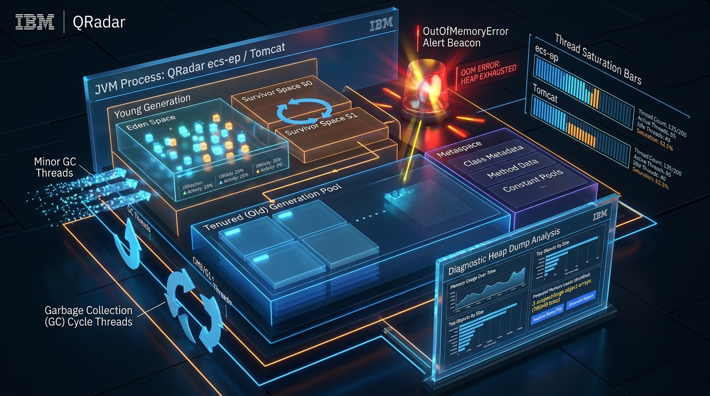
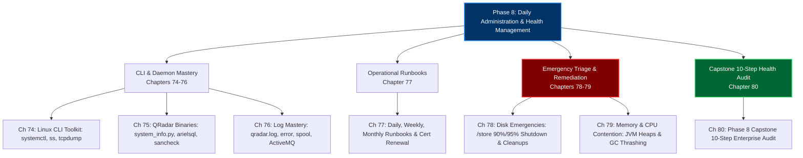
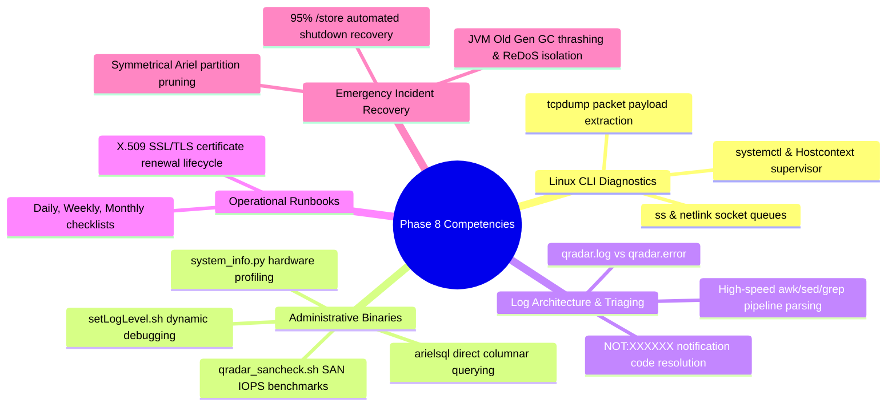

# Phase 8: Daily Administration, Linux CLI & Health Management (Days 74–80)

> **Track:** Enterprise IBM QRadar Administrator & SIEM Architect  
> **Phase Status:** 100% Complete (7 Chapters & 7 Embedded Hands-on Labs)  
> **Target Audience:** Senior SOC Engineers, SIEM Administrators (2+ Years Hands-on Experience)  
> **Prerequisites:** Phases 1–7 Mastery (Architecture, Ingestion, Parsing, CRE, Reference Data, AQL)  
> **Total Chapters:** 7 (Chapters 74–80) | **Total Embedded Labs:** 7 (Labs 74–80)  

---

## 1. 3D Architectural Visual Gallery

### Figure 8.1: QRadar Linux CLI Daemons & Ingress System Telemetry Cockpit

![[qradar_linux_cli_daemons_3d_1791648059770.jpg|1000]]

### Figure 8.2: Disk Protection Watermarks (85%, 90%, 95%) & Emergency Storage Cleanup

![[qradar_disk_cleanup_3d_1791648083811.jpg|1000]]

### Figure 8.3: Java Virtual Machine (JVM) Heap Architecture & Thread Saturation Profiler

![[qradar_jvm_heap_3d_1791648116152.jpg|1000]]

---

## 2. Phase 8 Overview & Curriculum Blueprint

Phase 8 elevates administrators from standard GUI operators to **Linux-native SIEM Engineers and System Architects**. When enterprise production clusters experience service crashes, backpressure, disk saturation, or certificate expirations, the Linux CLI is your primary operational cockpit.

---

## 3. Chapter Index & Hands-on Practice Labs Directory

| Chapter # | Day | Chapter Title | Core Technical Focus | Embedded Hands-on Lab |
| :--- | :--- | :--- | :--- | :--- |
| **[[Chapter_74_Linux_CLI_Toolkit_for_QRadar_systemctl_journalctl_ps_netstat_tcpdump|Chapter 74]]** | 74 | **Linux CLI Toolkit for QRadar** | `systemctl`, `journalctl`, `ps`, `top -H`, `df -i`, `ss -tina`, `tcpdump -X` | **Lab 74:** Live Linux CLI Diagnostics & Ingestion Triaging |
| **[[Chapter_75_QRadar_Administrative_Binaries_system_info_qradar_netstat_arielsql_sancheck|Chapter 75]]** | 75 | **QRadar Administrative Binaries** | `/opt/qradar/bin/` (`system_info.py`, `qradar_netstat.sh`, `arielsql`, `qradar_sancheck.sh`, `setLogLevel.sh`) | **Lab 75:** Mastering QRadar Administrative Binaries & Diagnostic Scripts |
| **[[Chapter_76_Log_File_Mastery_qradar_log_qradar_error_spool_ActiveMQ_Tomcat|Chapter 76]]** | 76 | **Log File Mastery** | `/var/log/qradar.log`, `/var/log/qradar.error`, `catalina.out`, ActiveMQ, Regex log parsing | **Lab 76:** Forensic Log Parsing & Live Triage Automation |
| **[[Chapter_77_Daily_Weekly_Monthly_Admin_Runbooks_Storage_LogSources_Licenses_Certificates|Chapter 77]]** | 77 | **Daily, Weekly & Monthly Admin Runbooks** | 3-Tier SIEM Operations Cadence, Log Source audits, SSL/TLS certificate renewals | **Lab 77:** Building an Automated Daily SIEM Health Audit Engine |
| **[[Chapter_78_Disk_Space_Emergencies_Store_at_90_and_95_Percent_Automated_Shutdown_Cleanups|Chapter 78]]** | 78 | **Disk Space Emergencies** | 85%/90%/95% Watermarks, Automated Service Shutdown, `/store` emergency cleanup playbook | **Lab 78:** Simulating & Resolving a 95% Disk Space Emergency |
| **[[Chapter_79_Memory_CPU_Contention_Runaway_Java_Heaps_Tomcat_Crashes_ecs_ep_Thread_Saturation|Chapter 79]]** | 79 | **Memory & CPU Contention** | JVM Heaps, GC Thrashing (`jstat -gcutil`), Decimal-to-Hex thread analysis (`top -H` + `jstack`) | **Lab 79:** Diagnosing High CPU, Thread Saturation & JVM Heaps |
| **[[Chapter_80_Phase_8_Capstone_10_Step_Enterprise_Health_Audit_on_Degraded_Cluster|Chapter 80]]** | 80 | **Phase 8 Capstone: Enterprise Health Audit** | 10-Step CLI Health Audit Playbook, RAG Status Scoring, Root Cause Analysis | **Lab 80:** The Phase 8 Capstone Health Audit Engine |

---

## 4. Phase 8 Competency Matrix

