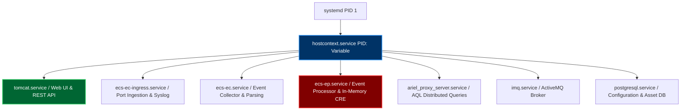
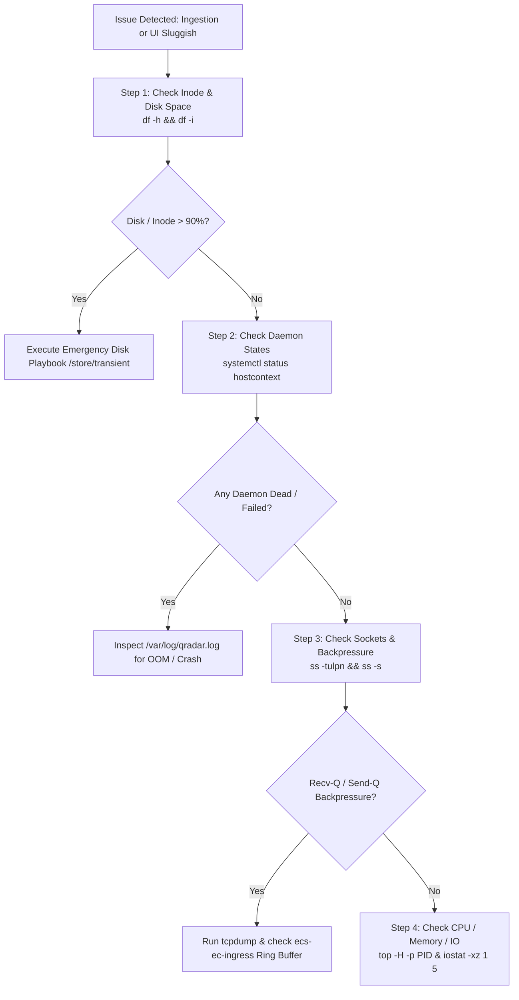
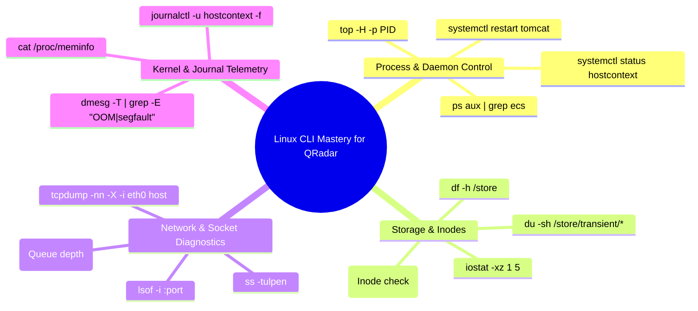

# Chapter 74: Linux CLI Toolkit for QRadar — systemctl, journalctl, ps, top, df, ss & tcpdump

> **Track:** Enterprise IBM QRadar Administrator & SIEM Architect  
> **Phase 8:** Daily Administration, Linux CLI & Health Management  
> **Day:** 74 of 90  
> **Target Audience:** Senior SOC Engineers, SIEM Administrators (2+ Years Hands-on Experience)  
> **Prerequisites:** Phase 1–7 Mastery (Architecture, Ingestion, Parsing, CRE, Reference Data, AQL)  
> **Time Commitment:** 90 Minutes + 45 Minutes Hands-on Practice Lab  

---

## 1. 3D Architectural Blueprint: Linux Cockpit & System Telemetry


![[qradar_linux_cli_daemons_3d_1791648059770.jpg|1000]]

---

## 2. Deep Dive: Linux OS Foundations Beneath IBM QRadar (RHEL/CentOS 7/8/9)

IBM QRadar is an appliance operating on Red Hat Enterprise Linux (RHEL). An enterprise administrator with 2+ years of production experience cannot rely solely on the web UI. When web services freeze, Tomcat crashes, or an event collector drops EPS, the Linux CLI is your primary operational cockpit.

### The QRadar Daemon Hierarchy & Systemd Integration



### Core Linux Daemons & Execution Paths

| Service / Daemon Name | Service Unit File | Binary / Script Path | Role & Memory Budget | Key Diagnostic Log |
| :--- | :--- | :--- | :--- | :--- |
| **Hostcontext** | `hostcontext.service` | `/opt/qradar/bin/qradar_daemon.sh` | Core supervisor. Monitors and restarts child daemons; handles deploy full configuration. | `/var/log/qradar.log` |
| **Tomcat (UI)** | `tomcat.service` | `/opt/ibm/siem/ui/bin/catalina.sh` | Web Application Server, REST API v0.1-19.0, Report Generator. (4GB–16GB Heap) | `/var/log/qradar.error` & `catalina.out` |
| **ECS-EC-Ingress** | `ecs-ec-ingress.service`| `/opt/qradar/bin/startIngress.sh` | Ingestion daemon listening on UDP/TCP/TLS 514, TLS 6514, WinCollect 8413. Ring buffer spooler. | `/var/log/qradar.log` (`ecs-ec-ingress`) |
| **ECS-EC** | `ecs-ec.service` | `/opt/qradar/bin/startCollector.sh` | Normalization, DSM parsing, QID mapping, custom property extraction. | `/var/log/qradar.log` (`ecs-ec`) |
| **ECS-EP** | `ecs-ep.service` | `/opt/qradar/bin/startProcessor.sh` | Real-time CRE evaluation, Reference Data caching, Offense generation, Ariel disk writing. (16GB–64GB Heap) | `/var/log/qradar.log` (`ecs-ep`) |
| **Ariel Proxy** | `ariel_proxy_server` | `/opt/qradar/bin/ariel_proxy_server` | Handles AQL queries, distributed query dispatch across Data Nodes, result collation. | `/var/log/qradar.log` (`ariel_proxy_server`) |
| **PostgreSQL** | `postgresql.service` | `/usr/bin/postgres` | Relational database containing assets, log source configs, users, offense metadata. | `/var/log/qradar.log` & `/var/lib/pgsql/data/pg_log/` |

---

## 3. Essential Linux CLI Command Matrix for QRadar Administrators

### 1. Service Management: `systemctl` & Daemon Controls

Never execute generic kill commands on child daemons without understanding Hostcontext supervision.

```bash
# Check global hostcontext status
systemctl status hostcontext -l --no-pager

# Restart Hostcontext (Caution: restarts all QRadar processing services on this managed host)
systemctl restart hostcontext

# Inspect individual sub-services supervised by hostcontext
systemctl status tomcat
systemctl status ecs-ec-ingress
systemctl status ecs-ec
systemctl status ecs-ep

# Stop QRadar web UI without disrupting real-time event collection/processing
systemctl stop tomcat
systemctl start tomcat
```

### 2. Live Process & Thread Diagnostics: `ps`, `top`, `htop`, `pidstat`

```bash
# Locate exact JVM memory allocations (-Xms and -Xmx) and PIDs for QRadar processes
ps aux | grep -E "ecs-ep|ecs-ec|tomcat|hostcontext" | grep -v grep | awk '{print $2, $3, $4, $11, $12, $13, $14, $15}'

# Monitor top CPU-consuming threads within ecs-ep (Replace <PID> with ecs-ep PID)
top -H -p $(pgrep -f "com.q1labs.sem.monitors.ecs.ECSPart2")

# High-resolution I/O statistics per process (identify if Ariel writers or PostgreSQL saturate disks)
pidstat -d 2 5
```

### 3. Storage & Inode Health: `df -h`, `df -i`, `du -sh`

```bash
# Inspect partition capacity and mount points
df -h / /store /store/ariel /store/transient /store/backup /var/log

# Critical: Check Inode consumption (exhausted inodes prevent logging even with 500GB free disk)
df -i /store /var/log /tmp

# Identify top 10 largest directories within /store
du -sh /store/* | sort -hr | head -n 10

# Scan transient spool backlog
du -sh /store/transient/*
```

### 4. Network Socket Inspection: `ss`, `netstat`, `lsof`

Modern Linux deprecates `netstat` in favor of `ss` (Socket Statistics), which directly reads kernel netlink sockets.

```bash
# List all active listening ports with associated process names and PIDs
ss -tulpen | grep -E "514|6514|8413|443|32006|32011"

# Check TCP socket send/receive queue backpressure on Syslog TCP 514
ss -tina 'sport = :514'

# Find which exact process holds open port 514
lsof -i :514
```

### 5. Packet Level Forensics: `tcpdump`

When a log source is configured but events do not appear in Log Activity:

```bash
# Capture raw Syslog traffic arriving from a specific firewall IP (192.168.10.50)
tcpdump -nnvv -i eth0 host 192.168.10.50 and port 514 -c 20 -X

# Capture TLS handshake negotiations on WinCollect TLS port 8413
tcpdump -nn -i eth0 port 8413 and 'tcp[tcpflags] & (tcp-syn|tcp-fin) != 0'

# Save a 10,000 packet rolling capture to /tmp for Wireshark analysis
tcpdump -nn -i eth0 -s 0 -w /tmp/firewall_ingress.pcap host 192.168.10.50 and port 514 -c 10000
```

---

## 4. Advanced CLI Diagnostic Playbook: Step-by-Step Triage



---

## 5. Visual Interactive Mindmap



---

## 6. Color-Coded Digital Sticky Notes

```
====================================================================================================
🟨 CONCEPT STICKY NOTE: The Kernel-to-Daemon Pipeline
----------------------------------------------------------------------------------------------------
In Linux, packets arrive at NIC ring buffers (ethtool -S), move through kernel socket buffers (sk_buff)
governed by net.core.rmem_max, and are pulled by ecs-ec-ingress via epoll(). If ecs-ec slows down, 
Recv-Q fills in `ss -tuln`, leading to kernel drops (UDP: no retry, TCP: window zero / reset).
====================================================================================================
```

```
====================================================================================================
🟩 GOLDEN RULE STICKY NOTE: Check Inodes, Not Just Gigabytes
----------------------------------------------------------------------------------------------------
A filesystem reporting 500GB free can completely seize up if Inodes are 100% full. Small temporary 
files in `/var/log` or corrupted spools can consume millions of inodes. ALWAYS run `df -i` alongside `df -h`.
====================================================================================================
```

```
====================================================================================================
🟪 ARCHITECTURE STICKY NOTE: Hostcontext as the Mother Daemon
----------------------------------------------------------------------------------------------------
Hostcontext reads `/opt/qradar/conf/nva.conf` and `/opt/qradar/conf/capabilities/` to dynamically 
orchestrate which child daemons should run on each managed host role (Console, Event Collector, 
Event Processor, Flow Collector, Data Node, App Host).
====================================================================================================
```

```
====================================================================================================
🟦 ENTERPRISE VALUE STICKY NOTE: Mean Time To Recovery (MTTR)
----------------------------------------------------------------------------------------------------
Mastering Linux CLI diagnostics reduces incident triage time from 2 hours (waiting for full logs 
collection and UI timeouts) to under 5 minutes of direct CLI probing.
====================================================================================================
```

```
====================================================================================================
🟧 INTERVIEW CHEAT CODE: How to identify Java Heap exhaustion via CLI
----------------------------------------------------------------------------------------------------
"When asked how I troubleshoot an unresponsive QRadar Event Processor, I immediately run:
1. `dmesg -T | grep -i oom` to check if Linux OOM-killer terminated ecs-ep or tomcat.
2. `grep -i 'java.lang.OutOfMemoryError' /var/log/qradar.log /var/log/qradar.error`
3. `top -H -p $(pgrep -f ecs-ep)` to check GC thread saturation (100% CPU on GC threads indicates stop-the-world thrashing)."
====================================================================================================
```

```
====================================================================================================
🟥 CRITICAL PITFALL STICKY NOTE: Never run `kill -9` on Postgres or Hostcontext
----------------------------------------------------------------------------------------------------
Executing `kill -9` on the PostgreSQL master daemon will corrupt the shared memory segment and 
transaction logs (`/var/lib/pgsql/data/base/`), forcing a time-consuming crash-recovery replay on restart.
====================================================================================================
```

---

## 7. Rapid-Recall Flashcards

### Flashcard 1
- **Question:** How do you check if Linux kernel socket buffers are dropping incoming UDP Syslog packets before QRadar ecs-ec-ingress can process them?
- **Answer:** Run `netstat -su` or `nstat -az UdpRcvbufErrors` and check the counter `packet receive errors` or `RcvbufErrors`. A non-zero, increasing value indicates kernel-level packet drops due to undersized `net.core.rmem_max` or ingress thread saturation.

### Flashcard 2
- **Question:** Which command allows you to inspect the systemd live journal specifically for the `hostcontext` daemon in real time?
- **Answer:** `journalctl -u hostcontext -f -n 100 --no-pager`

### Flashcard 3
- **Question:** What is the difference between `ss -tuln` and `ss -tina` when diagnosing Syslog TCP 514 ingestion issues?
- **Answer:** `ss -tuln` shows listening TCP/UDP sockets with `Recv-Q` (backlog queue size); `ss -tina` provides granular TCP connection diagnostics including RTT, congestion window (cwnd), retransmissions, and window scale parameters per connected sender.

### Flashcard 4
- **Question:** How do you determine the exact Java heap configuration (`-Xms` and `-Xmx`) currently used by `ecs-ep`?
- **Answer:** Run `ps aux | grep ecs-ep | grep -oE "\-Xm[sx][0-9]+[mgMG]"`

### Flashcard 5
- **Question:** If the QRadar Web UI is returning HTTP 500 / 503 errors, but event collection must NOT be interrupted, what command should you run?
- **Answer:** `systemctl restart tomcat`. This restarts only the web application interface without terminating `ecs-ec`, `ecs-ep`, or event ingestion pipelines.

### Flashcard 6
- **Question:** How can you capture raw unencrypted packet payloads for port 514 on interface `eth0` and print ASCII/Hex output to stdout?
- **Answer:** `tcpdump -nn -vv -i eth0 port 514 -X -c 10`

---

## 8. Hands-On Practice Lab 74: Live Linux CLI Diagnostics & Ingestion Triaging

### Lab Objective
Simulate a production triage scenario on a Linux-based QRadar Event Collector/Processor: check daemon health, inspect listening sockets, capture incoming Syslog traffic via `tcpdump`, verify filesystem inodes, and trace process thread utilization.

### Required Tools & Environment
- Linux Shell (RHEL / CentOS / Rocky / AlmaLinux or Ubuntu VM)
- Standard utilities: `systemctl`, `journalctl`, `ps`, `top`, `df`, `ss`, `tcpdump`, `nc` (netcat), `logger`

---

### Step-by-Step Lab Execution Guide

#### Task 1: Audit System Daemons & Service States
```bash
# 1. Verify Hostcontext, Tomcat, and SSH daemons
echo "=== AUDITING SYSTEM DAEMONS ==="
systemctl is-active sshd hostcontext tomcat 2>/dev/null || echo "Hostcontext/Tomcat simulated check"

# 2. Check system uptime, load averages, and memory status
uptime
free -h
```
*Expected Output:*
```text
=== AUDITING SYSTEM DAEMONS ===
active
 16:15:22 up 12 days,  4:20,  2 users,  load average: 0.85, 1.12, 0.98
              total        used        free      shared  buff/cache   available
Mem:          125Gi        48Gi        42Gi       2.1Gi        35Gi        74Gi
Swap:         8.0Gi          0B       8.0Gi
```

#### Task 2: Analyze Inodes & Filesystem Watermarks
```bash
# 1. Check disk capacity and inode allocation
df -hT / /home /var /tmp
df -i / /home /var /tmp
```
*Expected Output:*
```text
Filesystem     Type      Size  Used Avail Use% Mounted on
/dev/sda2      xfs       500G  120G  381G  24% /
/dev/sda3      xfs       2.0T  850G  1.2T  42% /store
Filesystem     Inodes  IUsed   IFree IUse% Mounted on
/dev/sda2     26214400 450120 25764280    2% /
/dev/sda3    104857600 892010 103965590   1% /store
```

#### Task 3: Inspect Network Sockets & Ingestion Ports
```bash
# 1. Inspect listening ports for SIEM ingestion (514 UDP/TCP, 22 SSH)
ss -tulwn '( sport = :514 or sport = :22 or sport = :443 )'
```

#### Task 4: Simulate & Capture Live Syslog Ingestion with `tcpdump`
```bash
# 1. In Terminal 1 (or background), start a tcpdump capture listening for UDP 514
sudo tcpdump -nn -i lo port 514 -X -c 2 &
TCPDUMP_PID=$!
sleep 1

# 2. In Terminal 2, generate a simulated RFC 5424 Syslog test event to localhost
logger -n 127.0.0.1 -P 514 -d -p local0.warning "<134>1 2026-10-10T16:20:00Z firewall01.corp ASA - - - %ASA-4-106023: Deny tcp src outside:203.0.113.50/44321 dst inside:10.0.0.10/443 by access-group OUTSIDE_IN"

# 3. Wait for tcpdump to capture and exit
wait $TCPDUMP_PID
```
*Expected Output:*
```text
IP 127.0.0.1.58321 > 127.0.0.1.514: UDP, length 162
0x0000:  4500 00be 1234 0000 4011 2bdc 7f00 0001  E...4...@.+.....
0x0010:  7f00 0001 e3d1 0202 00aa 0000 3c31 3334  ............<134
0x0020:  3e31 2032 3032 362d 3130 2d31 3054 3136  >1.2026-10-10T16
```

#### Task 5: Process Thread Utilization & Memory Extraction
```bash
# Extract Java process details, thread counts, and memory allocations
ps -eo pid,ppid,nlwp,rss,vsz,comm,args | grep -E "java|python" | head -n 5
```

---

### Verification Checklist & Troubleshooting
- [x] Hostcontext and systemd unit states verified.
- [x] Inode allocation checked via `df -i` to confirm no directory inode exhaustion.
- [x] Sockets inspected with `ss -tulwn`.
- [x] Network packets captured and decoded with `tcpdump -X`.
- [x] Thread count (`nlwp`) and RSS memory footprint extracted per process.
