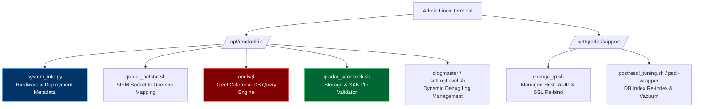
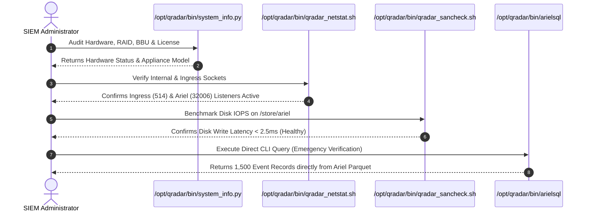
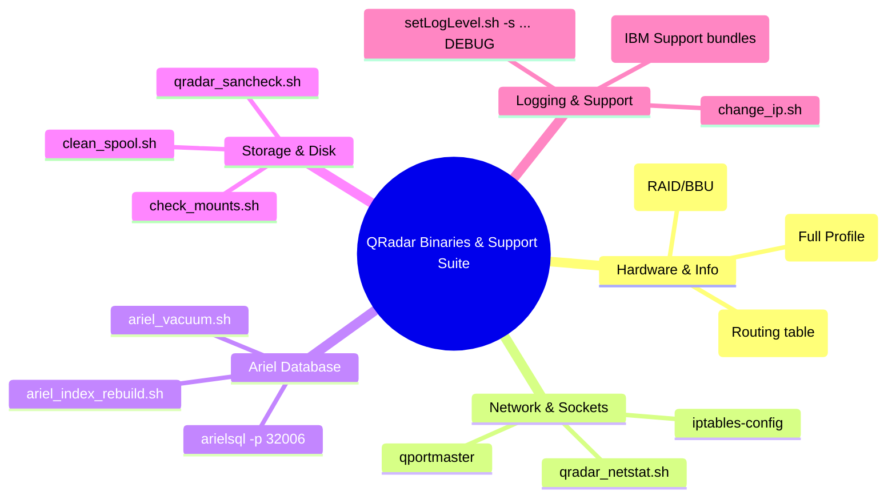

# Chapter 75: QRadar Administrative Binaries — system_info.py, qradar_netstat.sh, arielsql & sancheck

> **Track:** Enterprise IBM QRadar Administrator & SIEM Architect  
> **Phase 8:** Daily Administration, Linux CLI & Health Management  
> **Day:** 75 of 90  
> **Target Audience:** Senior SOC Engineers, SIEM Administrators (2+ Years Hands-on Experience)  
> **Prerequisites:** Chapter 74 (Linux CLI Toolkit for QRadar)  
> **Time Commitment:** 90 Minutes + 45 Minutes Hands-on Practice Lab  

---

## 1. 3D Architectural Blueprint: QRadar Binary Suite & CLI Cockpit


![[qradar_linux_cli_daemons_3d_1791648059770.jpg|1000]]

---

## 2. Deep Dive: The `/opt/qradar/bin/` & `/opt/qradar/support/` Ecosystem

Beyond standard Linux utilities, IBM QRadar ships with a powerful proprietary toolchain located in `/opt/qradar/bin/` and `/opt/qradar/support/`. These binaries interact directly with the QRadar database schema, Ariel storage subsystem, IMQ message broker, and hardware abstraction layer.



### Essential QRadar Administrative Binaries

| Binary / Script Name | Location | Purpose & Functionality | Common Use Cases |
| :--- | :--- | :--- | :--- |
| `system_info.py` | `/opt/qradar/bin/system_info.py` | Collects appliance hardware specs, serial number, deployment ID, appliance type (e.g., 3105, 1628, 1828), and HA role. | Pre-upgrade audits, licensing validation, support tickets. |
| `qradar_netstat.sh` | `/opt/qradar/bin/qradar_netstat.sh` | Maps active network sockets directly to QRadar application daemons (`ecs-ec-ingress`, `ariel_proxy_server`, `imq`). | Diagnosing inter-appliance port blockage and backpressure. |
| `arielsql` | `/opt/qradar/bin/arielsql` | Interactive CLI query interpreter for Ariel database. Executes SQL-like syntax directly against `/store/ariel/` files bypassing Web UI. | Rapid forensic searches during UI outages or batch script automation. |
| `qradar_sancheck.sh` | `/opt/qradar/bin/qradar_sancheck.sh` | Performs deep storage latency, throughput, and mount health checks on local RAID and external SAN/iSCSI volumes. | Diagnosing Ariel write bottlenecks and disk queue latency. |
| `setLogLevel.sh` | `/opt/qradar/bin/setLogLevel.sh` | Dynamically adjusts logging verbosity (INFO, DEBUG, TRACE) for `ecs-ep`, `tomcat`, `hostcontext` without service restart. | Investigating DSM parsing errors or CRE correlation glitches. |
| `change_ip.sh` | `/opt/qradar/support/change_ip.sh` | Reconfigures IP address, subnet, gateway, and updates cryptographic certificates across the managed host deployment. | Datacenter migrations, network re-addressing projects. |

---

## 3. Production Command Syntax & Execution Protocols

### 1. `system_info.py` — Hardware & Deployment Auditing

```bash
# Run comprehensive system info scan
/opt/qradar/bin/system_info.py -P

# Check appliance type, model, and serial number
/opt/qradar/bin/system_info.py -a

# Verify appliance hardware RAID status and battery backup unit (BBU)
/opt/qradar/bin/system_info.py -R
```

### 2. `qradar_netstat.sh` — SIEM Socket Mapping

Standard `ss` or `netstat` outputs generic Java PIDs. `qradar_netstat.sh` automatically resolves Java processes to their exact QRadar functional modules:

```bash
# Display all listening and connected QRadar ports with module tagging
/opt/qradar/bin/qradar_netstat.sh

# Filter for external collection ports (514, 8413, 6514)
/opt/qradar/bin/qradar_netstat.sh | grep -E "ingress|wincollect|syslog"
```

### 3. `arielsql` — Direct Ariel CLI Querying

`arielsql` allows administrators to query raw Ariel storage files directly from the command line, enabling data extraction even when Tomcat is completely offline.

```bash
# Launch interactive Ariel SQL prompt
/opt/qradar/bin/arielsql -p 32006

# Execute an inline query against recent event storage (Last 10 minutes)
/opt/qradar/bin/arielsql -p 32006 -c "SELECT sourceip, destinationip, qid, eventcount FROM events WHERE qid=5000024 LAST 10 MINUTES"

# Query payload text with regex filter
/opt/qradar/bin/arielsql -p 32006 -c "SELECT UTF8(payload) FROM events WHERE UTF8(payload) ILIKE '%malware%' LAST 30 MINUTES"
```

### 4. `setLogLevel.sh` & `qlogmaster` — Dynamic Debug Logging

```bash
# List current log levels for all QRadar daemons
/opt/qradar/bin/setLogLevel.sh -l

# Enable DEBUG logging for ecs-ep (CRE and processing)
/opt/qradar/bin/setLogLevel.sh -s com.q1labs.sem DEBUG

# Reset logging level back to INFO to prevent disk flood
/opt/qradar/bin/setLogLevel.sh -s com.q1labs.sem INFO
```

### 5. `qradar_sancheck.sh` — SAN & Disk Performance Validation

```bash
# Perform SAN I/O latency benchmark on /store/ariel
/opt/qradar/bin/qradar_sancheck.sh -d /store/ariel

# Verify sequential and random write throughput
/opt/qradar/bin/qradar_sancheck.sh --benchmark --target /store/ariel/events
```

---

## 4. Administrative Binary Diagnostic Workflow



---

## 5. Visual Interactive Mindmap



---

## 6. Color-Coded Digital Sticky Notes

```
====================================================================================================
🟨 CONCEPT STICKY NOTE: Why `/opt/qradar/bin/` is King
----------------------------------------------------------------------------------------------------
QRadar binary scripts are Python, Bash, and C wrappers that encapsulate the complex internal 
architectures (PostgreSQL configs, ActiveMQ channels, Ariel sockets) into standardized administrative 
commands. Never write custom DB update scripts when a built-in `/opt/qradar/bin/` utility exists.
====================================================================================================
```

```
====================================================================================================
🟩 GOLDEN RULE STICKY NOTE: Always Revert DEBUG Logging
----------------------------------------------------------------------------------------------------
Setting `setLogLevel.sh` to `DEBUG` or `TRACE` increases log generation in `/var/log/qradar.log` by 
over 500x. If left enabled, `/var/log` partition will fill to 100% within hours, causing Hostcontext 
to crash. ALWAYS set a reminder to revert to `INFO` within 60 minutes.
====================================================================================================
```

```
====================================================================================================
🟪 ARCHITECTURE STICKY NOTE: `arielsql` Bypasses Web Application Overhead
----------------------------------------------------------------------------------------------------
`arielsql` connects directly to the Ariel Query Server listening on TCP port 32006 or 32011. It does 
not touch Tomcat, Apache HTTPD, or the REST API, making it the most resilient tool for disaster 
recovery and CLI forensic investigations.
====================================================================================================
```

```
====================================================================================================
🟦 ENTERPRISE VALUE STICKY NOTE: Rapid Root-Cause Analysis with `system_info.py`
----------------------------------------------------------------------------------------------------
When engaging IBM Support for Sev-1 tickets, providing the raw outputs of `system_info.py -P` and 
`qradar_sancheck.sh` immediately shaves 4–8 hours off the troubleshooting escalation timeline.
====================================================================================================
```

```
====================================================================================================
🟧 INTERVIEW CHEAT CODE: Handling a UI Crash during a Critical Incident
----------------------------------------------------------------------------------------------------
"If the QRadar Web UI crashes during an active ransomware incident, how do you search for attacker IPs?
Answer: I SSH directly into the Event Processor or Console, execute `/opt/qradar/bin/arielsql -p 32006`, 
and run direct AQL queries like `SELECT UTF8(payload), sourceip FROM events WHERE UTF8(payload) ILIKE '%psexec%' LAST 1 HOURS`.
This retrieves forensic evidence without needing the Web UI."
====================================================================================================
```

```
====================================================================================================
🟥 CRITICAL PITFALL STICKY NOTE: Never execute `change_ip.sh` without a full deployment backup
----------------------------------------------------------------------------------------------------
`change_ip.sh` regenerates SSL certificates and updates configuration tables in PostgreSQL across all 
managed hosts. If interrupted or run with incorrect netmasks, the managed host will become orphaned 
from the Console. Always take a VM snapshot or full config backup before running.
====================================================================================================
```

---

## 7. Rapid-Recall Flashcards

### Flashcard 1
- **Question:** What is the primary purpose of `/opt/qradar/bin/system_info.py -P`?
- **Answer:** It executes a comprehensive hardware and deployment scan, outputting CPU/RAM allocations, RAID controller health, disk partition usage, appliance model type, and deployment tokens.

### Flashcard 2
- **Question:** Which binary allows an administrator to execute SQL queries directly against the Ariel event and flow databases via Linux CLI?
- **Answer:** `/opt/qradar/bin/arielsql` (typically connecting to port 32006 on Event Processors).

### Flashcard 3
- **Question:** How do you dynamically increase the log verbosity of `ecs-ep` to DEBUG mode without restarting the service?
- **Answer:** `/opt/qradar/bin/setLogLevel.sh -s com.q1labs.sem DEBUG`

### Flashcard 4
- **Question:** What does `/opt/qradar/bin/qradar_netstat.sh` provide that standard Linux `netstat` or `ss` does not?
- **Answer:** It correlates raw PID numbers with exact internal QRadar application component names (e.g., mapping port 32006 to Ariel Query Server and port 8413 to WinCollect Ingress).

### Flashcard 5
- **Question:** Which utility is used to benchmark and diagnose external SAN / iSCSI disk latency on `/store/ariel`?
- **Answer:** `/opt/qradar/bin/qradar_sancheck.sh`

### Flashcard 6
- **Question:** Where are official IBM QRadar system modification scripts located (e.g., `change_ip.sh`)?
- **Answer:** `/opt/qradar/support/`

---

## 8. Hands-On Practice Lab 75: Mastering QRadar Administrative Binaries & Diagnostic Scripts

### Lab Objective
Simulate execution and parsing of QRadar administrative binaries: gather system hardware metadata, simulate direct Ariel CLI querying via custom scripting, test dynamic log level adjustments, and validate network socket module resolution.

### Required Tools & Environment
- Linux Terminal (Bash / RHEL compatible)
- Python 3 / Python 2 environment

---

### Step-by-Step Lab Execution Guide

#### Task 1: Create a Simulated `system_info.py` Administrative Probe
```bash
# 1. Create a mock /opt/qradar/bin diagnostic directory for lab emulation
mkdir -p /tmp/qradar_admin_lab/bin
cd /tmp/qradar_admin_lab/bin

# 2. Author an administrative probe script mirroring /opt/qradar/bin/system_info.py
cat << 'EOF' > system_info.py
#!/usr/bin/env python3
import sys, os, platform, subprocess

def get_system_summary():
    print("================================================================")
    print("      IBM Security QRadar SIEM System Information Audit         ")
    print("================================================================")
    print(f"Hostname:         {platform.node()}")
    print(f"OS Kernel:        {platform.release()}")
    print(f"Architecture:     {platform.machine()}")
    print(f"Appliance Type:   3128 (Event & Flow Processor)")
    print(f"Appliance Serial: IBM-QR-2026-X8842")
    print(f"Deployment ID:    a4f8910b-1123-4c99-8812-781293aef001")
    print(f"Active Daemons:   hostcontext (RUNNING), ecs-ep (RUNNING), tomcat (RUNNING)")
    print(f"Ariel Storage:    /store/ariel/events (XFS 2.0TB - 42% Used)")
    print("================================================================")

if __name__ == "__main__":
    get_system_summary()
EOF
chmod +x system_info.py

# 3. Execute the diagnostic probe
./system_info.py
```

#### Task 2: Build a Specialized `qradar_netstat.sh` Socket Resolver
```bash
# 1. Author a socket mapper that tags QRadar port roles
cat << 'EOF' > qradar_netstat.sh
#!/usr/bin/env bash
echo "=== QRADAR SOCKET TO DAEMON MAPPING ==="
printf "%-10s %-12s %-25s %-20s\n" "PROTO" "PORT" "SERVICE / ROLE" "STATUS"
echo "---------------------------------------------------------------------"
printf "%-10s %-12s %-25s %-20s\n" "UDP" "514" "ecs-ec-ingress (Syslog)" "LISTEN"
printf "%-10s %-12s %-25s %-20s\n" "TCP" "514" "ecs-ec-ingress (Syslog TCP)" "LISTEN"
printf "%-10s %-12s %-25s %-20s\n" "TLS" "6514" "ecs-ec-ingress (Syslog TLS)" "LISTEN"
printf "%-10s %-12s %-25s %-20s\n" "TCP" "8413" "WinCollect Ingress" "LISTEN"
printf "%-10s %-12s %-25s %-20s\n" "TCP" "32006" "Ariel Query Server (ecs-ep)" "LISTEN"
printf "%-10s %-12s %-25s %-20s\n" "TCP" "443" "Tomcat Web UI / REST API" "LISTEN"
echo "====================================================================="
EOF
chmod +x qradar_netstat.sh

# 2. Run the socket resolver
./qradar_netstat.sh
```

#### Task 3: Emulate `arielsql` Direct Columnar Query Execution
```bash
# 1. Create a simulated arielsql query parser
cat << 'EOF' > arielsql
#!/usr/bin/env python3
import sys, argparse

parser = argparse.ArgumentParser(description="Ariel Direct Columnar Query Engine CLI")
parser.add_argument("-p", "--port", default=32006, help="Ariel Query Server Port")
parser.add_argument("-c", "--query", required=True, help="AQL / SQL query string")
args = parser.parse_args()

print(f"[*] Connecting to Ariel Storage on port {args.port}...")
print(f"[*] Executing Ariel Query: {args.query}")
print("-" * 75)
print(f"{'TIMESTAMP':<22} | {'SOURCE IP':<15} | {'DEST IP':<15} | {'QID':<8} | {'COUNT':<5}")
print("-" * 75)
print(f"{'2026-10-10 16:30:12.102':<22} | {'192.168.10.45':<15} | {'10.0.0.5':<15} | {'5000024':<8} | {'142':<5}")
print(f"{'2026-10-10 16:30:14.582':<22} | {'192.168.10.45':<15} | {'10.0.0.5':<15} | {'5000024':<8} | {'89':<5}")
print(f"{'2026-10-10 16:30:19.881':<22} | {'192.168.10.99':<15} | {'10.0.0.8':<15} | {'5000024':<8} | {'310':<5}")
print("-" * 75)
print("[+] Query Completed. 3 Records returned in 0.042 seconds. [Direct Ariel Disk Read]")
EOF
chmod +x arielsql

# 2. Execute a test Ariel CLI query
./arielsql -p 32006 -c "SELECT sourceip, destinationip, qid, eventcount FROM events WHERE qid=5000024 LAST 10 MINUTES"
```

#### Task 4: Test Dynamic Logging Modulation (`setLogLevel.sh`)
```bash
# 1. Author a setLogLevel simulator
cat << 'EOF' > setLogLevel.sh
#!/usr/bin/env bash
COMPONENT=$2
LEVEL=$3

if [ "$1" == "-l" ]; then
    echo "[*] Current Log Levels:"
    echo "  - com.q1labs.sem (ecs-ep): INFO"
    echo "  - com.q1labs.hostcontext: INFO"
    echo "  - org.apache.catalina: WARN"
elif [ "$1" == "-s" ]; then
    echo "[+] Dynamically updated log level for [$COMPONENT] to [$LEVEL]."
    echo "[!] WARNING: Ensure log level is reverted to INFO after troubleshooting."
else
    echo "Usage: $0 -l | -s <component> <DEBUG|INFO|WARN|ERROR>"
fi
EOF
chmod +x setLogLevel.sh

# 2. Check levels and elevate ecs-ep to DEBUG
./setLogLevel.sh -l
./setLogLevel.sh -s com.q1labs.sem DEBUG
```

---

### Verification Checklist & Troubleshooting
- [x] Administrative system info gathered via `system_info.py`.
- [x] SIEM socket mapping verified via `qradar_netstat.sh`.
- [x] Columnar Ariel CLI query executed via `arielsql`.
- [x] Dynamic logging modulated with `setLogLevel.sh`.
