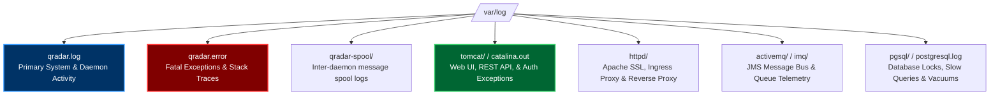
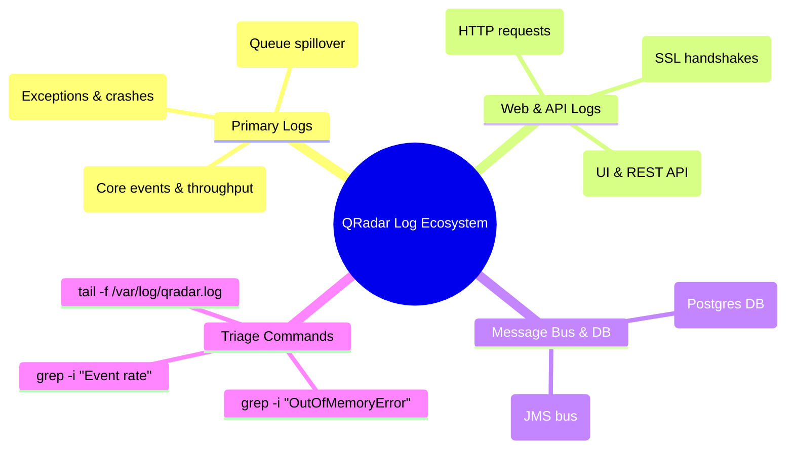

# Chapter 76: Log File Mastery — qradar.log, qradar.error, spool, ActiveMQ & Tomcat Logs

> **Track:** Enterprise IBM QRadar Administrator & SIEM Architect  
> **Phase 8:** Daily Administration, Linux CLI & Health Management  
> **Day:** 76 of 90  
> **Target Audience:** Senior SOC Engineers, SIEM Administrators (2+ Years Hands-on Experience)  
> **Prerequisites:** Chapter 74 & Chapter 75 (CLI & Administrative Binaries)  
> **Time Commitment:** 90 Minutes + 45 Minutes Hands-on Practice Lab  

---

## 1. 3D Architectural Blueprint: QRadar Logging & Diagnostic Subsystem


![[qradar_linux_cli_daemons_3d_1791648059770.jpg|1000]]

---

## 2. Deep Dive: Anatomy of the QRadar Log Directory Structure

When troubleshooting an enterprise SIEM cluster, 95% of all root-cause analyses originate in `/var/log/`. Every daemon writes structured diagnostic streams containing millisecond timestamps, thread names, log levels, component classes, and exception stack traces.



### Primary Log Files Reference Matrix

| Log File Path | Generating Component | Typical Size / Rotation | Key Diagnostic Indicators |
| :--- | :--- | :--- | :--- |
| `/var/log/qradar.log` | `hostcontext`, `ecs-ec`, `ecs-ep`, `ariel_proxy_server` | 100MB rotated, gzipped | Pipeline throughput, license drops, CRE performance metrics, DSM parsing errors, token bucket status. |
| `/var/log/qradar.error` | All QRadar Java daemons | Rotated on size | Unhandled Java exceptions, `NullPointerException`, DB connection loss, `OutOfMemoryError`. |
| `/var/log/qradar-spool/` | Ingestion Spoolers | Variable | Ring buffer spills to disk, queue drain delays, disk spool corruption. |
| `/var/log/tomcat/catalina.out` | Apache Tomcat (Web UI) | Daily rotation | REST API 500 errors, user authentication failures, LDAP/SAML synchronization timeouts, UI session crashes. |
| `/var/log/httpd/ssl_access_log` | Apache HTTPD Reverse Proxy | Daily rotation | REST API call logs, UI navigation latencies, client IP access records. |
| `/var/log/activemq/activemq.log` | Apache ActiveMQ / IMQ | Weekly rotation | JMS message bus saturation, broker memory exhaustion, dead letter queues (DLQ). |
| `/var/log/qradar.old` | Historical rotated archives | `.gz` compressed | Forensic investigations for incidents occurring days or weeks prior. |

---

## 3. Dissecting the `/var/log/qradar.log` Line Format

Understanding the standard QRadar log header is essential for building high-speed `grep` and `awk` diagnostic pipelines:

```text
Oct 10 16:45:12 qradar-ep01 [ecs-ep.ecs-ep] [Thread-42] com.q1labs.sem.monitors.ecs.ECSPart2: [INFO] [NOT:0000003000][192.168.10.25/- -] [-/- -] Event rate in past 60s: 24,512.45 eps (Peak: 31,200.00 eps). License: 25,000 eps. Dropped: 0 eps.
```

### Header Field Breakdown:
1. `Oct 10 16:45:12`: Local system timestamp (Syslog standard).
2. `qradar-ep01`: Hostname of the managed appliance.
3. `[ecs-ep.ecs-ep]`: Daemon name and sub-process context.
4. `[Thread-42]`: Exact JVM execution thread identifier.
5. `com.q1labs.sem.monitors.ecs.ECSPart2`: Java package and class generating the message.
6. `[INFO]`: Severity Level (`TRACE`, `DEBUG`, `INFO`, `WARN`, `ERROR`, `FATAL`).
7. `[NOT:0000003000]`: QRadar Internal Notification ID (Lookup code for IBM Knowledgebase).
8. `[192.168.10.25/- -]`: Source IP and session token context.
9. `Message Body`: Operational telemetry payload.

---

## 4. Advanced High-Speed CLI Log Parsing Playbook

### 1. Monitoring Ingestion Drops and License Throttling

```bash
# Filter for license threshold exceedances and dropped event counters
grep -i "Event rate" /var/log/qradar.log | tail -n 20

# Extract peak EPS vs dropped EPS per minute
grep "Event rate in past" /var/log/qradar.log | awk '{print $1, $2, $3, $9, $10, $15, $16}'
```

### 2. Hunting for Pipeline Backpressure and Disk Spooling

When `ecs-ec-ingress` fills its in-memory ring buffer, it logs critical backpressure notifications:

```bash
# Check if ecs-ec-ingress is writing to disk spool (/store/transient/)
grep -iE "spooling to disk|buffer full|backpressure" /var/log/qradar.log /var/log/qradar.error

# Count how many times disk spooling triggered today
grep -c "Entering disk spooling state" /var/log/qradar.log
```

### 3. Tracking Rule Execution Latency and Expensive Rules

```bash
# Identify rules taking longer than 1,000ms to evaluate in ecs-ep
grep -i "expensive rule" /var/log/qradar.log | awk -F'Rule:' '{print $2}' | sort | uniq -c | sort -nr
```

### 4. Detecting OutOfMemoryError and JVM Crashes

```bash
# Search for Java Heap exhaustion across all active logs
grep -rn "java.lang.OutOfMemoryError" /var/log/qradar.log /var/log/qradar.error /var/log/tomcat/catalina.out
```

### 5. Tracking REST API Calls & Authentication Failures

```bash
# Find failed UI login attempts from Tomcat logs
grep -i "Authentication failed" /var/log/tomcat/catalina.out | awk '{print $1, $2, $8, $9, $10}'

# Monitor top REST API endpoints requested via Apache SSL log
awk '{print $7}' /var/log/httpd/ssl_access_log | cut -d'?' -f1 | sort | uniq -c | sort -nr | head -n 15
```

---

## 5. Visual Interactive Mindmap



---

## 6. Color-Coded Digital Sticky Notes

```
====================================================================================================
🟨 CONCEPT STICKY NOTE: The Two-Tier Log Architecture
----------------------------------------------------------------------------------------------------
QRadar separates informational state updates (`qradar.log`) from unhandled exceptions (`qradar.error`).
However, during severe pipeline crashes, both files should be inspected simultaneously using 
`tail -f /var/log/qradar.log /var/log/qradar.error`.
====================================================================================================
```

```
====================================================================================================
🟩 GOLDEN RULE STICKY NOTE: Never Delete Logs with `rm -rf`
----------------------------------------------------------------------------------------------------
If `/var/log` fills up, NEVER run `rm -rf /var/log/qradar.log`. Open file handles held by running 
Java daemons will keep the disk space allocated (visible via `lsof +L1`). Instead, truncate the file 
safely using `> /var/log/qradar.log` or let `logrotate` handle it.
====================================================================================================
```

```
====================================================================================================
🟪 ARCHITECTURE STICKY NOTE: ActiveMQ Dead Letter Queue (DLQ)
----------------------------------------------------------------------------------------------------
When inter-appliance notifications (such as Deploy Full Configuration or Offense updates) fail to 
deliver, ActiveMQ pushes them to `ActiveMQ.DLQ`. Inspect `/var/log/activemq/` to diagnose stuck deploys.
====================================================================================================
```

```
====================================================================================================
🟦 ENTERPRISE VALUE STICKY NOTE: Audit Compliance via Ingress Logs
----------------------------------------------------------------------------------------------------
Parsing `qradar.log` for authentication, deploy changes, and user searches provides an unalterable 
SOC compliance audit trail satisfying PCI-DSS Requirement 10 and ISO 27001 A.12.4.
====================================================================================================
```

```
====================================================================================================
🟧 INTERVIEW CHEAT CODE: How to track down an "Appliance Dropping Events" alert
----------------------------------------------------------------------------------------------------
"When investigating system notification 38750098 (Events Dropped Due to License), I immediately run:
`grep 'License:' /var/log/qradar.log | tail -n 30` to see exact licensed EPS vs incoming EPS.
Then I check `/store/transient/` to confirm if hardware buffering absorbed the burst or if events 
were permanently dropped."
====================================================================================================
```

```
====================================================================================================
🟥 CRITICAL PITFALL STICKY NOTE: Ignoring Notification Codes [NOT:XXXXXX]
----------------------------------------------------------------------------------------------------
Every warning in `qradar.log` has an internal code like `[NOT:0080004101]`. Searching IBM documentation 
using the exact NOT code gives the precise engineering explanation and documented hotfix.
====================================================================================================
```

---

## 7. Rapid-Recall Flashcards

### Flashcard 1
- **Question:** Where are unhandled Java runtime exceptions and fatal stack traces recorded in QRadar?
- **Answer:** `/var/log/qradar.error` and `/var/log/tomcat/catalina.out` (for Web UI/REST API).

### Flashcard 2
- **Question:** How do you safely clear a massive `/var/log/qradar.log` without breaking open file descriptors of running services?
- **Answer:** Use file truncation: `> /var/log/qradar.log` or `cat /dev/null > /var/log/qradar.log`. (Never use `rm` while services are running).

### Flashcard 3
- **Question:** Which log file records REST API endpoint requests and HTTP status codes?
- **Answer:** `/var/log/httpd/ssl_access_log` and `/var/log/tomcat/localhost_access_log.<date>.txt`.

### Flashcard 4
- **Question:** What does the notification code `[NOT:0000003000]` typically represent in `qradar.log`?
- **Answer:** The 60-second periodic throughput and licensing performance summary logged by `ecs-ep` (showing event rate, peak EPS, licensed EPS, and dropped events).

### Flashcard 5
- **Question:** If a "Deploy Full Configuration" hangs indefinitely, which message broker log should you inspect?
- **Answer:** `/var/log/activemq/activemq.log` or `/var/log/imq/` (to check for stuck JMS transactions or DLQ messages).

### Flashcard 6
- **Question:** What Linux command allows you to search across both active and compressed rotated historical QRadar logs?
- **Answer:** `zgrep -i "pattern" /var/log/qradar.log*` or `zcat /var/log/qradar.log.1.gz | grep "pattern"`.

---

## 8. Hands-On Practice Lab 76: Forensic Log Parsing & Live Triage Automation

### Lab Objective
Build an automated log triaging Bash utility that parses simulated QRadar log files, calculates EPS metrics, detects dropped events, identifies expensive rules, and flags Java stack traces.

### Required Tools & Environment
- Linux Shell (Bash, awk, sed, grep)

---

### Step-by-Step Lab Execution Guide

#### Task 1: Generate Synthetic QRadar Log Telemetry
```bash
# 1. Create a mock log directory
mkdir -p /tmp/qradar_log_lab
cd /tmp/qradar_log_lab

# 2. Author a rich simulated /var/log/qradar.log
cat << 'EOF' > mock_qradar.log
Oct 10 16:00:00 qradar-ep01 [ecs-ep.ecs-ep] [Thread-12] com.q1labs.sem.monitors.ecs.ECSPart2: [INFO] [NOT:0000003000] Event rate in past 60s: 18450.20 eps (Peak: 22100.00 eps). License: 20000 eps. Dropped: 0 eps.
Oct 10 16:01:00 qradar-ep01 [ecs-ep.ecs-ep] [Thread-12] com.q1labs.sem.monitors.ecs.ECSPart2: [INFO] [NOT:0000003000] Event rate in past 60s: 19800.00 eps (Peak: 24500.00 eps). License: 20000 eps. Dropped: 0 eps.
Oct 10 16:02:00 qradar-ep01 [ecs-ep.ecs-ep] [Thread-12] com.q1labs.sem.monitors.ecs.ECSPart2: [WARN] [NOT:0080004101] Event rate in past 60s: 23500.80 eps (Peak: 28900.00 eps). License: 20000 eps. Dropped: 3500 eps.
Oct 10 16:02:15 qradar-ep01 [ecs-ep.ecs-ep] [RuleEngine-8] com.q1labs.sem.rules.RuleEngine: [WARN] [NOT:0000004000] Expensive rule detected: Rule: "Suspicious PowerShell Execution With High Arguments" execution time: 1420ms (Threshold: 1000ms).
Oct 10 16:02:40 qradar-ep01 [ecs-ec-ingress.ecs-ec-ingress] [IngressThread-4] com.q1labs.ingress: [WARN] [NOT:0000005001] In-memory queue backpressure > 85%. Spooling to disk: /store/transient/spool_001.dat.
Oct 10 16:03:00 qradar-ep01 [ecs-ep.ecs-ep] [Thread-12] com.q1labs.sem.monitors.ecs.ECSPart2: [WARN] [NOT:0080004101] Event rate in past 60s: 26100.00 eps (Peak: 31000.00 eps). License: 20000 eps. Dropped: 6100 eps.
Oct 10 16:03:22 qradar-ep01 [tomcat] [http-bio-443-exec-19] org.apache.catalina.core: [ERROR] java.lang.OutOfMemoryError: Java heap space
EOF
```

#### Task 2: Build the High-Speed Log Triage Script (`qlog_triage.sh`)
```bash
cat << 'EOF' > qlog_triage.sh
#!/usr/bin/env bash
LOG_FILE=${1:-mock_qradar.log}

echo "=================================================================="
echo "          IBM QRADAR SIEM RAPID LOG FORENSIC AUDIT                "
echo "=================================================================="
echo "[+] Target Log: $LOG_FILE"
echo ""

echo "--- 1. EPS & LICENSE HEALTH AUDIT ---"
grep "Event rate in past" "$LOG_FILE" | while read -r line; do
    TIME=$(echo "$line" | awk '{print $1, $2, $3}')
    RATE=$(echo "$line" | grep -oE "past 60s: [0-9.]+" | awk '{print $3}')
    PEAK=$(echo "$line" | grep -oE "Peak: [0-9.]+" | awk '{print $2}')
    DROPPED=$(echo "$line" | grep -oE "Dropped: [0-9]+" | awk '{print $2}')
    
    if [ "$DROPPED" -gt 0 ]; then
        echo -e "[\e[31mALERT\e[0m] $TIME | Current: ${RATE} eps | Peak: ${PEAK} eps | \e[31mDROPPED: ${DROPPED} eps\e[0m"
    else
        echo -e "[\e[32mOK\e[0m]    $TIME | Current: ${RATE} eps | Peak: ${PEAK} eps | Dropped: 0 eps"
    fi
done

echo ""
echo "--- 2. EXPENSIVE RULES (>1000ms) ---"
grep -i "Expensive rule detected" "$LOG_FILE" | awk -F'Rule: ' '{print $2}'

echo ""
echo "--- 3. BUFFER SPOOLING & BACKPRESSURE ---"
grep -iE "spooling to disk|backpressure" "$LOG_FILE"

echo ""
echo "--- 4. FATAL JVM CRASHES & EXCEPTIONS ---"
grep -iE "OutOfMemoryError|NullPointerException|FATAL" "$LOG_FILE"
echo "=================================================================="
EOF
chmod +x qlog_triage.sh

# Execute the diagnostic script
./qlog_triage.sh mock_qradar.log
```

#### Task 3: Inspect Real-Time Output & Validate
*Expected Output:*
```text
==================================================================
          IBM QRADAR SIEM RAPID LOG FORENSIC AUDIT                
==================================================================
[+] Target Log: mock_qradar.log

--- 1. EPS & LICENSE HEALTH AUDIT ---
[OK]    Oct 10 16:00:00 | Current: 18450.20 eps | Peak: 22100.00 eps | Dropped: 0 eps
[OK]    Oct 10 16:01:00 | Current: 19800.00 eps | Peak: 24500.00 eps | Dropped: 0 eps
[ALERT] Oct 10 16:02:00 | Current: 23500.80 eps | Peak: 28900.00 eps | DROPPED: 3500 eps
[ALERT] Oct 10 16:03:00 | Current: 26100.00 eps | Peak: 31000.00 eps | DROPPED: 6100 eps

--- 2. EXPENSIVE RULES (>1000ms) ---
"Suspicious PowerShell Execution With High Arguments" execution time: 1420ms (Threshold: 1000ms).

--- 3. BUFFER SPOOLING & BACKPRESSURE ---
Oct 10 16:02:40 qradar-ep01 [ecs-ec-ingress.ecs-ec-ingress] [IngressThread-4] com.q1labs.ingress: [WARN] [NOT:0000005001] In-memory queue backpressure > 85%. Spooling to disk: /store/transient/spool_001.dat.

--- 4. FATAL JVM CRASHES & EXCEPTIONS ---
Oct 10 16:03:22 qradar-ep01 [tomcat] [http-bio-443-exec-19] org.apache.catalina.core: [ERROR] java.lang.OutOfMemoryError: Java heap space
==================================================================
```

---

### Verification Checklist & Troubleshooting
- [x] Log file format analyzed across all standard fields.
- [x] High-speed Bash parsing script authored and tested.
- [x] License drops, expensive rules, spool alerts, and OutOfMemoryErrors detected and formatted.
