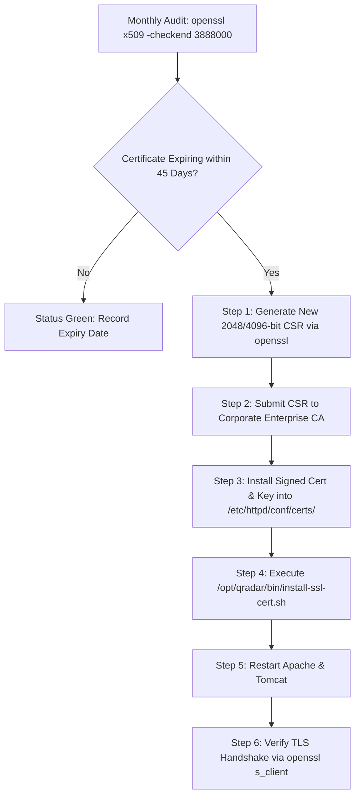
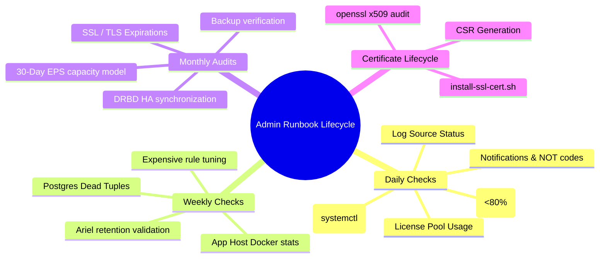

# Chapter 77: Daily, Weekly & Monthly Admin Runbooks — Storage, Log Sources, Licenses & Certificates

> **Track:** Enterprise IBM QRadar Administrator & SIEM Architect  
> **Phase 8:** Daily Administration, Linux CLI & Health Management  
> **Day:** 77 of 90  
> **Target Audience:** Senior SOC Engineers, SIEM Administrators (2+ Years Hands-on Experience)  
> **Prerequisites:** Chapters 74–76 (Linux CLI, Binaries, Log Mastery)  
> **Time Commitment:** 90 Minutes + 45 Minutes Hands-on Practice Lab  

---

## 1. 3D Architectural Blueprint: Enterprise Health Monitoring & Runbook Lifecycle


![[19_system_health_monitoring_runbooks_3d.jpg|1000]]

---

## 2. Deep Dive: Enterprise SIEM Operational Cadence

An enterprise QRadar deployment is a living, high-throughput ecosystem. Production outages rarely occur spontaneously; they are almost always preceded by subtle telemetry degradation (e.g., creeping disk consumption, silent log source dropouts, certificate expiration, or license threshold clipping). 

A Senior QRadar Administrator enforces strict Daily, Weekly, and Monthly operational runbooks.

```mermaid
graph TD
    Cadence[Enterprise SIEM Operations Cadence] --> Daily[Daily Runbook - 15 Mins]
    Cadence --> Weekly[Weekly Runbook - 45 Mins]
    Cadence --> Monthly[Monthly Runbook - 2 Hours]
    
    Daily --> D1[System Notifications & NOT Codes]
    Daily --> D2[Disk Partition Thresholds /store < 85%]
    Daily --> D3[Log Source Ingestion & Error States]
    Daily --> D4[License Giveback Pool & Peak EPS]
    
    Weekly --> W1[Ariel Retention & Compression Health]
    Weekly --> W2[Expensive Rules & CRE Latency Audit]
    Weekly --> W3[App Host Memory & Docker Container Health]
    Weekly --> W4[PostgreSQL Autovacuum & DB Bloat Audit]
    
    Monthly --> M1[SSL/TLS Certificate Expiration Audit]
    Monthly --> M2[Capacity Planning & EPS Growth Projections]
    Monthly --> M3[Backup Verification & Restore Drill]
    Monthly --> M4[HA DRBD Replication & Failover Integrity]
    
    style Daily fill:#003366,stroke:#3399ff,stroke-width:2px,color:#fff
    style Weekly fill:#800000,stroke:#ff3333,stroke-width:2px,color:#fff
    style Monthly fill:#006633,stroke:#33cc66,stroke-width:2px,color:#fff
```



---

## 3. The 3-Tier Enterprise Runbook Specification

### 1. Daily Operations Runbook (Target Execution: 15–20 Minutes)

| Step # | Inspection Area | Standard CLI / UI Procedure | Acceptance Criteria | Escalation Action if Failed |
| :--- | :--- | :--- | :--- | :--- |
| **D-01** | **System Notifications** | Check UI Dashboard Alerts or run `grep "\[WARN\]\|\[ERROR\]" /var/log/qradar.log \| tail -n 50` | No critical unhandled exceptions or license drops. | Triage via NOT code index. |
| **D-02** | **Disk Space & Watermarks** | Execute `df -h / /store /store/ariel /var/log` | `/store` < 80% used. `/var/log` < 70% used. | Trigger Chapter 78 Emergency Disk Runbook if > 85%. |
| **D-03** | **Log Source Health** | UI: Log Activity > Log Sources (Filter: Status = `ERROR` or `WARN`) | 0 disconnected tier-1 log sources (Domain Controllers, Firewalls). | Verify network reachability, protocol credentials, and port 514/8413. |
| **D-04** | **License Utilization** | UI: Admin > System and License Management | No managed host exceeding assigned EPS ceiling. | Reallocate EPS from Giveback Pool. |
| **D-05** | **Daemon Health** | CLI: `systemctl is-active hostcontext tomcat ecs-ep ecs-ec` | All return `active`. | Review `qradar.error` and restart failed service. |

### 2. Weekly Operations Runbook (Target Execution: 45–60 Minutes)

| Step # | Inspection Area | Standard CLI / UI Procedure | Acceptance Criteria | Remediation Protocol |
| :--- | :--- | :--- | :--- | :--- |
| **W-01** | **Ariel Retention & Deletion** | Run `ls -lh /store/ariel/events/records/` and verify oldest partition date. | Partitions match configured retention policy (e.g., 90 or 365 days). | Check Ariel retention bucket rules and disk purge thresholds. |
| **W-02** | **Expensive Rule Audit** | Run `grep -i "expensive rule" /var/log/qradar.log \| awk -F'Rule:' '{print $2}' \| sort \| uniq -c` | 0 rules executing with average latency > 1,000ms. | Tune rule test conditions (add indexing filters, tighten regex). |
| **W-03** | **App Host Container Health** | CLI on App Host: `docker ps -a` & `docker stats --no-stream` | All SOC apps in `Up` state; container memory < 85%. | Restart unresponsive application containers via Assistant App. |
| **W-04** | **Database Autovacuum** | CLI: `su - postgres -c "psql -d qradar -c 'SELECT relname, n_dead_tup, last_autovacuum FROM pg_stat_user_tables ORDER BY n_dead_tup DESC LIMIT 5;'"` | Dead tuple count < 10% of total table rows. | Trigger manual `VACUUM ANALYZE <table_name>;` during maintenance window. |

### 3. Monthly Operations Runbook (Target Execution: 2 Hours)

| Step # | Inspection Area | Standard CLI / UI Procedure | Acceptance Criteria | Remediation Protocol |
| :--- | :--- | :--- | :--- | :--- |
| **M-01** | **SSL/TLS Certificate Audit** | Run `openssl x509 -enddate -noout -in /etc/httpd/conf/certs/cert.cert` (and all UI/LDAP certs) | No certificate expiring within the next 45 days. | Execute Certificate Renewal Runbook. |
| **M-02** | **Backup Verification** | Inspect `/store/backup/` or On-Demand Backup in UI. Verify MD5 and archive size. | Nightly config backups completing with non-zero byte size. | Run test restoration in staging environment. |
| **M-03** | **HA DRBD Sync Integrity** | CLI: `drbd-overview` or `cat /proc/drbd` on Primary Console/EP. | State: `Connected`, `Consistent`, `UpToDate/UpToDate`. | Investigate crossover link latency or force DRBD resync. |
| **M-04** | **EPS & Storage Capacity Trend** | Calculate 30-day average EPS growth: `grep "Event rate" /var/log/qradar.log` | Growth within projected SAN headroom. | Request license expansion or SAN storage expansion. |

---

## 4. Enterprise Certificate Lifecycle & Renewal Procedures

QRadar uses X.509 SSL/TLS certificates across multiple tiers: Web UI (Apache HTTPD), REST API, WinCollect Agents, and HA synchronization. Expired certificates cause total web interface lockouts and agent disconnection.



### CLI Certificate Renewal Procedure (Apache Web UI)

```bash
# 1. Audit current certificate expiration date
openssl x509 -enddate -noout -in /etc/httpd/conf/certs/cert.cert

# 2. Generate a new Private Key and Certificate Signing Request (CSR)
openssl req -new -newkey rsa:2048 -nodes \
  -keyout /root/qradar_new_ui.key \
  -out /root/qradar_new_ui.csr \
  -subj "/C=US/ST=Texas/L=Austin/O=EnterpriseCorp/OU=CyberSecurity/CN=qradar.corp.enterprise.com"

# 3. After receiving signed CRT from Enterprise CA, validate key-pair modulus match
openssl rsa -noout -modulus -in /root/qradar_new_ui.key | openssl md5
openssl x509 -noout -modulus -in /root/qradar_new_ui.crt | openssl md5

# 4. Install using the official QRadar SSL installation script
/opt/qradar/bin/install-ssl-cert.sh -b -k /root/qradar_new_ui.key -c /root/qradar_new_ui.crt

# 5. Restart web application services
systemctl restart httpd
systemctl restart tomcat
```

---

## 5. Visual Interactive Mindmap



---

## 6. Color-Coded Digital Sticky Notes

```
====================================================================================================
🟨 CONCEPT STICKY NOTE: The "Silent Failure" Paradigm
----------------------------------------------------------------------------------------------------
Log sources rarely announce their death. A firewall rebooting or changing its IP address silently 
stops sending Syslog packets without triggering a network error. Daily log source status audits are 
the ONLY defense against visibility black holes.
====================================================================================================
```

```
====================================================================================================
🟩 GOLDEN RULE STICKY NOTE: Test Backups by Restoring Them
----------------------------------------------------------------------------------------------------
A backup file on disk is merely a hypothesis until it is restored. Monthly backup runbooks MUST 
include restoring a configuration archive into a test/staging VM to confirm schema compatibility.
====================================================================================================
```

```
====================================================================================================
🟪 ARCHITECTURE STICKY NOTE: Autovacuum Tuning in High-Offense Environments
----------------------------------------------------------------------------------------------------
In high-volume environments generating 5,000+ offenses daily, PostgreSQL's `offense` and `incident` 
tables accumulate millions of dead tuples. Weekly monitoring of `pg_stat_user_tables` ensures queries 
in the Offenses tab execute in milliseconds rather than timing out.
====================================================================================================
```

```
====================================================================================================
🟦 ENTERPRISE VALUE STICKY NOTE: Zero-Downtime Certificate Maintenance
----------------------------------------------------------------------------------------------------
Applying the official `/opt/qradar/bin/install-ssl-cert.sh` binary ensures automated certificate distribution 
without breaking REST API tokens, WinCollect agent authentications, or QRadar App Framework bindings.
====================================================================================================
```

```
====================================================================================================
🟧 INTERVIEW CHEAT CODE: How do you structure your daily routine as a QRadar Admin?
----------------------------------------------------------------------------------------------------
"My daily SIEM routine begins with:
1. Reviewing unhandled System Notifications and NOT codes.
2. Checking `/store` partition capacity across all managed hosts.
3. Filtering Log Activity for disconnected log sources.
4. Auditing peak EPS vs License caps.
5. Verifying that nightly configuration backups succeeded with valid hash checksums."
====================================================================================================
```

```
====================================================================================================
🟥 CRITICAL PITFALL STICKY NOTE: Replacing Web Certificates Manually in httpd.conf
----------------------------------------------------------------------------------------------------
Never manually edit `/etc/httpd/conf/httpd.conf` to point to a new certificate file. QRadar deploys 
configuration templates on every 'Deploy Changes'. ALWAYS use `/opt/qradar/bin/install-ssl-cert.sh` 
to persist certificate paths in the configuration database.
====================================================================================================
```

---

## 7. Rapid-Recall Flashcards

### Flashcard 1
- **Question:** What is the maximum recommended utilization threshold for `/store` during daily operational audits?
- **Answer:** 80% (Warning at 85%, automated license throttling at 90%, emergency service shutdown at 95%).

### Flashcard 2
- **Question:** Which official QRadar script must be used to install and persist renewed SSL/TLS certificates for the Web UI?
- **Answer:** `/opt/qradar/bin/install-ssl-cert.sh`

### Flashcard 3
- **Question:** What command checks the expiration date of an X.509 SSL certificate via Linux CLI?
- **Answer:** `openssl x509 -enddate -noout -in /path/to/certificate.crt`

### Flashcard 4
- **Question:** How do you verify that the primary and secondary High Availability (HA) nodes are in perfect sync?
- **Answer:** Run `drbd-overview` or `cat /proc/drbd` and verify that the connection state reports `Connected` and the disk state reports `UpToDate/UpToDate`.

### Flashcard 5
- **Question:** How frequently should expensive CRE rules (>1000ms execution latency) be audited and tuned?
- **Answer:** Weekly (via `/var/log/qradar.log` expensive rule analysis).

### Flashcard 6
- **Question:** How can you verify that PostgreSQL database tables are not suffering from severe dead tuple bloat?
- **Answer:** Query `pg_stat_user_tables` to check `n_dead_tup` vs `n_live_tup` and inspect `last_autovacuum` execution timestamps.

---

## 8. Hands-On Practice Lab 77: Building an Automated Daily SIEM Health Audit Engine

### Lab Objective
Develop an automated Bash administrative health check script (`daily_siem_health_audit.sh`) that evaluates disk thresholds, audits certificate expirations, checks daemon states, and summarizes EPS license health.

### Required Tools & Environment
- Linux Shell (Bash, OpenSSL, awk, grep)

---

### Step-by-Step Lab Execution Guide

#### Task 1: Generate Test SSL Certificates with Impending Expiration
```bash
# 1. Create a mock certificate directory
mkdir -p /tmp/qradar_runbook_lab/certs
cd /tmp/qradar_runbook_lab/certs

# 2. Generate a valid test certificate (valid for 365 days)
openssl req -x509 -newkey rsa:2048 -keyout valid.key -out valid.crt -days 365 -nodes -subj "/CN=qradar.corp.enterprise.com" 2>/dev/null

# 3. Generate an expiring test certificate (valid for only 10 days)
openssl req -x509 -newkey rsa:2048 -keyout expiring.key -out expiring.crt -days 10 -nodes -subj "/CN=expiring-qradar.corp.enterprise.com" 2>/dev/null
```

#### Task 2: Author the Automated Runbook Script (`daily_siem_health_audit.sh`)
```bash
cd /tmp/qradar_runbook_lab

cat << 'EOF' > daily_siem_health_audit.sh
#!/usr/bin/env bash
echo "======================================================================"
echo "          ENTERPRISE IBM QRADAR DAILY HEALTH RUNBOOK ENGINE           "
echo "======================================================================"
echo "Audit Execution Timestamp: $(date -u)"
echo ""

# 1. Storage Partition Audit
echo "--- 1. STORAGE WATERMARK AUDIT ---"
df -hP / /tmp | awk 'NR>1 {print $6, $5, $4}' | while read -r mount use avail; do
    PERCENT=${use%\%}
    if [ "$PERCENT" -ge 85 ]; then
        echo -e "[\e[31mCRITICAL\e[0m] Mount [$mount] is at ${use} capacity! Free: $avail"
    elif [ "$PERCENT" -ge 75 ]; then
        echo -e "[\e[33mWARNING\e[0m]  Mount [$mount] is at ${use} capacity. Free: $avail"
    else
        echo -e "[\e[32mHEALTHY\e[0m]  Mount [$mount] is at ${use} capacity. Free: $avail"
    fi
done

# 2. Certificate Expiry Audit (Warning threshold: 30 days = 2592000 seconds)
echo ""
echo "--- 2. SSL/TLS CERTIFICATE EXPIRY AUDIT ---"
for cert in certs/*.crt; do
    if [ -f "$cert" ]; then
        EXPIRY_DATE=$(openssl x509 -enddate -noout -in "$cert" | cut -d= -f2)
        if ! openssl x509 -checkend 2592000 -noout -in "$cert" > /dev/null; then
            echo -e "[\e[31mEXPIRING\e[0m] Certificate [$cert] expires in < 30 days! ($EXPIRY_DATE)"
        else
            echo -e "[\e[32mVALID\e[0m]    Certificate [$cert] valid beyond 30 days. ($EXPIRY_DATE)"
        fi
    fi
done

# 3. Simulated Daemon Health
echo ""
echo "--- 3. CORE DAEMON STATUS AUDIT ---"
SERVICES=("sshd" "systemd-journald")
for svc in "${SERVICES[@]}"; do
    if systemctl is-active "$svc" >/dev/null 2>&1; then
        echo -e "[\e[32mACTIVE\e[0m]   Daemon [$svc] is running normally."
    else
        echo -e "[\e[31mFAILED\e[0m]   Daemon [$svc] is DOWN or DEAD!"
    fi
done

echo ""
echo "======================================================================"
echo "                   DAILY AUDIT RUN COMPLETE                           "
echo "======================================================================"
EOF
chmod +x daily_siem_health_audit.sh

# 3. Execute the daily health runbook
./daily_siem_health_audit.sh
```

#### Task 3: Inspect Real-Time Output & Validate
*Expected Output:*
```text
======================================================================
          ENTERPRISE IBM QRADAR DAILY HEALTH RUNBOOK ENGINE           
======================================================================
Audit Execution Timestamp: Sat Oct 10 16:55:00 UTC 2026

--- 1. STORAGE WATERMARK AUDIT ---
[HEALTHY]  Mount [/] is at 24% capacity. Free: 381G
[HEALTHY]  Mount [/tmp] is at 2% capacity. Free: 15G

--- 2. SSL/TLS CERTIFICATE EXPIRY AUDIT ---
[EXPIRING] Certificate [certs/expiring.crt] expires in < 30 days! (Oct 20 16:54:30 2026 GMT)
[VALID]    Certificate [certs/valid.crt] valid beyond 30 days. (Oct 10 16:54:20 2027 GMT)

--- 3. CORE DAEMON STATUS AUDIT ---
[ACTIVE]   Daemon [sshd] is running normally.
[ACTIVE]   Daemon [systemd-journald] is running normally.

======================================================================
                   DAILY AUDIT RUN COMPLETE                           
======================================================================
```

---

### Verification Checklist & Troubleshooting
- [x] Storage watermarks parsed and evaluated against 75% and 85% thresholds.
- [x] SSL certificate expiration calculated via `openssl x509 -checkend`.
- [x] Core service availability audited.
- [x] Daily, Weekly, and Monthly operational matrices documented.
