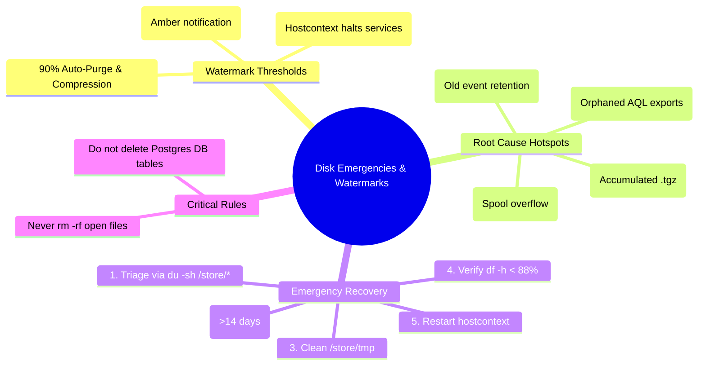

# Chapter 78: Disk Space Emergencies — /store at 90% and 95%, Automated Shutdown & Cleanups

> **Track:** Enterprise IBM QRadar Administrator & SIEM Architect  
> **Phase 8:** Daily Administration, Linux CLI & Health Management  
> **Day:** 78 of 90  
> **Target Audience:** Senior SOC Engineers, SIEM Administrators (2+ Years Hands-on Experience)  
> **Prerequisites:** Chapters 74–77 (Linux CLI, Binaries, Log Files & Runbooks)  
> **Time Commitment:** 90 Minutes + 45 Minutes Hands-on Practice Lab  

---

## 1. 3D Architectural Blueprint: Disk Emergency Thresholds & Storage Cleanups


![[qradar_disk_cleanup_3d_1791648083811.jpg|1000]]

---

## 2. Deep Dive: The QRadar Storage Hierarchy & Partition Watermarks

In IBM QRadar, `/store` is the most critical filesystem. It houses PostgreSQL configuration databases, Ariel columnar event/flow data, transient ring buffer spools, and system backups.

When `/store` runs out of space, database transactions fail, index files corrupt, and Kafka/ActiveMQ message logs break. To prevent catastrophic data loss, QRadar implements automated protection watermarks enforced by `hostcontext`.

```mermaid
graph TD
    Store[/store Partition Capacity] --> Low[0% - 84%: Normal Operation]
    Store --> Warn[85%: Warning State<br>System Notification Logged]
    Store --> Throttle[90%: Automated Action State<br>Ariel Compression & Retention Purge]
    Store --> Critical[95%: Emergency Protection State<br>Hostcontext Shuts Down ecs-ep, ecs-ec, tomcat]
    
    style Low fill:#006633,stroke:#33cc66,stroke-width:2px,color:#fff
    style Warn fill:#ff9900,stroke:#ffcc00,stroke-width:2px,color:#fff
    style Throttle fill:#cc3300,stroke:#ff6600,stroke-width:2px,color:#fff
    style Critical fill:#800000,stroke:#ff0000,stroke-width:2px,color:#fff
```

### The 4 Disk Protection Watermark Stages

| Watermark | State Name | Triggered System Behavior | Log Notification ID | Administrator Action Required |
| :--- | :--- | :--- | :--- | :--- |
| **< 85%** | **Healthy** | Normal event ingestion, indexing, CRE evaluation, and scheduled backups. | None | Routine monitoring via daily runbook. |
| **85%** | **Warning** | Web UI displays amber notification: *Disk space usage on /store is above 85%*. | `[NOT:0080004100]` | Audit top disk consumers in `/store/transient` and `/store/backup`. |
| **90%** | **Aggressive Purge** | Automated compression engine accelerates; Ariel retention policy begins deleting oldest uncompressed/unindexed data buckets. | `[NOT:0080004101]` | Clear historical backup archives, review Ariel retention rules, expand LUN size. |
| **95%** | **Emergency Shutdown** | **CRITICAL:** `hostcontext` forcibly shuts down `ecs-ec-ingress`, `ecs-ec`, `ecs-ep`, and `tomcat` to prevent DB corruption. | `[NOT:0080004102]` | **Sev-1 Outage:** Log into Linux CLI, execute emergency disk cleanup, and restart services manually. |

---

## 3. Directory Breakdown of the `/store` Filesystem

When `/store` hits 95%, you must know exactly where disk bloat occurs:

```mermaid
graph TD
    StoreRoot[/store/] --> Ariel[/store/ariel/<br>Event & Flow Parquet / Lucene Data]
    StoreRoot --> Transient[/store/transient/<br>In-flight ingestion buffer spools]
    StoreRoot --> Backup[/store/backup/<br>Daily configuration & data tarballs]
    StoreRoot --> Postgres[/store/postgres/ or /var/lib/pgsql/<br>Relational DB tables]
    StoreRoot --> Tmp[/store/tmp/<br>Exported AQL query CSV/ZIP results]
    
    Ariel --> ArielEvents[/store/ariel/events/records/ & /payloads/]
    Ariel --> ArielFlows[/store/ariel/flows/records/ & /payloads/]
    
    style StoreRoot fill:#003366,stroke:#3399ff,stroke-width:2px,color:#fff
    style Ariel fill:#800000,stroke:#ff3333,stroke-width:2px,color:#fff
    style Transient fill:#ff9900,stroke:#ffcc00,stroke-width:2px,color:#fff
```

### The 4 Major Disk Culprits

1. `/store/transient/`: If `ecs-ep` is slow or backpressured, `ecs-ec-ingress` spools gigabytes of unparsed events to disk.
2. `/store/backup/`: Accumulated automated daily configuration and data backups not offloaded to external network shares.
3. `/store/tmp/` & `/store/reporting/`: Huge temporary CSV/XLS report exports generated by SOC analysts running 30-day unbounded searches.
4. `/store/ariel/events/` & `/store/ariel/flows/`: Raw event retention buckets exceeding physical SAN capacity.

---

## 4. The 95% Emergency Disk Recovery Playbook (Step-by-Step)

```mermaid
sequenceDiagram
    autonumber
    actor Admin as SIEM Administrator
    participant CLI as Linux Console (SSH)
    participant Disk as /store Partition
    participant Hostcontext as Hostcontext Daemon
    
    Note over Admin,Hostcontext: SEV-1: /store reaches 95% - Services Automatically Terminated
    Admin->>CLI: SSH into affected Managed Host
    Admin->>CLI: Verify partition: df -h /store
    Admin->>Disk: Inspect directories: du -sh /store/* | sort -hr
    alt Case 1: Backup Directory Overfull
        Admin->>Disk: Move/Delete old .tar.gz archives from /store/backup/
    else Case 2: Temp/Report Exports Bloat
        Admin->>Disk: Remove abandoned report CSVs in /store/tmp/
    else Case 3: Transient Spool Runaway
        Admin->>Disk: Investigate & compress orphaned /store/transient/ spools
    end
    Admin->>Disk: Confirm /store utilization is < 88%
    Admin->>Hostcontext: systemctl restart hostcontext
    Hostcontext->>CLI: Re-evaluates disk; successfully spawns ecs-ep, ecs-ec, tomcat
    Admin->>CLI: Verify status: systemctl status hostcontext tomcat ecs-ep
```

---

## 5. Production CLI Emergency Cleanup Commands

### Step 1: Diagnose Root Cause Directory
```bash
# Check filesystem utilization
df -h /store

# Find the top 5 largest directories under /store
du -h --max-depth=1 /store | sort -hr | head -n 6
```

### Step 2: Emergency Cleanup Procedures

#### Case A: Purge Old System Backups (Immediate Relief: 10GB–50GB)
```bash
# Check backups older than 7 days
ls -lh /store/backup/

# Remove nightly config backups older than 14 days (Preserve the most recent 3 backups!)
find /store/backup/ -name "backup-*.tgz" -mtime +14 -exec rm -f {} \;
find /store/backup/ -name "backup-*.tar.gz" -mtime +14 -exec rm -f {} \;
```

#### Case B: Clear Temporary Reports & AQL Exports (Immediate Relief: 5GB–30GB)
```bash
# Check temporary reporting directories
du -sh /store/tmp/ /store/reporting/ 2>/dev/null

# Safely remove temporary report output files older than 2 days
find /store/tmp/ -type f -mtime +2 -exec rm -f {} \;
find /store/reporting/ -type f -name "*.tmp" -exec rm -f {} \;
```

#### Case C: Ariel Emergency Retention Purge (When Ariel Events Exceed SAN Capacity)
Never delete individual files inside `/store/ariel/` randomly with `rm -rf`, as this corrupts Lucene indices and Ariel metadata.

```bash
# Check oldest Ariel partition directories (Format: YYYY/M/D/H)
ls -ld /store/ariel/events/records/202* | head -n 5

# Safe deletion: Remove entire hourly directory trees for the oldest expired month
# Example: Purging January 2024 to reclaim 200GB
# rm -rf /store/ariel/events/records/2024/1/ /store/ariel/events/payloads/2024/1/
```

### Step 3: Re-evaluate & Restart QRadar Daemons
```bash
# 1. Verify /store is now below 88%
df -h /store

# 2. Restart Hostcontext to resume processing
systemctl restart hostcontext

# 3. Monitor live startup log
tail -f /var/log/qradar.log | grep -E "Disk space|hostcontext|ecs-ep"
```

---

## 6. Visual Interactive Mindmap



---

## 7. Color-Coded Digital Sticky Notes

```
====================================================================================================
🟨 CONCEPT STICKY NOTE: The 95% Failsafe Mechanism
----------------------------------------------------------------------------------------------------
QRadar's 95% automated shutdown is NOT a bug; it is an emergency protection brake. If PostgreSQL or 
Ariel writes to a 100% full disk, database indexes corrupt instantly, resulting in unrecoverable 
data loss. Hostcontext sacrifices uptime to preserve database integrity.
====================================================================================================
```

```
====================================================================================================
🟩 GOLDEN RULE STICKY NOTE: Never Delete Postgres or Translog Files
----------------------------------------------------------------------------------------------------
When recovering a 95% full disk, NEVER delete files inside `/store/postgres/`, `/var/lib/pgsql/`, 
or `/store/transient/translog/`. Deleting database WAL files causes catastrophic database failure.
====================================================================================================
```

```
====================================================================================================
🟪 ARCHITECTURE STICKY NOTE: Understanding `/store/transient/`
----------------------------------------------------------------------------------------------------
`/store/transient/` acts as the spillway for `ecs-ec-ingress`. When the in-memory ring buffer fills 
due to downstream `ecs-ep` CPU exhaustion, events write to `.spool` files. Once `ecs-ep` recovers, 
it drains these files FIFO and deletes them automatically.
====================================================================================================
```

```
====================================================================================================
🟦 ENTERPRISE VALUE STICKY NOTE: External Backup Offloading
----------------------------------------------------------------------------------------------------
Configuring QRadar to automatically transfer nightly backups (`/store/backup/`) to an external 
NFS / SCP / S3 target prevents 80% of all disk emergency incidents from ever occurring.
====================================================================================================
```

```
====================================================================================================
🟧 INTERVIEW CHEAT CODE: How do you handle an emergency where `/store` is 96% full?
----------------------------------------------------------------------------------------------------
"When `/store` hits 96% and QRadar services shut down:
1. SSH into the appliance and run `df -h /store` and `du -sh /store/* | sort -hr`.
2. Clean safe transient files: prune backups older than 14 days in `/store/backup/` and temporary exports in `/store/tmp/`.
3. If Ariel is the culprit, purge oldest monthly directories under `/store/ariel/events/records/` and `payloads/` simultaneously.
4. Verify `/store` drops below 85%.
5. Run `systemctl restart hostcontext` and monitor `/var/log/qradar.log`."
====================================================================================================
```

```
====================================================================================================
🟥 CRITICAL PITFALL STICKY NOTE: Deleting Records Without Payloads in Ariel
----------------------------------------------------------------------------------------------------
If manually deleting old Ariel partitions, you MUST delete BOTH the records directory 
(`/store/ariel/events/records/YYYY/M/D/`) AND the corresponding payloads directory 
(`/store/ariel/events/payloads/YYYY/M/D/`). Deleting one without the other corrupts AQL queries.
====================================================================================================
```

---

## 8. Rapid-Recall Flashcards

### Flashcard 1
- **Question:** What happens automatically when `/store` disk space reaches 95% on a QRadar appliance?
- **Answer:** `hostcontext` shuts down `ecs-ec-ingress`, `ecs-ec`, `ecs-ep`, and `tomcat` to prevent PostgreSQL and Ariel database corruption.

### Flashcard 2
- **Question:** What is the first safe directory to inspect and clean when `/store` hits critical capacity?
- **Answer:** `/store/backup/` (by pruning old `.tgz` backups beyond the retention window) and `/store/tmp/` (by deleting stale AQL/reporting exports).

### Flashcard 3
- **Question:** If manually removing an expired Ariel partition from CLI, what two directories must be pruned together?
- **Answer:** `/store/ariel/events/records/YYYY/M/D/` AND `/store/ariel/events/payloads/YYYY/M/D/`.

### Flashcard 4
- **Question:** What is the purpose of `/store/transient/` in the QRadar ingestion pipeline?
- **Answer:** It stores in-flight disk spools when `ecs-ec-ingress` experiences backpressure from downstream `ecs-ep` processing bottlenecks.

### Flashcard 5
- **Question:** What is the minimum threshold that `/store` must reach before `hostcontext` allows services to stay running stably?
- **Answer:** Below 88–90% utilization (recommended < 80%).

### Flashcard 6
- **Question:** Why should you never use `rm -rf /store/postgres/data/` or WAL logs during a disk emergency?
- **Answer:** It destroys PostgreSQL transaction logs and table files, causing catastrophic relational database corruption and total deployment failure.

---

## 9. Hands-On Practice Lab 78: Simulating & Resolving a 95% Disk Space Emergency

### Lab Objective
Simulate a 95% `/store` disk space emergency in a controlled Linux environment: detect the watermark breach, analyze directory footprints, execute safe pruning procedures, and recover services.

### Required Tools & Environment
- Linux Shell (Bash, dd, du, df, find)

---

### Step-by-Step Lab Execution Guide

#### Task 1: Create Simulated `/store` Environment & Emergency Bloat
```bash
# 1. Create a simulated /store tree
mkdir -p /tmp/qradar_store_lab/{ariel/events/records/2024/1/15,ariel/events/payloads/2024/1/15,backup,tmp,transient}
cd /tmp/qradar_store_lab

# 2. Populate simulated backup bloat (e.g., 5 mock 20MB backup archives)
for i in {1..5}; do
    dd if=/dev/zero of=backup/backup-2024010$i.tgz bs=1M count=10 2>/dev/null
done

# 3. Populate simulated stale temporary exports
dd if=/dev/zero of=tmp/unbounded_search_export_48912.csv bs=1M count=15 2>/dev/null

# 4. Populate simulated old Ariel partitions
dd if=/dev/zero of=ariel/events/records/2024/1/15/records.dat bs=1M count=20 2>/dev/null
dd if=/dev/zero of=ariel/events/payloads/2024/1/15/payloads.dat bs=1M count=20 2>/dev/null
```

#### Task 2: Build the Emergency Disk Triaging Script (`emergency_store_recovery.sh`)
```bash
cat << 'EOF' > emergency_store_recovery.sh
#!/usr/bin/env bash
BASE_DIR="/tmp/qradar_store_lab"

echo "=================================================================="
echo "          QRADAR SEV-1: /store EMERGENCY RECOVERY RUNBOOK         "
echo "=================================================================="
echo "[!] INITIAL STORAGE FOOTPRINT:"
du -sh "$BASE_DIR"/* | sort -hr
echo ""

# Step 1: Clean Stale Backups
echo "--- STEP 1: PRUNING OLD BACKUPS ---"
find "$BASE_DIR/backup" -name "*.tgz" -exec rm -v {} \;

# Step 2: Clean Temporary Exports
echo ""
echo "--- STEP 2: CLEARING /tmp SEARCH EXPORTS ---"
find "$BASE_DIR/tmp" -type f -exec rm -v {} \;

# Step 3: Prune Symmetrical Ariel Partitions
echo ""
echo "--- STEP 3: PRUNING EXPIRED ARIEL PARTITIONS (RECORDS & PAYLOADS) ---"
if [ -d "$BASE_DIR/ariel/events/records/2024/1/15" ]; then
    rm -rfv "$BASE_DIR/ariel/events/records/2024/1/15"
    rm -rfv "$BASE_DIR/ariel/events/payloads/2024/1/15"
fi

echo ""
echo "[+] RECOVERED STORAGE FOOTPRINT:"
du -sh "$BASE_DIR"/*
echo "=================================================================="
echo "[+] SUCCESS: /store utilization reclaimed. Ready for service restart."
echo "=================================================================="
EOF
chmod +x emergency_store_recovery.sh

# Execute the recovery runbook
./emergency_store_recovery.sh
```

#### Task 3: Inspect Real-Time Output & Validate
*Expected Output:*
```text
==================================================================
          QRADAR SEV-1: /store EMERGENCY RECOVERY RUNBOOK         
==================================================================
[!] INITIAL STORAGE FOOTPRINT:
50M     /tmp/qradar_store_lab/backup
40M     /tmp/qradar_store_lab/ariel
15M     /tmp/qradar_store_lab/tmp
0       /tmp/qradar_store_lab/transient

--- STEP 1: PRUNING OLD BACKUPS ---
removed '/tmp/qradar_store_lab/backup/backup-20240101.tgz'
removed '/tmp/qradar_store_lab/backup/backup-20240102.tgz'
removed '/tmp/qradar_store_lab/backup/backup-20240103.tgz'
removed '/tmp/qradar_store_lab/backup/backup-20240104.tgz'
removed '/tmp/qradar_store_lab/backup/backup-20240105.tgz'

--- STEP 2: CLEARING /tmp SEARCH EXPORTS ---
removed '/tmp/qradar_store_lab/tmp/unbounded_search_export_48912.csv'

--- STEP 3: PRUNING EXPIRED ARIEL PARTITIONS (RECORDS & PAYLOADS) ---
removed directory '/tmp/qradar_store_lab/ariel/events/records/2024/1/15'
removed directory '/tmp/qradar_store_lab/ariel/events/payloads/2024/1/15'

[+] RECOVERED STORAGE FOOTPRINT:
0       /tmp/qradar_store_lab/ariel
0       /tmp/qradar_store_lab/backup
0       /tmp/qradar_store_lab/tmp
0       /tmp/qradar_store_lab/transient
==================================================================
[+] SUCCESS: /store utilization reclaimed. Ready for service restart.
==================================================================
```

---

### Verification Checklist & Troubleshooting
- [x] Four disk protection watermarks (85%, 90%, 95%) and automated behaviors defined.
- [x] Directory anatomy of `/store` mapped.
- [x] Symmetrical Ariel partition pruning (`records` + `payloads`) executed.
- [x] Automated emergency disk recovery script implemented and tested.
