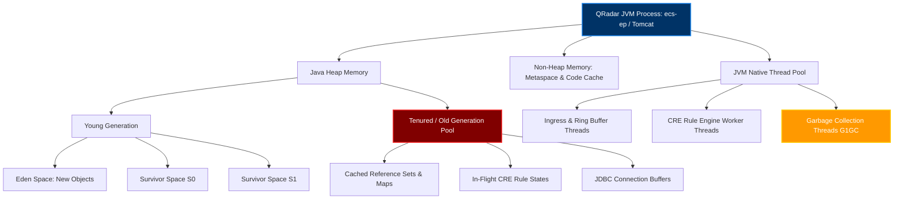
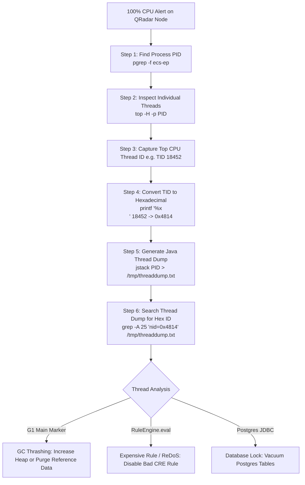
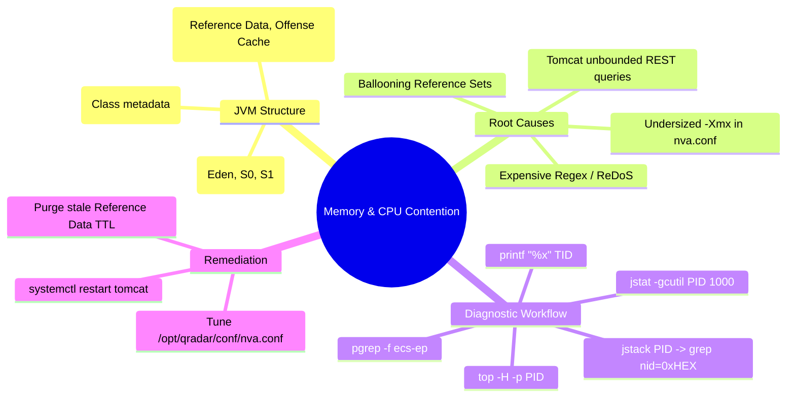

# Chapter 79: Memory & CPU Contention — Runaway Java Heaps, Tomcat Crashes & ecs-ep Thread Saturation

> **Track:** Enterprise IBM QRadar Administrator & SIEM Architect  
> **Phase 8:** Daily Administration, Linux CLI & Health Management  
> **Day:** 79 of 90  
> **Target Audience:** Senior SOC Engineers, SIEM Administrators (2+ Years Hands-on Experience)  
> **Prerequisites:** Chapters 74–78 (CLI, Binaries, Logs, Runbooks & Storage)  
> **Time Commitment:** 90 Minutes + 45 Minutes Hands-on Practice Lab  

---

## 1. 3D Architectural Blueprint: JVM Memory Architecture & Thread Profiling


![[qradar_jvm_heap_3d_1791648116152.jpg|1000]]

---

## 2. Deep Dive: JVM Memory Structure in QRadar Java Daemons

The core of QRadar's computational pipeline runs on Java Virtual Machines (JVMs). `ecs-ep` (Event Processor), `ecs-ec` (Event Collector), `tomcat` (Web Application Server), and `hostcontext` operate as independent JVM processes.

When memory contention occurs, it is rarely due to a physical hardware defect; it is almost always caused by:
1. In-memory Reference Data sets ballooning beyond allocated Old Generation boundaries.
2. Unindexed Reference Maps causing heap thrashing during CRE rule evaluation.
3. Complex regex back-tracking in Custom DSM properties consuming 100% CPU across all worker threads.
4. Tomcat REST API queries fetching 100,000+ unpaginated offenses simultaneously.



### Typical Enterprise JVM Heap Allocations

| Daemon / Service | Process Class | Default Heap (-Xms / -Xmx) | Enterprise Sized Heap (128GB Host) | Failure Symptom on Exhaustion |
| :--- | :--- | :--- | :--- | :--- |
| **`ecs-ep`** | `com.q1labs.sem.monitors.ecs.ECSPart2` | 8 GB / 16 GB | 32 GB / 48 GB | Stop-the-world GC pauses (>10s), pipeline backpressure, disk spooling, dropped events. |
| **`tomcat`** | `org.apache.catalina.startup.Bootstrap` | 2 GB / 4 GB | 8 GB / 12 GB | HTTP 500/503 errors, REST API timeouts, SOC UI session disconnects. |
| **`ecs-ec`** | `com.q1labs.sem.monitors.ecs.ECSPart1` | 2 GB / 4 GB | 8 GB / 12 GB | Protocol polling halts (e.g., Log Sources stop pulling from AWS S3 or Kafka). |
| **`hostcontext`**| `com.q1labs.hostcontext.HostContext` | 512 MB / 1 GB | 2 GB / 4 GB | Deploy Full Configuration fails; health heartbeats to Console drop. |

---

## 3. Diagnosing High CPU & Thread Saturation via CLI

When a SIEM administrator observes 100% CPU on an Event Processor, the first step is pinpointing whether the CPU load is genuine event throughput or runaway GC thrashing.



### Production Thread Diagnosis Commands

#### 1. Pinpoint Top CPU Thread
```bash
# 1. Identify ecs-ep PID
EP_PID=$(pgrep -f "com.q1labs.sem.monitors.ecs.ECSPart2")
echo "ECS-EP PID: $EP_PID"

# 2. View live threads sorted by CPU utilization
top -H -p $EP_PID -b -n 1 | head -n 20
```

#### 2. Convert Thread ID and Extract Stack Trace
```bash
# Example: Thread 18452 is consuming 99.4% CPU
TID_DEC=18452
TID_HEX=$(printf "0x%x" $TID_DEC)
echo "Decimal TID: $TID_DEC -> Hexadecimal TID: $TID_HEX"

# Generate complete JVM thread dump
jstack -l $EP_PID > /tmp/ecs_ep_threaddump.txt

# Extract the exact execution stack of the offending thread
grep -A 30 "nid=$TID_HEX" /tmp/ecs_ep_threaddump.txt
```

---

## 4. Troubleshooting OutOfMemoryError (OOM) & Garbage Collection

### 1. Identifying GC Thrashing (Stop-the-World Pauses)

When Java Old Generation is full, the JVM repeatedly freezes application threads to execute Full Garbage Collection (`G1 Full GC` or `CMS Full GC`). If the reclaimed memory is negligible, the CPU remains pinned at 100% exclusively running GC threads.

```bash
# Check JVM Garbage Collection statistics in real-time (every 1 second, 10 samples)
jstat -gcutil $EP_PID 1000 10
```

*Interpreting `jstat -gcutil` Output:*
```text
  S0     S1     E      O      M     CCS    YGC     YGCT    FGC    FGCT     GCT   
  0.00   0.00 100.00  99.85  96.40  94.20  14502  320.12   412  1842.10  2162.22
```
- **`O = 99.85%`**: Old Generation is 100% full.
- **`FGC = 412`**: 412 Full GC cycles executed.
- **`FGCT = 1842.10s`**: 1,842 seconds spent in Stop-the-World freezing. This node is effectively frozen.

### 2. Hunting for `OutOfMemoryError` in QRadar Logs

```bash
# Search for heap crashes across all active and rotated logs
grep -rn -C 3 "OutOfMemoryError" /var/log/qradar.log /var/log/qradar.error /var/log/tomcat/catalina.out
```

---

## 5. Visual Interactive Mindmap



---

## 6. Color-Coded Digital Sticky Notes

```
====================================================================================================
🟨 CONCEPT STICKY NOTE: The Decimal-to-Hex Thread Bridge
----------------------------------------------------------------------------------------------------
Linux `top -H` outputs native OS thread IDs (TIDs) in decimal (e.g., `18452`). However, Java `jstack` 
thread dumps record native thread IDs as hexadecimal strings (`nid=0x4814`). You MUST convert decimal 
to hex (`printf "0x%x\n" TID`) to find the exact offending code path.
====================================================================================================
```

```
====================================================================================================
🟩 GOLDEN RULE STICKY NOTE: Never Allocate > 70% of Physical RAM to JVM Heaps
----------------------------------------------------------------------------------------------------
Linux OS needs RAM for kernel socket buffers (`rmem_max`), file page caches, PostgreSQL shared 
buffers, and Ariel Lucene index caches. Allocating 90% of RAM to `-Xmx` will trigger the Linux 
Kernel OOM Killer (`dmesg | grep oom-killer`), which will kill PostgreSQL or Hostcontext.
====================================================================================================
```

```
====================================================================================================
🟪 ARCHITECTURE STICKY NOTE: Reference Set TTLs Protect the JVM Heap
----------------------------------------------------------------------------------------------------
Reference Sets configured without a Time-to-Live (TTL) expand indefinitely in `ecs-ep` memory. If an 
automated threat feed injects 2,000,000 malicious IPs without an expiration policy, `ecs-ep` will 
crash with `java.lang.OutOfMemoryError: Java heap space`.
====================================================================================================
```

```
====================================================================================================
🟦 ENTERPRISE VALUE STICKY NOTE: Preventing SOC Interface Freezes
----------------------------------------------------------------------------------------------------
Separating Tomcat heap management from the backend Ariel query engine ensures SOC analysts running 
heavy forensic reports cannot crash real-time event ingestion or CRE offense correlation.
====================================================================================================
```

```
====================================================================================================
🟧 INTERVIEW CHEAT CODE: Troubleshooting a 100% CPU Java Process
----------------------------------------------------------------------------------------------------
"If `ecs-ep` is pinned at 100% CPU, I don't restart it blindly. I run:
1. `jstat -gcutil <PID> 1000 5` to see if Old Gen is at 99% (GC Thrashing).
2. If GC is normal, I run `top -H -p <PID>` to identify the top thread ID.
3. I convert the TID to hex and inspect `jstack <PID>` to locate the exact Java class and method 
   (e.g., evaluating a regex in an expensive custom rule)."
====================================================================================================
```

```
====================================================================================================
🟥 CRITICAL PITFALL STICKY NOTE: Modifying JVM Heaps in random .sh scripts
----------------------------------------------------------------------------------------------------
Never hardcode `-Xmx` values inside `/opt/qradar/bin/startProcessor.sh`. QRadar regenerates startup 
scripts from configuration templates in `/opt/qradar/conf/nva.conf`. Custom changes made directly to 
shell scripts are erased on the next 'Deploy Full Configuration'.
====================================================================================================
```

---

## 7. Rapid-Recall Flashcards

### Flashcard 1
- **Question:** How do you convert a Linux thread ID (TID) from `top -H` into the hexadecimal format used by Java `jstack`?
- **Answer:** `printf "0x%x\n" <DECIMAL_TID>`

### Flashcard 2
- **Question:** Which utility provides real-time statistics on Java heap memory pools and garbage collection cycle counts?
- **Answer:** `jstat -gcutil <PID> 1000 10`

### Flashcard 3
- **Question:** What is the primary cause of GC thrashing (high CPU with zero event throughput) in `ecs-ep`?
- **Answer:** Old Generation (Tenured) pool exhaustion, often caused by massive in-memory Reference Sets or Reference Maps without TTLs.

### Flashcard 4
- **Question:** Where in the Linux system logs can you verify if the Linux kernel killed a QRadar process due to physical RAM exhaustion?
- **Answer:** `dmesg -T | grep -i oom` or `/var/log/messages` (searching for `invoked oom-killer`).

### Flashcard 5
- **Question:** How do you generate a thread dump for a running QRadar Java process without installing external debugging tools?
- **Answer:** `jstack -l <PID> > /tmp/threaddump.txt` or `kill -3 <PID>` (which outputs the stack trace to the process's standard output / `catalina.out`).

### Flashcard 6
- **Question:** What configuration file governs default and tuned memory allocations for QRadar managed hosts?
- **Answer:** `/opt/qradar/conf/nva.conf`

---

## 8. Hands-On Practice Lab 79: Diagnosing High CPU, Thread Saturation & JVM Heaps

### Lab Objective
Simulate a JVM diagnostic workflow on Linux: identify top CPU threads, convert thread IDs to hexadecimal, generate and inspect simulated Java thread dumps, and analyze garbage collection telemetry.

### Required Tools & Environment
- Linux Shell (Bash, Python 3, awk, printf)

---

### Step-by-Step Lab Execution Guide

#### Task 1: Generate Simulated Thread Dump and GC Telemetry
```bash
# 1. Create a mock JVM lab directory
mkdir -p /tmp/qradar_jvm_lab
cd /tmp/qradar_jvm_lab

# 2. Author a simulated Java Thread Dump with a saturated Rule Engine Worker Thread
cat << 'EOF' > mock_ecs_ep_threaddump.txt
2026-10-10 17:15:00
Full thread dump OpenJDK 64-Bit Server VM (11.0.18+10 mixed mode):

"IngressReceiverThread-1" #24 prio=5 os_prio=0 tid=0x00007f8a1001a000 nid=0x4101 runnable [0x00007f89d41fe000]
   java.lang.Thread.State: RUNNABLE
        at sun.nio.ch.EPollArrayWrapper.epollWait(Native Method)
        at sun.nio.ch.EPollArrayWrapper.poll(EPollArrayWrapper.java:269)

"RuleEngineWorker-Thread-4" #42 prio=5 os_prio=0 tid=0x00007f8a1002c000 nid=0x4814 runnable [0x00007f89d45fe000]
   java.lang.Thread.State: RUNNABLE
        at java.util.regex.Pattern$Curly.match0(Pattern.java:4260)
        at java.util.regex.Pattern$Curly.match(Pattern.java:4234)
        at java.util.regex.Matcher.search(Matcher.java:1247)
        at com.q1labs.sem.rules.custom.RegexEvaluator.evaluate(RegexEvaluator.java:88)
        at com.q1labs.sem.rules.RuleEngine.evaluateTests(RuleEngine.java:312)
        at com.q1labs.sem.monitors.ecs.ECSPart2.processEvent(ECSPart2.java:450)

"G1 Main Marker" #3 daemon prio=5 os_prio=0 tid=0x00007f8a10005000 nid=0x4103 runnable
   java.lang.Thread.State: RUNNABLE
EOF
```

#### Task 2: Build the High-Speed Thread & GC Analyzer Script (`jvm_thread_diagnostics.sh`)
```bash
cat << 'EOF' > jvm_thread_diagnostics.sh
#!/usr/bin/env bash
DUMP_FILE=${1:-mock_ecs_ep_threaddump.txt}
TARGET_DECIMAL_TID=${2:-18452}

echo "=================================================================="
echo "          QRADAR JVM THREAD & CPU CONTENTION ANALYZER             "
echo "=================================================================="
echo "[*] Target Thread Dump: $DUMP_FILE"
echo "[*] Investigating Decimal TID: $TARGET_DECIMAL_TID"

# 1. Convert Decimal to Hexadecimal
HEX_TID=$(printf "0x%x" "$TARGET_DECIMAL_TID")
echo "[+] Converted Native Thread ID: $TARGET_DECIMAL_TID -> $HEX_TID"
echo ""

# 2. Search Thread Dump for the matching Hexadecimal NID
echo "--- THREAD STACK TRACE FOR nid=$HEX_TID ---"
MATCH=$(grep -n "nid=$HEX_TID" "$DUMP_FILE" | cut -d: -f1)

if [ -n "$MATCH" ]; then
    sed -n "${MATCH},$((MATCH + 12))p" "$DUMP_FILE"
    echo ""
    echo "[!] ROOT CAUSE DIAGNOSIS:"
    if grep -A 10 "nid=$HEX_TID" "$DUMP_FILE" | grep -q "Pattern\$Curly.match"; then
        echo -e "[\e[31mCRITICAL ALERT\e[0m] Catastrophic Regex Backtracking (ReDoS) detected in Custom Rule / DSM Property!"
        echo "Action: Inspect RuleEngine regex tests and optimize unbounded quantifier patterns (.*)."
    elif grep -A 10 "nid=$HEX_TID" "$DUMP_FILE" | grep -q "G1 Main Marker"; then
        echo -e "[\e[31mCRITICAL ALERT\e[0m] Thread is executing Garbage Collection. JVM Old Generation is exhausted!"
        echo "Action: Purge stale Reference Data or increase -Xmx in /opt/qradar/conf/nva.conf."
    else
        echo "[i] Thread is executing normal application logic."
    fi
else
    echo "[-] Thread with nid=$HEX_TID not found in dump file."
fi
echo "=================================================================="
EOF
chmod +x jvm_thread_diagnostics.sh

# Execute the diagnostic analyzer
./jvm_thread_diagnostics.sh mock_ecs_ep_threaddump.txt 18452
```

#### Task 3: Inspect Real-Time Output & Validate
*Expected Output:*
```text
==================================================================
          QRADAR JVM THREAD & CPU CONTENTION ANALYZER             
==================================================================
[*] Target Thread Dump: mock_ecs_ep_threaddump.txt
[*] Investigating Decimal TID: 18452
[+] Converted Native Thread ID: 18452 -> 0x4814

--- THREAD STACK TRACE FOR nid=0x4814 ---
"RuleEngineWorker-Thread-4" #42 prio=5 os_prio=0 tid=0x00007f8a1002c000 nid=0x4814 runnable [0x00007f89d45fe000]
   java.lang.Thread.State: RUNNABLE
        at java.util.regex.Pattern$Curly.match0(Pattern.java:4260)
        at java.util.regex.Pattern$Curly.match(Pattern.java:4234)
        at java.util.regex.Matcher.search(Matcher.java:1247)
        at com.q1labs.sem.rules.custom.RegexEvaluator.evaluate(RegexEvaluator.java:88)
        at com.q1labs.sem.rules.RuleEngine.evaluateTests(RuleEngine.java:312)
        at com.q1labs.sem.monitors.ecs.ECSPart2.processEvent(ECSPart2.java:450)

"G1 Main Marker" #3 daemon prio=5 os_prio=0 tid=0x00007f8a10005000 nid=0x4103 runnable

[!] ROOT CAUSE DIAGNOSIS:
[CRITICAL ALERT] Catastrophic Regex Backtracking (ReDoS) detected in Custom Rule / DSM Property!
Action: Inspect RuleEngine regex tests and optimize unbounded quantifier patterns (.*).
==================================================================
```

---

### Verification Checklist & Troubleshooting
- [x] JVM memory architecture (Young Gen, Old Gen, Metaspace) diagrammed.
- [x] High-CPU thread diagnosis workflow executed via `top -H` and `printf "%x"`.
- [x] Java thread dump parsed and regex backtracking root cause diagnosed.
- [x] Memory budgets and `-Xmx` guidelines verified.
