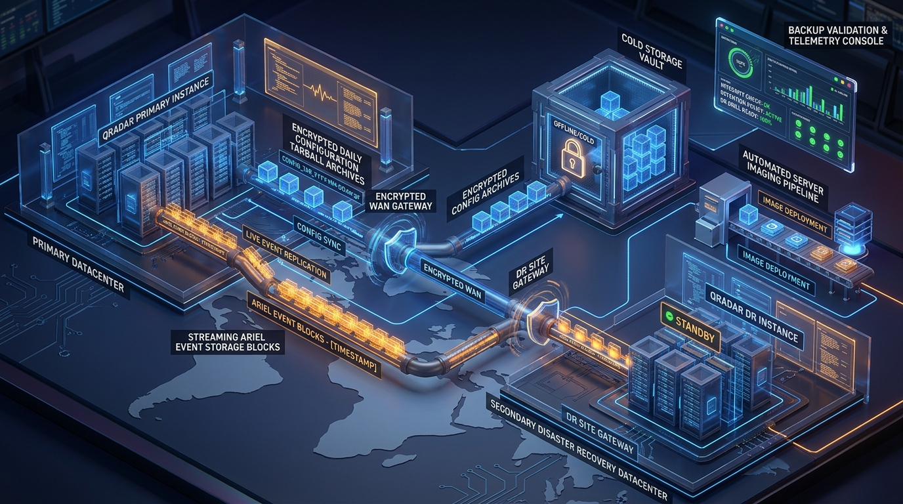
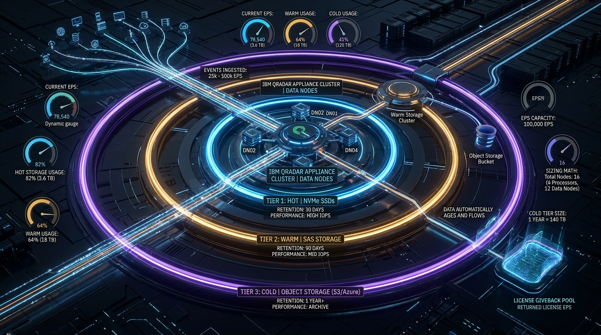
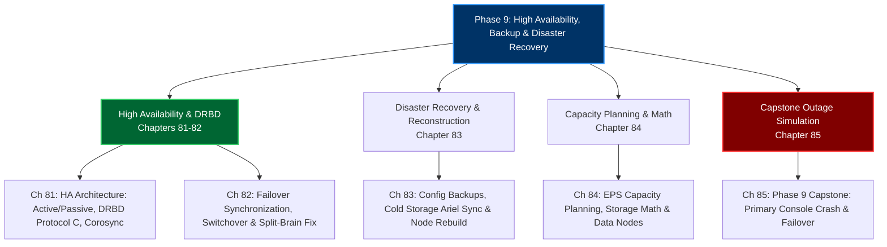

# Phase 9: High Availability (HA), Backup, Disaster Recovery & Multi-Tenancy (Days 81–85)

> **Track:** Enterprise IBM QRadar Administrator & SIEM Architect  
> **Phase Status:** 100% Complete (5 Chapters & 5 Embedded Hands-on Labs)  
> **Target Audience:** Senior SOC Engineers, SIEM Administrators (2+ Years Hands-on Experience)  
> **Prerequisites:** Phases 1–8 Mastery (Architecture, Ingestion, Parsing, CRE, Reference Data, AQL, Linux Administration)  
> **Total Chapters:** 5 (Chapters 81–85) | **Total Embedded Labs:** 5 (Labs 81–85)  

---

## 1. 3D Architectural Visual Gallery

### Figure 9.1: Enterprise High Availability Cluster & DRBD Block-Level Replication

![[qradar_ha_drbd_3d_1791715532560.jpg|1000]]

### Figure 9.2: Disaster Recovery (DR) Architecture & Cold Storage Sync

![[qradar_dr_backup_3d_1791715579274.jpg|1000]]

### Figure 9.3: Enterprise EPS Capacity Planning & Storage Sizing

![[qradar_eps_sizing_3d_1791715613106.jpg|1000]]

---

## 2. Phase 9 Overview & Curriculum Blueprint

Phase 9 transforms administrators into **Enterprise SIEM Architects and Reliability Engineers**. High Availability and Disaster Recovery represent the highest operational responsibilities in an enterprise SOC—protecting multi-terabyte security intelligence repositories against hardware deaths, datacenter catastrophes, and capacity exhaustion.



---

## 3. Chapter Index & Hands-on Practice Labs Directory

| Chapter # | Day | Chapter Title | Core Technical Focus | Embedded Hands-on Lab |
| :--- | :--- | :--- | :--- | :--- |
| **[[Chapter_81_High_Availability_Architecture_Active_Passive_DRBD_Replication_Heartbeat_Corosync|Chapter 81]]** | 81 | **High Availability Architecture** | Active/Passive Dual-Node, DRBD Protocol C, Virtual IP (VIP), Corosync Heartbeat, `/proc/drbd` | **Lab 81:** Simulating & Auditing QRadar HA Cluster Telemetry |
| **[[Chapter_82_HA_Failover_Synchronization_Planned_Switchover_Unplanned_Split_Brain_Recovery|Chapter 82]]** | 82 | **HA Failover & Synchronization** | Planned Switchover (`ha_manage.sh`), Gratuitous ARP (GARP), Split-Brain Detection (`cs:StandAlone`), Survivor/Victim recovery | **Lab 82:** Simulating & Resolving an Enterprise HA Split-Brain Disaster |
| **[[Chapter_83_Backup_and_Disaster_Recovery_Config_Backups_Cold_Storage_Ariel_Sync_Reconstruction|Chapter 83]]** | 83 | **Backup & Disaster Recovery (DR)** | HA vs DR trade-offs, Nightly Config Tarballs, Cold Storage Ariel Async Sync, Bare-Metal Reconstruction | **Lab 83:** Building an Automated DR Backup Validation & Recovery Drill |
| **[[Chapter_84_EPS_Capacity_Planning_Ingestion_Growth_Data_Node_Storage_Math_Giveback_Pool|Chapter 84]]** | 84 | **EPS Capacity Planning & Sizing Math** | Ingestion Storage Math, Ariel 3.5:1 Compression, Lucene Overhead, Data Node (14xx) Scale-Out, Giveback Pool | **Lab 84:** Building an Automated SIEM Storage Sizing Calculator |
| **[[Chapter_85_Phase_9_Capstone_Simulating_Primary_Console_Failure_Manual_Failover_and_State_Recovery|Chapter 85]]** | 85 | **Phase 9 Capstone: Primary Console Crash** | Unplanned Motherboard Crash, Forced Secondary Promotion, VIP Re-binding, `postmaster.pid` Lock Cleanup, Hardware Rejoin | **Lab 85:** The Capstone High Availability Disaster Simulation Engine |

---

## 4. Phase 9 Competency Matrix

```mermaid
mindmap
  root((Phase 9 Competencies))
    High Availability Mechanics
      DRBD Kernel Module Protocol C
      Virtual IP (VIP) and Gratuitous ARP
      Corosync keepalive & quorum
      /proc/drbd telemetry fields
    Failover & Split-Brain
      ha_manage.sh planned switchover
      Survivor vs Victim node arbitration
      drbdadm connect --discard-my-data
    Disaster Recovery
      Automated nightly config offloading
      Asynchronous Ariel cold sync
      Identical patch bare-metal rebuild
    Capacity Engineering
      Daily Raw to Ariel compression math
      Data Node 14xx horizontal query scale
      Dynamic License Giveback pools
```
