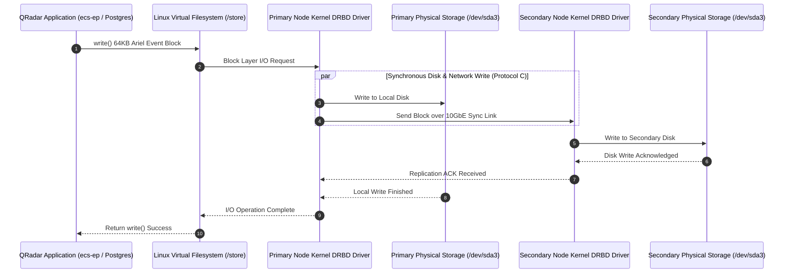
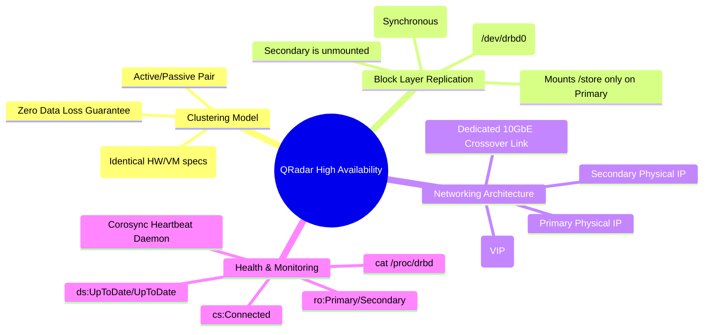

# Chapter 81: High Availability (HA) Architecture — Active/Passive Clusters, DRBD & Corosync

> **Track:** Enterprise IBM QRadar Administrator & SIEM Architect  
> **Phase 9:** High Availability, Backup, Disaster Recovery & Multi-Tenancy  
> **Day:** 81 of 90  
> **Target Audience:** Senior SOC Engineers, SIEM Administrators (2+ Years Hands-on Experience)  
> **Prerequisites:** Phase 8 Complete (Daily Administration, Linux CLI & Health Management)  
> **Time Commitment:** 90 Minutes + 45 Minutes Hands-on Practice Lab  

---

## 1. 3D Architectural Blueprint: Enterprise High Availability Cluster & DRBD Sync


![[qradar_ha_drbd_3d_1791715532560.jpg|1000]]

---

## 2. Deep Dive: The QRadar Active/Passive High Availability Model

High Availability (HA) in IBM QRadar is implemented as an **Active/Passive dual-node appliance cluster**. For mission-critical enterprise environments, an HA pair eliminates single points of failure across the SIEM deployment, guaranteeing near-zero data loss during hardware failures, power outages, kernel panics, or routine software maintenance.

```mermaid
graph TD
    ClientTraffic[External Syslog / WinCollect / SOC Analysts] --> VIP[Virtual IP: 10.10.1.50]
    
    subgraph PrimaryAppliance[Primary Appliance - ACTIVE]
        PrimaryHost[Primary IP: 10.10.1.51]
        VIP --> PrimaryHost
        DaemonsActive[Active Daemons: hostcontext, ecs-ep, tomcat]
        FSPrimary[Filesystem: /store Mounted Read-Write]
        DRBDPrimary[/dev/drbd0 - Primary State]
    end
    
    subgraph SecondaryAppliance[Secondary Appliance - STANDBY]
        SecondaryHost[Secondary IP: 10.10.1.52]
        DaemonsPassive[Standby Daemon: hostcontext-ha only]
        FSSecondary[Filesystem: /store Unmounted]
        DRBDSecondary[/dev/drbd0 - Secondary State]
    end
    
    PrimaryHost <-->|Corosync / Heartbeat Pulse<br>Keepalive Every 2000ms| SecondaryHost
    DRBDPrimary -->|Dedicated 10GbE Crossover Link<br>Synchronous Block-Level DRBD Replication| DRBDSecondary
    
    style VIP fill:#003366,stroke:#3399ff,stroke-width:2px,color:#fff
    style PrimaryAppliance fill:#006633,stroke:#33cc66,stroke-width:2px,color:#fff
    style SecondaryAppliance fill:#666666,stroke:#999999,stroke-width:2px,color:#fff
```

### Supported Appliance Types in QRadar HA

Every major appliance family in QRadar can be paired into an HA cluster:
1. **QRadar Console (31xx series)**: High-availability Web UI, REST API, offense management, and configuration databases.
2. **Event & Flow Processors (16xx / 17xx / 18xx series)**: High-availability in-memory CRE correlation, Ariel database indexing, and event processing.
3. **Event Collectors (15xx series)**: Ingestion buffer and protocol spool high-availability.
4. **Data Nodes (14xx series)**: Distributed Ariel storage high-availability.

---

## 3. Distributed Replicated Block Device (DRBD) Protocol Mechanics

Unlike application-level database mirroring, QRadar employs **DRBD (Distributed Replicated Block Device)** at the Linux kernel block layer. DRBD operates like a network-based RAID 1 mirror.



### DRBD Replication Protocol Specification: Protocol C (Synchronous)
QRadar exclusively uses **DRBD Protocol C**:
- A write operation is not marked as completed in the Linux kernel until **both** the local storage on the Primary node and the remote storage on the Secondary node have acknowledged the write to physical non-volatile disk.
- **Data Loss Guarantee**: Zero RPO (Recovery Point Objective) for committed transactions.
- **Network Requirement**: High-speed, ultra-low latency dedicated crossover Ethernet interface (< 2ms round-trip latency; recommended 10Gbps+ with MTU 9000 Jumbo Frames).

---

## 4. Network Architecture: The 3-IP Triangle & Virtual IP (VIP)

An enterprise QRadar HA cluster requires three distinct IP addresses within the management subnet, plus dedicated private IPs for crossover synchronization:

| Network Interface | Role | IP Example | Description |
| :--- | :--- | :--- | :--- |
| **Management (VIP)** | Virtual Floating IP | `10.10.1.50` | The permanent address bound to the active primary node. All syslog forwarders, WinCollect agents, and SOC browser sessions connect to this VIP. |
| **Primary Real IP** | Primary Static IP | `10.10.1.51` | Physical management IP of Appliance 1 (used for out-of-band management and initial SSH). |
| **Secondary Real IP** | Secondary Static IP | `10.10.1.52` | Physical management IP of Appliance 2. |
| **HA Sync Interface** | Dedicated Crossover (eth1/eth2) | `192.168.200.1` (Pri)<br>`192.168.200.2` (Sec) | Isolated direct 10GbE DAC/fiber connection dedicated exclusively to DRBD block replication and Corosync heartbeats. |

---

## 5. Corosync & Heartbeat Clustering Engine

QRadar uses `corosync` and `heartbeat` daemon extensions to monitor cluster health. The active node transmits continuous heartbeat UDP packets over both the management network and the crossover sync network:

```bash
# Check raw kernel DRBD status
cat /proc/drbd
```

### Understanding the `/proc/drbd` Output Fields

```text
version: 8.4.11 (api:1/proto:86-101)
srcversion: 760E80053CD61A8EBB8740B 
 0: cs:Connected ro:Primary/Secondary ds:UpToDate/UpToDate C r-----
    ns:1849204 nr:0 dw:1849204 dr:209849 al:412 bm:0 lo:0 pe:0 ua:0 ap:0 ep:1 wo:f oos:0
```

| Field Code | Field Name | Optimal State | Meaning / Significance |
| :--- | :--- | :--- | :--- |
| **`cs:`** | Connection State | `Connected` | Both nodes communicate normally over DRBD. (Warning: `WFConnection`, `StandAlone`, `SyncSource`). |
| **`ro:`** | Roles | `Primary/Secondary` | Node 1 is Active (Primary), Node 2 is Standby (Secondary). |
| **`ds:`** | Disk States | `UpToDate/UpToDate` | Both storage arrays are fully synchronized. Any write made to Primary exists on Secondary. |
| **`C`** | Protocol | `C` | DRBD Protocol C (Synchronous write replication). |
| **`oos:`** | Out of Sync | `0` | Number of kilobytes out of sync. `0` means zero replication backlog. |

---

## 6. Visual Interactive Mindmap



---

## 7. Color-Coded Digital Sticky Notes

```
====================================================================================================
🟨 CONCEPT STICKY NOTE: The Unmounted Storage Invariant
----------------------------------------------------------------------------------------------------
In a healthy QRadar HA cluster, the `/store` partition is mounted ONLY on the Active Primary node.
On the Secondary Standby node, `/store` is strictly UNMOUNTED. If you attempt to manually mount 
`/store` on the secondary while DRBD is active, Linux kernel filesystem corruption will occur.
====================================================================================================
```

```
====================================================================================================
🟩 GOLDEN RULE STICKY NOTE: Hardware Sizing Parity is Mandatory
----------------------------------------------------------------------------------------------------
The Primary and Secondary appliances in an HA pair MUST have identical CPU, RAM, disk capacity, 
and NIC configurations. If the secondary has slower disks or smaller storage partitions, DRBD 
will bottleneck the primary node to the speed of the slowest disk.
====================================================================================================
```

```
====================================================================================================
🟪 ARCHITECTURE STICKY NOTE: The Dedicated Crossover Link
----------------------------------------------------------------------------------------------------
DRBD block replication consumes massive bandwidth during high event bursts (e.g., 50,000 EPS). 
ALWAYS use a dedicated physical point-to-point crossover link (or isolated VLAN) with 9000-byte 
Jumbo Frames to prevent replication packets from congesting the corporate management LAN.
====================================================================================================
```

```
====================================================================================================
🟦 ENTERPRISE VALUE STICKY NOTE: Regulatory Compliance for Zero-RPO
----------------------------------------------------------------------------------------------------
Using DRBD Protocol C satisfies stringent regulatory mandates (such as PCI-DSS, HIPAA, and FISMA High), 
guaranteeing that financial or healthcare forensic logs are not lost even during catastrophic hardware failure.
====================================================================================================
```

```
====================================================================================================
🟧 INTERVIEW CHEAT CODE: Explaining QRadar HA to an Architect
----------------------------------------------------------------------------------------------------
"QRadar High Availability is an Active/Passive cluster built on Linux DRBD kernel replication and 
Corosync heartbeat. It operates at the block level under Protocol C, synchronously mirroring the 
`/store` partition across a dedicated crossover link. Clients and log sources communicate exclusively 
with a Virtual IP (VIP), ensuring transparent failover without reconfiguration."
====================================================================================================
```

```
====================================================================================================
🟥 CRITICAL PITFALL STICKY NOTE: Mixing Software Patch Levels Across HA Pairs
----------------------------------------------------------------------------------------------------
Never upgrade the software patch level (e.g., 7.5.0 UP8) on the Primary node while leaving the 
Secondary on an older patch. QRadar HA automated failover will fail if the PostgreSQL database schema 
or binary versions between the two nodes diverge.
====================================================================================================
```

---

## 8. Rapid-Recall Flashcards

### Flashcard 1
- **Question:** What replication mechanism does QRadar HA use to synchronize data between primary and secondary nodes?
- **Answer:** DRBD (Distributed Replicated Block Device) operating synchronously at the Linux kernel block layer (Protocol C).

### Flashcard 2
- **Question:** On which node is the `/store` partition mounted during normal HA operations?
- **Answer:** Exclusively on the **Primary (Active)** node. On the Secondary (Standby) node, `/store` is unmounted.

### Flashcard 3
- **Question:** What IP address should syslog forwarders, WinCollect agents, and SOC analysts connect to in an HA deployment?
- **Answer:** The **Virtual IP (VIP)**, which dynamically floats to whichever appliance is currently in the Active role.

### Flashcard 4
- **Question:** What is the meaning of `ds:UpToDate/UpToDate` in `/proc/drbd`?
- **Answer:** It indicates that the physical disk states on both the local and remote nodes are 100% synchronized with zero missing blocks.

### Flashcard 5
- **Question:** Why is a dedicated crossover link (or isolated network) required for QRadar HA synchronization?
- **Answer:** To prevent heavy DRBD block replication traffic and jumbo frames from flooding the corporate LAN and to provide a low-latency heartbeat path (<2ms) to prevent false failovers.

### Flashcard 6
- **Question:** What cluster management and heartbeat daemon runs on QRadar to coordinate node failover?
- **Answer:** `corosync` / `heartbeat` (supervised by `hostcontext-ha`).

---

## 9. Hands-On Practice Lab 81: Simulating & Auditing QRadar HA Cluster Telemetry

### Lab Objective
Construct an interactive Linux HA audit script (`audit_qradar_ha.sh`) that parses simulated `/proc/drbd` status files, evaluates cluster connection states, verifies disk synchronization, and detects failover prerequisites.

### Required Tools & Environment
- Linux Shell (Bash, awk, sed, grep)

---

### Step-by-Step Lab Execution Guide

#### Task 1: Generate Simulated DRBD Kernel States
```bash
# 1. Create a mock HA environment
mkdir -p /tmp/qradar_ha_lab
cd /tmp/qradar_ha_lab

# 2. Author a healthy DRBD status file
cat << 'EOF' > mock_drbd_healthy.txt
version: 8.4.11 (api:1/proto:86-101)
srcversion: 760E80053CD61A8EBB8740B 
 0: cs:Connected ro:Primary/Secondary ds:UpToDate/UpToDate C r-----
    ns:4592012 nr:0 dw:4592012 dr:891240 al:812 bm:0 lo:0 pe:0 ua:0 ap:0 ep:1 wo:f oos:0
EOF

# 3. Author a degraded/syncing DRBD status file
cat << 'EOF' > mock_drbd_syncing.txt
version: 8.4.11 (api:1/proto:86-101)
srcversion: 760E80053CD61A8EBB8740B 
 0: cs:SyncSource ro:Primary/Secondary ds:UpToDate/Inconsistent C r-----
    [==>.................] sync'ed: 14.8% (842010/988000)K
    ns:124000 nr:0 dw:124000 dr:8912 al:42 bm:0 lo:1 pe:4 ua:0 ap:0 ep:1 wo:f oos:842010
EOF
```

#### Task 2: Build the High-Speed HA Cluster Diagnostic Script (`audit_qradar_ha.sh`)
```bash
cat << 'EOF' > audit_qradar_ha.sh
#!/usr/bin/env bash
STATUS_FILE=${1:-mock_drbd_healthy.txt}

echo "=================================================================="
echo "          IBM QRADAR HIGH AVAILABILITY CLUSTER AUDIT              "
echo "=================================================================="
echo "[+] Target Status Source: $STATUS_FILE"
echo ""

# Extract Key Parameters
CS=$(grep -oE "cs:[A-Za-z]+" "$STATUS_FILE" | cut -d: -f2)
RO=$(grep -oE "ro:[A-Za-z/]+" "$STATUS_FILE" | cut -d: -f2)
DS=$(grep -oE "ds:[A-Za-z/]+" "$STATUS_FILE" | cut -d: -f2)
OOS=$(grep -oE "oos:[0-9]+" "$STATUS_FILE" | cut -d: -f2)

echo "--- 1. CLUSTER CONNECTION & ROLE AUDIT ---"
printf "%-20s: %s\n" "Connection State (cs)" "$CS"
printf "%-20s: %s\n" "Node Roles (ro)" "$RO"
printf "%-20s: %s\n" "Disk States (ds)" "$DS"
printf "%-20s: %s KB\n" "Out of Sync (oos)" "$OOS"
echo ""

echo "--- 2. HEALTH EVALUATION & FAILOVER READINESS ---"
if [ "$CS" == "Connected" ] && [ "$DS" == "UpToDate/UpToDate" ]; then
    echo -e "[\e[32mHEALTHY\e[0m] HA Cluster is in OPTIMAL state."
    echo "[+] Primary is ACTIVE and fully synchronized with Secondary."
    echo "[+] Failover readiness: 100% (Instant zero-RPO failover possible)."
elif [ "$CS" == "SyncSource" ]; then
    PERCENT=$(grep -oE "sync'ed: [0-9.]+%" "$STATUS_FILE" | awk '{print $2}')
    echo -e "[\e[33mSYNCHRONIZING\e[0m] Background block resynchronization in progress: $PERCENT"
    echo -e "[\e[33mWARNING\e[0m] Secondary storage is INCONSISTENT. Unplanned failover will result in data loss!"
else
    echo -e "[\e[31mCRITICAL\e[0m] Cluster is in DEGRADED or STANDALONE state!"
    echo "Action: Inspect crossover link connectivity and investigate split-brain conditions."
fi
echo "=================================================================="
EOF
chmod +x audit_qradar_ha.sh

# Test with healthy mock data
./audit_qradar_ha.sh mock_drbd_healthy.txt

# Test with synchronizing mock data
./audit_qradar_ha.sh mock_drbd_syncing.txt
```

#### Task 3: Inspect Real-Time Output & Validate
*Expected Output for Healthy Cluster:*
```text
==================================================================
          IBM QRADAR HIGH AVAILABILITY CLUSTER AUDIT              
==================================================================
[+] Target Status Source: mock_drbd_healthy.txt

--- 1. CLUSTER CONNECTION & ROLE AUDIT ---
Connection State (cs): Connected
Node Roles (ro)      : Primary/Secondary
Disk States (ds)     : UpToDate/UpToDate
Out of Sync (oos)    : 0 KB

--- 2. HEALTH EVALUATION & FAILOVER READINESS ---
[HEALTHY] HA Cluster is in OPTIMAL state.
[+] Primary is ACTIVE and fully synchronized with Secondary.
[+] Failover readiness: 100% (Instant zero-RPO failover possible).
==================================================================
```

---

### Verification Checklist & Troubleshooting
- [x] Active/Passive HA architecture modeled.
- [x] DRBD block-level Protocol C mechanics verified.
- [x] 3-IP network architecture and Virtual IP (VIP) mapped.
- [x] High-speed `/proc/drbd` diagnostic tool authored and tested.
