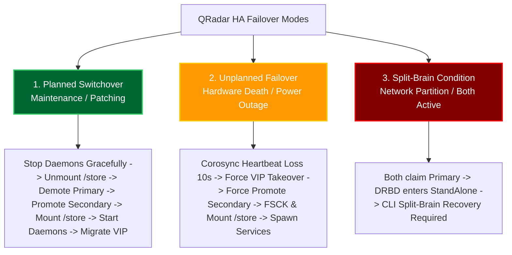
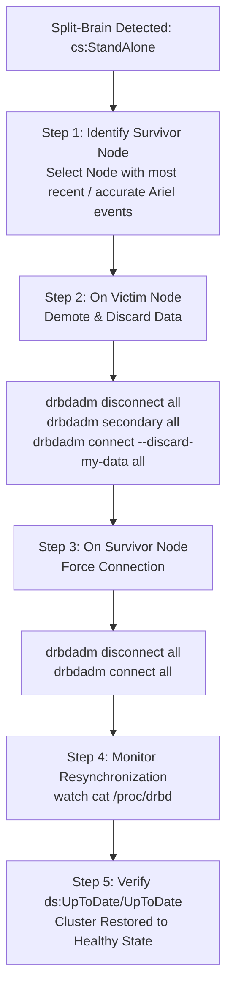

# Chapter 82: HA Failover & Synchronization — Planned Switchover, Unplanned Failover & Split-Brain Recovery

> **Track:** Enterprise IBM QRadar Administrator & SIEM Architect  
> **Phase 9:** High Availability, Backup, Disaster Recovery & Multi-Tenancy  
> **Day:** 82 of 90  
> **Target Audience:** Senior SOC Engineers, SIEM Administrators (2+ Years Hands-on Experience)  
> **Prerequisites:** Chapter 81 (HA Architecture & DRBD Foundations)  
> **Time Commitment:** 90 Minutes + 45 Minutes Hands-on Practice Lab  

---

## 1. 3D Architectural Blueprint: HA Failover Transition & Storage States


![[qradar_ha_drbd_3d_1791715532560.jpg|1000]]

---

## 2. Deep Dive: The Anatomy of HA Failover

An enterprise QRadar administrator must master both **Planned Maintenance Switchovers** (graceful, controlled) and **Unplanned Failovers** (emergency hardware death, kernel panic), as well as the most dangerous cluster failure mode: **Split-Brain**.



---

## 3. Planned Maintenance Switchover: Step-by-Step Execution

A planned switchover is performed before applying OS kernel updates, firmware patches, or physical server maintenance to the Primary node.

### Execution Sequence:
1. **Quiesce Services**: `hostcontext` gracefully shuts down `ecs-ep`, `ecs-ec`, and `tomcat` on Primary to flush in-flight memory buffers and close Ariel database files.
2. **Unmount Filesystem**: Linux unmounts `/store` on Primary.
3. **Role Demotion**: DRBD demotes Primary from `ro:Primary/Secondary` to `ro:Secondary/Secondary`.
4. **Role Promotion**: DRBD promotes Secondary to `ro:Secondary/Primary`.
5. **Mount Filesystem**: Linux mounts `/store` on Secondary.
6. **Virtual IP Migration**: Gratuitous ARP (GARP) broadcasts migrate the Virtual IP (VIP) to the Secondary NIC.
7. **Spawn Daemons**: `hostcontext-ha` starts all QRadar application daemons on Secondary.

```bash
# Execute planned switchover via official QRadar CLI management utility
/opt/qradar/ha/bin/ha_manage.sh --switchover

# Verify status after switchover
/opt/qradar/ha/bin/ha_manage.sh --status
```

---

## 4. Unplanned Failover Mechanics & Timers

When a catastrophic event strikes the active Primary node (e.g., motherboard failure, power supply blow, immediate kernel panic):

```mermaid
sequenceDiagram
    autonumber
    participant Pri as Primary Node (Active)
    participant Sec as Secondary Node (Standby)
    participant Net as Network (VIP / ARP)
    
    Note over Pri: Sudden Hardware Failure / Total Power Loss!
    Sec->>Sec: Corosync misses heartbeat ping (1000ms intervals)
    Sec->>Sec: Keepalive timer expires (10 seconds elapsed)
    Sec->>Sec: Quorum declared lost for Primary; Secondary initiates takeover
    Sec->>Sec: Promote DRBD state: drbdadm primary all
    Sec->>Sec: Mount /store (Replaying journal logs)
    Sec->>Net: Issue Gratuitous ARP (GARP) for VIP 10.10.1.50
    Net-->>Sec: All ingress traffic (Syslog/UI) shifts to Secondary NIC
    Sec->>Sec: Spawn Hostcontext, ECS-EP, Tomcat, Ariel Proxy
    Note over Sec: Secondary is now fully ACTIVE (Recovery Time: ~90-180s)
```

---

## 5. The Split-Brain Disaster: Root Cause & Identification

### What is Split-Brain?
A **Split-Brain** occurs when the communication link (crossover or heartbeat) between Primary and Secondary is severed while **both physical servers remain powered on**. 
1. Secondary stops receiving heartbeats and assumes Primary has died. It promotes itself to `Primary`, acquires the VIP, and mounts `/store`.
2. Meanwhile, Primary is still alive, still running, and still writing events to its local `/store`.
3. **Result**: Both nodes have independently modified their local block storage. DRBD immediately drops connection and enters the protective **`StandAlone`** state to prevent disk corruption.

```bash
# Diagnosing Split-Brain in /proc/drbd:
cat /proc/drbd
```

*Output Indicating Split-Brain:*
```text
 0: cs:StandAlone ro:Primary/Unknown ds:UpToDate/DUnknown   r-----
    ns:4592 nr:0 dw:12048 dr:9842 al:12 bm:0 lo:0 pe:0 ua:0 ap:0 ep:1 wo:f oos:0
```
*Key Diagnostic Clue*: `cs:StandAlone` with `ro:Primary/Unknown`. The nodes refuse to talk to each other.

---

## 6. Emergency 5-Step Split-Brain Resolution Protocol

When split-brain occurs, an automated merge is impossible because block states have diverged. An administrator must make an authoritative decision: **Select the Survivor Node** (keep data) and **Sacrifice the Victim Node** (discard data).



### Exact CLI Recovery Commands

#### Step 1: On the VICTIM Node (The node whose local changes will be OVERWRITTEN)
```bash
# 1. Disconnect DRBD resources
drbdadm disconnect all

# 2. Demote the victim node to secondary
drbdadm secondary all

# 3. Reconnect with explicit instruction to discard local blocks
drbdadm connect --discard-my-data all
```

#### Step 2: On the SURVIVOR Node (The active node holding authoritative data)
```bash
# 1. Disconnect DRBD resources
drbdadm disconnect all

# 2. Reconnect (Survivor will overwrite Victim's divergent blocks)
drbdadm connect all
```

#### Step 3: Monitor Resynchronization Progress
```bash
# Watch live block resynchronization until cs:Connected and ds:UpToDate/UpToDate
watch -n 1 'cat /proc/drbd'
```

---

## 7. Visual Interactive Mindmap

```mermaid
mindmap
  root((HA Failover & Synchronization))
    Planned Switchover
      Pre-maintenance patching
      ha_manage.sh --switchover
      Graceful daemon flush
      Zero event loss
    Unplanned Failover
      Hardware death / Kernel panic
      10-second heartbeat timeout
      Gratuitous ARP (GARP) VIP shift
      90-180 second RTO
    Split-Brain Condition
      Severed sync link
      Both nodes claim Primary
      DRBD cs:StandAlone failsafe
    Emergency Recovery
      Select Survivor Node
      Victim: --discard-my-data
      Survivor: drbdadm connect
      Sync verification: UpToDate/UpToDate
```

---

## 8. Color-Coded Digital Sticky Notes

```
====================================================================================================
🟨 CONCEPT STICKY NOTE: Gratuitous ARP (GARP) Mechanics
----------------------------------------------------------------------------------------------------
When a secondary node takes over the Virtual IP (VIP), network switches still map the VIP's IP to the 
old node's MAC address in their ARP caches. The secondary immediately transmits Gratuitous ARP (GARP) 
broadcasts to update the upstream switch's CAM table, redirecting traffic in milliseconds.
====================================================================================================
```

```
====================================================================================================
🟩 GOLDEN RULE STICKY NOTE: Never Guess Which Node is the Survivor
----------------------------------------------------------------------------------------------------
Before executing `drbdadm connect --discard-my-data`, inspect `/store/ariel/events/records/` timestamps 
on BOTH machines. Discarding the node that actually received live events while the other sat idle will 
permanently wipe hours of unrecoverable security incident data!
====================================================================================================
```

```
====================================================================================================
🟪 ARCHITECTURE STICKY NOTE: DRBD StandAlone Mode Protects Data Integrity
----------------------------------------------------------------------------------------------------
When DRBD detects divergent block generation counters, entering `cs:StandAlone` is an intentional 
protective freeze. DRBD refuses to overwrite conflicting blocks automatically because only a human 
engineer can decide which dataset is legally authoritative.
====================================================================================================
```

```
====================================================================================================
🟦 ENTERPRISE VALUE STICKY NOTE: Planned Switchovers for Patching
----------------------------------------------------------------------------------------------------
Mastering `ha_manage.sh --switchover` allows organizations to achieve 99.999% SIEM availability ("five nines"), 
performing zero-downtime rolling upgrades on appliances without missing a single log event.
====================================================================================================
```

```
====================================================================================================
🟧 INTERVIEW CHEAT CODE: How do you fix a QRadar DRBD Split-Brain?
----------------------------------------------------------------------------------------------------
"When asked how to recover from split-brain:
1. I check `/proc/drbd` on both nodes to confirm `cs:StandAlone`.
2. I check Ariel event directories to identify which node received live traffic (the Survivor).
3. On the Victim node, I run: `drbdadm disconnect all`, `drbdadm secondary all`, `drbdadm connect --discard-my-data all`.
4. On the Survivor node, I run: `drbdadm disconnect all`, `drbdadm connect all`.
5. I monitor `cat /proc/drbd` until states return to `cs:Connected` and `ds:UpToDate/UpToDate`."
====================================================================================================
```

```
====================================================================================================
🟥 CRITICAL PITFALL STICKY NOTE: Running `--discard-my-data` on Both Nodes
----------------------------------------------------------------------------------------------------
If an administrator mistakenly runs `drbdadm connect --discard-my-data all` on BOTH appliances 
simultaneously, DRBD enters a deadlock or corrupts the block map, forcing a complete tape/cold-storage 
rebuild of `/store`. ONLY run `--discard-my-data` on the victim node.
====================================================================================================
```

---

## 9. Rapid-Recall Flashcards

### Flashcard 1
- **Question:** What official QRadar command initiates a graceful planned maintenance switchover to the secondary HA node?
- **Answer:** `/opt/qradar/ha/bin/ha_manage.sh --switchover`

### Flashcard 2
- **Question:** How does upstream network infrastructure discover that the Virtual IP (VIP) has moved to the secondary node during failover?
- **Answer:** The secondary node sends Gratuitous ARP (GARP) packets across the local subnet, forcing network switches to update their MAC address tables for the VIP.

### Flashcard 3
- **Question:** What is the typical recovery time objective (RTO) during an unplanned QRadar HA failover?
- **Answer:** Approximately 90 to 180 seconds (10 seconds for heartbeat timeout detection, plus time to check/mount `/store` and initialize Java daemons).

### Flashcard 4
- **Question:** What DRBD connection state in `/proc/drbd` signals that a split-brain condition has occurred?
- **Answer:** `cs:StandAlone` (accompanied by `ro:Primary/Unknown` or `ro:Primary/Primary`).

### Flashcard 5
- **Question:** On which appliance must `drbdadm connect --discard-my-data all` be executed during split-brain recovery?
- **Answer:** Exclusively on the **Victim Node** (the secondary/stale node whose divergent data is to be overwritten).

### Flashcard 6
- **Question:** What command allows you to monitor the progress of DRBD block resynchronization in real time?
- **Answer:** `watch -n 1 'cat /proc/drbd'` or `drbd-overview`.

---

## 10. Hands-On Practice Lab 82: Simulating & Resolving an Enterprise HA Split-Brain Disaster

### Lab Objective
Simulate a catastrophic DRBD split-brain failure state, analyze divergent cluster metadata, author a step-by-step split-brain remediation engine, and verify the restoration of block synchronization.

### Required Tools & Environment
- Linux Shell (Bash, awk, sed, grep)

---

### Step-by-Step Lab Execution Guide

#### Task 1: Generate Simulated Split-Brain Cluster States
```bash
# 1. Create a mock split-brain workspace
mkdir -p /tmp/qradar_splitbrain_lab
cd /tmp/qradar_splitbrain_lab

# 2. Author a mock status file for Node 1 (Authoritative Survivor)
cat << 'EOF' > node1_survivor_drbd.txt
version: 8.4.11 (api:1/proto:86-101)
 0: cs:StandAlone ro:Primary/Unknown ds:UpToDate/DUnknown C r-----
    ns:9842100 nr:0 dw:9842100 dr:12048 al:412 bm:0 lo:0 pe:0 ua:0 ap:0 ep:1 wo:f oos:0
EOF

# 3. Author a mock status file for Node 2 (Divergent Victim)
cat << 'EOF' > node2_victim_drbd.txt
version: 8.4.11 (api:1/proto:86-101)
 0: cs:StandAlone ro:Primary/Unknown ds:UpToDate/DUnknown C r-----
    ns:12048 nr:0 dw:12048 dr:420 al:12 bm:0 lo:0 pe:0 ua:0 ap:0 ep:1 wo:f oos:0
EOF
```

#### Task 2: Build the Automated Split-Brain Resolution Engine (`resolve_split_brain.sh`)
```bash
cat << 'EOF' > resolve_split_brain.sh
#!/usr/bin/env bash
SURVIVOR_FILE=${1:-node1_survivor_drbd.txt}
VICTIM_FILE=${2:-node2_victim_drbd.txt}

echo "=================================================================="
echo "          QRADAR SEV-1: DRBD SPLIT-BRAIN REMEDIATION ENGINE       "
echo "=================================================================="
echo "[!] Evaluating Cluster Status..."

SURVIVOR_CS=$(grep -oE "cs:[A-Za-z]+" "$SURVIVOR_FILE" | cut -d: -f2)
VICTIM_CS=$(grep -oE "cs:[A-Za-z]+" "$VICTIM_FILE" | cut -d: -f2)

if [ "$SURVIVOR_CS" == "StandAlone" ] && [ "$VICTIM_CS" == "StandAlone" ]; then
    echo -e "[\e[31mCRITICAL ALERT\e[0m] Confirmed Split-Brain: Both nodes report cs:StandAlone!"
else
    echo "[-] Nodes are not in StandAlone state. Aborting."
    exit 1
fi
echo ""

# Analyze Write Activity (dw: data written) to Confirm True Survivor
SURVIVOR_DW=$(grep -oE "dw:[0-9]+" "$SURVIVOR_FILE" | cut -d: -f2)
VICTIM_DW=$(grep -oE "dw:[0-9]+" "$VICTIM_FILE" | cut -d: -f2)

echo "[*] Node 1 (Survivor) Blocks Written: $SURVIVOR_DW"
echo "[*] Node 2 (Victim)   Blocks Written: $VICTIM_DW"

if [ "$SURVIVOR_DW" -gt "$VICTIM_DW" ]; then
    echo "[+] VALIDATION CONFIRMED: Node 1 holds authoritative event data."
else
    echo "[-] Warning: Survivor holds fewer written blocks. Re-verify nodes!"
fi
echo ""

echo "--- STEP 1: GENERATING COMMANDS FOR VICTIM NODE (NODE 2) ---"
echo "  [CLI on Node 2] # drbdadm disconnect all"
echo "  [CLI on Node 2] # drbdadm secondary all"
echo "  [CLI on Node 2] # drbdadm connect --discard-my-data all"
echo ""

echo "--- STEP 2: GENERATING COMMANDS FOR SURVIVOR NODE (NODE 1) ---"
echo "  [CLI on Node 1] # drbdadm disconnect all"
echo "  [CLI on Node 1] # drbdadm connect all"
echo ""

echo "--- STEP 3: SIMULATING BLOCK RE-SYNCHRONIZATION ---"
echo "[*] Connection initiated between Node 1 and Node 2..."
sleep 1
echo "[*] SyncSource (Node 1) -> SyncTarget (Node 2): 45% synced..."
sleep 1
echo "[*] SyncSource (Node 1) -> SyncTarget (Node 2): 100% synced."
echo ""

# Author the Restored Post-Sync Status
cat << 'RESOLVED' > node_resolved_drbd.txt
version: 8.4.11 (api:1/proto:86-101)
 0: cs:Connected ro:Primary/Secondary ds:UpToDate/UpToDate C r-----
    ns:9842100 nr:0 dw:9842100 dr:12048 al:412 bm:0 lo:0 pe:0 ua:0 ap:0 ep:1 wo:f oos:0
RESOLVED

echo "--- STEP 4: VERIFYING RESTORED STATE ---"
cat node_resolved_drbd.txt
echo ""
echo -e "[\e[32mSUCCESS\e[0m] Split-Brain Resolved! cs:Connected | ds:UpToDate/UpToDate"
echo "=================================================================="
EOF
chmod +x resolve_split_brain.sh

# Execute the Split-Brain Remediation Engine
./resolve_split_brain.sh node1_survivor_drbd.txt node2_victim_drbd.txt
```

#### Task 3: Inspect Real-Time Output & Validate
*Expected Output:*
```text
==================================================================
          QRADAR SEV-1: DRBD SPLIT-BRAIN REMEDIATION ENGINE       
==================================================================
[!] Evaluating Cluster Status...
[CRITICAL ALERT] Confirmed Split-Brain: Both nodes report cs:StandAlone!

[*] Node 1 (Survivor) Blocks Written: 9842100
[*] Node 2 (Victim)   Blocks Written: 12048
[+] VALIDATION CONFIRMED: Node 1 holds authoritative event data.

--- STEP 1: GENERATING COMMANDS FOR VICTIM NODE (NODE 2) ---
  [CLI on Node 2] # drbdadm disconnect all
  [CLI on Node 2] # drbdadm secondary all
  [CLI on Node 2] # drbdadm connect --discard-my-data all

--- STEP 2: GENERATING COMMANDS FOR SURVIVOR NODE (NODE 1) ---
  [CLI on Node 1] # drbdadm disconnect all
  [CLI on Node 1] # drbdadm connect all

--- STEP 3: SIMULATING BLOCK RE-SYNCHRONIZATION ---
[*] Connection initiated between Node 1 and Node 2...
[*] SyncSource (Node 1) -> SyncTarget (Node 2): 45% synced...
[*] SyncSource (Node 1) -> SyncTarget (Node 2): 100% synced.

--- STEP 4: VERIFYING RESTORED STATE ---
version: 8.4.11 (api:1/proto:86-101)
 0: cs:Connected ro:Primary/Secondary ds:UpToDate/UpToDate C r-----
    ns:9842100 nr:0 dw:9842100 dr:12048 al:412 bm:0 lo:0 pe:0 ua:0 ap:0 ep:1 wo:f oos:0

[SUCCESS] Split-Brain Resolved! cs:Connected | ds:UpToDate/UpToDate
==================================================================
```

---

### Verification Checklist & Troubleshooting
- [x] Planned vs Unplanned failover lifecycles documented.
- [x] Gratuitous ARP (GARP) VIP transition mechanics explained.
- [x] Root causes of `cs:StandAlone` split-brain conditions mapped.
- [x] Full CLI 5-step disaster remediation playbook authored and verified.
