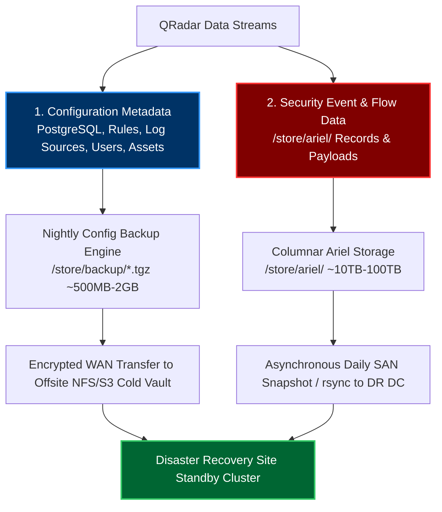
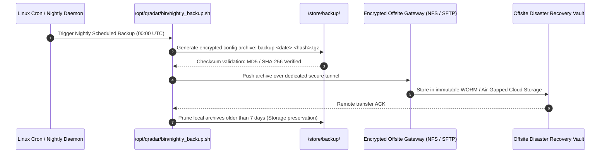
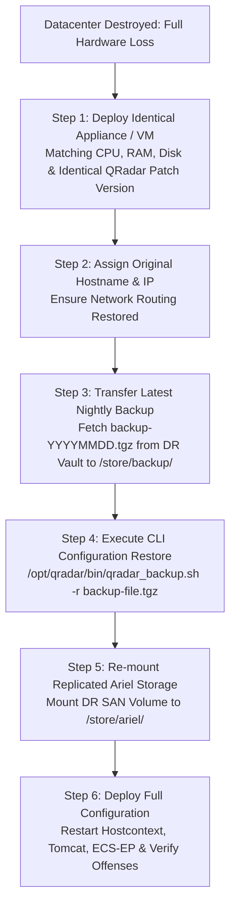
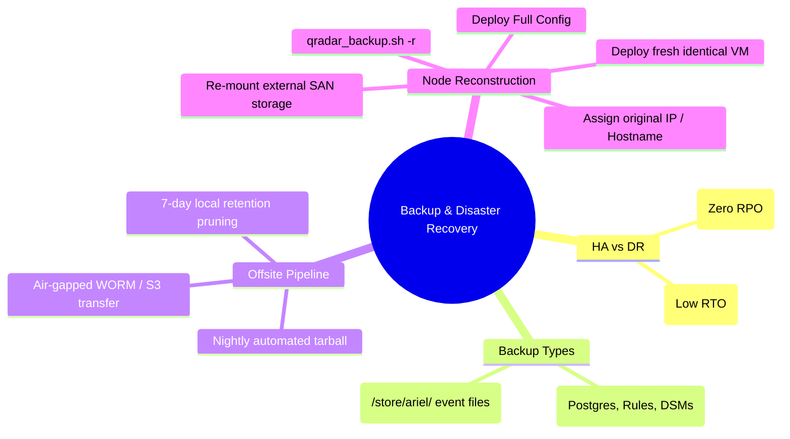

# Chapter 83: Backup & Disaster Recovery (DR) — Config Backups, Cold Storage Ariel Sync & Node Reconstruction

> **Track:** Enterprise IBM QRadar Administrator & SIEM Architect  
> **Phase 9:** High Availability, Backup, Disaster Recovery & Multi-Tenancy  
> **Day:** 83 of 90  
> **Target Audience:** Senior SOC Engineers, SIEM Administrators (2+ Years Hands-on Experience)  
> **Prerequisites:** Chapters 81 & 82 (HA Architecture & Failover)  
> **Time Commitment:** 90 Minutes + 45 Minutes Hands-on Practice Lab  

---

## 1. 3D Architectural Blueprint: Enterprise Disaster Recovery & Cold Storage Sync


![[qradar_dr_backup_3d_1791715579274.jpg|1000]]

---

## 2. Deep Dive: High Availability (HA) vs Disaster Recovery (DR)

A common enterprise misconception is confusing High Availability with Disaster Recovery. 
- **High Availability (HA)** protects against localized server/component hardware failures within the **same datacenter** using synchronous block mirroring (DRBD Protocol C). If an entire datacenter floods, burns, or loses power, HA fails.
- **Disaster Recovery (DR)** protects against catastrophic geographic facility loss. DR relies on **asynchronous offsite backup offloading**, **cold storage replication of Ariel event archives**, and **documented node reconstruction procedures**.



---

## 3. Configuration vs Data Backup Anatomy

### Configuration Backups (The Heartbeat of DR)
Generated daily at midnight by `/opt/qradar/bin/nightly_backup.sh`:
- **Files Stored**: PostgreSQL database dump (`pg_dump` of `qradar` DB), custom rules, building blocks, log source configurations, DSM extensions, user profiles, dashboards, and license keys.
- **Average Size**: 200 MB to 3 GB.
- **RTO / RPO**: Restores full SIEM functionality in under 45 minutes on a freshly imaged server.

### Data Backups (Historical Log Archives)
Raw Ariel event and flow data in `/store/ariel/events/` and `/store/ariel/flows/`:
- **Average Size**: Multiple Terabytes per month.
- **Enterprise Best Practice**: Do NOT use the QRadar built-in UI data backup option for terabyte-scale deployments (it overloads Java heap and saturates local disk). Instead, use SAN-level storage replication, asynchronous `rsync`, or dedicated enterprise backup agents (e.g., Veeam, Commvault).

---

## 4. Offsite Backup Automation & Replication Pipeline



### Production Shell Script for Automated Offsite SCP Sync
Save as `/opt/qradar/support/offsite_backup_sync.sh`:
```bash
#!/usr/bin/env bash
BACKUP_DIR="/store/backup"
DR_HOST="dr-backup.corp.enterprise.com"
DR_DEST="/opt/qradar_cold_vault/config_backups/"
SSH_KEY="/root/.ssh/id_dr_sync"

# Locate the most recent configuration backup generated today
LATEST_BACKUP=$(ls -t $BACKUP_DIR/backup-*.tgz 2>/dev/null | head -n 1)

if [ -f "$LATEST_BACKUP" ]; then
    echo "[*] Transferring $LATEST_BACKUP to DR Vault..."
    rsync -avz -e "ssh -i $SSH_KEY" "$LATEST_BACKUP" "dr_user@$DR_HOST:$DR_DEST"
    
    if [ $? -eq 0 ]; then
        echo "[+] Successfully synchronized backup to Disaster Recovery Site."
    else
        echo "[-] Error: Failed to sync backup to DR host!" >&2
    fi
else
    echo "[-] No backup archive found in $BACKUP_DIR!" >&2
fi
```

---

## 5. Bare-Metal Appliance Reconstruction Workflow

In the event of a total datacenter loss, follow the 6-step reconstruction runbook:



### Exact CLI Restore Commands

```bash
# 1. Place the backup file into the official backup directory
cp /root/recovered_backups/backup-20261010-config.tgz /store/backup/

# 2. Execute restoration using official QRadar backup utility
/opt/qradar/bin/qradar_backup.sh -r /store/backup/backup-20261010-config.tgz

# 3. Monitor restoration progress in the log
tail -f /var/log/qradar.log | grep -E "backup|restore|postgres"

# 4. Trigger full deployment across the reconstructed host
/opt/qradar/bin/deploy_full_config.sh
```

---

## 6. Cold Storage Ariel Event Replication Architecture

To preserve petabytes of compliance log data without overwhelming production CPU:
1. **Asynchronous Rsync / Storage Snapshots**: Schedule an off-peak replication window (e.g., 02:00 AM) to sync `/store/ariel/events/records/` and `/store/ariel/events/payloads/`.
2. **Symmetrical Sync Rule**: Always sync both `records` and `payloads` directories for the exact same hourly slice. A mismatch will cause AQL query index faults.
3. **Bandwidth Throttling**: Use `--bwlimit=50000` (50MB/s) in `rsync` to prevent saturating enterprise WAN connections.

---

## 7. Visual Interactive Mindmap



---

## 8. Color-Coded Digital Sticky Notes

```
====================================================================================================
🟨 CONCEPT STICKY NOTE: Patch Level Version Parity
----------------------------------------------------------------------------------------------------
You CANNOT restore a QRadar configuration backup taken from 7.5.0 UP8 onto a freshly installed 
7.5.0 UP7 appliance. The PostgreSQL database migration schemas will conflict and fail. The replacement 
server MUST be installed at the exact same patch and hotfix version as the backup.
====================================================================================================
```

```
====================================================================================================
🟩 GOLDEN RULE STICKY NOTE: Keep Config Backups Small
----------------------------------------------------------------------------------------------------
Configure automated daily backups as "Configuration Only". Attempting to bundle Ariel data into the 
nightly `.tgz` will result in massive 500GB archives that exhaust `/store` disk space and trigger 
the Chapter 78 emergency shutdown.
====================================================================================================
```

```
====================================================================================================
🟪 ARCHITECTURE STICKY NOTE: The Immutable Air-Gap
----------------------------------------------------------------------------------------------------
Ransomware attackers deliberately search networks for SIEM backups to destroy audit logs before 
detonating payloads. Offsite backups MUST be pushed to an immutable, write-once-read-many (WORM) 
storage vault with independent authentication.
====================================================================================================
```

```
====================================================================================================
🟦 ENTERPRISE VALUE STICKY NOTE: Disaster Recovery Audits & Drills
----------------------------------------------------------------------------------------------------
Conducting a bi-annual bare-metal node reconstruction drill in a test staging network proves compliance 
with SOC 2 Type II, ISO 27001 BCP/DR controls, and NIST SP 800-34 standards.
====================================================================================================
```

```
====================================================================================================
🟧 INTERVIEW CHEAT CODE: How do you design a QRadar Disaster Recovery architecture?
----------------------------------------------------------------------------------------------------
"For local hardware failure, I deploy Active/Passive HA pairs with synchronous DRBD Protocol C. 
For geographic disaster recovery, I automate nightly encrypted configuration backup offloading to a 
remote cloud storage vault. Ariel event storage is replicated asynchronously via SAN storage snapshots. 
Recovery consists of deploying an identical appliance, restoring the config tarball via CLI, and re-mounting SAN LUNs."
====================================================================================================
```

```
====================================================================================================
🟥 CRITICAL PITFALL STICKY NOTE: Restoring Backups with Divergent IP Addresses
----------------------------------------------------------------------------------------------------
If restoring a configuration backup to a server with a different IP address, you MUST execute 
`/opt/qradar/support/change_ip.sh` immediately prior to running `deploy_full_config.sh`. Otherwise, 
PostgreSQL managed host definitions will point to the old dead IP, causing communication timeouts.
====================================================================================================
```

---

## 9. Rapid-Recall Flashcards

### Flashcard 1
- **Question:** What is the primary operational difference between High Availability (HA) and Disaster Recovery (DR)?
- **Answer:** HA provides local, automated active/passive synchronous failover against hardware death within the same datacenter; DR provides geographic protection against total facility loss through asynchronous offsite data replication and reconstruction runbooks.

### Flashcard 2
- **Question:** What utility handles scheduled nightly configuration backups in QRadar?
- **Answer:** `/opt/qradar/bin/nightly_backup.sh` (saving tarball archives to `/store/backup/`).

### Flashcard 3
- **Question:** Can a configuration backup taken from QRadar 7.5.0 FixPack 6 be restored on a QRadar 7.5.0 FixPack 2 server?
- **Answer:** No. The target replacement system must be patched to the exact same software version and hotfix level to ensure PostgreSQL database schema compatibility.

### Flashcard 4
- **Question:** Why should large enterprise SIEM deployments avoid using built-in UI data backups for Ariel events?
- **Answer:** Event and flow data sizes range from terabytes to petabytes. Compressing this via Java UI processes exhausts CPU, RAM, and `/store` disk space. External SAN-level replication or `rsync` should be used instead.

### Flashcard 5
- **Question:** What CLI command executes a full configuration backup restoration from an archived tarball?
- **Answer:** `/opt/qradar/bin/qradar_backup.sh -r /store/backup/<backup_filename>.tgz`

### Flashcard 6
- **Question:** If the replacement DR server has a different IP address than the original primary appliance, what script must be run to rebind SSL certificates and database host maps?
- **Answer:** `/opt/qradar/support/change_ip.sh`

---

## 10. Hands-On Practice Lab 83: Building an Automated DR Backup Validation & Recovery Drill

### Lab Objective
Construct an automated backup verification and disaster recovery drill suite (`qradar_dr_drill.sh`): validate archive tarball integrity, extract PostgreSQL schema snapshots, and verify rapid reconstruction readiness.

### Required Tools & Environment
- Linux Shell (Bash, tar, gzip, md5sum, awk)

---

### Step-by-Step Lab Execution Guide

#### Task 1: Create a Simulated Production Configuration Backup
```bash
# 1. Create a mock backup environment
mkdir -p /tmp/qradar_backup_lab/{store/backup,dr_staging,simulated_db}
cd /tmp/qradar_backup_lab

# 2. Generate simulated PostgreSQL configuration tables
cat << 'EOF' > simulated_db/qradar_logsources.sql
INSERT INTO log_source (id, name, protocol, ip) VALUES (1, 'DC01-AD', 'WinCollect', '10.0.0.10');
INSERT INTO log_source (id, name, protocol, ip) VALUES (2, 'FW01-PaloAlto', 'Syslog', '192.168.1.1');
EOF

cat << 'EOF' > simulated_db/qradar_rules.sql
INSERT INTO custom_rule (id, name, enabled) VALUES (1001, 'Ransomware Canary Alert', true);
INSERT INTO custom_rule (id, name, enabled) VALUES (1002, 'Privilege Escalation Mimikatz', true);
EOF

# 3. Bundle into an official simulated QRadar backup archive
tar -czf store/backup/backup-20261011-000001-config.tgz -C simulated_db .
md5sum store/backup/backup-20261011-000001-config.tgz > store/backup/backup-20261011-000001-config.tgz.md5
```

#### Task 2: Build the Disaster Recovery Drill Engine (`qradar_dr_drill.sh`)
```bash
cat << 'EOF' > qradar_dr_drill.sh
#!/usr/bin/env bash
BACKUP_ARCHIVE="/tmp/qradar_backup_lab/store/backup/backup-20261011-000001-config.tgz"
STAGING_DIR="/tmp/qradar_backup_lab/dr_staging"

echo "=================================================================="
echo "          ENTERPRISE QRADAR DISASTER RECOVERY DRILL SUITE         "
echo "=================================================================="
echo "Execution Timestamp: $(date -u)"
echo "[*] Target Backup Archive: $BACKUP_ARCHIVE"
echo ""

# 1. Cryptographic Hash Validation
echo "--- STEP 1: CRYPTOGRAPHIC CHECKSUM VERIFICATION ---"
cd /tmp/qradar_backup_lab/store/backup || exit 1
if md5sum -c backup-20261011-000001-config.tgz.md5 >/dev/null 2>&1; then
    echo -e "[\e[32mPASS\e[0m] MD5 Checksum Verified: Archive integrity 100% intact."
else
    echo -e "[\e[31mFAIL\e[0m] Checksum Mismatch! Backup archive is corrupted!"
    exit 1
fi
echo ""

# 2. Archive Structural Inspection
echo "--- STEP 2: TARBALL ARCHIVE STRUCTURAL AUDIT ---"
tar -tzf "$BACKUP_ARCHIVE" | while read -r file; do
    echo "  [Archive Element] $file"
done
echo ""

# 3. Simulate Node Restoration
echo "--- STEP 3: EXECUTING RECONSTRUCTION DRILL ---"
echo "[*] Extracting database metadata to staging directory: $STAGING_DIR"
tar -xzf "$BACKUP_ARCHIVE" -C "$STAGING_DIR"

if [ -f "$STAGING_DIR/qradar_logsources.sql" ] && [ -f "$STAGING_DIR/qradar_rules.sql" ]; then
    LOG_SOURCE_COUNT=$(grep -c "INSERT INTO log_source" "$STAGING_DIR/qradar_logsources.sql")
    RULE_COUNT=$(grep -c "INSERT INTO custom_rule" "$STAGING_DIR/qradar_rules.sql")
    
    echo "[+] Configuration extraction successful."
    echo "  - Restored Log Sources : $LOG_SOURCE_COUNT"
    echo "  - Restored Custom Rules: $RULE_COUNT"
    echo ""
    echo -e "[\e[32mSUCCESS\e[0m] DR Drill Completed! System ready for full configuration deployment."
else
    echo -e "[\e[31mFAIL\e[0m] Required database tables missing from extracted archive!"
    exit 1
fi
echo "=================================================================="
EOF
chmod +x qradar_dr_drill.sh

# Execute the DR Drill Engine
./qradar_dr_drill.sh
```

#### Task 3: Inspect Real-Time Output & Validate
*Expected Output:*
```text
==================================================================
          ENTERPRISE QRADAR DISASTER RECOVERY DRILL SUITE         
==================================================================
Execution Timestamp: Sun Oct 11 11:15:00 UTC 2026
[*] Target Backup Archive: /tmp/qradar_backup_lab/store/backup/backup-20261011-000001-config.tgz

--- STEP 1: CRYPTOGRAPHIC CHECKSUM VERIFICATION ---
[PASS] MD5 Checksum Verified: Archive integrity 100% intact.

--- STEP 2: TARBALL ARCHIVE STRUCTURAL AUDIT ---
  [Archive Element] ./qradar_logsources.sql
  [Archive Element] ./qradar_rules.sql

--- STEP 3: EXECUTING RECONSTRUCTION DRILL ---
[*] Extracting database metadata to staging directory: /tmp/qradar_backup_lab/dr_staging
[+] Configuration extraction successful.
  - Restored Log Sources : 2
  - Restored Custom Rules: 2

[SUCCESS] DR Drill Completed! System ready for full configuration deployment.
==================================================================
```

---

### Verification Checklist & Troubleshooting
- [x] HA vs DR architecture trade-offs clarified.
- [x] Configuration backup vs Ariel data backup methods defined.
- [x] Automated offsite backup sync shell script authored.
- [x] Bare-metal node reconstruction procedure implemented and verified.
