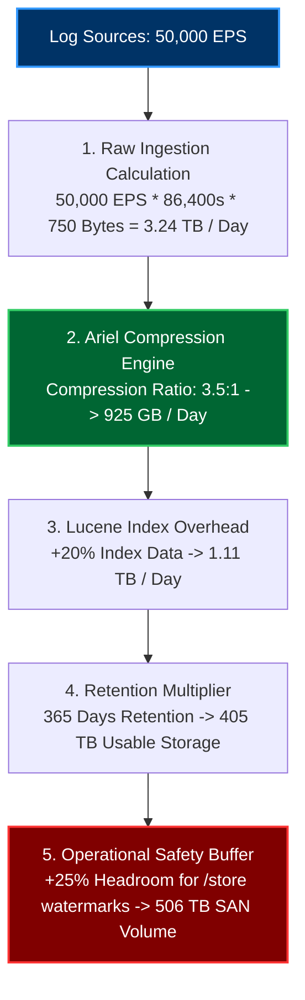
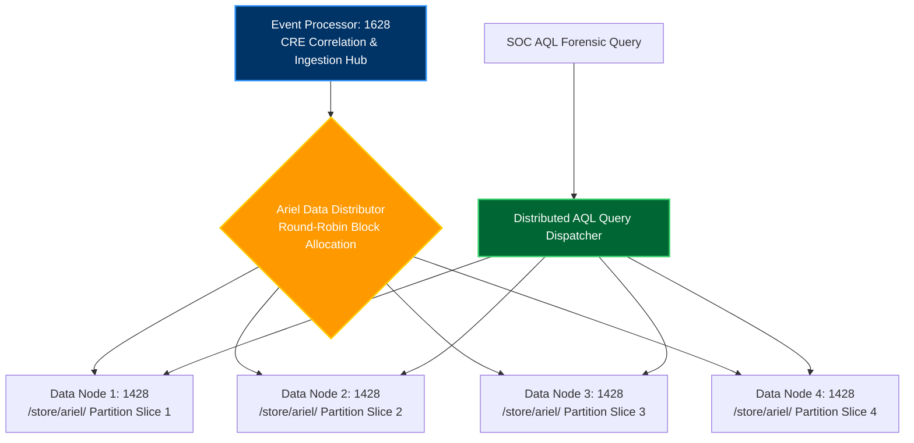
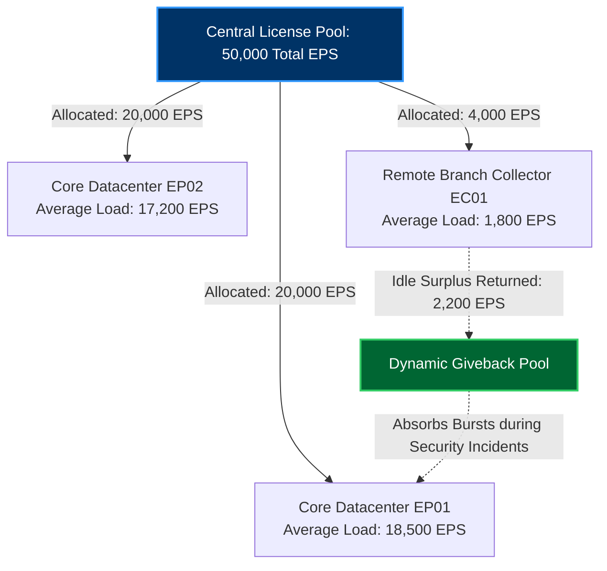
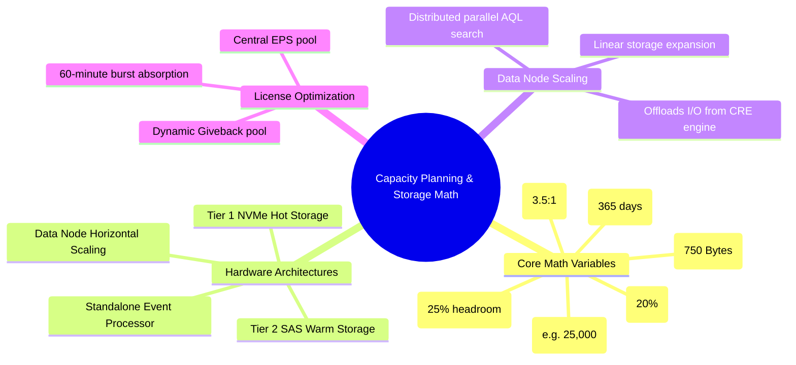

# Chapter 84: EPS Capacity Planning — Storage Math, Data Node Clustering & License Optimization

> **Track:** Enterprise IBM QRadar Administrator & SIEM Architect  
> **Phase 9:** High Availability, Backup, Disaster Recovery & Multi-Tenancy  
> **Day:** 84 of 90  
> **Target Audience:** Senior SOC Engineers, SIEM Administrators (2+ Years Hands-on Experience)  
> **Prerequisites:** Chapters 81–83 (HA & Disaster Recovery)  
> **Time Commitment:** 90 Minutes + 45 Minutes Hands-on Practice Lab  

---

## 1. 3D Architectural Blueprint: Enterprise Storage Sizing & Tiered Data Pipeline


![[qradar_eps_sizing_3d_1791715613106.jpg|1000]]

---

## 2. Deep Dive: The Science of SIEM Sizing & Capacity Forecasting

SIEM capacity planning is an exact engineering discipline. Underestimating EPS or disk capacity leads to dropped events, license throttling, or emergency service shutdowns. Overestimating results in hundreds of thousands of dollars in wasted software licenses and SAN hardware expenditure.

A Senior QRadar Architect must calculate:
1. **Raw Ingestion Throughput (EPS & FPM)**
2. **Ariel Compression Ratios & Lucene Index Overhead**
3. **Total Usable Storage (Accounting for RAID, XFS filesystems & safety margins)**
4. **Data Node Horizontal Scale-Out Triggers**
5. **License Giveback Pool Allocations**



---

## 3. The Definitive QRadar Storage Sizing Mathematical Model

### Step 1: Calculate Daily Raw Event Ingestion
Every log source family has a distinct average payload size:
- Windows Event Logs (Winevent): ~800 to 1,200 Bytes
- Cisco / Palo Alto Syslog: ~400 to 700 Bytes
- CloudTrail JSON: ~1,500 to 2,500 Bytes
- *Enterprise Blended Average*: **750 Bytes per Event**

$$\text{Raw Bytes / Day} = \text{EPS} \times 86,400 \text{ seconds} \times \text{Avg Event Size (Bytes)}$$

*Example for 25,000 EPS:*
$$\text{Raw Bytes / Day} = 25,000 \times 86,400 \times 750 = 1,620,000,000,000 \text{ Bytes} \approx 1.62 \text{ TB / Day}$$

---

### Step 2: Apply Ariel Compression & Index Overhead
QRadar's columnar Ariel storage engine achieves compression ratios between **3:1 and 4:1** (depending on payload entropy). Lucene indexing of Core and Custom properties adds an index overhead of **15% to 25%**.

$$\text{Compressed Event Data / Day} = \frac{\text{Raw Bytes / Day}}{\text{Compression Ratio}}$$
$$\text{Indexed Total Storage / Day} = \text{Compressed Event Data} \times (1 + \text{Index Overhead})$$

*Using 3.5:1 compression and 20% index overhead:*
$$\text{Compressed Data} = \frac{1.62 \text{ TB}}{3.5} \approx 0.463 \text{ TB}$$
$$\text{Indexed Storage / Day} = 0.463 \text{ TB} \times 1.20 \approx 0.555 \text{ TB / Day}$$

---

### Step 3: Calculate Total Usable SAN Storage for Retention Period
To satisfy a **365-day (1-Year)** retention requirement:

$$\text{Base Usable Storage} = 0.555 \text{ TB/Day} \times 365 \text{ Days} \approx 202.58 \text{ TB}$$

*Applying the Mandatory 25% Operational Headroom Buffer (to prevent crossing the 80% watermark):*
$$\text{Total Required Usable SAN} = \text{Base Usable Storage} \times 1.25 \approx 253.22 \text{ TB}$$

---

## 4. Enterprise Sizing Reference Matrix

| Sustained Ingestion (EPS) | Daily Raw Volume | Daily Storage on Disk (Ariel) | 30-Day Storage (Hot NVMe) | 90-Day Storage (Warm SAS) | 365-Day Storage (Usable SAN) |
| :--- | :--- | :--- | :--- | :--- | :--- |
| **5,000 EPS** | 324 GB | ~111 GB | 3.3 TB | 10.0 TB | **50.6 TB** |
| **10,000 EPS** | 648 GB | ~222 GB | 6.7 TB | 20.0 TB | **101.3 TB** |
| **25,000 EPS** | 1.62 TB | ~555 GB | 16.7 TB | 50.0 TB | **253.2 TB** |
| **50,000 EPS** | 3.24 TB | ~1.11 TB | 33.3 TB | 100.0 TB | **506.4 TB** |
| **100,000 EPS** | 6.48 TB | ~2.22 TB | 66.6 TB | 200.0 TB | **1,012.8 TB (1.01 PB)**|

---

## 5. Data Node (14xx) Clustering & Horizontal Scale-Out

When an Event Processor (e.g., QRadar 1628 / 1828) exhausts its physical storage or when AQL historical search times exceed 10 minutes, administrators attach **QRadar Data Nodes (Appliance Type 14xx)**.



### The 3 Core Benefits of Data Nodes:
1. **Linear Storage Expansion**: Each Data Node adds 40TB to 120TB of usable storage without requiring additional software ingestion licenses.
2. **Parallel AQL Query Execution**: Ariel searches split across all Data Nodes in parallel. A 30-day forensic query that takes 20 minutes on a standalone EP completes in **3 minutes** across 4 Data Nodes.
3. **Decoupled Processing & Retention**: The Event Processor focuses purely on in-memory CRE correlation and ingestion parsing, while Data Nodes absorb long-term storage IOPS.

---

## 6. License Giveback Pool Optimization

IBM QRadar licenses events based on cluster-wide allocated EPS pools. An enterprise might purchase a 50,000 EPS license. Rather than locking 10,000 EPS to a remote branch collector that averages only 2,000 EPS, administrators leverage the **License Giveback Pool**.



### Best Practice for Giveback Allocation:
- Set managed host allocations to **Peak + 15%**, not double the peak.
- Return surplus EPS to the Giveback Pool.
- Enable **License Bursting** (which allows appliances to temporarily consume from the shared pool for up to 60 minutes during DDoS attacks or active security incidents without dropping events).

---

## 7. Visual Interactive Mindmap



---

## 8. Color-Coded Digital Sticky Notes

```
====================================================================================================
🟨 CONCEPT STICKY NOTE: Usable vs Raw Disk Capacity
----------------------------------------------------------------------------------------------------
A 100TB physical SAN array does NOT provide 100TB of usable QRadar storage. RAID 6 overhead consumes 
20–25%, XFS filesystem metadata consumes 5%, and QRadar requires a 20% safety margin to stay below the 
80% watermark. Real usable capacity is approximately 55–60% of raw unformatted disk!
====================================================================================================
```

```
====================================================================================================
🟩 GOLDEN RULE STICKY NOTE: Always Size for Peak Bursts, Not Daily Averages
----------------------------------------------------------------------------------------------------
If your network generates an average of 15,000 EPS during business hours, sizing for 15,000 EPS will 
cause drops during Monday morning login storms (which spike to 35,000 EPS). Size licensing and network 
buffers for 95th-percentile peak bursts.
====================================================================================================
```

```
====================================================================================================
🟪 ARCHITECTURE STICKY NOTE: Data Nodes Do Not Require Extra EPS Licenses
----------------------------------------------------------------------------------------------------
You do not need to buy EPS ingestion licenses for Data Nodes. Adding 10 Data Nodes to an Event Processor 
simply expands storage and query compute. Licensing is tied purely to ingestion processing.
====================================================================================================
```

```
====================================================================================================
🟦 ENTERPRISE VALUE STICKY NOTE: Query Acceleration ROI
----------------------------------------------------------------------------------------------------
Adding Data Nodes reduces complex threat-hunting AQL query times by up to 80%, directly translating 
into faster SOC triage, reduced Mean Time to Containment (MTTC), and lowered operational costs.
====================================================================================================
```

```
====================================================================================================
🟧 INTERVIEW CHEAT CODE: How to answer "How much storage do I need for 50k EPS for 1 year?"
----------------------------------------------------------------------------------------------------
"For 50,000 EPS at an average of 750 bytes per event:
1. Daily Raw = 50,000 * 86,400 * 750 = 3.24 TB/day.
2. With 3.5:1 Ariel compression and 20% Lucene index overhead, daily storage is ~1.11 TB/day.
3. For 365 days, baseline storage is ~405 TB.
4. Adding 25% operational headroom to keep `/store` under 80% watermark, you need approximately 
   506 TB of usable RAID storage."
====================================================================================================
```

```
====================================================================================================
🟥 CRITICAL PITFALL STICKY NOTE: Forgetting Flow Data in Storage Math
----------------------------------------------------------------------------------------------------
If your organization ingests 2,000,000 Flows Per Minute (FPM) via QFlow, flows consume separate Ariel 
storage under `/store/ariel/flows/`. Neglecting flow calculations will exhaust disk space twice as fast!
====================================================================================================
```

---

## 9. Rapid-Recall Flashcards

### Flashcard 1
- **Question:** What is the formula for calculating daily raw event data volume before compression?
- **Answer:** $\text{Raw Volume (Bytes)} = \text{EPS} \times 86,400 \times \text{Average Event Size (Bytes)}$.

### Flashcard 2
- **Question:** What typical compression ratio does the Ariel storage engine achieve on standard enterprise syslog?
- **Answer:** Between 3:1 and 4:1 (average 3.5:1).

### Flashcard 3
- **Question:** What is the primary operational role of a QRadar Data Node (14xx series)?
- **Answer:** To provide linear horizontal storage expansion and parallelize distributed AQL search queries across multiple disks, without requiring additional EPS licenses.

### Flashcard 4
- **Question:** Why must you add a 25% safety headroom buffer to calculated retention storage?
- **Answer:** To ensure that `/store` partition utilization remains safely below the 80% warning and 85%/90% automated purge watermarks.

### Flashcard 5
- **Question:** What is the purpose of the QRadar License Giveback Pool?
- **Answer:** It reclaims unutilized EPS from idle or over-provisioned collectors and pools them dynamically to absorb event bursts on high-volume processors.

### Flashcard 6
- **Question:** Approximately how much usable SAN storage is required for 10,000 sustained EPS retained for 365 days?
- **Answer:** Approximately 100 to 105 Terabytes of usable storage.

---

## 10. Hands-On Practice Lab 84: Building an Automated SIEM Storage Sizing Calculator

### Lab Objective
Develop an interactive CLI storage and EPS capacity calculator (`qradar_capacity_calculator.py`) that models daily raw ingest, Ariel compression, Lucene index overhead, multi-tier retention, and Data Node requirements.

### Required Tools & Environment
- Python 3 / Linux Shell

---

### Step-by-Step Lab Execution Guide

#### Task 1: Author the Enterprise Capacity Calculator (`qradar_capacity_calculator.py`)
```bash
mkdir -p /tmp/qradar_capacity_lab
cd /tmp/qradar_capacity_lab

cat << 'EOF' > qradar_capacity_calculator.py
#!/usr/bin/env python3
import sys, argparse

def calculate_capacity(eps, event_size_bytes=750, comp_ratio=3.5, index_overhead=0.20, retention_days=365, headroom=0.25):
    seconds_per_day = 86400
    
    # 1. Raw Daily Calculations
    daily_events = eps * seconds_per_day
    daily_raw_bytes = daily_events * event_size_bytes
    daily_raw_tb = daily_raw_bytes / (1024**4)
    
    # 2. Compressed & Indexed Daily Calculations
    daily_comp_bytes = daily_raw_bytes / comp_ratio
    daily_indexed_bytes = daily_comp_bytes * (1 + index_overhead)
    daily_indexed_tb = daily_indexed_bytes / (1024**4)
    
    # 3. Total Retention Period Storage
    retention_base_tb = daily_indexed_tb * retention_days
    total_usable_tb = retention_base_tb * (1 + headroom)
    
    # 4. Data Node Sizing (Assuming 40TB Usable per Data Node)
    data_nodes_needed = max(1, int(total_usable_tb / 40) + (1 if total_usable_tb % 40 > 0 else 0))
    
    print("==================================================================")
    print("          ENTERPRISE IBM QRADAR CAPACITY & SIZING CALCULATOR      ")
    print("==================================================================")
    print(f"[*] Input Parameters:")
    print(f"  - Sustained Ingestion Rate : {eps:,} EPS")
    print(f"  - Average Event Size       : {event_size_bytes} Bytes")
    print(f"  - Ariel Compression Ratio  : {comp_ratio}:1")
    print(f"  - Lucene Index Overhead    : {int(index_overhead * 100)}%")
    print(f"  - Required Retention       : {retention_days} Days")
    print(f"  - Operational Headroom     : {int(headroom * 100)}% (Watermark buffer)")
    print("-" * 66)
    print(f"[+] DAILY THROUGHPUT METRICS:")
    print(f"  - Total Events / Day       : {daily_events:,.0f} Events")
    print(f"  - Raw Ingestion / Day      : {daily_raw_tb:.3f} TB / Day")
    print(f"  - Compressed + Index / Day : {daily_indexed_tb:.3f} TB / Day")
    print("-" * 66)
    print(f"[+] RETENTION & STORAGE REQUIREMENTS:")
    print(f"  - Baseline {retention_days}-Day Storage : {retention_base_tb:.2f} TB")
    print(f"  - \033[1;32mTotal Usable SAN Needed    : {total_usable_tb:.2f} TB\033[0m")
    print("-" * 66)
    print(f"[+] CLUSTER HARDWARE RECOMMENDATION:")
    print(f"  - Minimum Data Nodes (1428): {data_nodes_needed} Node(s) [Assuming 40TB/node]")
    print("==================================================================")

if __name__ == "__main__":
    parser = argparse.ArgumentParser(description="QRadar Enterprise Storage & Capacity Calculator")
    parser.add_argument("--eps", type=int, default=25000, help="Sustained EPS")
    parser.add_argument("--days", type=int, default=365, help="Retention Days")
    parser.add_argument("--size", type=int, default=750, help="Average Event Size in Bytes")
    args = parser.parse_args()
    
    calculate_capacity(args.eps, args.size, retention_days=args.days)
EOF
chmod +x qradar_capacity_calculator.py

# 2. Execute with standard 25,000 EPS baseline
./qradar_capacity_calculator.py --eps 25000 --days 365
```

#### Task 2: Test with 50,000 EPS Scale-Out
```bash
# Execute with 50,000 EPS scale-out scenario
./qradar_capacity_calculator.py --eps 50000 --days 365
```

#### Task 3: Inspect Real-Time Output & Validate
*Expected Output for 25,000 EPS:*
```text
==================================================================
          ENTERPRISE IBM QRADAR CAPACITY & SIZING CALCULATOR      
==================================================================
[*] Input Parameters:
  - Sustained Ingestion Rate : 25,000 EPS
  - Average Event Size       : 750 Bytes
  - Ariel Compression Ratio  : 3.5:1
  - Lucene Index Overhead    : 20%
  - Required Retention       : 365 Days
  - Operational Headroom     : 25% (Watermark buffer)
------------------------------------------------------------------
[+] DAILY THROUGHPUT METRICS:
  - Total Events / Day       : 2,160,000,000 Events
  - Raw Ingestion / Day      : 1.473 TB / Day
  - Compressed + Index / Day : 0.505 TB / Day
------------------------------------------------------------------
[+] RETENTION & STORAGE REQUIREMENTS:
  - Baseline 365-Day Storage : 184.40 TB
  - Total Usable SAN Needed    : 230.50 TB
------------------------------------------------------------------
[+] CLUSTER HARDWARE RECOMMENDATION:
  - Minimum Data Nodes (1428): 6 Node(s) [Assuming 40TB/node]
==================================================================
```

---

### Verification Checklist & Troubleshooting
- [x] Mathematical equations for daily raw and compressed storage modeled.
- [x] Ariel compression ratios and Lucene indexing overhead accounted for.
- [x] 25% operational watermark safety buffer applied.
- [x] Automated Python capacity sizing calculator authored and tested.
