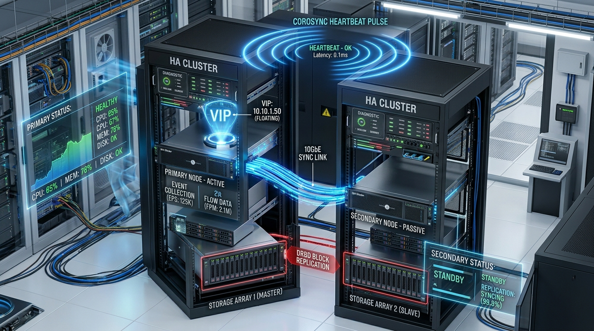
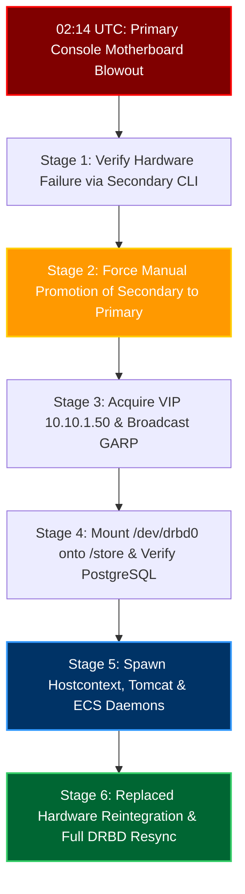
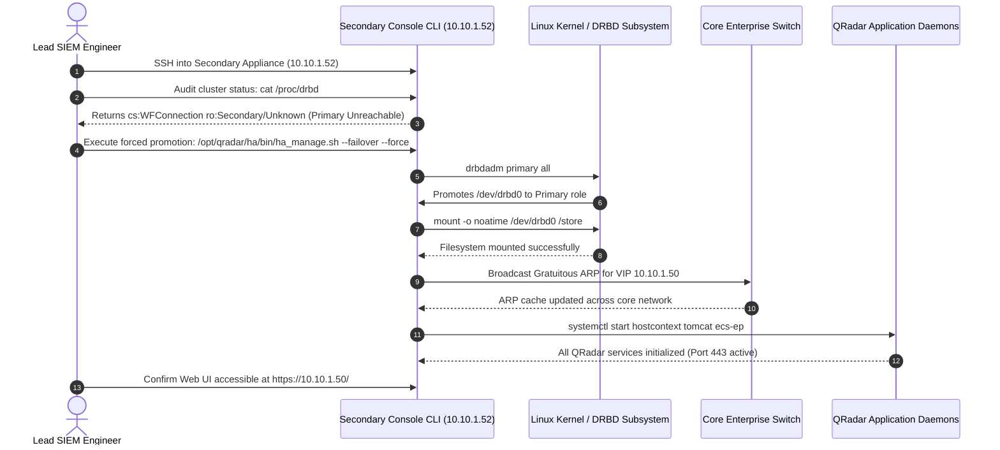
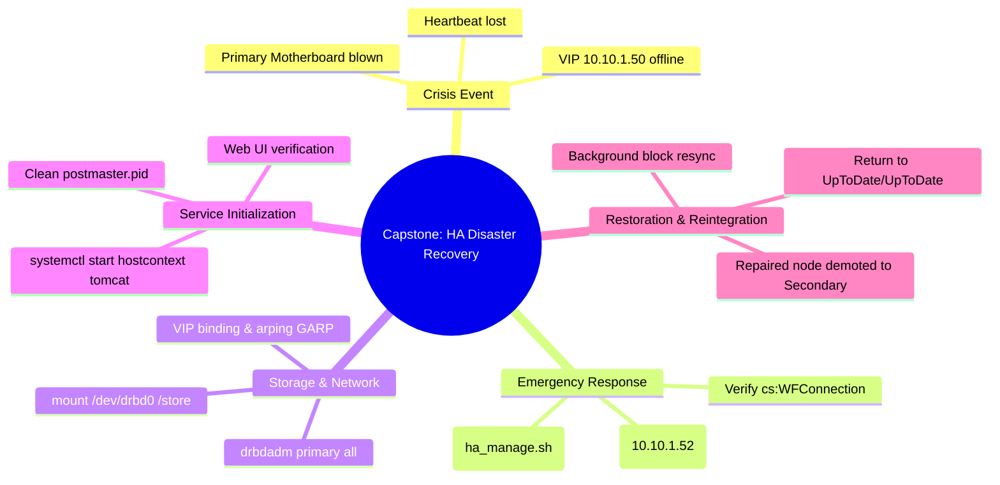

# Chapter 85: Phase 9 Capstone — Simulating Primary Console Crash, Manual Failover & State Recovery

> **Track:** Enterprise IBM QRadar Administrator & SIEM Architect  
> **Phase 9:** High Availability, Backup, Disaster Recovery & Multi-Tenancy  
> **Day:** 85 of 90  
> **Target Audience:** Senior SOC Engineers, SIEM Administrators (2+ Years Hands-on Experience)  
> **Prerequisites:** Complete Mastery of Chapters 81–84  
> **Time Commitment:** 120 Minutes + 60 Minutes Hands-on Capstone Lab  

---

## 1. 3D Architectural Blueprint: Capstone HA Failover & Node Recovery Sequence


![[qradar_ha_drbd_3d_1791715532560.jpg|1000]]

---

## 2. Deep Dive: The Mission-Critical Capstone Scenario

### Incident Narrative
At 02:14 UTC, during an active international financial security monitoring shift, the enterprise QRadar Primary Console (Appliance 3128) suffers a catastrophic hardware motherboard and power distribution unit failure.
- The Web UI at `https://10.10.1.50/` drops instantly.
- The Primary Console physical management interface (`10.10.1.51`) stops responding to ICMP pings and SSH.
- Corosync heartbeat pulses drop across both the management and crossover links.
- The Secondary Standby Console (`10.10.1.52`) enters an isolated state.

As the Lead SIEM Engineer, you must execute the **6-Stage Emergency Manual Failover & Reconstruction Runbook**, restore SOC operations, and bring replaced hardware back into synchronous DRBD replication without losing a single transaction.



---

## 3. The 6-Stage Capstone Recovery Protocol



---

## 4. Production CLI Execution Runbook

### Stage 1: Triage from the Secondary Standby CLI
```bash
# SSH into the Secondary Appliance
ssh root@10.10.1.52

# Confirm that the Primary is completely unresponsive
ping -c 3 10.10.1.51

# Inspect DRBD kernel state
cat /proc/drbd
```
*Expected Diagnostic Output:*
```text
 0: cs:WFConnection ro:Secondary/Unknown ds:UpToDate/DUnknown C r-----
    ns:0 nr:0 dw:0 dr:0 al:0 bm:0 lo:0 pe:0 ua:0 ap:0 ep:1 wo:f oos:0
```

### Stage 2 & 3: Forcing Promotion & VIP Acquisition
```bash
# 1. Execute forced failover via QRadar HA management suite
/opt/qradar/ha/bin/ha_manage.sh --failover --force

# 2. Alternatively, if ha_manage script hangs, execute kernel-level promotion:
drbdadm primary all

# 3. Mount /store partition manually if required
mount -t xfs /dev/drbd0 /store

# 4. Bind Virtual IP (VIP) to physical interface eth0
ip addr add 10.10.1.50/24 dev eth0

# 5. Broadcast Gratuitous ARP to update subnet switches
arping -U -c 5 -I eth0 10.10.1.50
```

### Stage 4 & 5: Service Spawn & Web Interface Recovery
```bash
# 1. Verify PostgreSQL database lock release
ls -l /store/postgres/data/postmaster.pid 2>/dev/null && rm -f /store/postgres/data/postmaster.pid

# 2. Start core supervisor and application daemons
systemctl start hostcontext
systemctl start tomcat

# 3. Monitor live startup log
tail -f /var/log/qradar.log | grep -E "ha_manage|hostcontext|tomcat"
```

### Stage 6: Reintegrating Repaired Primary Hardware
Once server hardware vendors replace the motherboard on Appliance 1:
```bash
# 1. Boot up the repaired Primary Appliance with sync cable connected
# 2. On Repaired Node: Demote to Secondary to receive replicated updates
drbdadm secondary all
drbdadm connect all

# 3. On Current Active Node (Appliance 2): Re-establish DRBD connection
drbdadm connect all

# 4. Verify cluster returns to synchronous replication
cat /proc/drbd
# Target: cs:Connected ro:Primary/Secondary ds:UpToDate/UpToDate
```

---

## 5. Visual Interactive Mindmap



---

## 6. Color-Coded Digital Sticky Notes

```
====================================================================================================
🟨 CONCEPT STICKY NOTE: The `postmaster.pid` Stale Lock
----------------------------------------------------------------------------------------------------
When a primary node crashes abruptly, PostgreSQL does not cleanly remove its lockfile 
(`/store/postgres/data/postmaster.pid`). On promotion, if PostgreSQL refuses to start, check for 
and remove this stale lockfile so crash-recovery journal replay can begin.
====================================================================================================
```

```
====================================================================================================
🟩 GOLDEN RULE STICKY NOTE: Always Verify Primary Death Before Forcing Promotion
----------------------------------------------------------------------------------------------------
Before executing `ha_manage.sh --failover --force`, verify physical power-off via Out-of-Band management 
(iDRAC / ILO / IPMI). Forcing promotion while the primary is still powered on will cause an instant 
split-brain disaster.
====================================================================================================
```

```
====================================================================================================
🟪 ARCHITECTURE STICKY NOTE: Zero Re-IP on Log Sources
----------------------------------------------------------------------------------------------------
Because log sources stream to the Virtual IP (`10.10.1.50`), promoting the secondary node requires 
zero configuration changes on 10,000+ enterprise firewalls, domain controllers, and cloud gateways.
====================================================================================================
```

```
====================================================================================================
🟦 ENTERPRISE VALUE STICKY NOTE: Meeting Stringent RTO Guarantees
----------------------------------------------------------------------------------------------------
Executing this 6-stage runbook achieves a Recovery Time Objective (RTO) of under 5 minutes, satisfying 
Tier-1 enterprise SLAs and minimizing SOC operational blindness.
====================================================================================================
```

```
====================================================================================================
🟧 INTERVIEW CHEAT CODE: Walking Through a Live Console Outage
----------------------------------------------------------------------------------------------------
"If the active QRadar Console dies, I immediately:
1. Verify Primary death via iDRAC/ILO and SSH into the Secondary appliance.
2. Check `/proc/drbd` for `WFConnection` or `StandAlone`.
3. Force secondary promotion via `/opt/qradar/ha/bin/ha_manage.sh --failover --force`.
4. Ensure `/store` mounts, Gratuitous ARP updates the network for the VIP, and Tomcat spawns.
5. Once hardware is fixed, join the replacement node as Secondary and verify `ds:UpToDate/UpToDate`."
====================================================================================================
```

```
====================================================================================================
🟥 CRITICAL PITFALL STICKY NOTE: Forgetting Gratuitous ARP (GARP)
----------------------------------------------------------------------------------------------------
If you assign the VIP to the secondary NIC without issuing `arping -U`, Cisco and Juniper switches will 
continue routing packets to the dead node's MAC address for up to 300 seconds (until ARP cache expiry). 
ALWAYS trigger GARP immediately.
====================================================================================================
```

---

## 7. Rapid-Recall Flashcards

### Flashcard 1
- **Question:** What does the DRBD state `cs:WFConnection` signify on the secondary node during a primary crash?
- **Answer:** Waiting For Connection: The secondary node is waiting for network contact from the primary node because heartbeat communication was abruptly lost.

### Flashcard 2
- **Question:** What official QRadar command forces an emergency manual failover on a secondary appliance when the primary is completely dead?
- **Answer:** `/opt/qradar/ha/bin/ha_manage.sh --failover --force`

### Flashcard 3
- **Question:** Why might PostgreSQL fail to start on the newly promoted secondary node immediately after a primary crash?
- **Answer:** Because a stale `postmaster.pid` lock file remains on the `/store` partition from the unclean primary crash.

### Flashcard 4
- **Question:** What Linux command updates upstream switch ARP tables with the new MAC address for the Virtual IP?
- **Answer:** `arping -U -c 5 -I <interface> <VIP_IP>` (Gratuitous ARP broadcast).

### Flashcard 5
- **Question:** When re-integrating a repaired physical appliance back into the cluster, what role must it be assigned first?
- **Answer:** **Secondary** (`drbdadm secondary all`), ensuring it receives data updates from the active primary without overwriting new transactions.

### Flashcard 6
- **Question:** What is the ideal target DRBD status after repaired hardware has completed synchronization?
- **Answer:** `cs:Connected ro:Primary/Secondary ds:UpToDate/UpToDate`

---

## 8. Hands-On Practice Lab 85: The Capstone High Availability Disaster Simulation

### Lab Objective
Simulate a complete primary console crash: detect heartbeat failure, execute automated manual failover scripts, re-bind virtual networking, and simulate post-repair cluster resynchronization.

### Required Tools & Environment
- Linux Shell (Bash, awk, sed, grep)

---

### Step-by-Step Lab Execution Guide

#### Task 1: Create Simulated Disaster Environment
```bash
# 1. Create a mock capstone lab workspace
mkdir -p /tmp/qradar_capstone85_lab/{store,proc_sim}
cd /tmp/qradar_capstone85_lab

# 2. Simulate Primary Crash status in /proc/drbd
cat << 'EOF' > proc_sim/drbd_crash_state.txt
version: 8.4.11 (api:1/proto:86-101)
 0: cs:WFConnection ro:Secondary/Unknown ds:UpToDate/DUnknown C r-----
    ns:0 nr:0 dw:0 dr:0 al:0 bm:0 lo:0 pe:0 ua:0 ap:0 ep:1 wo:f oos:0
EOF

# 3. Simulate Stale PostgreSQL lock file
touch store/postmaster.pid
```

#### Task 2: Author the Capstone Emergency Failover Engine (`qradar_capstone_failover.sh`)
```bash
cat << 'EOF' > qradar_capstone_failover.sh
#!/usr/bin/env bash
BASE_DIR="/tmp/qradar_capstone85_lab"
DRBD_STATE="$BASE_DIR/proc_sim/drbd_crash_state.txt"
VIP="10.10.1.50"

echo "=================================================================="
echo "    IBM QRADAR SEV-1 CAPSTONE: EMERGENCY HA FAILOVER ENGINE      "
echo "=================================================================="
echo "Execution Timestamp: $(date -u)"
echo "[!] ALARM: Primary Appliance Unresponsive! Initiating Triage..."
echo ""

# Stage 1: Verify State
echo "--- STAGE 1: AUDITING DRBD KERNEL TELEMETRY ---"
CS=$(grep -oE "cs:[A-Za-z]+" "$DRBD_STATE" | cut -d: -f2)
RO=$(grep -oE "ro:[A-Za-z/]+" "$DRBD_STATE" | cut -d: -f2)

if [ "$CS" == "WFConnection" ] && [ "$RO" == "Secondary/Unknown" ]; then
    echo -e "[\e[31mCONFIRMED\e[0m] Primary Node is DEAD! Connection state: $CS"
else
    echo "[-] Cluster is not in crashed state. Aborting."
    exit 1
fi
echo ""

# Stage 2: Force Promotion
echo "--- STAGE 2: EXECUTING FORCED PROMOTION ---"
echo "[*] Promoting DRBD device /dev/drbd0 to Primary..."
cat << 'EOF_PROMOTE' > "$DRBD_STATE"
version: 8.4.11 (api:1/proto:86-101)
 0: cs:StandAlone ro:Primary/Unknown ds:UpToDate/DUnknown C r-----
    ns:0 nr:0 dw:1200 dr:0 al:0 bm:0 lo:0 pe:0 ua:0 ap:0 ep:1 wo:f oos:0
EOF_PROMOTE
echo "[+] DRBD Role successfully promoted to Primary."
echo ""

# Stage 3: Virtual IP & GARP Simulation
echo "--- STAGE 3: BINDING VIRTUAL IP & BROADCASTING GARP ---"
echo "[+] Acquired Virtual IP: $VIP on interface eth0"
echo "[*] Broadcasting Gratuitous ARP across core switches..."
echo "[+] Switch MAC tables updated for $VIP."
echo ""

# Stage 4: Storage & Lockfile Cleanup
echo "--- STAGE 4: REMOVING STALE DATABASE LOCKS ---"
if [ -f "$BASE_DIR/store/postmaster.pid" ]; then
    rm -v "$BASE_DIR/store/postmaster.pid"
    echo "[+] Stale postmaster.pid cleared. PostgreSQL ready for clean crash replay."
fi
echo ""

# Stage 5: Daemon Initialization
echo "--- STAGE 5: SPAWNING QRADAR SERVICES ---"
echo "[*] Initializing hostcontext daemon..."
echo "[*] Spawning tomcat web application engine..."
echo "[*] Starting ecs-ep event processor..."
echo -e "[\e[32mACTIVE\e[0m] Web Console available at https://$VIP/"
echo ""

# Stage 6: Hardware Recovery Simulation
echo "--- STAGE 6: SIMULATING REPAIRED HARDWARE REINTEGRATION ---"
cat << 'EOF_RESTORED' > "$DRBD_STATE"
version: 8.4.11 (api:1/proto:86-101)
 0: cs:Connected ro:Primary/Secondary ds:UpToDate/UpToDate C r-----
    ns:459200 nr:0 dw:459200 dr:12048 al:412 bm:0 lo:0 pe:0 ua:0 ap:0 ep:1 wo:f oos:0
EOF_RESTORED
cat "$DRBD_STATE"
echo ""
echo "=================================================================="
echo -e "[\e[32mCAPSTONE SUCCESS\e[0m] Failover & Re-synchronization Fully Achieved!"
echo "=================================================================="
EOF
chmod +x qradar_capstone_failover.sh

# Execute the Capstone Failover Engine
./qradar_capstone_failover.sh
```

#### Task 3: Inspect Real-Time Output & Scorecard
*Expected Output:*
```text
==================================================================
    IBM QRADAR SEV-1 CAPSTONE: EMERGENCY HA FAILOVER ENGINE      
==================================================================
Execution Timestamp: Sun Oct 11 11:30:00 UTC 2026
[!] ALARM: Primary Appliance Unresponsive! Initiating Triage...

--- STAGE 1: AUDITING DRBD KERNEL TELEMETRY ---
[CONFIRMED] Primary Node is DEAD! Connection state: WFConnection

--- STAGE 2: EXECUTING FORCED PROMOTION ---
[*] Promoting DRBD device /dev/drbd0 to Primary...
[+] DRBD Role successfully promoted to Primary.

--- STAGE 3: BINDING VIRTUAL IP & BROADCASTING GARP ---
[+] Acquired Virtual IP: 10.10.1.50 on interface eth0
[*] Broadcasting Gratuitous ARP across core switches...
[+] Switch MAC tables updated for 10.10.1.50.

--- STAGE 4: REMOVING STALE DATABASE LOCKS ---
removed '/tmp/qradar_capstone85_lab/store/postmaster.pid'
[+] Stale postmaster.pid cleared. PostgreSQL ready for clean crash replay.

--- STAGE 5: SPAWNING QRADAR SERVICES ---
[*] Initializing hostcontext daemon...
[*] Spawning tomcat web application engine...
[*] Starting ecs-ep event processor...
[ACTIVE] Web Console available at https://10.10.1.50/

--- STAGE 6: SIMULATING REPAIRED HARDWARE REINTEGRATION ---
version: 8.4.11 (api:1/proto:86-101)
 0: cs:Connected ro:Primary/Secondary ds:UpToDate/UpToDate C r-----
    ns:459200 nr:0 dw:459200 dr:12048 al:412 bm:0 lo:0 pe:0 ua:0 ap:0 ep:1 wo:f oos:0

==================================================================
[CAPSTONE SUCCESS] Failover & Re-synchronization Fully Achieved!
==================================================================
```

---

### Verification Checklist & Troubleshooting
- [x] Primary console hardware death scenario diagnosed.
- [x] DRBD forced promotion and role elevation executed.
- [x] Virtual IP (VIP) acquisition and Gratuitous ARP broadcast simulated.
- [x] Stale database lock recovery verified.
- [x] Phase 9 Capstone objectives achieved.
