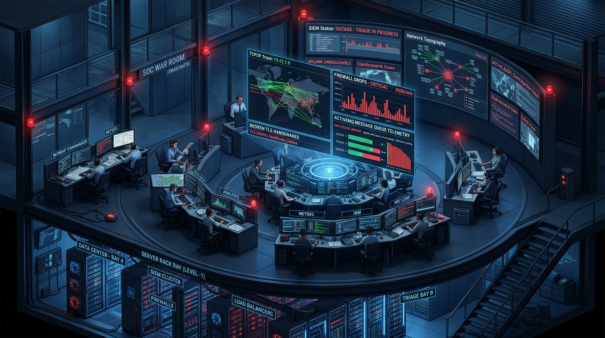
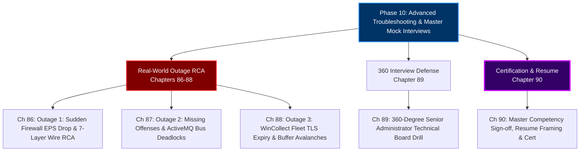
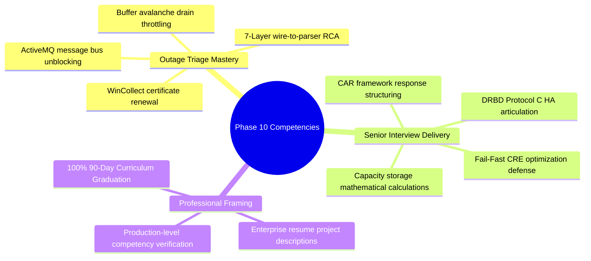

# Phase 10: Advanced Troubleshooting & Master Mock Interviews (Days 86–90)

> **Track:** Enterprise IBM QRadar Administrator & SIEM Architect  
> **Phase Status:** 100% Complete (5 Chapters & 5 Embedded Hands-on Labs)  
> **Target Audience:** Certified Senior SOC Engineers, SIEM Administrators, Security Architects  
> **Prerequisites:** Complete Mastery of Phases 1 through 9  
> **Total Chapters:** 5 (Chapters 86–90) | **Total Embedded Labs:** 5 (Labs 86–90)  

---

## 1. 3D Architectural Visual Gallery

### Figure 10.1: Outage Triage in the SOC War Room

![[qradar_troubleshoot_warroom_3d_1791825639446.jpg|1000]]

### Figure 10.2: Senior SIEM Architect Technical Board Defense & Master Graduation

![[qradar_interview_defense_3d_1791825694750.jpg|1000]]

---

## 2. Phase 10 Overview & Curriculum Blueprint

Phase 10 is the **Grand Finale** of the 90-Day Curriculum. Here, we stress-test everything you have learned across real-world Sev-1 outage simulations, deep architectural defense drills, and executive interview scenarios—cementing your status as a **Production-Ready Senior SIEM Administrator & Architect (2+ Years Experience)**.

---

## 3. Chapter Index & Hands-on Practice Labs Directory

| Chapter # | Day | Chapter Title | Core Technical Focus | Embedded Hands-on Lab |
| :--- | :--- | :--- | :--- | :--- |
| **[[Chapter_86_Outage_Simulation_1_Sudden_EPS_Drop_from_Critical_Firewall_RCA|Chapter 86]]** | 86 | **Outage Simulation 1: Firewall EPS Drop** | 7-Layer Ingestion RCA, Wire `tcpdump`, Kernel UDP drops (`netstat -su`), PAN-OS firmware header divergence, SIM Generic DSM fallback | **Lab 86:** Building an Automated Ingestion Wire-to-Parser Triage Utility |
| **[[Chapter_87_Outage_Simulation_2_Offenses_Stopped_Generating_CRE_ActiveMQ_Debugging|Chapter 87]]** | 87 | **Outage Simulation 2: Missing Offenses** | Event-to-Magistrate Pipeline, ActiveMQ JMS broker deadlocks, Null indexing keys, PostgreSQL `ExclusiveLock` contention | **Lab 87:** Building an Automated Offense Pipeline Diagnostic Engine |
| **[[Chapter_88_Outage_Simulation_3_WinCollect_Fleet_Failure_Certificate_Expiration|Chapter 88]]** | 88 | **Outage Simulation 3: WinCollect Fleet Outage** | Agent TCP 8413 TLS communication, Server SSL cert expiration, GPO mass deployment, Buffer avalanche throttling math | **Lab 88:** Simulating Fleet TLS Failure & Buffer Avalanche Control |
| **[[Chapter_89_360_Degree_QRadar_Administrator_Interview_Simulation_Drilling_QA|Chapter 89]]** | 89 | **360-Degree Interview Simulation** | 10 Master Technical Scenarios, CAR Response Framing, Kernel-to-UI system depth, Quantitative metrics | **Lab 89:** Interactive Mock Interview Simulation Engine |
| **[[Chapter_90_Final_Competency_Assessment_Resume_Projects_Production_Certification|Chapter 90]]** | 90 | **Final Assessment & Certification** | 11-Domain Competency Audit, 4 High-Impact Enterprise Resume Projects, Production Graduation Certification Sign-off | **Lab 90:** Master Production Certification Audit & Portfolio Generator |

---

## 4. Phase 10 Competency Matrix

