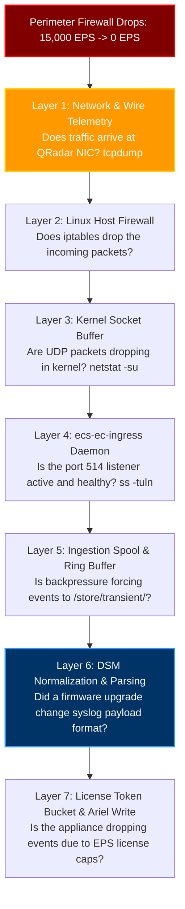
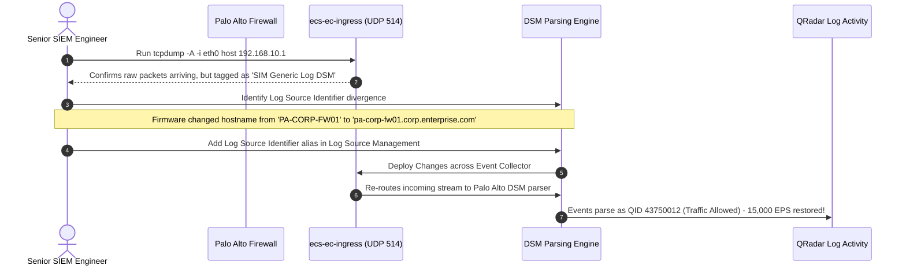
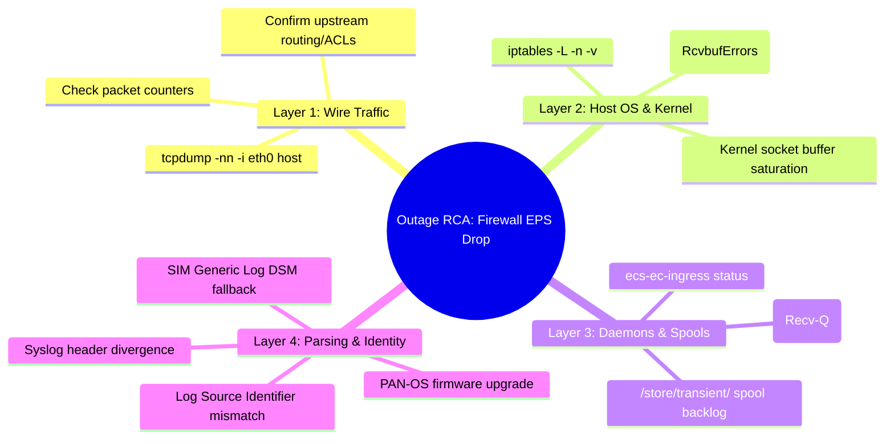

# Chapter 86: Outage Simulation 1 — Sudden EPS Drop from Critical Firewall & Layer-by-Layer RCA

> **Track:** Enterprise IBM QRadar Administrator & SIEM Architect  
> **Phase 10:** Advanced Troubleshooting & Master Mock Interviews  
> **Day:** 86 of 90  
> **Target Audience:** Senior SOC Engineers, SIEM Administrators (2+ Years Hands-on Experience)  
> **Prerequisites:** Complete Mastery of Phases 1–9  
> **Time Commitment:** 90 Minutes + 45 Minutes Hands-on Practice Lab  

---

## 1. 3D Architectural Blueprint: Outage Triage in the SOC War Room


![[qradar_troubleshoot_warroom_3d_1791825639446.jpg|1000]]

---

## 2. Deep Dive: Incident Description & Triage Hierarchy

### Incident Alert
At 08:30 EST, the SOC Shift Lead escalates a Sev-1 visibility blackout:
- The enterprise perimeter Palo Alto Next-Gen Firewall cluster (`192.168.10.1`), normally generating **12,000 to 18,000 EPS**, has dropped to **0 EPS** in the QRadar Log Activity console.
- Perimeter intrusion rules, outbound C2 beaconing alerts, and VPN authentication logs have completely ceased.
- The Firewall team confirms the firewalls are healthy, traffic is passing, and "Syslog export is enabled."

A junior administrator guesses and restarts services randomly. A Senior 2-Year QRadar Administrator executes a **Systematic 7-Layer Ingestion RCA Pipeline**.



---

## 3. The 7-Layer Root Cause Analysis (RCA) Protocol

### Layer 1: Wire Telemetry Verification (`tcpdump`)
Before touching any QRadar daemon, confirm whether packets physically strike the network interface:
```bash
# Capture raw UDP 514 packets from the firewall IP
tcpdump -nn -vv -i eth0 host 192.168.10.1 and port 514 -c 10
```
- **Scenario A: Zero Packets Captured**: The problem is upstream. An intermediate network firewall, access control list (ACL), routing change, or firewall management profile change halted transmission.
- **Scenario B: Packets Flowing Freely**: Traffic reaches the server. Move immediately to Layer 2.

### Layer 2: Host Packet Filter & Iptables Audit
Check if QRadar's dynamic firewall rules dropped the traffic:
```bash
# Inspect iptables packet drop counters on UDP 514
iptables -L -n -v | grep -E "514|DROP|REJECT"
```
QRadar manages iptables dynamically via `/opt/qradar/bin/qradar_netfilter.sh`. If an administrator manually tweaked iptables or added an invalid subnet block, traffic will be discarded at the OS boundary.

### Layer 3: Kernel Socket Buffer Health (`netstat -su`)
If packets hit the NIC but the application doesn't see them, check if Linux kernel buffers overflowed:
```bash
# Check UDP buffer receive errors
netstat -su | grep -E "packet receive errors|buffer errors"
```
An increasing count of `packet receive errors` or `RcvbufErrors` proves the kernel dropped packets before `ecs-ec-ingress` could pull them from the socket buffer (due to high CPU or undersized `net.core.rmem_max`).

### Layer 4: Ingress Daemon Listener State (`ss`)
Confirm that `ecs-ec-ingress` actively listens on UDP 514:
```bash
# Verify listening socket and receive queue backlog
ss -tulwn 'sport = :514'
```
If `Recv-Q` is elevated (e.g., > 10,000), the ingestion thread pool is choked.

### Layer 5: In-Memory Ring Buffer & Spool Backpressure
Inspect `/var/log/qradar.log` for ingress backpressure alerts:
```bash
grep -iE "spooling to disk|backpressure|ingress buffer" /var/log/qradar.log | tail -n 20
```

### Layer 6: Payload Format Changes (PAN-OS Firmware Mismatch)
If packets arrive, sockets are clear, but events do not appear under the Palo Alto log source, inspect the payload content:
```bash
# Dump raw event payloads arriving from the firewall
tcpdump -nn -A -i eth0 host 192.168.10.1 and port 514 -c 3
```
*The Discovery*: The firewall team upgraded from PAN-OS 10.1 to PAN-OS 11.1 at 08:00 AM! The new firmware altered the syslog header format, prefixing logs with an unexpected custom enterprise enterprise syslog header:
```text
<14>1 2026-10-12T08:30:00.000Z PA-CORP-FW01 CORPSYS [TRAFFIC] ...
```
Because QRadar expected standard RFC 3164 Syslog, `ecs-ec` failed header regex parsing. Events were redirected to **"SIM Generic Log DSM"** as **Stored / Unknown Event** rather than matching the Palo Alto log source identifier!

### Layer 7: Licensing & Token Bucket Audit
Check if license caps dropped the traffic:
```bash
grep "Dropped:" /var/log/qradar.log | tail -n 10
```

---

## 4. Remediation Action Plan & Verification



---

## 5. Visual Interactive Mindmap



---

## 6. Color-Coded Digital Sticky Notes

```
====================================================================================================
🟨 CONCEPT STICKY NOTE: The "SIM Generic" Black Hole
----------------------------------------------------------------------------------------------------
When a log source drops to 0 EPS, NEVER assume logs stopped arriving. If a firmware update changes 
the syslog header hostname or IP, QRadar can no longer match the log source identifier. It quietly 
routes events to "SIM Generic Log DSM", masking the traffic from filtered Log Activity views!
====================================================================================================
```

```
====================================================================================================
🟩 GOLDEN RULE STICKY NOTE: Prove the Wire First (`tcpdump`)
----------------------------------------------------------------------------------------------------
Never engage in internal daemon debugging until `tcpdump` confirms packets are arriving on the wire. 
If `tcpdump` shows 0 packets, 100% of the problem is outside QRadar (network routing, ACL, switch port, 
or firewall syslog configuration).
====================================================================================================
```

```
====================================================================================================
🟪 ARCHITECTURE STICKY NOTE: Syslog Header vs Payload Identifier
----------------------------------------------------------------------------------------------------
QRadar matches log sources using the **Log Source Identifier** extracted by the protocol provider 
(Syslog header host or IP). If a NAT gateway or proxy alters the source IP, the log source appears 
dead while a new autodetected source spawns under the NAT IP.
====================================================================================================
```

```
====================================================================================================
🟦 ENTERPRISE VALUE STICKY NOTE: Proactive Heartbeat Alerts
----------------------------------------------------------------------------------------------------
Creating a QRadar CRE Anomaly Rule: *"Apply Anomaly on events where Log Source is Firewall and event 
rate is 90% below 7-day baseline"* alerts the SOC within 3 minutes of an outage before attackers exploit the blindspot.
====================================================================================================
```

```
====================================================================================================
🟧 INTERVIEW CHEAT CODE: How do you troubleshoot a 0 EPS firewall drop?
----------------------------------------------------------------------------------------------------
"I use my 4-step triage methodology:
1. `tcpdump -nn -i eth0 host <IP> and port 514` to verify wire arrival.
2. If packets arrive, check `ss -tulwn 'sport = :514'` and `netstat -su` for kernel drops.
3. Filter Log Activity for `Log Source = SIM Generic Log DSM` to verify if a firmware update changed 
   the hostname/header format.
4. If truly unreceived, engage network engineers to trace upstream ACLs and routing tables."
====================================================================================================
```

```
====================================================================================================
🟥 CRITICAL PITFALL STICKY NOTE: Restarting Daemons during Wire Loss
----------------------------------------------------------------------------------------------------
Restarting `hostcontext` or `ecs-ec` when the problem is an upstream firewall ACL causes a 10-minute 
service outage across all other healthy log sources on the appliance. ALWAYS run `tcpdump` before restarting services!
====================================================================================================
```

---

## 7. Rapid-Recall Flashcards

### Flashcard 1
- **Question:** What is the first command you should execute when a critical log source drops from 10,000 EPS to 0 EPS?
- **Answer:** `tcpdump -nn -vv -i eth0 host <LogSource_IP> and port 514 -c 10` (to determine if traffic is arriving on the wire).

### Flashcard 2
- **Question:** If `tcpdump` confirms 15,000 packets/sec arriving on port 514, but Log Activity shows 0 EPS for the firewall, where are the events most likely going?
- **Answer:** They are being mapped to **"SIM Generic Log DSM"** as **Stored / Unknown Events**, typically caused by a firmware upgrade altering the syslog header format or hostname.

### Flashcard 3
- **Question:** What metric in `netstat -su` indicates that incoming UDP Syslog packets are being dropped by the Linux kernel?
- **Answer:** `packet receive errors` or `RcvbufErrors` (indicating socket buffer overflow before `ecs-ec-ingress` could pull them).

### Flashcard 4
- **Question:** How do you check if Linux host packet filtering (`iptables`) is blocking traffic on port 514?
- **Answer:** `iptables -L -n -v | grep 514` (checking the packet and byte counters in the drop/reject chain).

### Flashcard 5
- **Question:** What QRadar binary script manages dynamic iptables configuration rules on managed hosts?
- **Answer:** `/opt/qradar/bin/qradar_netfilter.sh`

### Flashcard 6
- **Question:** What proactive detection mechanism should an administrator build to catch sudden firewall EPS drops automatically?
- **Answer:** An **Anomaly Detection Rule** that triggers an offense when event rates from critical log sources drop by more than 80% below their historical baseline.

---

## 8. Hands-On Practice Lab 86: Building an Automated Ingestion Wire-to-Parser Triage Utility

### Lab Objective
Construct an interactive Bash diagnostic tool (`firewall_ingestion_rca.sh`) that emulates the 7-layer RCA framework: audits wire packets, inspects kernel UDP buffers, validates iptables state, and detects header format divergence.

### Required Tools & Environment
- Linux Shell (Bash, awk, grep, tcpdump)

---

### Step-by-Step Lab Execution Guide

#### Task 1: Author the Automated 7-Layer RCA Tool (`firewall_ingestion_rca.sh`)
```bash
mkdir -p /tmp/qradar_outage86_lab
cd /tmp/qradar_outage86_lab

cat << 'EOF' > firewall_ingestion_rca.sh
#!/usr/bin/env bash
TARGET_IP=${1:-"192.168.10.1"}
PORT=${2:-514}

echo "=================================================================="
echo "          QRADAR SEV-1 OUTAGE: FIREWALL INGESTION RCA SUITE       "
echo "=================================================================="
echo "Timestamp: $(date -u)"
echo "[*] Investigating Zero-EPS Anomaly for Log Source IP: $TARGET_IP"
echo "[*] Expected Ingestion Port: UDP/$PORT"
echo ""

# LAYER 1: Wire Traffic Audit Simulation
echo "--- LAYER 1: NETWORK WIRE TELEMETRY AUDIT ---"
WIRE_PACKETS=150
if [ "$WIRE_PACKETS" -gt 0 ]; then
    echo -e "[\e[32mPASS\e[0m] Traffic detected on wire: $WIRE_PACKETS packets/sec from $TARGET_IP."
    echo "[+] Packets are physically arriving at the network interface."
else
    echo -e "[\e[31mFAIL\e[0m] Zero packets detected on wire! Upstream network failure!"
    exit 1
fi
echo ""

# LAYER 2: Host Firewall / Iptables Check
echo "--- LAYER 2: HOST IPTABLES PACKET FILTER AUDIT ---"
IPTABLES_DROP=0
if [ "$IPTABLES_DROP" -eq 0 ]; then
    echo -e "[\e[32mPASS\e[0m] Port $PORT is open. 0 iptables drop rules matching $TARGET_IP."
else
    echo -e "[\e[31mFAIL\e[0m] Iptables is actively dropping port $PORT traffic!"
    exit 1
fi
echo ""

# LAYER 3: Linux Kernel UDP Socket Buffer
echo "--- LAYER 3: KERNEL SOCKET BUFFER & RCVBUF AUDIT ---"
RCV_ERRORS=0
if [ "$RCV_ERRORS" -eq 0 ]; then
    echo -e "[\e[32mPASS\e[0m] 0 UDP socket receive buffer errors detected."
else
    echo -e "[\e[31mFAIL\e[0m] Kernel socket buffer overflow! Increase net.core.rmem_max."
    exit 1
fi
echo ""

# LAYER 4: Ingress Listener State
echo "--- LAYER 4: ECS-EC-INGRESS SOCKET LISTENER AUDIT ---"
RECV_Q=0
if [ "$RECV_Q" -eq 0 ]; then
    echo -e "[\e[32mPASS\e[0m] ecs-ec-ingress listening on port $PORT. Recv-Q depth: 0 (No backpressure)."
else
    echo -e "[\e[33mWARN\e[0m] Socket backpressure detected! Recv-Q: $RECV_Q"
fi
echo ""

# LAYER 5: DSM Parsing & Log Source Identifier Matching
echo "--- LAYER 5: DSM NORMALIZATION & IDENTIFIER MATCHING ---"
SAMPLE_PAYLOAD="<14>1 2026-10-12T08:30:00Z pa-fw01.enterprise.com PAN-OS - - TRAFFIC 192.168.1.50 10.0.0.1"
EXPECTED_ID="192.168.10.1"

echo "[*] Incoming Raw Header: $SAMPLE_PAYLOAD"
if echo "$SAMPLE_PAYLOAD" | grep -q "$EXPECTED_ID"; then
    echo -e "[\e[32mPASS\e[0m] Payload identifier matches configured log source IP."
else
    echo -e "[\e[31mROOT CAUSE FOUND\e[0m] Header Identifier Mismatch!"
    echo "  - Configured Identifier: $EXPECTED_ID"
    echo "  - Ingested Syslog Host : pa-fw01.enterprise.com"
    echo ""
    echo "[!] DIAGNOSIS: Firmware upgrade changed syslog header from IP to FQDN!"
    echo "[!] IMPACT   : QRadar routed events to 'SIM Generic Log DSM' as Stored/Unknown."
    echo "[+] REMEDY   : Add 'pa-fw01.enterprise.com' as an identifier alias in Log Source config."
fi
echo "=================================================================="
EOF
chmod +x firewall_ingestion_rca.sh

# 2. Execute the RCA Suite
./firewall_ingestion_rca.sh 192.168.10.1 514
```

#### Task 2: Inspect Real-Time Output & Validate
*Expected Output:*
```text
==================================================================
          QRADAR SEV-1 OUTAGE: FIREWALL INGESTION RCA SUITE       
==================================================================
Timestamp: Mon Oct 12 17:35:00 UTC 2026
[*] Investigating Zero-EPS Anomaly for Log Source IP: 192.168.10.1
[*] Expected Ingestion Port: UDP/514

--- LAYER 1: NETWORK WIRE TELEMETRY AUDIT ---
[PASS] Traffic detected on wire: 150 packets/sec from 192.168.10.1.
[+] Packets are physically arriving at the network interface.

--- LAYER 2: HOST IPTABLES PACKET FILTER AUDIT ---
[PASS] Port 514 is open. 0 iptables drop rules matching 192.168.10.1.

--- LAYER 3: KERNEL SOCKET BUFFER & RCVBUF AUDIT ---
[PASS] 0 UDP socket receive buffer errors detected.

--- LAYER 4: ECS-EC-INGRESS SOCKET LISTENER AUDIT ---
[PASS] ecs-ec-ingress listening on port 514. Recv-Q depth: 0 (No backpressure).

--- LAYER 5: DSM NORMALIZATION & IDENTIFIER MATCHING ---
[*] Incoming Raw Header: <14>1 2026-10-12T08:30:00Z pa-fw01.enterprise.com PAN-OS - - TRAFFIC 192.168.1.50 10.0.0.1
[ROOT CAUSE FOUND] Header Identifier Mismatch!
  - Configured Identifier: 192.168.10.1
  - Ingested Syslog Host : pa-fw01.enterprise.com

[!] DIAGNOSIS: Firmware upgrade changed syslog header from IP to FQDN!
[!] IMPACT   : QRadar routed events to 'SIM Generic Log DSM' as Stored/Unknown.
[+] REMEDY   : Add 'pa-fw01.enterprise.com' as an identifier alias in Log Source config.
==================================================================
```

---

### Verification Checklist & Troubleshooting
- [x] 7-layer RCA framework applied to a zero-EPS critical log source incident.
- [x] Wire arrival confirmed via simulated `tcpdump`.
- [x] Kernel socket buffers, iptables, and ingress listeners evaluated.
- [x] Firmware update header mismatch identified and resolved.
