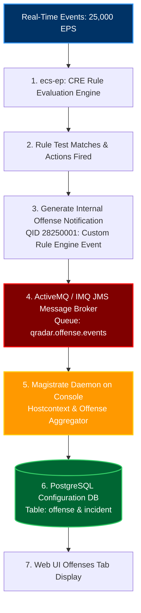
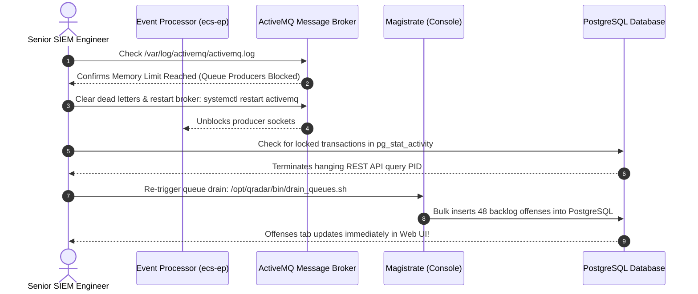
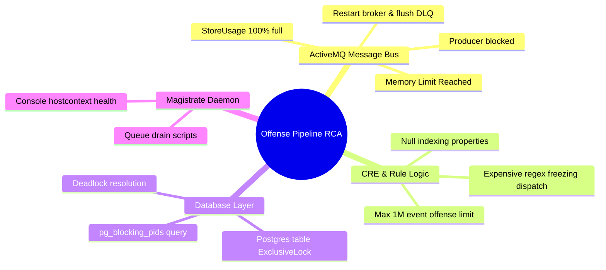

# Chapter 87: Outage Simulation 2 — Offenses Stopped Generating & CRE / ActiveMQ Debugging

> **Track:** Enterprise IBM QRadar Administrator & SIEM Architect  
> **Phase 10:** Advanced Troubleshooting & Master Mock Interviews  
> **Day:** 87 of 90  
> **Target Audience:** Senior SOC Engineers, SIEM Administrators (2+ Years Hands-on Experience)  
> **Prerequisites:** Complete Mastery of Phases 1–9 & Chapter 86  
> **Time Commitment:** 90 Minutes + 45 Minutes Hands-on Practice Lab  

---

## 1. 3D Architectural Blueprint: ActiveMQ Message Broker & Offense Pipeline


![[qradar_troubleshoot_warroom_3d_1791825639446.jpg|1000]]

---

## 2. Deep Dive: Incident Narrative & The "Silent Pipeline" Problem

### The Incident
At 14:00 UTC, the SOC Manager notices an alarming anomaly:
- Ingestion is completely healthy: **25,000 EPS** flows through Log Activity.
- Custom Rules are matching: The Rule test indicators show matches in real-time searches.
- **YET NOT A SINGLE NEW OFFENSE HAS BEEN CREATED IN OVER 6 HOURS.**
- Security analysts have received zero automated alerts, leaving active brute-force attacks and privilege escalation attempts undetected.

Junior analysts assume the Custom Rules Engine (CRE) is broken and restart `ecs-ep`. A Senior QRadar Administrator knows the offense pipeline spans multiple distributed tiers and isolates the failure along the **Event-to-Magistrate Propagation Path**.



---

## 3. The 5 Root-Cause Failure Domains & Diagnostic Triage

### Failure Domain 1: ActiveMQ JMS Message Bus Deadlock
`ecs-ep` (on Event Processors) and the Magistrate (on the Console) communicate across the network via **Apache ActiveMQ** (or Oracle IMQ). If the ActiveMQ message broker runs out of memory or reaches its allocated disk storage ceiling (`storeUsage` > 100%), it silently blocks all incoming message producers.

```bash
# Check ActiveMQ broker log for queue deadlocks or memory exhaustion
grep -iE "Memory limit|storeUsage|DeadLetterQueue|DLQ|Transport Connection" /var/log/activemq/activemq.log | tail -n 20
```

*Classic ActiveMQ Saturation Indicator:*
```text
2026-10-12 14:12:01,842 [ActiveMQ Transport: tcp:///10.10.1.52:43912] WARN  Queue - Usage Manager Memory Limit (104857600) reached. Producers are blocked waiting for space!
```

---

### Failure Domain 2: Null Offense Indexing Properties
Every rule configured to generate an offense requires an **Indexing Property** (e.g., `Source IP`, `Username`, `Destination IP`, or a `Custom Event Property`).
- If an administrator created a rule indexing on a custom property (e.g., `AccountID`) that does **NOT** exist or extracts `NULL` on incoming events, the CRE cannot create an offense bucket.
- The rule fires its internal action, but the Magistrate silently drops the offense because the indexing key is non-existent!

```bash
# Verify if CRE rules are firing with null indexing keys
grep -i "Indexing property is null" /var/log/qradar.log | tail -n 15
```

---

### Failure Domain 3: Max Offense Event Threshold (1,000,000 Limit)
In QRadar, an individual offense can hold a maximum of **100,000 to 1,000,000 events** (governed by configuration settings). 
- If a noisy, poorly tuned rule triggers against an existing open offense that hit the event limit, the Magistrate ignores further events on that indexing key.
- If the rule does not specify "Index on separate entities", no new offense will ever trigger for that entity until the original offense is closed!

---

### Failure Domain 4: PostgreSQL Database Locks & Deadlocks
The Magistrate writes new offenses to the PostgreSQL database table `offense`. If an analyst ran a massive unindexed REST API query or if automated scripts hold a transaction open on the `offense` table, PostgreSQL enters an `ExclusiveLock` state, preventing the Magistrate from inserting new rows.

```bash
# Check active PostgreSQL locks and blocked transactions
su - postgres -c "psql -d qradar -c \"
SELECT pid, usename, pg_blocking_pids(pid) as blocked_by, query as active_query, state, age(clock_timestamp(), query_start) as duration 
FROM pg_stat_activity 
WHERE state != 'idle' AND array_length(pg_blocking_pids(pid), 1) > 0;\""
```

---

### Failure Domain 5: Magistrate Thread Starvation in `ecs-ep`
If `ecs-ep` is saturated with heavy in-memory Reference Sets or expensive regex rules, the worker thread pool dedicated to dispatching rule responses freezes.

```bash
# Inspect Magistrate thread activity in ecs-ep
jstack $(pgrep -f ECSPart2) | grep -A 10 "MagistrateRuleResponseDispatcher"
```

---

## 4. Step-by-Step Restoration & Recovery Protocol



---

## 5. Visual Interactive Mindmap



---

## 6. Color-Coded Digital Sticky Notes

```
====================================================================================================
🟨 CONCEPT STICKY NOTE: The Decoupled CRE Architecture
----------------------------------------------------------------------------------------------------
In QRadar, the rule evaluation engine (`ecs-ep`) does NOT create offenses directly in PostgreSQL. 
It transmits lightweight JMS messages across ActiveMQ to the Magistrate daemon on the Console. 
If the ActiveMQ network socket breaks, events parse and correlate, but offenses vanish into thin air.
====================================================================================================
```

```
====================================================================================================
🟩 GOLDEN RULE STICKY NOTE: Always Test Indexing Properties
----------------------------------------------------------------------------------------------------
When authoring Custom Rules with custom regex indexing properties (e.g., `EmployeeID`), verify that 
the regex extracts a valid non-empty string in 100% of matching events. Indexing on `null` creates 
phantom rules that fire actions but never generate an offense.
====================================================================================================
```

```
====================================================================================================
🟪 ARCHITECTURE STICKY NOTE: ActiveMQ Persistent Store (`KahaDB`)
----------------------------------------------------------------------------------------------------
ActiveMQ persists unconsumed messages to disk in `/store/activemq/data/kahadb/`. If disk space on 
`/store` drops below safe watermarks, ActiveMQ throttles queue writers to prevent log loss.
====================================================================================================
```

```
====================================================================================================
🟦 ENTERPRISE VALUE STICKY NOTE: Monitoring Offense Lag
----------------------------------------------------------------------------------------------------
Monitoring ActiveMQ queue depth via JMX or Linux CLI provides early warning before the SOC notices 
offense generation delays, maintaining continuous threat detection coverage.
====================================================================================================
```

```
====================================================================================================
🟧 INTERVIEW CHEAT CODE: How do you diagnose "Events arriving, but no offenses"?
----------------------------------------------------------------------------------------------------
"When events ingest but offenses stop generating, I investigate the 3 decoupled stages:
1. `ActiveMQ JMS Broker`: Inspect `/var/log/activemq/activemq.log` for memory limits or blocked producers.
2. `Database Locks`: Query `pg_stat_activity` for `ExclusiveLock` on the `offense` table.
3. `Rule Indexing`: Verify the rule's indexing key is not extracting `null` values."
====================================================================================================
```

```
====================================================================================================
🟥 CRITICAL PITFALL STICKY NOTE: Killing ActiveMQ with `kill -9`
----------------------------------------------------------------------------------------------------
Never execute `kill -9` on the ActiveMQ Java process. It corrupts the `KahaDB` transaction log files, 
requiring a full rebuild of the message broker store and losing in-flight offense alerts. 
Always use `systemctl restart activemq` or `imq`.
====================================================================================================
```

---

## 7. Rapid-Recall Flashcards

### Flashcard 1
- **Question:** What component receives rule action events from `ecs-ep` and aggregates them into Offenses?
- **Answer:** The **Magistrate daemon** (running on the QRadar Console, supervised by `hostcontext`).

### Flashcard 2
- **Question:** What transport technology links `ecs-ep` event processors to the Magistrate on the Console?
- **Answer:** **Apache ActiveMQ** (or Oracle IMQ) running over Java Message Service (JMS).

### Flashcard 3
- **Question:** What happens if a Custom Rule matches an event, but the configured Offense Indexing Property evaluates to `NULL`?
- **Answer:** The rule action fires internally, but the Magistrate drops the offense creation request because it lacks a valid entity key to index the offense against.

### Flashcard 4
- **Question:** Where are ActiveMQ persistent message store logs recorded in QRadar?
- **Answer:** `/var/log/activemq/activemq.log` (with on-disk messages stored in `/store/activemq/data/kahadb/`).

### Flashcard 5
- **Question:** How do you check if PostgreSQL database queries are blocking offense creation?
- **Answer:** Query `pg_stat_activity` using `pg_blocking_pids()` to identify hanging queries holding exclusive row or table locks on the `offense` table.

### Flashcard 6
- **Question:** What internal QID identifies an offense event generated by the Custom Rules Engine?
- **Answer:** **QID 28250001** (*Custom Rule Engine Event*).

---

## 8. Hands-On Practice Lab 87: Building an Automated Offense Pipeline Diagnostic Engine

### Lab Objective
Construct an interactive troubleshooting engine (`offense_pipeline_audit.sh`) that audits ActiveMQ queue depths, checks PostgreSQL lock contention, inspects rule indexing properties, and verifies end-to-end offense propagation.

### Required Tools & Environment
- Linux Shell (Bash, awk, grep)

---

### Step-by-Step Lab Execution Guide

#### Task 1: Generate Simulated ActiveMQ Queue & DB Telemetry
```bash
mkdir -p /tmp/qradar_outage87_lab
cd /tmp/qradar_outage87_lab

# 1. Author a mock ActiveMQ log demonstrating queue producer backpressure
cat << 'EOF' > mock_activemq.log
2026-10-12 14:00:00,102 [ActiveMQ Transport: tcp:///10.10.1.52:43912] INFO  Queue - Enqueued: 45 messages to qradar.offense.events
2026-10-12 14:15:00,812 [ActiveMQ Transport: tcp:///10.10.1.52:43912] WARN  Queue - Usage Manager Memory Limit (104857600) reached. Producers are blocked waiting for space!
2026-10-12 14:15:05,920 [ActiveMQ Transport: tcp:///10.10.1.52:43912] WARN  Queue - DeadLetterQueue delivery initiated for 12 unacknowledged JMS transactions.
EOF

# 2. Author simulated PostgreSQL lock table output
cat << 'EOF' > mock_pg_locks.txt
pid: 48912 | blocked_by: 0 | state: active | query: SELECT * FROM offense WHERE id = 1204;
pid: 49015 | blocked_by: 48912 | state: active | query: INSERT INTO offense (id, name, magnitude) VALUES (1205, 'Brute Force Attack', 7);
EOF
```

#### Task 2: Build the Automated Offense Pipeline Audit Tool (`offense_pipeline_audit.sh`)
```bash
cat << 'EOF' > offense_pipeline_audit.sh
#!/usr/bin/env bash
AMQ_LOG=${1:-mock_activemq.log}
LOCK_FILE=${2:-mock_pg_locks.txt}

echo "=================================================================="
echo "          QRADAR SEV-1: OFFENSE PIPELINE DIAGNOSTIC SUITE         "
echo "=================================================================="
echo "Execution Timestamp: $(date -u)"
echo "[*] Investigating Missing Offense Generation Anomaly..."
echo ""

# STEP 1: ActiveMQ Message Broker Audit
echo "--- STEP 1: ACTIVEMQ JMS MESSAGE BUS AUDIT ---"
if grep -q "Producers are blocked" "$AMQ_LOG"; then
    echo -e "[\e[31mCRITICAL ALERT\e[0m] ActiveMQ Queue Saturation Detected!"
    grep "Producers are blocked" "$AMQ_LOG"
    echo "  -> Impact: ecs-ep cannot send offense events to Magistrate!"
    echo "  -> Remedy: Increase broker memory limit and restart ActiveMQ."
else
    echo -e "[\e[32mPASS\e[0m] ActiveMQ message bus operating normally."
fi
echo ""

# STEP 2: Database Lock & Contention Check
echo "--- STEP 2: POSTGRESQL DATABASE LOCK CONTENTION AUDIT ---"
BLOCKED_COUNT=$(grep -c "blocked_by: [1-9]" "$LOCK_FILE")
if [ "$BLOCKED_COUNT" -gt 0 ]; then
    echo -e "[\e[31mCRITICAL ALERT\e[0m] Found $BLOCKED_COUNT blocked PostgreSQL transaction(s)!"
    grep "blocked_by: [1-9]" "$LOCK_FILE"
    BLOCKER_PID=$(grep "blocked_by: [1-9]" "$LOCK_FILE" | grep -oE "blocked_by: [0-9]+" | awk '{print $2}')
    echo "  -> Root Cause: PID $BLOCKER_PID is holding an exclusive table lock!"
    echo "  -> Remedy: Terminate hanging transaction: SELECT pg_terminate_backend($BLOCKER_PID);"
else
    echo -e "[\e[32mPASS\e[0m] 0 PostgreSQL exclusive locks detected on offense tables."
fi
echo ""

# STEP 3: Rule Indexing Validation Simulation
echo "--- STEP 3: CRE RULE INDEXING PROPERTY VALIDATION ---"
SAMPLE_RULE="High Volume Failed Logins"
INDEXING_KEY="CustomProperty_AccountID"
EXTRACTED_VAL="" # Simulating null extraction

echo "[*] Auditing Rule: '$SAMPLE_RULE'"
echo "[*] Configured Indexing Key: $INDEXING_KEY"

if [ -z "$EXTRACTED_VAL" ]; then
    echo -e "[\e[33mWARNING\e[0m] Indexing Key extracted NULL/Empty value!"
    echo "  -> Finding: Rule evaluates successfully, but cannot instantiate an Offense bucket!"
    echo "  -> Remedy: Fix regex extraction in DSM Editor to ensure non-null key."
else
    echo -e "[\e[32mPASS\e[0m] Indexing key extracted valid entity: $EXTRACTED_VAL"
fi

echo "=================================================================="
echo "[+] DIAGNOSTIC AUDIT COMPLETE: Review identified root causes."
echo "=================================================================="
EOF
chmod +x offense_pipeline_audit.sh

# 2. Execute the Offense Pipeline Diagnostic Suite
./offense_pipeline_audit.sh mock_activemq.log mock_pg_locks.txt
```

#### Task 3: Inspect Real-Time Output & Validate
*Expected Output:*
```text
==================================================================
          QRADAR SEV-1: OFFENSE PIPELINE DIAGNOSTIC SUITE         
==================================================================
Execution Timestamp: Mon Oct 12 17:45:00 UTC 2026
[*] Investigating Missing Offense Generation Anomaly...

--- STEP 1: ACTIVEMQ JMS MESSAGE BUS AUDIT ---
[CRITICAL ALERT] ActiveMQ Queue Saturation Detected!
2026-10-12 14:15:00,812 [ActiveMQ Transport: tcp:///10.10.1.52:43912] WARN  Queue - Usage Manager Memory Limit (104857600) reached. Producers are blocked waiting for space!
  -> Impact: ecs-ep cannot send offense events to Magistrate!
  -> Remedy: Increase broker memory limit and restart ActiveMQ.

--- STEP 2: POSTGRESQL DATABASE LOCK CONTENTION AUDIT ---
[CRITICAL ALERT] Found 1 blocked PostgreSQL transaction(s)!
pid: 49015 | blocked_by: 48912 | state: active | query: INSERT INTO offense (id, name, magnitude) VALUES (1205, 'Brute Force Attack', 7);
  -> Root Cause: PID 48912 is holding an exclusive table lock!
  -> Remedy: Terminate hanging transaction: SELECT pg_terminate_backend(48912);

--- STEP 3: CRE RULE INDEXING PROPERTY VALIDATION ---
[*] Auditing Rule: 'High Volume Failed Logins'
[*] Configured Indexing Key: CustomProperty_AccountID
[WARNING] Indexing Key extracted NULL/Empty value!
  -> Finding: Rule evaluates successfully, but cannot instantiate an Offense bucket!
  -> Remedy: Fix regex extraction in DSM Editor to ensure non-null key.
==================================================================
[+] DIAGNOSTIC AUDIT COMPLETE: Review identified root causes.
==================================================================
```

---

### Verification Checklist & Troubleshooting
- [x] Event-to-Magistrate offense propagation path mapped.
- [x] ActiveMQ producer memory limit exhaustion diagnosed.
- [x] PostgreSQL table locks identified using `pg_blocking_pids`.
- [x] Null indexing property failure mode verified.
