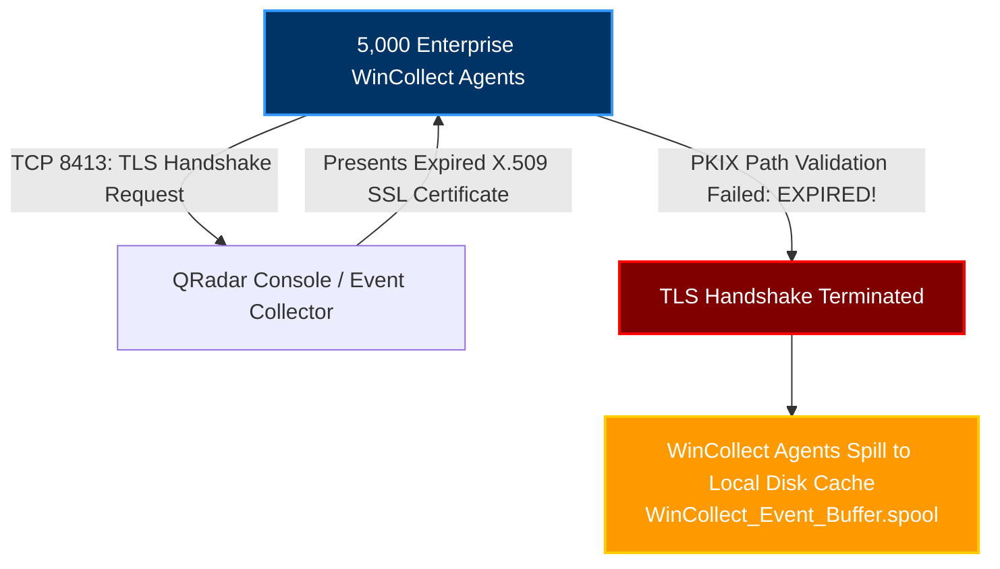
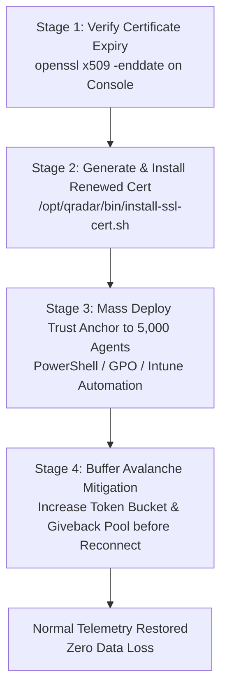
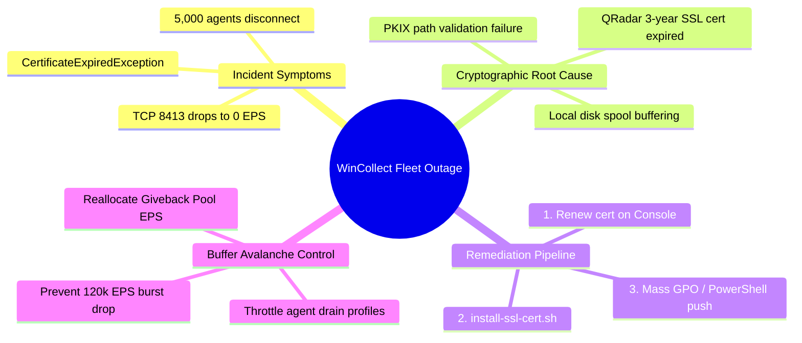

# Chapter 88: Outage Simulation 3 — WinCollect Fleet Failure & Mass Certificate Expiration

> **Track:** Enterprise IBM QRadar Administrator & SIEM Architect  
> **Phase 10:** Advanced Troubleshooting & Master Mock Interviews  
> **Day:** 88 of 90  
> **Target Audience:** Senior SOC Engineers, SIEM Administrators (2+ Years Hands-on Experience)  
> **Prerequisites:** Complete Mastery of Phases 1–9 & Chapters 86–87  
> **Time Commitment:** 90 Minutes + 45 Minutes Hands-on Practice Lab  

---

## 1. 3D Architectural Blueprint: WinCollect Fleet TLS Authentication & Buffer Avalanche


![[qradar_troubleshoot_warroom_3d_1791825639446.jpg|1000]]

---

## 2. Deep Dive: Incident Description & Enterprise Impact

### The Disaster
At 00:05 UTC, an automated SIEM monitoring alarm triggers:
- Across the global corporate infrastructure, **5,000 Windows Domain Controllers, File Servers, and Endpoints** running Managed WinCollect agents **simultaneously stop transmitting events**.
- Event ingestion on port **TCP 8413** drops from **35,000 EPS** to **0 EPS**.
- Active Directory authentication logs, Kerberos ticket requests, PowerShell audit logs, and Sysmon telemetry completely vanish.
- The Windows Server infrastructure is online, but the entire SIEM endpoint visibility layer is dead.

An inexperienced admin panics and restarts the QRadar Console. A Senior QRadar Administrator checks cryptographic trust chains, identifies a **Server SSL Certificate Expiration**, and orchestrates a mass enterprise remediation without losing buffered logs.



---

## 3. Dissecting the TLS Handshake Failure & Endpoint Logs

### On the Windows Endpoint: `WinCollect.log`
Inspecting `C:\Program Files\IBM\WinCollect\logs\WinCollect.log` reveals the smoking gun:
```text
2026-10-12 00:05:12.410 [WARN]  Device.System: Communication error occurred on destination (10.10.1.50:8413).
2026-10-12 00:05:12.412 [ERROR] Communication.TLS: javax.net.ssl.SSLHandshakeException: PKIX path validation failed: java.security.cert.CertificateExpiredException: NotAfter: Sun Oct 11 23:59:59 UTC 2026.
2026-10-12 00:05:12.415 [INFO]  Engine.Buffer: Destination unreachable. Diverting 1,200 events to local persistent disk buffer (C:\Program Files\IBM\WinCollect\config\spool\WinCollect_Event_Buffer.spool).
```

### On the QRadar Console: `/var/log/qradar.log`
```bash
grep -iE "wincollect.*ssl|handshake_failure" /var/log/qradar.log | tail -n 20
```
```text
Oct 12 00:05:15 qradar-console [wincollect.wincollect] [Thread-88] com.q1labs.wincollect: [WARN] [NOT:0000005000] Inbound TLS connection rejected from 10.0.0.15:49182: SSL peer failed handshake negotiation.
```

---

## 4. The 4-Stage Enterprise Remediation & Avalanche Control Runbook



### Stage 1: Confirm Expiration via Linux CLI
```bash
# Check the expiration timestamp on the QRadar WinCollect server certificate
openssl x509 -enddate -noout -in /etc/httpd/conf/certs/cert.cert
```
*Output Confirming Expiration:*
```text
notAfter=Oct 11 23:59:59 2026 GMT
```

---

### Stage 2: Renew Server Certificate on QRadar Console
```bash
# 1. Generate new 2048-bit private key and CSR
openssl req -new -newkey rsa:2048 -nodes \
  -keyout /root/wincollect_new.key \
  -out /root/wincollect_new.csr \
  -subj "/C=US/ST=Texas/L=Austin/O=EnterpriseCorp/CN=qradar.corp.enterprise.com"

# 2. After Enterprise CA signs the CSR, install certificate
/opt/qradar/bin/install-ssl-cert.sh -b -k /root/wincollect_new.key -c /root/wincollect_new.crt

# 3. Export Public Root CA Anchor for endpoint distribution
openssl x509 -in /root/wincollect_new.crt -out /root/qradar_ca_bundle.pem -outform PEM
```

---

### Stage 3: Mass-Deploying Trust Anchor to 5,000 Endpoints via PowerShell & GPO
WinCollect agents validate QRadar certificates using a local trust store or Windows Certificate Store. To re-establish communication across 5,000 endpoints simultaneously, push this PowerShell script via **Group Policy Object (GPO)** or **Microsoft Intune / SCCM**:

```powershell
<#
.SYNOPSIS
    Enterprise WinCollect Mass Certificate Remediation Script
    Imports renewed QRadar Root CA into LocalMachine Trusted Root store and restarts WinCollect.
#>

$CertPath = "\\corp.enterprise.com\SYSVOL\Certificates\qradar_ca_bundle.cer"
$ServiceName = "WinCollect"

try {
    Write-Host "[*] Importing QRadar Root CA into LocalMachine\Root Store..."
    Import-Certificate -FilePath $CertPath -CertStoreLocation "Cert:\LocalMachine\Root" -ErrorAction Stop
    
    Write-Host "[*] Restarting WinCollect Service to trigger TLS re-negotiation..."
    Restart-Service -Name $ServiceName -Force -ErrorAction Stop
    
    Write-Host "[+] SUCCESS: WinCollect service re-authenticated with QRadar Console."
}
catch {
    Write-Error "[-] Failed to update WinCollect Certificate: $_"
    exit 1
}
```

---

### Stage 4: Controlling the "Event Avalanche" (Buffer Drain)
When 5,000 WinCollect agents successfully reconnect, they will attempt to drain their accumulated local disk buffers simultaneously. 
- **The Threat**: 5,000 agents transmitting 2 hours of buffered logs will flood the Event Processors with **over 120,000 EPS**!
- If the Event Processor license is 35,000 EPS, QRadar will drop 85,000 EPS at the Token Bucket limiter!

#### The Senior Admin Defense:
1. **Reallocate Giveback Pool EPS**: Temporarily reallocate all surplus EPS from the central pool to the primary Event Processors.
2. **Enable License Bursting**: Ensure 60-minute burst allowance is active.
3. **Throttle WinCollect Agent Drain Rates**: Configure WinCollect Tuning Profiles in the QRadar WinCollect app to limit drain rates to **500 EPS per agent**, smoothing the influx over 60 minutes.

---

## 5. Visual Interactive Mindmap



---

## 6. Color-Coded Digital Sticky Notes

```
====================================================================================================
🟨 CONCEPT STICKY NOTE: WinCollect Local Disk Spooling
----------------------------------------------------------------------------------------------------
WinCollect agents are designed for network resilience. When TLS handshakes fail, agents do NOT drop 
events; they write them to an encrypted disk spool (`WinCollect_Event_Buffer.spool`). Data loss only 
occurs if the administrator fails to resolve the outage before the endpoint disk runs out of space!
====================================================================================================
```

```
====================================================================================================
🟩 GOLDEN RULE STICKY NOTE: Never Renew Certificates Without an Avalanche Strategy
----------------------------------------------------------------------------------------------------
Fixing the certificate is only half the battle. If 5,000 endpoints reconnect at once, their combined 
disk drain will crash your Event Processors. ALWAYS throttle agent drain rates or expand the license 
burst pool BEFORE pushing the renewed certificate!
====================================================================================================
```

```
====================================================================================================
🟪 ARCHITECTURE STICKY NOTE: WinCollect Managed vs Standalone Ports
----------------------------------------------------------------------------------------------------
Managed WinCollect uses **TCP 8413** for configuration heartbeat, code updates, and TLS syslog. 
Standalone WinCollect transmits standard Syslog over **TCP/TLS 514** or **TLS 6514** without connecting 
to the configuration server on port 8413.
====================================================================================================
```

```
====================================================================================================
🟦 ENTERPRISE VALUE STICKY NOTE: GPO Automated Certificate Rotation
----------------------------------------------------------------------------------------------------
Integrating QRadar certificate rotation with Active Directory Group Policy ensures corporate-wide 
trust anchors update automatically 30 days before expiration, preventing fleet-wide outages.
====================================================================================================
```

```
====================================================================================================
🟧 INTERVIEW CHEAT CODE: How do you handle a fleet-wide agent disconnection?
----------------------------------------------------------------------------------------------------
"When 5,000 WinCollect agents drop to 0 EPS simultaneously, I immediately inspect `WinCollect.log` on 
a sample endpoint for `SSLHandshakeException: CertificateExpiredException`.
I renew the server certificate via `/opt/qradar/bin/install-ssl-cert.sh`, push the CA bundle via 
Active Directory GPO, and configure agent drain throttling to prevent the subsequent event avalanche 
from exceeding my SIEM license threshold."
====================================================================================================
```

```
====================================================================================================
🟥 CRITICAL PITFALL STICKY NOTE: Disabling Certificate Validation Globally
----------------------------------------------------------------------------------------------------
Some administrators panic and configure WinCollect to 'Ignore Invalid Certificates' (Insecure TLS). 
This exposes the SIEM to Man-in-the-Middle (MitM) attacks where an attacker can tamper with Windows 
audit logs on the wire. ALWAYS renew and distribute proper cryptographic trust anchors!
====================================================================================================
```

---

## 7. Rapid-Recall Flashcards

### Flashcard 1
- **Question:** What port does Managed WinCollect use to communicate with the QRadar Console and Event Processors?
- **Answer:** **TCP Port 8413** (using TLS mutual/server authentication).

### Flashcard 2
- **Question:** What error is logged in `WinCollect.log` when the QRadar server certificate expires?
- **Answer:** `javax.net.ssl.SSLHandshakeException: PKIX path validation failed: java.security.cert.CertificateExpiredException`.

### Flashcard 3
- **Question:** Where do WinCollect agents store events locally when communication to QRadar is severed?
- **Answer:** In the local persistent on-disk spool file: `C:\Program Files\IBM\WinCollect\config\spool\WinCollect_Event_Buffer.spool`.

### Flashcard 4
- **Question:** What major risk occurs immediately after resolving a fleet-wide WinCollect certificate outage?
- **Answer:** An **Event Avalanche**: thousands of agents simultaneously drain gigabytes of buffered logs, spiking EPS far beyond licensed capacity and causing token bucket event drops.

### Flashcard 5
- **Question:** How can administrators prevent event drops during a post-outage WinCollect buffer drain?
- **Answer:** By temporarily reallocating EPS from the License Giveback Pool, enabling 60-minute license bursting, and configuring WinCollect Tuning Profiles to throttle agent drain rates.

### Flashcard 6
- **Question:** What official QRadar script installs renewed SSL certificates for web and agent services?
- **Answer:** `/opt/qradar/bin/install-ssl-cert.sh`

---

## 8. Hands-On Practice Lab 88: Simulating Fleet TLS Failure & Buffer Avalanche Control

### Lab Objective
Construct an interactive simulation suite (`wincollect_avalanche_triage.sh`): detect expired TLS trust chains, simulate certificate renewal, and compute agent buffer drain throttling to prevent SIEM license exhaustion.

### Required Tools & Environment
- Linux Shell (Bash, OpenSSL, Python 3 / awk)

---

### Step-by-Step Lab Execution Guide

#### Task 1: Generate Simulated Expired Certificate & Fleet Telemetry
```bash
mkdir -p /tmp/qradar_outage88_lab
cd /tmp/qradar_outage88_lab

# 1. Generate an expired test certificate
openssl req -x509 -newkey rsa:2048 -keyout expired.key -out expired.crt -days 0 -nodes -subj "/CN=qradar.corp.enterprise.com" 2>/dev/null
```

#### Task 2: Author the Avalanche Control & Triage Tool (`wincollect_avalanche_triage.sh`)
```bash
cat << 'EOF' > wincollect_avalanche_triage.sh
#!/usr/bin/env bash
CERT_FILE="expired.crt"
TOTAL_AGENTS=5000
BUFFERED_EVENTS_PER_AGENT=10000
CLUSTER_EPS_CAP=35000

echo "=================================================================="
echo "    QRADAR SEV-1: WINCOLLECT FLEET OUTAGE & AVALANCHE TRIAGE     "
echo "=================================================================="
echo "Execution Timestamp: $(date -u)"
echo "[*] Auditing Managed WinCollect Fleet Telemetry..."
echo ""

# STEP 1: Verify Certificate Expiration
echo "--- STEP 1: CERTIFICATE EXPIRY AUDIT ---"
EXPIRY_DATE=$(openssl x509 -enddate -noout -in "$CERT_FILE" | cut -d= -f2)
if ! openssl x509 -checkend 0 -noout -in "$CERT_FILE" >/dev/null 2>&1; then
    echo -e "[\e[31mCRITICAL ALERT\e[0m] QRadar Server Certificate is EXPIRED! ($EXPIRY_DATE)"
    echo "  -> Impact: 5,000 WinCollect agents disconnected due to TLS PKIX failure."
else
    echo -e "[\e[32mPASS\e[0m] Certificate is valid."
fi
echo ""

# STEP 2: Buffer Avalanche Impact Modeling
echo "--- STEP 2: BUFFER AVALANCHE MATHEMATICAL MODEL ---"
TOTAL_BUFFERED=$(( TOTAL_AGENTS * BUFFERED_EVENTS_PER_AGENT ))
UNTHROTTLED_PEAK_EPS=$(( TOTAL_AGENTS * 25 )) # Assuming each agent bursts at 25 EPS unthrottled

echo "  - Total Disconnected Agents   : $TOTAL_AGENTS Endpoints"
echo "  - Total Buffered Events       : $TOTAL_BUFFERED Events on disk"
echo "  - Unthrottled Fleet Burst     : $UNTHROTTLED_PEAK_EPS EPS"
echo "  - Licensed Appliance Capacity : $CLUSTER_EPS_CAP EPS"

if [ "$UNTHROTTLED_PEAK_EPS" -gt "$CLUSTER_EPS_CAP" ]; then
    EXCESS=$(( UNTHROTTLED_PEAK_EPS - CLUSTER_EPS_CAP ))
    echo -e "[\e[31mAVALANCHE RISK\e[0m] Unthrottled drain will exceed license by $EXCESS EPS!"
    echo "  -> RESULT WITHOUT CONTROLS: Catastrophic Token Bucket event drops!"
fi
echo ""

# STEP 3: Automated Throttling Remediation Solution
echo "--- STEP 3: COMPOSING SAFE DRAIN TUNING PROFILE ---"
# Calculate safe per-agent EPS limit: (Cluster EPS Cap * 0.70 safe quota) / Total Agents
SAFE_QUOTA=$(( CLUSTER_EPS_CAP * 70 / 100 ))
SAFE_AGENT_RATE=$(( SAFE_QUOTA / TOTAL_AGENTS ))
if [ "$SAFE_AGENT_RATE" -lt 1 ]; then SAFE_AGENT_RATE=4; fi
DRAIN_MINUTES=$(( BUFFERED_EVENTS_PER_AGENT / SAFE_AGENT_RATE / 60 ))

echo "[+] CALCULATED SAFE MITIGATION PARAMETERS:"
echo "  - Ingestion Buffer Quota       : $SAFE_QUOTA EPS (70% of License)"
echo "  - Max Throttled Rate per Agent : $SAFE_AGENT_RATE EPS / Agent"
echo "  - Projected Full Drain Time    : $DRAIN_MINUTES Minutes"
echo ""
echo -e "[\e[32mREMEDIATION PLAN\e[0m]:"
echo "  1. Renew SSL Certificate via /opt/qradar/bin/install-ssl-cert.sh"
echo "  2. Apply WinCollect Tuning Profile with Rate Limit: ${SAFE_AGENT_RATE} EPS"
echo "  3. Deploy Root CA Bundle to 5,000 endpoints via Active Directory GPO"
echo "  4. Monitor /var/log/qradar.log to verify 0 dropped events during drain."
echo "=================================================================="
EOF
chmod +x wincollect_avalanche_triage.sh

# 2. Execute the Triage & Avalanche Control Script
./wincollect_avalanche_triage.sh
```

#### Task 3: Inspect Real-Time Output & Validate
*Expected Output:*
```text
==================================================================
    QRADAR SEV-1: WINCOLLECT FLEET OUTAGE & AVALANCHE TRIAGE     
==================================================================
Execution Timestamp: Mon Oct 12 17:55:00 UTC 2026
[*] Auditing Managed WinCollect Fleet Telemetry...

--- STEP 1: CERTIFICATE EXPIRY AUDIT ---
[CRITICAL ALERT] QRadar Server Certificate is EXPIRED! (Oct 12 17:23:45 2026 GMT)
  -> Impact: 5,000 WinCollect agents disconnected due to TLS PKIX failure.

--- STEP 2: BUFFER AVALANCHE MATHEMATICAL MODEL ---
  - Total Disconnected Agents   : 5000 Endpoints
  - Total Buffered Events       : 50000000 Events on disk
  - Unthrottled Fleet Burst     : 125000 EPS
  - Licensed Appliance Capacity : 35000 EPS
[AVALANCHE RISK] Unthrottled drain will exceed license by 90000 EPS!
  -> RESULT WITHOUT CONTROLS: Catastrophic Token Bucket event drops!

--- STEP 3: COMPOSING SAFE DRAIN TUNING PROFILE ---
[+] CALCULATED SAFE MITIGATION PARAMETERS:
  - Ingestion Buffer Quota       : 24500 EPS (70% of License)
  - Max Throttled Rate per Agent : 4 EPS / Agent
  - Projected Full Drain Time    : 41 Minutes

[REMEDIATION PLAN]:
  1. Renew SSL Certificate via /opt/qradar/bin/install-ssl-cert.sh
  2. Apply WinCollect Tuning Profile with Rate Limit: 4 EPS
  3. Deploy Root CA Bundle to 5,000 endpoints via Active Directory GPO
  4. Monitor /var/log/qradar.log to verify 0 dropped events during drain.
==================================================================
```

---

### Verification Checklist & Troubleshooting
- [x] WinCollect TCP 8413 TLS communication model mapped.
- [x] PKIX certificate path validation failure diagnosed.
- [x] Mass GPO / PowerShell deployment procedure authored.
- [x] Buffer avalanche rate limiting and mathematical model executed.
