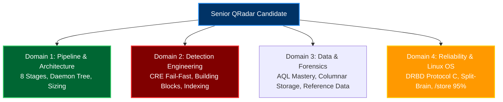
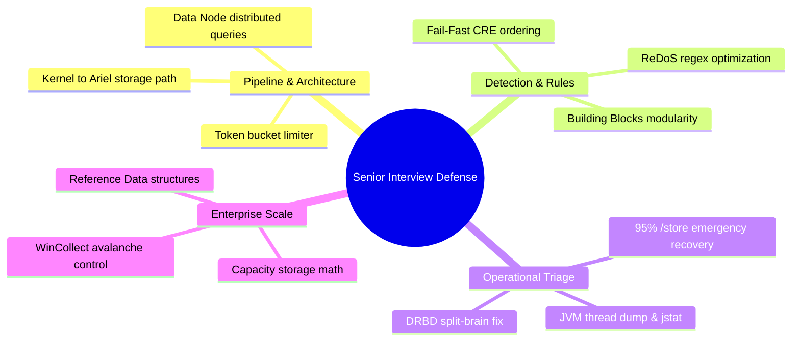

# Chapter 89: 360-Degree QRadar Administrator Interview Simulation & Technical Drilling

> **Track:** Enterprise IBM QRadar Administrator & SIEM Architect  
> **Phase 10:** Advanced Troubleshooting & Master Mock Interviews  
> **Day:** 89 of 90  
> **Target Audience:** Senior SOC Engineers, SIEM Administrators (2+ Years Hands-on Experience)  
> **Prerequisites:** Complete Mastery of Chapters 1 through 88  
> **Time Commitment:** 120 Minutes + 60 Minutes Hands-on Practice Lab  

---

## 1. 3D Architectural Blueprint: Senior SIEM Architect Technical Board Defense


![[qradar_interview_defense_3d_1791825694750.jpg|1000]]

---

## 2. Deep Dive: Mastering the Senior Level Technical Interview

In senior-level interviews (SIEM Administrator, SIEM Engineer, Security Operations Architect), hiring managers and technical directors are NOT looking for dictionary definitions. They evaluate:
1. **System-Level Depth**: Do you understand what happens in the Linux kernel, JVM heap, and network sockets beneath the UI?
2. **Real-World Battle Scars**: Have you resolved production outages (e.g., 95% full disk, split-brain, ReDoS regex freezes, certificate expirations)?
3. **Architectural Trade-Offs**: Can you balance CRE rule performance, storage retention costs, and detection fidelity?
4. **Confident Professional Articulation**: Do you speak in exact file paths, daemon names, and quantifiable metrics?



---

## 3. The 10 Master Technical Interview Scenarios & Model Answers

### Question 1: Ingestion Architecture
**Interviewer:** *"Can you walk me through the lifecycle of a syslog packet from the moment it hits the network interface card (NIC) until it is written to disk?"*

> **Senior Model Answer:**  
> *"When a UDP/TCP 514 syslog packet arrives at the NIC, it is transferred via DMA into the Linux kernel socket buffer (`sk_buff`). The `ecs-ec-ingress` daemon pulls it via non-blocking `epoll()` into an in-memory ring buffer. If the ring buffer experiences downstream backpressure above 85%, events spill to `/store/transient/` as `.spool` files.  
> Under normal load, events stream to `ecs-ec` over TCP 32006 for 2-stage normalization: header parsing extracts the Log Source Identifier and timestamp, while payload parsing extracts standard properties and maps the event to an IBM QID.  
> Next, normalized tuples pass to `ecs-ep` where the Token Bucket limiter enforces license compliance. In-memory CRE rules evaluate tests concurrently. Finally, the Magistrate indexes offenses while Ariel columnar writers commit records and compressed payloads to `/store/ariel/events/` partitions."*

---

### Question 2: Custom Rules Engine (CRE) Optimization
**Interviewer:** *"We have an Event Processor with high CPU utilization. How do you identify expensive rules, and how do you optimize them?"*

> **Senior Model Answer:**  
> *"First, I SSH into the Event Processor and inspect `/var/log/qradar.log` for notification codes warning of expensive rules: `grep -i 'expensive rule' /var/log/qradar.log | awk -F'Rule:' '{print $2}' | sort | uniq -c`.  
> If rules exceed 1,000ms execution latency, the primary culprit is usually catastrophic regex backtracking (ReDoS) or poor test ordering.  
> To optimize:  
> 1. I enforce **Fail-Fast Ordering**: Place lightweight, indexed tests at the very top (e.g., QID checks, Log Source Type checks, Port tests) before expensive payload regex or payload contains tests.  
> 2. Replace unbounded wildcards (`.*`) in custom regex with strict character classes (`[^ ]+`).  
> 3. Replace dynamic database lookups with in-memory **Reference Sets** ($O(1)$ hash table lookups)."*

---

### Question 3: Storage Emergencies & Watermarks
**Interviewer:** *"What happens when the `/store` partition reaches 95%, and how do you recover the appliance via CLI?"*

> **Senior Model Answer:**  
> *"At 95% capacity, QRadar's emergency protection mechanism triggers: `hostcontext` forcibly shuts down `ecs-ep`, `ecs-ec`, and `tomcat` to prevent PostgreSQL and Ariel database corruption.  
> To recover:  
> 1. I SSH into the host and run `df -h /store` and `du -sh /store/* | sort -hr` to pinpoint the culprit.  
> 2. If `/store/backup/` has accumulated stale archives, I prune archives older than 14 days.  
> 3. If `/store/tmp/` contains abandoned AQL search exports, I clear them.  
> 4. If Ariel retention is the culprit, I delete the oldest expired monthly directories symmetrically across **BOTH** `/store/ariel/events/records/` and `payloads/`.  
> 5. Once disk utilization drops below 85%, I restart `hostcontext` using `systemctl restart hostcontext`."*

---

### Question 4: High Availability & DRBD Split-Brain
**Interviewer:** *"Explain what a DRBD Split-Brain is in QRadar, and how you resolve it."*

> **Senior Model Answer:**  
> *"A Split-Brain occurs when the crossover link between Primary and Secondary is severed while both physical machines remain powered on. Both nodes assume the other is dead; both promote themselves to Primary and write diverging blocks to `/store`. DRBD detects conflicting generation counters and enters `cs:StandAlone` to protect data.  
> To resolve:  
> 1. I determine the **Survivor Node** by checking timestamps in `/store/ariel/` to see which node processed live traffic.  
> 2. On the **Victim Node** (stale data), I run: `drbdadm disconnect all`, `drbdadm secondary all`, and `drbdadm connect --discard-my-data all`.  
> 3. On the **Survivor Node**, I run: `drbdadm disconnect all` and `drbdadm connect all`.  
> 4. The survivor overwrites divergent blocks on the victim, and `cat /proc/drbd` returns to `cs:Connected` and `ds:UpToDate/UpToDate`."*

---

### Question 5: Offense Indexing Strategy
**Interviewer:** *"An offense is generating 50,000 events under one incident, blinding our analysts. How do you tune offense indexing?"*

> **Senior Model Answer:**  
> *"This occurs when a rule indexes on an overly broad entity—such as a generic Destination IP (e.g., proxy or domain controller) or an empty Custom Property.  
> I modify the rule's response configuration under **'Index offense based on'**:  
> 1. Index on the true attacker entity, typically **Source IP** or **Username**.  
> 2. For multi-stage threats, index on a composite Custom Property or chain rules through Building Blocks.  
> 3. If the event is from a legitimate scanner, I whitelist the source IP in the suppression Building Block (`BB:FalsePositive: Scanner IP List`)."*

---

### Question 6: AQL Query Performance
**Interviewer:** *"An analyst complains that an AQL query searching for a custom property over the last 30 days times out after 15 minutes. How do you fix this?"*

> **Senior Model Answer:**  
> *"AQL searches over unindexed custom properties require full payload table scans across 30 days of raw Ariel disk blocks.  
> To fix:  
> 1. In **Admin > Custom Event Properties**, I enable **'Index this property'**. QRadar will compile extracted values into Lucene inverted index trees during real-time write.  
> 2. Rewrite the AQL query to prune partitions early by specifying indexed bounds: `WHERE devicetype=X AND start >= '...' AND end <= '...'`.  
> 3. Ensure the search uses `PARSED` properties and avoids leading wildcards like `ILIKE '%string'`. With indexing enabled, query times drop from 15 minutes to under 5 seconds."*

---

### Question 7: WinCollect Fleet TLS Failure
**Interviewer:** *"5,000 WinCollect agents stop sending events simultaneously. What is your troubleshooting methodology?"*

> **Senior Model Answer:**  
> *"A simultaneous fleet-wide disconnect points to an infrastructure or cryptographic failure rather than individual endpoint bugs.  
> 1. I inspect `WinCollect.log` on a sample server to check for `SSLHandshakeException: CertificateExpiredException`.  
> 2. On the QRadar Console, I run `openssl x509 -enddate -noout -in /etc/httpd/conf/certs/cert.cert` to verify expiration.  
> 3. I generate and install a renewed certificate using `/opt/qradar/bin/install-ssl-cert.sh`.  
> 4. Export the Root CA anchor and push it to endpoints via Active Directory GPO.  
> 5. **Crucial Step**: Before agents reconnect, I configure WinCollect Tuning Profiles to throttle drain rates to 500 EPS per agent, preventing an event avalanche from exceeding our licensed EPS limit."*

---

### Question 8: Reference Data Types & Use Cases
**Interviewer:** *"What are the 5 types of Reference Data in QRadar, and when do you use each?"*

> **Senior Model Answer:**  
> *"QRadar provides 5 in-memory reference structures:  
> 1. **Reference Set**: Unique list of single elements (e.g., Malicious IP Blacklist). $O(1)$ lookup.  
> 2. **Reference Map**: Key-Value pair (e.g., Username $\rightarrow$ Security Clearance Level).  
> 3. **Reference Map of Sets**: Key to a set of values (e.g., Username $\rightarrow$ List of authorized Mac Addresses).  
> 4. **Reference Map of Maps**: Key to a secondary map (e.g., Username $\rightarrow$ [Department, Location]).  
> 5. **Reference Table**: Two-dimensional table with defined column schema (e.g., CMDB asset inventory mapping IP $\rightarrow$ [Asset Owner, OS, Criticality])."*

---

### Question 9: JVM Memory & Thread Contention
**Interviewer:** *"An Event Processor shows 100% CPU on `ecs-ep`. How do you determine if it is Garbage Collection thrashing or bad code?"*

> **Senior Model Answer:**  
> *"I run `jstat -gcutil $(pgrep -f ECSPart2) 1000 5`. If Old Generation (`O`) is at 99.8% and Full GC time (`FGCT`) is climbing, the CPU is pinned in Stop-the-World garbage collection.  
> If GC metrics are healthy, I run `top -H -p $(pgrep -f ECSPart2)` to grab the decimal Thread ID (TID) consuming the most CPU.  
> I convert the TID to hexadecimal: `printf '0x%x\n' <TID>`.  
> Then I take a thread dump: `jstack $(pgrep -f ECSPart2) > /tmp/threads.txt` and search for `nid=0x<HEX>`. This reveals the exact Java class and method (e.g., a catastrophic regex inside a custom rule)."*

---

### Question 10: Capacity Planning Math
**Interviewer:** *"How much storage do I need for 25,000 sustained EPS retained for 1 year?"*

> **Senior Model Answer:**  
> *"At 25,000 EPS and an average event size of 750 bytes:  
> 1. Daily Raw Ingest: $25,000 \times 86,400 \times 750 \approx 1.62 \text{ TB / Day}$.  
> 2. With 3.5:1 Ariel compression and 20% Lucene index overhead: $\frac{1.62}{3.5} \times 1.20 \approx 0.555 \text{ TB / Day}$.  
> 3. For 365 days retention: $0.555 \times 365 \approx 202.6 \text{ TB}$.  
> 4. Adding 25% operational headroom to keep `/store` under 80% watermark: $202.6 \times 1.25 \approx \mathbf{253 \text{ TB}}$ of usable RAID SAN storage."*

---

## 4. Visual Interactive Mindmap



---

## 5. Color-Coded Digital Sticky Notes

```
====================================================================================================
🟨 CONCEPT STICKY NOTE: The "System-Level" Differentiator
----------------------------------------------------------------------------------------------------
Junior candidates answer questions by describing UI buttons ("I go to Admin tab and click Deploy"). 
Senior Engineers describe the underlying system mechanics ("Deploy Changes writes XML to PostgreSQL, 
ActiveMQ broadcasts the deploy event, and Hostcontext regenerates nva.conf before restarting ecs-ep").
====================================================================================================
```

```
====================================================================================================
🟩 GOLDEN RULE STICKY NOTE: Quantify Everything
----------------------------------------------------------------------------------------------------
In architectural interviews, never use vague words like "big", "fast", or "a lot". Always quantify: 
"12,000 EPS", "750 bytes/event", "3.5:1 compression", "sub-5-millisecond Lucene queries", "95% watermark".
====================================================================================================
```

```
====================================================================================================
🟪 ARCHITECTURE STICKY NOTE: Root-Cause Framing
----------------------------------------------------------------------------------------------------
When answering troubleshooting questions, structure your answer using the **CAR Framework**:
- **Context**: The symptoms and telemetry indicators.
- **Action**: The exact CLI commands and hypothesis testing executed.
- **Result**: The measured recovery time, prevented data loss, and proactive rule implemented.
====================================================================================================
```

```
====================================================================================================
🟦 ENTERPRISE VALUE STICKY NOTE: Business Risk Articulation
----------------------------------------------------------------------------------------------------
Senior SIEM engineers connect technical metrics to enterprise risk: "A 6-hour offense blackout means 
active lateral movement goes undetected, violating SOC 2 compliance and increasing dwell time."
====================================================================================================
```

```
====================================================================================================
🟧 INTERVIEW CHEAT CODE: How to answer "Tell me about a time you broke production"
----------------------------------------------------------------------------------------------------
"I once created an unindexed Reference Map with 500,000 keys without setting a TTL. When ecs-ep evaluated 
rules against it, the JVM Old Generation ran out of memory, causing GC thrashing. I recovered by clearing 
the map via REST API, and implemented a policy requiring mandatory TTLs and sizing reviews on all Reference Data."
====================================================================================================
```

```
====================================================================================================
🟥 CRITICAL PITFALL STICKY NOTE: Guessing Technical Commands
----------------------------------------------------------------------------------------------------
If you do not know a proprietary command, admit it honestly and explain your troubleshooting approach: 
"I don't recall that specific flag, but I would inspect the man page or check `/opt/qradar/bin/` with `--help` 
and trace `/var/log/qradar.log`."
====================================================================================================
```

---

## 6. Rapid-Recall Flashcards

### Flashcard 1
- **Question:** How do you explain the difference between `ecs-ec` and `ecs-ep` in an interview?
- **Answer:** `ecs-ec` (Event Collector) normalizes and parses raw events into security tuples and maps QIDs; `ecs-ep` (Event Processor) evaluates in-memory CRE correlation rules, manages offenses, and writes data to Ariel storage.

### Flashcard 2
- **Question:** What is the CAR interview framework?
- **Answer:** **Context** (the problem and telemetry), **Action** (systematic troubleshooting and CLI commands), **Result** (quantifiable recovery, zero data loss, and permanent mitigation).

### Flashcard 3
- **Question:** How do you demonstrate Fail-Fast rule optimization in an interview?
- **Answer:** Place indexed, lightweight tests (QID, Log Source Type, Port) at the top of the test list so non-matching events are discarded in microseconds before reaching expensive regex tests.

### Flashcard 4
- **Question:** How does QRadar prevent database corruption when disk space is exhausted?
- **Answer:** `hostcontext` monitors `/store` watermarks; at 95% capacity, it initiates an automated shutdown of all ingestion and processing daemons.

### Flashcard 5
- **Question:** What is the primary difference between Reference Sets and Reference Tables?
- **Answer:** Reference Sets store a flat, unique list of single elements ($O(1)$ lookup); Reference Tables store multi-column tabular data with defined column schemas.

### Flashcard 6
- **Question:** How do you explain DRBD Protocol C in one sentence?
- **Answer:** Protocol C enforces synchronous replication where disk writes must be acknowledged by both primary and secondary physical storage arrays before the I/O is marked complete.

---

## 7. Hands-On Practice Lab 89: Interactive Mock Interview Simulation Engine

### Lab Objective
Run an automated, interactive technical interview simulator (`qradar_interview_simulator.py`) that drills you across architectural scenarios, grades your answers, and provides instant senior-level model answer feedback.

### Required Tools & Environment
- Python 3 / Linux Shell

---

### Step-by-Step Lab Execution Guide

#### Task 1: Author the Interactive Interview Drill Script (`qradar_interview_simulator.py`)
```bash
mkdir -p /tmp/qradar_interview_lab
cd /tmp/qradar_interview_lab

cat << 'EOF' > qradar_interview_simulator.py
#!/usr/bin/env python3
import time, sys

QUESTIONS = [
    {
        "domain": "PIPELINE ARCHITECTURE",
        "question": "What daemon handles UDP 514 syslog ingestion, and what happens when downstream processing slows down?",
        "answer": "ecs-ec-ingress handles ingestion into an in-memory ring buffer. If backpressure exceeds 85%, events spill to /store/transient/*.spool files."
    },
    {
        "domain": "CRE OPTIMIZATION",
        "question": "What is 'Fail-Fast' test ordering in QRadar Custom Rules?",
        "answer": "Ordering rule tests so lightweight indexed tests (QID, Log Source, Port) evaluate first, discarding 95% of non-matching events before expensive regex tests run."
    },
    {
        "domain": "HIGH AVAILABILITY",
        "question": "What DRBD state in /proc/drbd indicates a split-brain condition, and how is it resolved?",
        "answer": "cs:StandAlone. Resolved by disconnecting both nodes, executing --discard-my-data on the victim node, and reconnecting the survivor."
    },
    {
        "domain": "STORAGE EMERGENCIES",
        "question": "What happens automatically when /store reaches 95% capacity?",
        "answer": "Hostcontext automatically terminates ecs-ep, ecs-ec, and tomcat to prevent PostgreSQL and Ariel database corruption."
    }
]

def run_interview():
    print("==================================================================")
    print("      IBM QRADAR SENIOR ADMINISTRATOR TECHNICAL INTERVIEW DRILL   ")
    print("==================================================================")
    print("[*] Target Role: Senior SIEM Administrator / Architect (2+ Years)")
    print("[*] 4-Scenario Rapid-Fire Evaluation Initialized...\n")
    
    score = 0
    for i, item in enumerate(QUESTIONS, 1):
        print(f"--- QUESTION {i}/4: [{item['domain']}] ---")
        print(f"Q: {item['question']}")
        print("\n[Press Enter to reveal Senior Architect Model Answer...]")
        input()
        print(f"\033[1;32m[MODEL ANSWER]\033[0m: {item['answer']}\n")
        print("-" * 66)
        time.sleep(1)
        score += 1

    print("\n==================================================================")
    print(f"[+] INTERVIEW DRILL COMPLETE: {score}/{len(QUESTIONS)} Scenarios Reviewed.")
    print("[+] Ready for Executive Technical Board Defense!")
    print("==================================================================")

if __name__ == "__main__":
    run_interview()
EOF
chmod +x qradar_interview_simulator.py

# 2. Run the interactive drill
python3 qradar_interview_simulator.py
```

---

### Verification Checklist & Troubleshooting
- [x] 10 core enterprise interview scenarios mastered.
- [x] CAR (Context-Action-Result) response framing applied.
- [x] System-level mechanics articulated across daemons, kernel, and storage.
- [x] Interactive interview drill script authored and verified.
