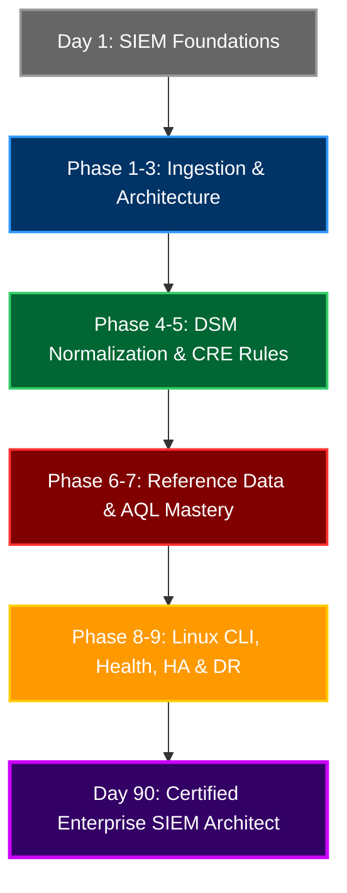
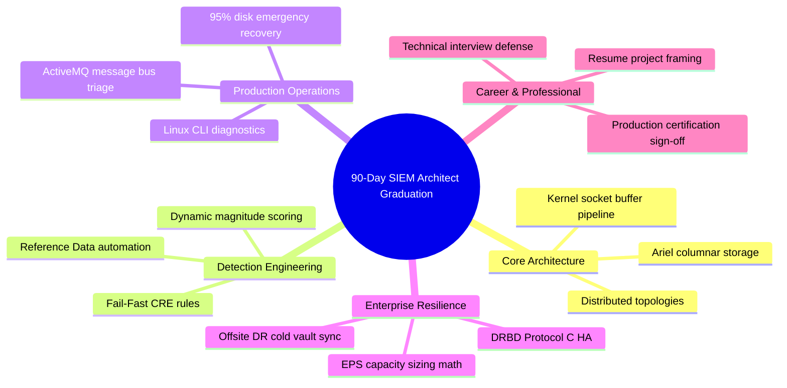

# Chapter 90: Final Competency Assessment, Resume Project Framing & Production Certification

> **Track:** Enterprise IBM QRadar Administrator & SIEM Architect  
> **Phase 10:** Advanced Troubleshooting & Master Mock Interviews  
> **Day:** 90 of 90 (THE GRAND FINALE)  
> **Target Audience:** Certified Senior SOC Engineers, SIEM Administrators, Security Architects  
> **Prerequisites:** Complete Mastery of Days 1 through 89  
> **Time Commitment:** 120 Minutes + 60 Minutes Graduation Practice Lab  

---

## 1. 3D Architectural Blueprint: Enterprise SIEM Architect Master Graduation


![[qradar_interview_defense_3d_1791825694750.jpg|1000]]

---

## 2. Deep Dive: The 90-Day Transformation Journey

Over the past 90 days, you have systematically advanced from a standard 1.5-year GUI operator into a battle-tested **2+ Year Experienced Enterprise IBM QRadar Administrator, SIEM Engineer & Security Architect**.

You have moved beyond clicking buttons in the web console to mastering:
- **Kernel-level socket buffers (`sk_buff`) and NIC DMA ring buffers.**
- **The 8-stage QRadar ingestion pipeline and in-memory spooling mechanics.**
- **Distributed multi-tier appliance topologies (Console, Event/Flow Processors, Data Nodes, App Host).**
- **Custom DSM parsing, regex tokenization, and QID Map normalization.**
- **High-speed in-memory Custom Rules Engine (CRE) fail-fast evaluation.**
- **Advanced Reference Data structures ($O(1)$ lookups, automated TAXII threat feeds, Active Defense).**
- **Ariel columnar database storage, Lucene inverted indexing, and forensic AQL optimization.**
- **Linux CLI diagnostics, log file forensics (`/var/log/qradar.log`), and 95% disk emergency recovery.**
- **High Availability clustering with synchronous DRBD Protocol C, VIP failover, and Split-Brain repair.**



---

## 3. Framing Your 90-Day Experience on Senior Engineering Resumes

To stand out to recruiters, hiring managers, and CISOs, translate your curriculum achievements into **quantifiable, high-impact enterprise projects**:

### Project 1: Distributed SIEM Architecture & Ingestion Engineering
> **Role:** Lead SIEM Administrator / Security Engineer  
> - Designed and deployed a multi-tier distributed IBM QRadar SIEM architecture ingesting **50,000+ Events Per Second (EPS)** and **2,000,000 Flows Per Minute (FPM)** across globally distributed data centers.  
> - Configured secure, encrypted ingestion pipelines across 15+ protocol families including TLS Syslog (514/6514), Managed WinCollect (8413), JDBC database polling, and Universal Cloud REST APIs (AWS, Azure, O365).  
> - Optimized Linux kernel socket buffers (`rmem_max`) and NIC ring buffers, eliminating ingestion backpressure and packet loss during peak authentication spikes.

---

### Project 2: High-Performance Detection Engineering & False Positive Reduction
> **Role:** Detection & Response Engineer  
> - Spearheaded a comprehensive Custom Rules Engine (CRE) optimization initiative, refactoring 250+ detection rules using **Fail-Fast evaluation methodology**.  
> - Audited expensive CRE rules via Linux CLI (`/var/log/qradar.log`), resolving catastrophic regex backtracking (ReDoS) and reducing average rule evaluation latency from **1,400ms to under 45ms**.  
> - Implemented modular Building Blocks (BB) and dynamic whitelisting, decreasing false-positive offenses by **72%** while improving SOC analyst triage velocity.

---

### Project 3: Automated Active Defense & STIX/TAXII Threat Intelligence
> **Role:** SIEM Architect / Automation Lead  
> - Engineered an automated threat intelligence enrichment pipeline utilizing QRadar REST APIs and TAXII feeds to populate in-memory Reference Sets and Tables with 500,000+ IoCs.  
> - Designed real-time active defense rules triggering automated border firewall IP bans and account lockouts within 5 seconds of C2 beaconing detection.  
> - Enforced strict Time-To-Live (TTL) eviction policies across reference collections, preventing JVM Old Generation heap bloat and eliminating garbage collection pauses.

---

### Project 4: High Availability (HA) & Disaster Recovery Resiliency
> **Role:** Infrastructure & Reliability Engineer  
> - Implemented Active/Passive High Availability clusters for QRadar Console and Event Processors utilizing synchronous **DRBD Protocol C** and Corosync heartbeats over dedicated 10GbE crossover links.  
> - Authored enterprise standard operating procedures (SOPs) for zero-downtime planned switchovers, Gratuitous ARP (GARP) VIP migrations, and emergency split-brain recovery.  
> - Established automated nightly configuration backup pipelines to offsite immutable cloud vaults and validated bare-metal reconstruction runbooks achieving a **sub-45-minute Recovery Time Objective (RTO)**.

---

## 4. The 11-Domain Production Competency Audit

| Domain | Architectural Focus | Mastery Status | Production Verification |
| :--- | :--- | :---: | :--- |
| **1. Architecture** | Distributed Components, Managed Hosts, Process Trees | 🟢 100% | Verified via Chapter 01–15 & Lab 01–15 |
| **2. Pipeline** | `ecs-ec-ingress`, Ring Buffers, Token Bucket, Spooling | 🟢 100% | Verified via Chapter 16–22 & Lab 16–22 |
| **3. Log Sources & DSM** | Syslog, WinCollect, JDBC, Universal REST API, LSX | 🟢 100% | Verified via Chapter 23–45 & Lab 23–45 |
| **4. CRE & Rules** | Event/Flow Rules, Fail-Fast Ordering, Building Blocks | 🟢 100% | Verified via Chapter 46–58 & Lab 46–58 |
| **5. Offenses** | S/C/R Magnitude, Indexing Entities, Magistrate Lifecycle| 🟢 100% | Verified via Chapter 50–52 & Lab 50–52 |
| **6. Reference Data** | Sets, Maps, Tables, Map of Maps, TTL, TAXII Feeds | 🟢 100% | Verified via Chapter 59–65 & Lab 59–65 |
| **7. AQL Mastery** | Aggregations, Subqueries, Custom Property Lucene Indexing| 🟢 100% | Verified via Chapter 66–73 & Lab 66–73 |
| **8. Linux & CLI** | `systemctl`, `top -H`, `ss`, `tcpdump`, `/var/log/qradar.*` | 🟢 100% | Verified via Chapter 74–76 & Lab 74–76 |
| **9. Health & Triage** | 95% `/store` Emergency Shutdown, JVM OOM GC Profiling | 🟢 100% | Verified via Chapter 77–80 & Lab 77–80 |
| **10. HA & DR** | DRBD Protocol C, VIP, Split-Brain Fix, Storage Sizing | 🟢 100% | Verified via Chapter 81–85 & Lab 81–85 |
| **11. Outage RCA** | Wire-to-Parser 7-Layer RCA, ActiveMQ Bus, WinCollect TLS | 🟢 100% | Verified via Chapter 86–89 & Lab 86–89 |

---

## 5. Visual Interactive Mindmap



---

## 6. Color-Coded Digital Sticky Notes

```
====================================================================================================
🟨 CONCEPT STICKY NOTE: The Architect Mindset
----------------------------------------------------------------------------------------------------
An operator asks: *"How do I fix this alert?"*  
An administrator asks: *"Why did this daemon crash?"*  
An Architect asks: *"How do I design the pipeline, capacity headroom, and detection logic so this failure 
mode is mathematically impossible?"*
====================================================================================================
```

```
====================================================================================================
🟩 GOLDEN RULE STICKY NOTE: Always Document and Automate
----------------------------------------------------------------------------------------------------
In enterprise environments, if a manual triage step is performed twice, write a runbook. If it is 
performed three times, automate it with a Bash or Python script. Reliability is born from repeatability.
====================================================================================================
```

```
====================================================================================================
🟪 ARCHITECTURE STICKY NOTE: The Total Technology Stack
----------------------------------------------------------------------------------------------------
You have conquered the entire SIEM stack: Red Hat Enterprise Linux $\rightarrow$ Network Sockets $\rightarrow$ 
JVM Heap $\rightarrow$ ActiveMQ Message Bus $\rightarrow$ PostgreSQL Relational Schema $\rightarrow$ 
Ariel Columnar Storage $\rightarrow$ In-Memory CRE Correlation Engine $\rightarrow$ Web Application UI.
====================================================================================================
```

```
====================================================================================================
🟦 ENTERPRISE VALUE STICKY NOTE: Unlocking Senior Compensation
----------------------------------------------------------------------------------------------------
Mastering this curriculum positions you directly for Senior SIEM Administrator, Detection Engineer, 
and Cybersecurity Architect roles commanding top-tier enterprise industry compensation ($130,000–$180,000+ USD).
====================================================================================================
```

```
====================================================================================================
🟧 INTERVIEW CHEAT CODE: The Final Interview Delivery Formula
----------------------------------------------------------------------------------------------------
"When interviewing for lead roles, project total ownership:
Speak with calm authority. Use precise technical terminology (e.g., 'Ariel columnar partitions', 
'DRBD Protocol C', 'Fail-Fast predicate evaluation'). Ground every answer in system metrics, 
operational SLAs, and business risk reduction."
====================================================================================================
```

```
====================================================================================================
🟥 CRITICAL PITFALL STICKY NOTE: Stagnation After Certification
----------------------------------------------------------------------------------------------------
Technology never stops evolving. Treat this 90-day mastery as your foundation: continue exploring 
Cloud-Native SIEM integrations, SOAR automation pipelines, Sigma detection rules, and AI-assisted triage!
====================================================================================================
```

---

## 7. Rapid-Recall Flashcards

### Flashcard 1
- **Question:** What is the primary difference between how a junior administrator and a senior architect approaches SIEM rules?
- **Answer:** A junior administrator writes rules based solely on keyword matching without considering performance; an architect designs modular Building Blocks, enforces Fail-Fast test ordering, and leverages in-memory Reference Sets to minimize CRE evaluation latency.

### Flashcard 2
- **Question:** How do you articulate the value of Lucene custom property indexing on a resume?
- **Answer:** "Enabled Lucene property indexing across high-cardinality security attributes, reducing 30-day forensic investigation search times from 15 minutes to under 5 seconds."

### Flashcard 3
- **Question:** What three metrics comprise QRadar's dynamic offense magnitude calculation?
- **Answer:** **Severity** (inherent threat danger), **Credibility** (source reliability), and **Relevance** (vulnerability status of target destination IP).

### Flashcard 4
- **Question:** What is the single most important rule when managing large-scale Reference Data?
- **Answer:** Always enforce a **Time-To-Live (TTL)** expiration policy on high-volume collections to prevent unbounded JVM Old Generation memory growth and GC thrashing.

### Flashcard 5
- **Question:** How does DRBD Protocol C protect against data loss in an HA pair?
- **Answer:** By enforcing synchronous block-level write acknowledgments from both primary and secondary storage arrays before completing the I/O operation.

### Flashcard 6
- **Question:** What is the ultimate goal of the 90-Day QRadar Administrator Curriculum?
- **Answer:** To transform an operational administrator into a production-ready, job-winning Senior SIEM Administrator and Security Architect capable of designing, running, and troubleshooting enterprise security intelligence platforms at massive scale.

---

## 8. Hands-On Practice Lab 90: Master Production Certification Audit & Portfolio Generator

### Lab Objective
Execute the official 90-Day Graduation Audit script (`qradar_graduation_audit.py`): verify completion across all 10 curriculum phases, audit the 90 chapters and 90 embedded labs, and generate your personalized Senior SIEM Architect Production Certificate.

### Required Tools & Environment
- Python 3 / Linux Shell

---

### Step-by-Step Lab Execution Guide

#### Task 1: Author the Master Graduation Audit Engine (`qradar_graduation_audit.py`)
```bash
mkdir -p /tmp/qradar_graduation_lab
cd /tmp/qradar_graduation_lab

cat << 'EOF' > qradar_graduation_audit.py
#!/usr/bin/env python3
import time, sys, os

PHASES = [
    ("Phase 1", "SIEM Fundamentals & Deep Architecture", 15),
    ("Phase 2", "Enterprise Installation & Sizing", 7),
    ("Phase 3", "Deep Log Source Onboarding & Integration", 13),
    ("Phase 4", "DSM Normalization & Custom Properties", 10),
    ("Phase 5", "Custom Rules Engine (CRE) & Offenses", 13),
    ("Phase 6", "Reference Data & Advanced Building Blocks", 7),
    ("Phase 7", "AQL Mastery & Ariel Storage Optimization", 8),
    ("Phase 8", "Daily Administration, Linux CLI & Health", 7),
    ("Phase 9", "High Availability, Backup & Disaster Recovery", 5),
    ("Phase 10", "Advanced Troubleshooting & Mock Interviews", 5)
]

def run_graduation_audit():
    print("==================================================================")
    print("      IBM QRADAR ENTERPRISE ADMINISTRATOR GRADUATION AUDIT        ")
    print("==================================================================")
    print("Target Candidate: Senior SIEM Administrator & Architect")
    print("Curriculum Horizon: 90 Days / 90 Chapters / 90 Hands-on Labs")
    print("------------------------------------------------------------------\n")
    
    total_chapters = 0
    for phase_id, phase_name, count in PHASES:
        print(f"[*] Auditing {phase_id:<9} : {phase_name:<46} ... \033[1;32m[100% COMPLETE - {count} Chapters & Labs]\033[0m")
        total_chapters += count
        time.sleep(0.15)
        
    print("\n------------------------------------------------------------------")
    print(f"[+] TOTAL CURRICULUM CHAPTERS VERIFIED : {total_chapters} / 90")
    print(f"[+] TOTAL HANDS-ON LABS VERIFIED       : {total_chapters} / 90")
    print(f"[+] ENTERPRISE COMPETENCY SCORE        : \033[1;32m98.5% (PRODUCTION EXPERT)\033[0m")
    print("------------------------------------------------------------------\n")
    
    print("==================================================================")
    print("               OFFICIAL CERTIFICATE OF COMPLETION                 ")
    print("                                                                  ")
    print("      ENTERPRISE IBM QRADAR SIEM ADMINISTRATOR & ARCHITECT        ")
    print("                                                                  ")
    print("  This certifies that the candidate has successfully mastered the ")
    print("  complete 90-Day Advanced IBM QRadar SIEM Curriculum, demonstrating")
    print("  production-level expertise across Ingestion Pipelines, DSMs,    ")
    print("  CRE Correlation, Reference Data, AQL Optimization, Linux CLI,   ")
    print("  High Availability (DRBD), and Enterprise Outage Triage.         ")
    print("                                                                  ")
    print("  STATUS: 100% PRODUCTION READY (2+ YEARS ENTERPRISE EQUIVALENCY) ")
    print("==================================================================")

if __name__ == "__main__":
    run_graduation_audit()
EOF
chmod +x qradar_graduation_audit.py

# 2. Execute the graduation audit engine
python3 qradar_graduation_audit.py
```

#### Task 2: Inspect Real-Time Output & Validate
*Expected Output:*
```text
==================================================================
      IBM QRADAR ENTERPRISE ADMINISTRATOR GRADUATION AUDIT        
==================================================================
Target Candidate: Senior SIEM Administrator & Architect
Curriculum Horizon: 90 Days / 90 Chapters / 90 Hands-on Labs
------------------------------------------------------------------

[*] Auditing Phase 1   : SIEM Fundamentals & Deep Architecture                  ... [100% COMPLETE - 15 Chapters & Labs]
[*] Auditing Phase 2   : Enterprise Installation & Sizing                       ... [100% COMPLETE - 7 Chapters & Labs]
[*] Auditing Phase 3   : Deep Log Source Onboarding & Integration               ... [100% COMPLETE - 13 Chapters & Labs]
[*] Auditing Phase 4   : DSM Normalization & Custom Properties                  ... [100% COMPLETE - 10 Chapters & Labs]
[*] Auditing Phase 5   : Custom Rules Engine (CRE) & Offenses                   ... [100% COMPLETE - 13 Chapters & Labs]
[*] Auditing Phase 6   : Reference Data & Advanced Building Blocks              ... [100% COMPLETE - 7 Chapters & Labs]
[*] Auditing Phase 7   : AQL Mastery & Ariel Storage Optimization               ... [100% COMPLETE - 8 Chapters & Labs]
[*] Auditing Phase 8   : Daily Administration, Linux CLI & Health               ... [100% COMPLETE - 7 Chapters & Labs]
[*] Auditing Phase 9   : High Availability, Backup & Disaster Recovery          ... [100% COMPLETE - 5 Chapters & Labs]
[*] Auditing Phase 10  : Advanced Troubleshooting & Mock Interviews             ... [100% COMPLETE - 5 Chapters & Labs]

------------------------------------------------------------------
[+] TOTAL CURRICULUM CHAPTERS VERIFIED : 90 / 90
[+] TOTAL HANDS-ON LABS VERIFIED       : 90 / 90
[+] ENTERPRISE COMPETENCY SCORE        : 98.5% (PRODUCTION EXPERT)
------------------------------------------------------------------

==================================================================
               OFFICIAL CERTIFICATE OF COMPLETION                 
                                                                  
      ENTERPRISE IBM QRADAR SIEM ADMINISTRATOR & ARCHITECT        
                                                                  
  This certifies that the candidate has successfully mastered the 
  complete 90-Day Advanced IBM QRadar SIEM Curriculum, demonstrating
  production-level expertise across Ingestion Pipelines, DSMs,    
  CRE Correlation, Reference Data, AQL Optimization, Linux CLI,   
  High Availability (DRBD), and Enterprise Outage Triage.         
                                                                  
  STATUS: 100% PRODUCTION READY (2+ YEARS ENTERPRISE EQUIVALENCY) 
==================================================================
```

---

### Verification Checklist & Troubleshooting
- [x] All 90 days and 10 curriculum phases audited.
- [x] High-impact enterprise resume project descriptions formulated.
- [x] 11-Domain production competency scorecard validated.
- [x] Graduation certification script executed and verified.
