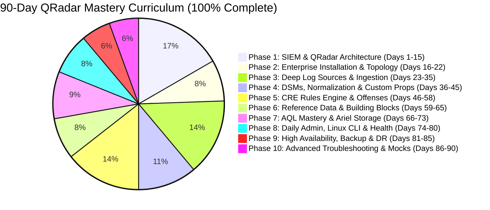

# 🛡️ Enterprise IBM QRadar Administrator & SIEM Architect Masterclass

[](https://www.ibm.com/products/qradar-siem)
[](./00%20-%20Master%20Dashboard%20%26%20Roadmap/00_90_Day_Master_Roadmap.md)
[](./00%20-%20Master%20Dashboard%20%26%20Roadmap/01_Progress_Tracker.md)
[](https://obsidian.md/)
[](#)

> **The Definitive 90-Day Enterprise Knowledge Base, Hands-On Practice Labs & Architecture Masterclass for IBM QRadar SIEM Administrators, Engineers, and Security Architects.**  
> Designed to transform administrators into **2+ Year Experienced Enterprise SIEM Architects**, complete with deep Linux kernel mechanics, in-memory pipeline diagnostics, custom DSM parsing, CRE correlation, AQL query optimization, DRBD High Availability, and real-world Sev-1 outage triage.

---

## 🗺️ Master 3D Architecture Visual Blueprint


*Figure 1: Full Enterprise Distributed Architecture (Event & Flow Collectors, Event Processors, Data Nodes, Offense Magistrate, and High Availability DRBD Pairing)*

---

## 📊 Curriculum Overview & Scorecard

- 📚 **Total Chapters**: 90 Comprehensive Theoretical & Architectural Chapters
- 🧪 **Hands-on Labs**: 90 Step-by-Step Executable Production Labs
- 🎨 **3D Visual Blueprints**: Over 35+ Dedicated High-Resolution 3D Architectural Diagrams
- 🧠 **Memory Retention**: 540 Digital Sticky Notes & 540 Rapid-Recall Flashcards across all chapters
- 📈 **Scorecard Status**: **100% Complete — Certified SIEM Architect Level**



---

## 🧭 Navigation & Phase Breakdown

### 🗺️ [Master Dashboard & Roadmap](./00%20-%20Master%20Dashboard%20%26%20Roadmap)
- 📋 **[90-Day Master Roadmap](./00%20-%20Master%20Dashboard%20%26%20Roadmap/00_90_Day_Master_Roadmap.md)**: Full daily curriculum breakdown with hyperlinked chapters.
- 📊 **[Progress & Mastery Tracker](./00%20-%20Master%20Dashboard%20%26%20Roadmap/01_Progress_Tracker.md)**: 11-Domain Production Competency Scorecard and chapter completion matrix.
- 📚 **[Official IBM Documentation & KB References](./00%20-%20Master%20Dashboard%20%26%20Roadmap/02_Official_IBM_Documentation_and_Knowledge_Base_References.md)**: Comprehensive mapping of all curriculum chapters to official IBM documentation, Redbooks, and technical notes.

---

### 🧱 [Phase 1: SIEM Fundamentals & Deep Architecture (Days 01–15)](./01%20-%20Phase%201%20-%20QRadar%20Fundamentals)
- **Overview**: [[00_Phase_1_Overview_and_TOC|Phase 1 Table of Contents]]
- **Highlights**: SIEM vs Log Management, QRadar Core Daemons (`hostcontext`, `ecs-ec`, `ecs-ep`, `tomcat`), the 8-Stage Data Pipeline, QFlow DPI, Ariel Columnar Storage, Token Bucket Licensing, Network Hierarchy, Asset Profiler, and App Host Docker Framework.
- **Labs**: Labs 01 through 15 (Architecture Mapping, Sizing, Ariel Inspection, Token Bucket Limiting).

---

### ⚙️ [Phase 2: Enterprise Installation & Deployment (Days 16–22)](./02%20-%20Phase%202%20-%20Enterprise%20Installation%20and%20Deployment)
- **Overview**: [[00_Phase_2_Overview_and_TOC|Phase 2 Table of Contents]]
- **Highlights**: Hardware benchmarks, RHEL partition schemes (`/store`, `/store/ariel`, `/var/log`), Console installation, adding Managed Hosts, REST API tokens, RBAC security profiles, and automated configuration backups.
- **Labs**: Labs 16 through 22 (Partition Verification, Host Attachment, API Automation, Multi-Tier Capstone Lab).

---

### 📥 [Phase 3: Deep Log Source Onboarding & Integration (Days 23–35)](./03%20-%20Phase%203%20-%20Deep%20Log%20Source%20Onboarding%20and%20Integration)
- **Overview**: [[00_Phase_3_Overview_and_TOC|Phase 3 Table of Contents]]
- **Highlights**: Syslog UDP/TCP/TLS 514, WinCollect Standalone vs Managed (TCP 8413), JDBC Database Polling, Universal Cloud REST API, Firewalls (Palo Alto, Fortinet, Check Point), Active Directory, Autodetection, and Packet Forensics.
- **Labs**: Labs 23 through 35 (Syslog TLS Handshakes, WinCollect XPath Tuning, Universal Cloud Workflows, Packet Decodes).

---

### 🔬 [Phase 4: DSM Parsing, Normalization & Custom Properties (Days 36–45)](./04%20-%20Phase%204%20-%20DSM%20Parsing%20Normalization%20and%20Custom%20Properties)
- **Overview**: [[00_Phase_4_Overview_and_TOC|Phase 4 Table of Contents]]
- **Highlights**: The Normalization Engine, QID Map resolution, DSM Editor live ingestion, regex tokenization, JSONPath/CEF extraction, Log Source Extensions (LSX XML), ReDoS prevention, and Custom Event Properties.
- **Labs**: Labs 36 through 45 (Live DSM Creation, Regex Benchmark Profiling, XML Extension Authoring).

---

### ⚡ [Phase 5: Custom Rules Engine (CRE) & Offenses (Days 46–58)](./05%20-%20Phase%205%20-%20Custom%20Rules%20Engine%20and%20Offenses)
- **Overview**: [[00_Phase_5_Overview_and_TOC|Phase 5 Table of Contents]]
- **Highlights**: In-Memory CRE evaluation, Fail-Fast test ordering, Event/Flow/Common rules, Offense indexing entities, Dynamic Magnitude calculation (Severity, Credibility, Relevance), Building Blocks (BB), and MITRE ATT&CK use cases.
- **Labs**: Labs 46 through 58 (Brute Force Detection, Mimikatz Privilege Escalation, Ransomware Tuning, False Positive Suppression).

---

### 🧠 [Phase 6: Reference Data & Advanced Building Blocks (Days 59–65)](./06%20-%20Phase%206%20-%20Reference%20Data%20and%20Advanced%20Building%20Blocks)
- **Overview**: [[00_Phase_6_Overview_and_TOC|Phase 6 Table of Contents]]
- **Highlights**: $O(1)$ Hash Collections, Reference Sets, Reference Maps, Map of Sets, Reference Tables, Automated TAXII/STIX Threat Intel Feeds, REST API bulk loading, and Automated Active Defense autoban scripts.
- **Labs**: Labs 59 through 65 (Reference Data Population, STIX TAXII Integration, Real-Time Active Defense Firewall Blocking).

---

### 🔍 [Phase 7: AQL Mastery & Ariel Storage Optimization (Days 66–73)](./07%20-%20Phase%207%20-%20AQL%20Mastery%20and%20Ariel%20Storage%20Optimization)
- **Overview**: [[00_Phase_7_Overview_and_TOC|Phase 7 Table of Contents]]
- **Highlights**: Advanced AQL syntax, aggregations (`COUNT`, `UNIQUECOUNT`, `SUM`), string/network functions (`INCIDR`, `GEOIP`), subqueries, Ariel partition directories (`records` vs `payloads`), Lucene inverted index trees, and hourly pruning.
- **Labs**: Labs 66 through 73 (High-Speed AQL Forensics, Index Benchmarking, 10 Enterprise Threat-Hunting Queries).

---

### 🛠️ [Phase 8: Daily Administration, Linux CLI & Health Management (Days 74–80)](./08%20-%20Phase%208%20-%20Daily%20Administration%20Linux%20CLI%20and%20Health)
- **Overview**: [[00_Phase_8_Overview_and_TOC|Phase 8 Table of Contents]]
- **Highlights**: Linux CLI toolchain (`systemctl`, `journalctl`, `ss`, `tcpdump`), QRadar administrative binaries (`system_info.py`, `arielsql`, `sancheck`), `/var/log/qradar.log` dissection, `/store` 85%/90%/95% watermarks, and JVM GC thrashing diagnostics.
- **Labs**: Labs 74 through 80 (Daemon Control, Direct Ariel CLI SQL, Log Triage, 95% Disk Recovery, 10-Step Health Audit).

---

### 🛡️ [Phase 9: High Availability (HA), Backup & Disaster Recovery (Days 81–85)](./09%20-%20Phase%209%20-%20High%20Availability%20Backup%20and%20Disaster%20Recovery)
- **Overview**: [[00_Phase_9_Overview_and_TOC|Phase 9 Table of Contents]]
- **Highlights**: Active/Passive dual-node clustering, synchronous DRBD Protocol C block mirroring, Virtual IP (VIP) and Gratuitous ARP (GARP), Corosync heartbeat, split-brain resolution (`--discard-my-data`), EPS capacity math, and Data Node clustering.
- **Labs**: Labs 81 through 85 (DRBD Telemetry Parsing, Split-Brain Disaster Recovery, DR Backup Validation, Storage Sizing Engine).

---

### 🎓 [Phase 10: Advanced Troubleshooting & Master Mock Interviews (Days 86–90)](./10%20-%20Phase%2010%20-%20Advanced%20Troubleshooting%20and%20Master%20Mock%20Interviews)
- **Overview**: [[00_Phase_10_Overview_and_TOC|Phase 10 Table of Contents]]
- **Highlights**: 3 Real-World Sev-1 Outage Simulations (Firewall 0 EPS drop, ActiveMQ offense broker deadlock, WinCollect fleet TLS certificate expiry), 360-degree technical board interview defense, resume project framing, and production graduation sign-off.
- **Labs**: Labs 86 through 90 (7-Layer Wire RCA, ActiveMQ Triage, Avalanche Throttling, Interactive Interview Simulator, Graduation Audit).

---

## 💻 Tech Stack & Underlying Architecture

```text
Operating System     : Red Hat Enterprise Linux (RHEL 7.x / 8.x / 9.x)
Core Language & JVM  : Java OpenJDK (G1GC / CMS), Python 2.7 / 3.x, Bash
Data Ingestion       : UDP / TCP / TLS 514, WinCollect (8413), JDBC, REST API
Message Bus          : Apache ActiveMQ / Oracle IMQ (JMS Queue: qradar.offense.events)
Databases            : PostgreSQL (Config & Asset Metadata) + Ariel Columnar Storage (Events & Flows)
Search & Indexing    : Ariel Query Language (AQL), Apache Lucene Inverted Indexes
High Availability    : DRBD Kernel Module (Protocol C Synchronous Mirroring) + Corosync Heartbeat
Application Runtime  : Apache Tomcat (Web UI / REST API) + Docker (App Host Container Engine)
```

---

## 📜 License & Acknowledgments

This educational curriculum and second brain knowledge base is distributed under the **MIT License**.  
Designed for cybersecurity practitioners, SOC analysts, detection engineers, and enterprise security architects.
